# Changelog

What each change added, newest first. A visible change has a clip: click the still to play it. `python3 tools/changelog/changelog.py page --open` plays them all in one page.

## 2026-11-14

- **terminal-led-word-same-size** `4e772646b` The agent LED's word in the terminal bar and on the self-test card is drawn at the size of the chips and rows beside it, at every text size (#422) *For you: The agent light's word is no longer bigger than the text around it.* *No clip: visible, not yet recorded: fleet worker*
- **terminal-bar-says-what-each-item-is** `a8c5caf03` The terminal bar names its tabs for the program in them, shows the agent as one LED with one word, says Start agent, and gives items up in a stated order when narrow (#423) *For you: The terminal's bar is easier to read: tabs are named for what runs in them, the agent is one light with one word, and the button says Start agent.* *No clip: visible, not yet recorded: fleet worker*
- **terminal-starts-collapsed** `84b5e4c5d` The terminal starts collapsed on every screen, the status bar carries a Terminal Cmd+J label that raises it, and a raise is kept across a relaunch (#424) *For you: The terminal now starts out of the way; click Terminal Cmd+J at the bottom of the window, or press the chord, to open it, and it opens the way you left it next time.* *No clip: visible, not yet recorded: fleet worker*
- **terminal-custom-agent-needs-a-command** `c15b3e550` A saved Custom agent with no command is a settings problem that names the file and offers omp as the fix, and the Terminal agent row never offers or saves Custom without a command (#425) *For you: A terminal agent set to Custom with no command is now reported in Settings with a one-press fix, and the picker no longer lets you choose it without one.* *No clip: visible, not yet recorded: fleet worker*
- **ui-99-gooey-review** `161fb38a` A card's picture keeps its crop and every dialog card keeps its width after the gooey swaps; the rows that wrap (library tags, cross-link buttons, review buttons, hand-back answers, a setting's actions, the kit's layer and chip rows) now put the row's own gap between their lines (UI-99, #260) *For you: The project cards' pictures and the dialogs look as they did; button rows that wrap onto a second line now leave a few more pixels between the lines.* *No clip: visible, not yet recorded: fleet worker; the card crop, the dialog widths and the wrap gaps are proved by the_gooey_swaps_keep_what_a_person_saw*
- **ui-99-gooey-gaps** `b41c8d84` The growing columns, dialog cards, placed overlays and splash images of the editor are laid out with bevy_gooey's new layout constructors instead of hand-built nodes (UI-99, #260 part) *No clip: nobody can see this change; proved by the_editor_keeps_its_raw_nodes_counted, the_small_files_are_built_from_gooey_widgets and the whole editor binary*
- **ui-99-gooey-sections** `daedd101` The Map inspector's section blocks, the wish and lesson lines, the problem lines and the report note's answers are laid out with bevy_gooey's rows and columns instead of hand-built nodes (UI-99, #260 part) *No clip: nobody can see this change; proved by the_editor_keeps_its_raw_nodes_counted, the_small_files_are_built_from_gooey_widgets and the_agent_blocks_lines_are_gooey_rows*
- **ui-99-gooey-notes** `74c7ffd1` The notes and data editors' columns and the review thumbnail are laid out with bevy_gooey's column, row and image_box instead of hand-built nodes (UI-99, #260 part) *No clip: nobody can see this change; proved by the_editor_keeps_its_raw_nodes_counted and the whole editor binary*
- **ui-99-gooey-readouts** `13346151` The Familiar's readout lines, the launcher's button lines and the project page's dialog answers are laid out with bevy_gooey's rows instead of hand-built nodes (UI-99, #260 part) *No clip: nobody can see this change; proved by the_editor_keeps_its_raw_nodes_counted and the_small_files_are_built_from_gooey_widgets*
- **ui-99-gooey-rows** `260734cd` The library browser, the agent history, the panel heading and the dialogs' button lines are laid out with bevy_gooey's rows and columns (UI-99, #260 part) *No clip: nobody can see this change; proved by the_editor_keeps_its_raw_nodes_counted and the_small_files_are_built_from_gooey_widgets*
- **ui-99-gooey-blocks** `fb6222ae` The World, Sound and Game panels, the outliner and the inspector's blocks are laid out with bevy_gooey's rows and columns instead of hand-built nodes (UI-99, #260 part) *No clip: nobody can see this change; proved by the_editor_keeps_its_raw_nodes_counted and the_small_files_are_built_from_gooey_widgets*
- **bm-09-review-fixes** `4fbc22a2f` The benchmark report escapes a failed trial's quoted hand-back, an interrupted run writes and publishes no report, the stale-credential sweep touches only the runner's own run directories, and the docs say what the credential scrub does not cover *No clip: a runner fix; proved by a_failed_trial_quotes_render_as_text, an_interrupt_stops_the_run_cleanly, a_stale_trial_home_is_swept, a_trial_agent_inherits_no_credential and a_map_probe_matches_the_editor*
- **bm-09-benchmark-runner-hardening** `a53a76298` The benchmark runner no longer fails a task whose setup raced the editor's map (the runner waits for the map and reads a refused setup step), refuses a model name with no provider, records a tool-call budget stop (and stops only on the call beyond the budget), escapes quoted text in its report, scrubs credential strings from the kept transcript and sweeps a killed run's credential directories, and Ctrl-C stops a run through its guards *No clip: a runner fix; proved by a_refused_setup_step_is_a_harness_error, a_bare_model_name_is_refused, a_report_says_which_trials_hit_the_budget, a_report_escapes_what_it_quotes, a_transcript_holds_no_credential, a_stale_trial_home_is_swept, an_interrupt_stops_the_run_cleanly and the re-pointed a_run_measures_a_real_agent*
- **bm-08-first-real-agent-run-fixes** `c77a7842` The benchmark runner's nine defects from its first real-agent run are fixed: a trial carries one provider's credential and deletes its HOME, a dead provider is found by one pre-flight turn and stops a run after three refusals, the refusal task grades the refusal and not its wording, a tool-call budget is enforced, a report says why trials were harness errors and counts the cache tokens, a retried provider error no longer voids a trial, and the release command names --model and --jobs *No clip: a runner fix; proved by a_refusal_is_graded_on_meaning_not_wording, a_trials_credentials_do_not_outlive_it, a_dead_provider_stops_the_run, a_report_says_why_trials_were_harness_errors, a_tool_call_budget_stops_the_agent, a_reaped_agent_is_not_signalled_by_group, a_report_counts_the_cache_tokens, a_retried_provider_error_does_not_void_the_trial and tools/release/test_bench_gate.py*
- **sg-09-handback-names-style-lines** `59e6353531b1099e278c52637a432830f10b9790` A hand-back names the style lines it followed: the card lists each line's text with a link that opens it on the Design page, and the state keeps every line *No clip: visible, not yet recorded: fleet worker*
- **sg-07-agents-write-style** `ed399cfa8919c15ac5ef56a5c83acd93a016eeaf` An agent changes a level's or area's style by style_edit (small exact edits, logged, undoable, followed to the Design page), and proposes a change to the game's or a region's style as a STYLE row you keep or discard *No clip: visible, not yet recorded: fleet worker*

## 2026-11-13

- **sg-05-design-workspace** `edb097b97` The Design workspace (Cmd/Ctrl+0): the game style as a tree, a rendered page with its pictures, and the place board as cards *No clip: visible, not yet recorded: fleet worker*
- **bm-05-a-release-needs-a-benchmark-run** `c98f48b7a63c319bc0164ce4916b76ce7ee6370b` A release needs a benchmark run, and a regression stops it: tools/release/bench_gate.py refuses a release with no committed report for its code, or whose comparison with the previous release's report is worse *No clip: a release rule; proved by tools/release/test_bench_gate.py (no report, an unrelated commit, a worse comparison, and no measurable change)*
- **sg-08-a-new-project-starts-with-a-style** `5dbce481` A new project starts with design/style.md (one H1 and nine H2s, each one prompt line) and the grant for it, and each topic (dialogue, interaction, sound, ui, names) starts from a template *For you: A new project starts with a style page of its own, ready to fill in.* *No clip: files in a new project; proved by a_new_project_starts_with_a_style (wizard writes the nine H2s in order, grants them, `create_topic` and `write_style` write from templates (the buttons wait on #404), opening a project writes no file)*
- **sg-06-areas-on-the-map** `3d4d1dec` Areas drawn on the map: `design_area_set` creates, moves, resizes and removes an area (overlap refused, a removed page kept), View > Show style areas outlines them, and the UNDER CURSOR line and the inspector's Style link name and open the area *For you: You can draw named areas on a level's map, see them outlined, and open an area's style page from the inspector.* *No clip: visible, not yet recorded: fleet worker*
- **piece-edit-operation** `15ee73f7` Cmd+Delete on the Map, which sends a piece to the Meshes tab to be defined, is an operation an agent calls too (piece_edit) *No clip: an API behind an existing key, no new picture; proved by piece_edit_is_an_operation*
- **ops-nits-34-37** `a36faeb0` The shelf walk shows the piece it lands on, a shelf answer survives a round trip and the shelf_focus guide row names both tabs (#129 review) *No clip: a test and API fix behind existing keys; proved by shelf_is_an_operation and ops_view::tests::a_shelf_answer_round_trips_through_json*
- **shelf-operations** `d1e0d10f` The shelf arrows and the left and right keys on the Meshes and Tiles tabs are operations an agent calls too (shelf_walk, shelf_focus) *No clip: an API behind existing keys, no new picture; proved by shelf_is_an_operation*
- **ops-review-34-36** `4fe4fe1b` A rig history step whose log line fails is taken back whole, the labeller refusals and the kit-name refusal are tested, and the rig step keeps its selection by name (#129 review) *No clip: a test and API fix behind existing keys; proved by rig_history_is_an_operation, labeller_requests_are_operations and tile_page_is_an_operation*
- **tile-page-operations** `13b933dc` The Tiles tab's right, left, Enter, C and N keys are operations an agent calls too (tile_page_enter, tile_page_leave, tile_open, tile_close, tile_new) *No clip: an API behind existing keys, no new picture; proved by tile_page_is_an_operation*
- **rig-history-operation** `18f5947e` Cmd+Z and Cmd+Shift+Z on the Anim tab are one operation an agent calls too (rig_history_step) *No clip: an API behind existing keys, no new picture; proved by rig_history_is_an_operation*
- **labeller-operations** `9a630c29` L, Shift+L and Shift+Y ask the labeller through operations an agent calls too (labels_suggest, labels_walk, labels_abandon) *No clip: an API behind existing keys, no new picture; proved by labeller_requests_are_operations*
- **ops-review-31-33** `f361cded` A check queues every rig for the watcher and a refused call moves no view, both tested; Cmd+Z's note and problem are tested (#129 review) *No clip: a test and API fix behind existing keys; proved by rig_check_is_an_operation, kit_rescan_is_an_operation and tile_pieces_are_operations*
- **rig-check-and-rescan-operations** `db8554b8` The Anim tab check-all key (C) and the Meshes tab rescan key (R) are operations an agent calls too (rig_check_all, kit_rescan) *No clip: an API behind existing keys, no new picture; proved by rig_check_is_an_operation and kit_rescan_is_an_operation*
- **camera-operations** `c677aa33` The Map camera keys (W A S D held, Q and E) are operations an agent calls too (camera_pan, camera_turn) *No clip: an API behind existing keys, no new picture; proved by camera_is_an_operation*
- **ops-review-29-30** `6621cff0` The agent guide list of undocumented operations only shrinks, the Tiles history test runs the recorder between an agent's steps, and Cmd+Z files a real refusal as a problem (#129 review) *No clip: a test and API fix behind existing keys; proved by every_operation_has_a_row_in_the_agent_guide and tile_pieces_are_operations*
- **tile-history-operation** `bf4a71bc` Cmd+Z and Cmd+Shift+Z on the Tiles tab are one operation an agent calls too (tile_history_step) *No clip: an API behind existing keys, no new picture; proved by tile_pieces_are_operations*
- **tile-nudge-flush-drop-operations** `948b6289` The tile in hand: the arrows, Shift and the arrows, Enter and Shift and Enter are operations an agent calls too (tile_member_nudge, tile_member_flush, tile_member_drop, tile_slot_drop) *No clip: an API behind existing keys, no new picture; proved by tile_pieces_are_operations*
- **ops-review-26-28** `77c1fae8` The agent guide names every operation a slice added, and a refused lattice step or a scrub press on a frame of no time behaves (#129 review) *No clip: a docs and API fix behind existing keys; proved by every_operation_has_a_row_in_the_agent_guide, lattice_cursor_is_an_operation and stage_is_an_operation*
- **tile-in-hand-operations** `9123e37e` The tile in hand: Space, the member keys, J, R and the remove keys are operations an agent calls too (tile_hand_arm, tile_member_focus, tile_grid_deepen, tile_member_turn, tile_member_remove, tile_clear) *No clip: an API behind existing keys, no new picture; proved by tile_in_hand_is_operations*
- **lattice-cursor-operation** `69c9d194` The lattice grid cursor keys (F, H, T, G, [ and ]) are one operation an agent calls too (lattice_cursor_step) *No clip: an API behind existing keys, no new picture; proved by lattice_cursor_is_an_operation*
- **stage-operations** `69c9d194` The rig bench stage keys (Space, the held left and right arrows, V) are operations an agent calls too (stage_play, stage_scrub, stage_camera) *No clip: an API behind existing keys, no new picture; proved by stage_is_an_operation*
- **ui-59-tab-strip-height** `ad0bfa28` The workspace strip keeps its height under gooey's edge tabs, so the inspector, the badges' free ground and the history list stand where they stood (#245) *No clip: layout fix; proved by the_tab_strip_is_as_tall_as_it_was, a_badge_stands_on_ground_nothing_else_uses, a_wheel_scrolls_to_the_end_of_the_session, every_destination_is_measured_and_the_baseline_says_so*
- **ui-r06-dock-tabs-glide** `ecf9fed9` A reordered dock tab and the tab behind it both glide to their places, held by the editor's glide test at the gooey pin that fixes the late skin (#336) *No clip: visible, not yet recorded: fleet worker*
- **ui-59-kit-gooey-parts** `f176a889` The Kit panels' glyph buttons, tabs, pack bands and counts are gooey widgets: tiles.rs has no raw Node left and compose.rs one (the world-space slot label) (#245) *No clip: visible, not yet recorded: fleet worker*
- **af-03c-every-followed-row-is-measured** `8682499aa3a07ec99436e52d44278244f48c8cd8` The follow's row is measured on screen for every off-map variant: the Files tree row and the inspector's section headings join the rig, note, data and piece rows (#359) *No clip: visible, not yet recorded: fleet worker*
- **af-03b-the-files-tree-follows** `fcad49e0c0714f903e64fa93b3c2d97a38062267` When an agent edits a file, the Files tree opens the folders above it and scrolls its row into view (#359) *No clip: visible, not yet recorded: fleet worker*
- **sg-03c-reload-lists-nested-places** `5e426b924e2be1d9e1e4d576d3f874999e08db01` The Reload panel lists a place's board, its pictures and a nested design page wherever the place is, by the shape reload::kind_of uses (#420) *No clip: a list in a panel; proved by the_reload_panel_lists_nested_boards_and_design_pages and a_places_design_pages_are_kinds*
- **sg-03b-agent-board-copy-in** `b262e02cb9a76fda71345544fbae1348f57b66c1` An agent's board_set add refuses an absolute path outside the project, naming it; only a person's drop copies a file in (#419) *No clip: a refusal in an operation; proved by an_agent_cannot_copy_a_host_file_onto_a_board*
- **nv-08-project-workspace-review** `742339db` A map opened from the Project workspace is the one clicked (also with no map open, and a map with unsaved edits asks first), the page builds without the home, and the refusal of an unbuilt workspace is pinned at the command, the chord and the activity bar (#385) *No clip: visible, not yet recorded: fleet worker*
- **nv-08-project-workspace** `da96dc8a` The Project workspace: the project's page (its maps, its kits and the agent guide) is a panel of the workbench, reached by Cmd+1 or the activity bar, while the same page stays as the screen of a project with no door open (NV-08, #385) *For you: The project's page is now a workspace of the editor: press Cmd+1 to see your maps, your kits and your agent guide without leaving the map you are working on.* *No clip: visible, not yet recorded: fleet worker*
- **ui-r06-dock-tab-glide-measured** `6b2145df` A reordered dock tab's glide is measured in the editor's own bottom dock: the leading tab glides over many frames, the tab behind it lands in two because gooey skins a rebuilt tab a frame late, and the test pins that (#336) *No clip: tests only, no visible change; proved by a_dock_tab_reordered_glides_to_its_place*
- **ui-59-kit-cells** `081a5625` The Kit lists' fixed columns (the severity mark, the fold chevrons, the detail line's gap) are gooey cells: 10 raw Nodes in tiles.rs down to 6, each remaining one is a hit target, a tab inset, a button band or a flex item gooey has no widget for (#245) *No clip: visible, not yet recorded: fleet worker*
- **nv-08-library-in-kit** `9acdd2de` The library browser is in the Kit workspace (View > Show library, offered only there) and no longer a section of the Map's inspector; every listed part has a test that opens its workspace and finds it by label (NV-08, #385) *No clip: visible, not yet recorded: fleet worker*
- **bm-07-a-handback-becomes-a-task-draft** `f6ec865a` A hand-back the person kept becomes a benchmark task draft: Make a benchmark task in the Agent workspace writes the task, its scene and its checks into the project's own folder, and a wish made from that hand-back names it *No clip: visible, not yet recorded: fleet worker*
- **bm-04-the-first-benchmark-suite** `d1f72ff9` The first benchmark suite: 20 dev tasks, 8 held-out tasks the runner reads from outside the repository, and grader checks for terrain, water, data and maps *No clip: a task suite; proved by every_task_is_valid, the_suite_grades_terrain_water_data_and_maps, held_out_tasks_stay_out_of_every_trial, and cauldron-bench run --agent oracle (28 of 28) and --agent nothing (0 of 28)*
- **sg-02-style-chain** `dd9442a3` An agent reads the style of a place with grimoire_style: the game's files, then the region's, level's and area's, behind the person's trust, with the pictures they cite *For you: Your agent can read how a place in your game should look and feel, but only the style files you have allowed.* *No clip: an MCP tool; proved by the_style_of_a_place_is_the_chain_of_its_files, a_style_file_needs_the_persons_trust, the_style_of_a_place_is_served_behind_the_persons_trust, grimoire_style_attaches_the_pictures_the_style_cites*
- **bm-06-agents-and-models-compared** `8731b3ebca83880443be787315bb2c84669d4d45` cauldron-bench run --agent claude-code and matrix: one suite across agent and model pairs, success against cost with the frontier marked, refused across commits (#416) *No clip: a comparison report; proved by a_matrix_of_pairs_writes_one_report_with_every_row_and_the_frontier_marked, a_matrix_refuses_pairs_run_at_different_commits_guides_or_suites and a_stream_json_transcript_gives_tokens_calls_refusals_and_cost*
- **bm-03-the-benchmark-report-and-the-comparison** `2159326176051d662b8e070010f561f910b6dcd3` cauldron-bench ends every run with a report (success, pass^k, cost, edits behind the editor's back) and compare says better, worse or no measurable change with a paired interval; an unfit run is refused (#413) *No clip: a report and its comparison; proved by pass_hat_k_is_the_hand_computed_value_for_c_0_3_and_5_of_n_5, two_runs_that_differ_by_one_task_show_no_measurable_change, two_runs_that_differ_on_most_tasks_say_better_or_worse_with_the_interval and a_run_with_two_harness_errors_in_ten_trials_is_unfit_and_compare_refuses_it*
- **sg-04-markdown-in-the-file-editor** `07563a6c` The file editor reads Markdown: a link or picture whose path is not there is an error on the path, completion after ]( lists the place's board then the project's files, hover on a picture shows its caption and licence, and headings are an outline; language support is one module per language behind one trait *No clip: visible, not yet recorded: fleet worker*
- **sg-03-dream-board** `7c20d383` Every place of the design tree has a dream board, design/<place>/board/board.yaml, changed only through board_set and listed in grimoire_state.board; it replaces maps/<map>.references.ron, which cauldron migrate moves to the level's board with the same captions *No clip: data and an operation; proved by a_dream_board_for_every_place (3 tests), references (3 tests) and a_dropped_image_becomes_a_reference; the board is drawn in SG-05*
- **bm-02-cauldron-bench-run** `ab26869b` cauldron-bench run measures a real agent against a real editor: oracle passes every task and nothing passes none, the tool list is read from the agent, and a --variant hides exactly its tool (#412) *No clip: a command-line runner; proved by the four ignored tests in bevy_cauldron_bench/tests/a_run_measures_a_real_agent.rs (4 passed, 47.3 s) and the six measured omp trials*

## 2026-11-12

- **bm-01-a-benchmark-task** `0f71b7b2` A benchmark task: a prompt, a fixture, a known answer and graded checks a run must satisfy, proved valid with no model *For you: Tasks the editor's agent is measured on are now files: what to do, what it looks like when done, and a check for each part, so a run can be scored without a person watching it.* *No clip: a task format and grader; proved by every_task_is_valid, a_task_whose_solution_does_not_satisfy_it_is_refused, a_task_already_solved_by_its_setup_is_refused and the two at-load refusals*
- **sg-01-design-tree** `a3e07c06` bevy_grimoire_core::design reads design/ into a tree of places (the game, its regions, levels and areas) with their topics, and grimoire_state.design lists it with everything wrong: a level with no map, two areas that overlap, a chain over 64 KiB, a file over 32 KiB refused whole, a picture that is not there *No clip: a reader; proved by the_design_tree_lists_places_and_their_problems (8 tests) and the_design_tree_is_in_the_editors_state (3 tests)*
- **gd-03-refusal-offers-the-migration** `201764bb` A project refused for still holding RON offers the migration on the screen that refused it *For you: A project from before the cutover now shows a Migrate button where it says why it will not open, so you do not have to leave the window* *No clip: no clip yet: the button and its conversion are proved by bevy_cauldron/tests/a_refused_project_offers_to_migrate_itself.rs (5 tests); the editor's own screen is owed a recording*
- **gd-10-sample-game** `81f82273f` A sample game made of YAML and Rhai in games/sample, played by a test from the YAML and from the bake *No clip: visible, not yet recorded: fleet worker*
- **gd-08-bake-for-release** `c19954bdb` cauldron bake turns every YAML file a game loads into binaries, proved against the YAML; a baked release refuses stale data naming the file *No clip: a build step; proved by a_bake_is_proved_against_the_yaml and the sample game's baked playthrough*
- **gd-03-every-file-is-yaml** `6dc96b1cc` Every project file, and the user's own settings, recent and trusted files, are YAML; cauldron migrate moves an old project and an old project is refused at open naming the command 
- **nv-07-review-fixes** `5b64f67a` NV-07's remaining routes: a file's page is the Files workspace, a Cmd+click must be in the editor, and F12 respects the focus and question gates *No clip: one route instead of two, the click's region, and the chord gates; proved by a_primary_click_on_the_tree_stays_in_files, f12_with_the_finder_open_does_nothing, a_file_references_page_is_the_files_workspace_at_that_file and a_project_files_change_opens_the_files_workspace_on_that_file*
- **nv-09-game-field-open-file** `9fbadd9e` NV-09: a component in the Game state view has Open file, which lands on the line of the YAML that sets it *For you: The Game workspace stays read-only: each field you look at has an Open file that takes you to the exact line in your YAML that sets it.* *No clip: visible, not yet recorded: fleet worker*
- **nv-10-agent-row-undo** `9fbadd9e` NV-10: every row of the Agent workspace's history has Undo, which takes that change back through the operation log *For you: Each change the Familiar made in the Agent workspace now has an Undo beside its Look, so you can take one back without leaving the list.* *No clip: visible, not yet recorded: fleet worker*
- **nv-06-cue-and-file-stops** `9fbadd9e` NV-06: Back and Forward remember the cue you were on and the file line you left *For you: Back now returns to the exact cue you were reading in Sound and the exact line you left in a file, not just to the workspace.* *No clip: visible, not yet recorded: fleet worker*
- **nv-05-cues-scripts-files** `9fbadd9e` NV-05: the finder names cues, scripts and files as well as maps, pieces, rigs and notes *For you: Press Cmd+P and type any cue, script or file name in your project, not only a piece: choosing one opens Sound on that cue, or Files on that script at its top.* *No clip: visible, not yet recorded: fleet worker*
- **nv-07-cross-links** `9fbadd9e` NV-07: a reference opens what it names: a cue's Used by, Open file on a placement and a piece, and Cmd/Ctrl+click or F12 on a reference *For you: A value that names something is now a way to it: Cmd+click a cue's name in a file to open it in Sound, press Open file on a placement to land on its line in the map's YAML, and Sound lists which files name the cue you are looking at.* *No clip: visible, not yet recorded: fleet worker*
- **pack-fold-filter-focus-operations** `2f8a26d1` Space on a candidate-list heading and the F and / filter keys are operations an agent calls too (pack_fold, filter_focus) *No clip: an operation behind existing keys, no new picture; proved by pack_fold_and_filter_focus_are_operations*
- **rig-tile-walk-operations** `2f8a26d1` The rig bench's and the Tiles page's up and down keys are operations an agent calls too (rig_walk, tile_page_walk) *No clip: an operation behind existing keys, no new picture; proved by rig_and_tile_walks_are_operations*
- **compose-cursor-operations** `2f8a26d1` The COMPOSE tab's arrow keys and O/P are operations an agent calls too (compose_walk, compose_focus, compose_carousel_step) *No clip: an operation behind existing keys, no new picture; proved by compose_cursor_is_an_operation*
- **nv-11-forest-list** `b25d4d5f9` NV-11: the World workspace lists a map's forest *For you: The World workspace now lists how many trees your map has and how many of each kind.* *No clip: visible, not yet recorded: fleet worker*
- **nv-11-water-list** `345402870` NV-11: the World workspace lists a map's water *For you: The World workspace now lists the springs, sinks and lakes placed on your map.* *No clip: visible, not yet recorded: fleet worker*
- **nv-11-lights-list** `603092e0e` NV-11: the World workspace lists the map's lights in every build *For you: The World workspace now lists the light fixtures on your map, even in an editor built without the lights crate.* *No clip: visible, not yet recorded: fleet worker*
- **nv-11-cue-list** `b02f5f083` NV-11: the Sound workspace lists the project's cues in every build *For you: The Sound workspace now lists your project's sound cues even in an editor built without the audio crate.* *No clip: visible, not yet recorded: fleet worker*
- **nv-11-clip-in-finder** `585c68b5b` NV-11: a rig's clip is a row of the Go to anything finder *For you: Press Cmd+P and type a clip's name, such as a rig's gallop, then Enter, to open that rig on the bench with that clip playing alone.* *No clip: visible, not yet recorded: fleet worker*
- **nv-11-problems-chord** `d06a386b0` NV-11: Cmd/Ctrl+Shift+X shows the problems list, which was six wheel notches down the inspector *For you: Press Cmd+Shift+X (Ctrl+Shift+X off a Mac) to bring the list of problems with your map on screen, wherever you are in the editor.* 
- **gd-14-agent-file-edit** `c071cc57d` An agent's file_edit lands live in the open file: comments kept, the person's caret untouched, the changed lines tinted 
- **gd-13-project-replace** `c071cc57d` Find and replace across the project: a streaming, cancellable search, a diff preview, and Replace all as one operation with one undo 
- **gd-12-file-editor-navigation** `c071cc57d` The file editor has a minimap, folding by structure, indent guides and find; the fold chords are the editor's own 
- **nv-11-measure-again** `cb21d7f5` NV-11: the navigation measurement again, against the real NV-01 baseline, with each target met or filed *No clip: a measurement; proved by navigation::every_destination_is_measured_and_the_baseline_says_so and the_navigation_baseline_stays_frozen*
- **nv-10-agent-workspace** `b94516fe5` NV-10: the Agent workspace: the AGENT block, the waiting wishes and lessons, and the agent's last changes with Look *For you: A new Agent workspace shows what the Familiar is doing, what is waiting for you, and its last three changes; Look on a change takes you to the Map and frames the pieces that change touched.* 
- **ui-59-review-fixes** `7f440c897` A library row's thumbnail slot draws nothing over its fill until its portrait exists; the outliner reads a held search without rebuilding; chrome.rs's raw layout is counted (#245, #259) *No clip: visible, not yet recorded: fleet worker*
- **ui-59-kit-on-gooey** `474832fc7` The Kit panels' margin rows, wrapping chip rows, fill texts, batch progress and thumbnail slot are gooey widgets: 42 raw Nodes in tiles.rs down to 10 (#245) *No clip: visible, not yet recorded: fleet worker*
- **ui-r06-collapse-split** `92a7f0d6b` Cmd+B collapses the shell split through gooey's CollapseSplit instead of a synthesised Enter key (#336) *No clip: visible, not yet recorded: fleet worker*
- **ui-93-patched-rows** `4920d7d25` The outliner and the history take the one row a change names instead of rebuilding 10,000 and 5,000: the UI costs under 2 ms on every frame of a placement, an undo and a redo (#259) *No clip: performance of existing lists, no new picture; proved by a_change_to_the_map_reaches_the_lists_row_by_row and the_frame_a_change_lands_on_stays_inside_two_milliseconds*

## 2026-11-11

- **picker-operations** `e03ea6120` The composition picker's P and Shift+up/down keys are operations an agent calls too (composition_picker_toggle, composition_picker_walk) *No clip: an operation behind existing keys, no new picture; proved by composition_picker_is_an_operation*
- **outliner-toggles** `a2f9e5525` The outliner hides, shows and locks pieces and layers through operations an agent calls too, and a click leaves what is hidden or locked alone 
- **nv-03-activity-bar** `646559d3` The activity bar: one icon per registered workspace at the window's far left, with badges (#380) *For you: A strip of workspace icons now runs down the left edge of the editor; click one to switch, and View, Show activity bar hides it.* 
- **nav-02-keys** `49bed771` The four view keys (=, 1, 2, 3) are gone and the nine workspace chords are the way: the key budget is raised by exactly five (#379) *For you: The Command (Control) plus 1 to 9 keys move between workspaces; the bare 1, 2, 3 and = keys no longer switch panels, and a keymap you saved that names them still loads.* 
- **ag-06-lessons** `46de85f8a32d` An agent proposes one line for the project's guide after a hand-back, and the person keeps or discards it in the AGENT block; only Keep writes .dark_factory/AGENTS.md *No clip: visible, not yet recorded: fleet worker*
- **ag-05-edit-by-label** `8758619867a1` The agent guide on the project page is edited the way a person edits it: the field under its label takes the keystrokes and Save writes and grants what was typed 
- **panels4-show-reload-panel** View > Show reload panel puts the bottom dock up whatever the window's room, and the dock has one writer so ending Zen in a smaller window never flashes it *For you: A new View row, Show reload panel, shows what became of each file you edited, even on a short window where the strip along the bottom stays away on its own.* *No clip: a View row and a layout rule; proved by crates/bevy_cauldron/tests/the_reload_panel_is_a_gooey_dock_panel.rs (view_show_reload_panel_shows_the_dock_in_the_reference_window_and_unticking_hides_it, ending_zen_in_a_window_that_shrank_leaves_the_dock_hidden_at_once)*
- **nv-06-back-and-forward** `53797d3a` Back and Forward across workspaces and cameras, bounded at 100 places *No clip: visible, not yet recorded: fleet worker*
- **nv-05-go-to-anything** `53797d3a` Go to anything: one finder over everything a project names, commands with a leading `>` 
- **panels4-dock-gives-way** The bottom dock is shown only where the workbench can spare the room: at the 1280 x 720 reference window with the terminal open it stays out of the layout instead of leaving the inspector 24 px, Zen mode folds it with the rest, and the arrangement keeps its own dock *For you: The strip along the bottom of the window now appears only when the window is tall enough for it; on a short window the map and the inspector keep their room.* *No clip: a layout rule with no picture of its own at the sizes tested; proved by crates/bevy_cauldron/tests/the_reload_panel_is_a_gooey_dock_panel.rs (the_bottom_dock_gives_way_in_the_reference_window, the_bottom_dock_is_gooeys_and_stands_under_the_body) and the sixteen layout tests it restores*
- **panels4-review-fixes** `44bc6840` Reset layout and a staged panel touch only the arrangement dock, and the rig bench's slot column is wide enough to show the clip index instead of clipping it *No clip: visible, not yet recorded: fleet worker*
- **ui-59-kit-gooey-rows** `fd6eb166` The Compose pane's label/value lines and indents, and the Tiles panel's strips, lattice columns and rows, are `bevy_gooey` rows, columns and cells; 43 raw `Node` literals remain in `tiles.rs` and 2 in `compose.rs`, each waiting on a layout that can carry its own margin, and a ratchet holds the count *No clip: visible, not yet recorded: fleet worker*
- **ui-58-rig-bench-gooey** `cab916e7` The rig bench is built from `bevy_gooey` widgets — rows, cells, columns, image boxes and overlays — with no raw `Node` literal left in anim_tab.rs or anim_plots.rs *For you: The animation bench's slot table and its plots now use the same widgets as the rest of the interface, so they grow with your text size and stay lined up at any size.* *No clip: visible, not yet recorded: fleet worker*
- **ui-61-reload-dock** `47f94a17` The reload panel is a `bevy_gooey` panel in a bottom dock across the foot of the workbench, with its own tab, instead of a block in the INSPECTOR *For you: What became of each file you edit now has its own panel along the bottom of the window, so it is there whichever workspace you are in.* *No clip: visible, not yet recorded: fleet worker*
- **gooey-pin-9ae6c95** `9785850c` The bevy_gooey pin moves to 9ae6c95 (virtual lists, layout primitives, host-placed docks), and the shell's dock no longer builds its placeholder pages over the map *No clip: a dependency pin and the regression it caused in the shell's dock, with no intended change on screen; proved by crates/bevy_cauldron/tests/the_shell_dock_builds_nothing_over_the_viewport.rs (3) and the shell tests that already read the dock (the_shell_is_a_gooey_dock, a_saved_arrangement_is_the_one_the_editor_shows, the_workspaces_keep_their_promises, a_workspace_switch_keeps_the_map: 21)*
- **nav-04-session-reset** A project with no session file, or one that will not read, starts with no tabs and never writes over the file it could not read (#381, review) *No clip: a fix to what a project switch does to the session, with no picture of its own; proved by crates/bevy_cauldron/tests/the_open_documents_come_back.rs (a_project_with_no_session_starts_without_the_last_projects_tabs, an_unreadable_session_file_is_never_overwritten)*
- **label-one-path** One labelling path: the decision model, and the chat path is gone *For you: The editor now labels pieces through one endpoint only, so there is one thing to configure and nothing to fall back to.* *No clip: not visible: the labeller is unchanged on screen, and the change is which code answers it; proved by bevy_cauldron label and decide unit tests (35) and the editor labeller tests a_vlm_label_is_suggested_then_applied (3), the_two_paths_read_one_judgement_the_same_way (2), the_wired_labelling_paths_agree_on_the_same_pieces (2), decision_labels_mount_front (2), every_refusal_is_in_a_problem (2)*
- **ui-73-live-text-resize** `dc536981` A label already on screen follows the text size: chrome::TypeRole plus chrome::resize_the_labels rewrite every drawn TextFont when the setting changes, and chrome::LinesRoom grows the room that holds it *For you: Changing the text size now enlarges the labels that are already on screen, not only the ones drawn after you changed it.* *No clip: visible, not yet recorded: fleet worker*

## 2026-11-10

- **gd-03-editor-owned-files-are-yaml** `1c056fc1` The editor and its crates no longer depend on RON: the checks, settings, family settings, forests, people, scripts, trees and the shipped skin are YAML, and a family setting is one YAML value *No clip: visible, not yet recorded: fleet worker; proved by the bevy_cauldron editor suite, bevy_grimoire_core/tests/family.rs and bevy_oracle/tests/checks.rs*
- **gd-03-game-reads-yaml** `f18dcd26` A game loads every project file as YAML, and a damaged one is refused by name with the field *No clip: the format cutover, not a screen; proved by bevy_grimoire/tests/live_verdicts.rs and the game crate's 97 tests*
- **gd-03-editor-reads-yaml** `711cc582` The editor reads and writes every project file it owns as YAML, at the same .yaml paths the game does *No clip: the format cutover, not a screen; proved by bevy_cauldron_mcp/tests/an_agent_calls_the_server.rs and the core suite*
- **gd-03-every-kind-is-yaml** `9961769b` Every project file kind reads and writes YAML through one reader and one writer, and a RON project is refused at open naming the migrate command *No clip: the format cutover, not a screen; proved by bevy_grimoire_core/tests/every_project_root_kind_is_yaml.rs and the whole core suite*
- **gd-03-migrate-only-what-moved** `6d63ee4e` bevy_cauldron migrate converts only the file kinds that already read YAML, so an old project is never left with a file nothing reads *No clip: a command-line behaviour, not a screen; proved by bevy_grimoire_core/tests/the_migrate_command_moves_only_the_kinds_that_read_yaml.rs*
- **gd-03-cutover-play-and-agent** A project's play.yaml and agent.yaml are read and written as YAML, and a project still holding either as RON is refused at open, naming the migrate command *No clip: visible, not yet recorded: fleet worker; proved by bevy_grimoire_core/tests/a_project_file_is_yaml.rs (2)*
- **projects-home-one-press** `5dd407dc` One press on a project card opens it: the choose-then-open step is gone, so the card acts as every other control on the home does, and the accent rail marks the card the keyboard or the pointer is on (feedback-1794103491165, #344) *For you: One click on a project now opens it, instead of needing a second click you had no reason to expect.* *No clip: visible, not yet recorded: fleet worker*
- **af-05-layout-proposal** `acbd84c6` A layout the agent proposes is followed as a preview: `layout_propose` goes through the follow's queue as a `Manner::Preview`, so the camera goes to the area it would lay and the outline is drawn in the suggestion ink rather than the applied one (AF-05) *For you: When your agent lays out a room, you now see the proposal drawn as a proposal, not as something that already happened.* 
- **af-04-look-command** `a915a554` Look is a palette command a person can bind: `view.look_at_agent_change`, on the AGENT block, the chip and now the keymap screen, all three calling the one `Following::look_now` (AF-04) *For you: You can now put `show me what the agent changed` on a key of your own, and your agent can run it too.* *No clip: visible, not yet recorded: fleet worker*
- **agent-view-verbs** `c3aa7f12` An agent can arm a tool, cycle the grid, arm the snip and toggle the journal and the rig bench's ghost through the same operations the keys dispatch; B and G are two more of them *No clip: visible, not yet recorded: fleet worker*
- **guide-is-a-file-kind** `aba70e5b` The project's agent guide is a file kind of the reload contract, and a guide the editor cannot serve is refused by name in grimoire_state.reloads *No clip: served text; proved by the_guide_is_a_file_kind::the_agents_guide_is_a_kind_of_the_reload_contract and the_guide_is_a_file_kind::a_guide_that_does_not_read_is_refused_in_the_reloads_list_and_the_fix_is_applied*
- **ui-r06-shell-motion** `bfb131d1` The left panel slides shut and open (Cmd+B) instead of vanishing, and a collapsed one peeks over the viewport when the pointer rests on its edge without the viewport moving; a refusal's toast enters from the top edge on the frame it is raised (G-62, G-65, UI-R06, #336 slice; dock tab reorder is still open) *For you: The left panel now slides away and back, and peeks out when you rest the pointer on its edge.* 
- **nav-04-document-tabs** `2b5f7122` Document tabs: maps and files you open are tabs, kept per person and restored with the project (#381) *For you: Maps you have open now show as tabs along the top, with a dot while a map has unsaved changes and a close button; Command+W closes one, Command+Shift+T brings back the last closed, and your open tabs come back next time you open the project.* *No clip: visible, not yet recorded: fleet worker*
- **nav-02-workspaces** `cece60d6` Workspaces replace the doors: nine of them, each with its own layout, and switching keeps the map and the selection (#379) *For you: The editor now has workspaces, which you move between with the Command key (Control on Windows and Linux) plus a digit; switching no longer reloads your map or drops your selection, and each workspace remembers its own panel layout.* *No clip: visible, not yet recorded: fleet worker*
- **ui-93-change-frame** `7caea249` The UI budget counts gooey's own table and tree drawing, holds the frame after a change to its measured 3.8 ms floor (6 ms asserted), and measures a typed search reaching the 10,000-node tree inside 100 ms; the outliner's rebuild went from 4.3 ms to 2.7 ms *No clip: instrumentation and measurement, nothing a person sees; proved by the_ui_frame_covers_a_change_and_the_input_path::**
- **ui-51-outliner-layers** `7e842d45` The outliner groups placements by layer (floor, wall, ceiling, surface, opening, decal) and then by kind, and its stamp and note rows say what they are *No clip: visible, not yet recorded: fleet worker*
- **ui-53-wheel-hands-on** `ef2745a3` A history or outliner list that cannot use a wheel notch hands it to the inspector, and a jump needs a click, not a key walk; the current history line is not hoverable *No clip: visible, not yet recorded: fleet worker*
- **ui-53-history-list** `8230892` The history panel scrolls: 5,000 log lines in a virtualized list, with the agent's lines marked *No clip: visible, not yet recorded: fleet worker*
- **ui-80-overlay-ink** `c2a7773` The editor's skin carries the light map's two inks, and the map's grid and the seating lattice are drawn in the running skin's grid tone instead of the editor's own *For you: The light map and the grid now take their colours from the theme you choose, so a high-contrast or a project skin reaches the overlays you read the map by.* *No clip: visible, not yet recorded: fleet worker*
- **ui-73-accessibility-reaches-chrome** `50a5c9c` The theme reaches the running gooey skin; the text size now scales `chrome::font`, so a label drawn **after** the setting is read is that many times larger (a label already on screen keeps its size until it is made again — live resize is owed); the interface size multiplies `UiScale`, so 125% enlarges the panels and the type together *For you: Changing the interface size now enlarges the whole window together. A larger text size applies to labels the editor draws after the change, not to ones already on screen.* *No clip: visible, not yet recorded: fleet worker*
- **ui-03-game-ui-preview** `13d4d9c` The Game UI preview panel: a project's family/bevy_gooey.ron is drawn under a SkinScope in its own View panel, and the editor's chrome never takes it *For you: Your game's own look now has a panel of its own, so you can see it while you edit without it repainting the editor around you.* *No clip: visible, not yet recorded: fleet worker*
- **ui-02-skin-ink** `064c3ba` The editor's colours come from its gooey skin: chrome.rs declares no colour constant, its 28 are one Ink struct read from src/editor_skin.ron, and the ladder is checked by GooeySkin::problems() *For you: The editor now takes every colour it draws from one palette file, so its look is data a theme can change rather than 28 numbers buried in the code.* *No clip: visible, not yet recorded: fleet worker*
- **gd-07-one-event** `336c251` One name in one frame is one event however many producers write it, so a switch and a state machine agree; and a body a save puts inside a volume is a state rather than a crossing, so reopening a project does not press its switch *No clip: visible, not yet recorded: fleet worker*
- **gd-06-rhai-scripts** `9b6cfff` A script is a component: a .rhai file a game runs on an entity, with four hooks, reflection-driven access to the entity's own components, events, timers, and a recompile when the file is saved that keeps the script's state *For you: You can now give an entity a behaviour written as a short script, and change that behaviour by editing and saving the file while the game runs.* *No clip: visible, not yet recorded: fleet worker*
- **gd-07-review-three** A trigger volume signals the way in only and once a frame, so a switch and a state machine agree about one crossing; take_damage visits only the entities that have its components, which the system's own count proves; every constant the private submodules hold is reachable at one path *No clip: visible, not yet recorded: a fix to what a volume's signal means and to one system's query shape, with no picture of its own beyond the components gd-07-behaviours records; proved by crates/bevy_grimoire/tests/a_game_behaves_from_yaml.rs (30)*
- **gd-07-review** BehaviourPlugin adds no plugin of its own so behaviours-first-then-DefaultPlugins builds; a Trigger or Countdown now writes the Signal its switch or state machine names, in the same frame; a door the file saved open and a follower under a parent behave as documented; a Damage with no Health is taken off; each behaviour answers to one path, behaviours::Health *No clip: visible, not yet recorded: the fix to a behaviour's own act, with no picture of its own beyond the components gd-07-behaviours records; proved by crates/bevy_grimoire/tests/a_game_behaves_from_yaml.rs (25)*
- **gd-07-behaviours** `eb72eed6` A game's behaviours are components a YAML file sets: a trigger volume, a switch and its door, a spawner, a pickup, health and damage, a countdown, a path follow and a state machine, each registered by BehaviourPlugin and each with its own test *For you: You can now give a room a working door, a tripwire, a coin to pick up and a guard that wakes up, by writing them in the game's YAML file rather than in code.* *No clip: visible, not yet recorded: these are game-side components and nothing in the editor's viewport draws them yet, which is GD-10's sample game; proved by crates/bevy_grimoire/tests/a_game_behaves_from_yaml.rs (15)*
- **gd-03-migrate** `79fb318` The library that moves a project's files from RON to YAML, losslessly: every file a release wrote converts and is read back as its own type, a comment is carried above the line it was written about and never into a value, and the RON originals are kept in .dark_factory/migrated-ron/ *No clip: a refactor and its tests, with no picture of its own; proved by bevy_grimoire_core/tests/a_project_migrates_from_ron_to_yaml.rs (19) and bevy_cauldron/tests/a_fixture_projects_ron_files_become_yaml.rs (1)*
- **nav-01-baseline-checked** `2546b2f` The navigation baseline is checked against the editor, and every row's route and cost come from what the driver did (#378) *No clip: a test's checking and its generated document, with no picture of their own; proved by crates/bevy_cauldron/tests/navigation.rs (every_destination_is_measured_and_the_baseline_says_so)*
- **nav-01-baseline** `cb218eb` Every destination's route is measured and written down: twenty rows of keys and clicks, seven of them unreachable *No clip: a measurement and its generated document, with no picture of their own; proved by navigation.rs (every_destination_is_measured_and_the_baseline_is_written)*
- **ui-52-library-browser** `42972da5` The library browser: the project's pieces as a grid of portraits in the Inspector, with its own search and a row of tag filters, where choosing a card arms its piece and dragging one onto the map places it *For you: You can now browse your pieces as pictures rather than a list: search them, filter by what they are, and drag one onto the map.* *No clip: visible, not yet recorded: fleet worker*
- **ui-51-outliner-everything** `5a275e04` The outliner draws the map's compositions, people, triggers and notes as groups of their own beside the pieces, and a piece row's menu pins it (asking for the reason) or hides it for this session; pieces are still grouped by kind, and grouping by layer is not built because a placement has no layer field *For you: The Inspector's outliner now shows everything on your map, not just pieces, and right-clicking a piece's row lets you pin it or take it out of the way.* *No clip: visible, not yet recorded: fleet worker*
- **gd-05-review-three** `ef00ad52` A refused game entity file changes nothing even when a resource is the thing refused, and .nan/.inf, a bad shape and a dotted entity name each name the line they are on *No clip: a fix to four refusals in one reader, with no picture of its own; proved by bevy_grimoire/tests/a_game_defines_its_entities_in_yaml.rs (20)*
- **gd-05-review** `e5cb2dad` A fault in a game's entity file names the line it is on, a refused file changes nothing in the running game, a child entity is made once and not once per save, and an immutable component is inserted rather than panicking *No clip: a fix to five behaviours inside one reader, with no picture of its own; proved by bevy_grimoire/tests/a_game_defines_its_entities_in_yaml.rs (16)*
- **gd-05-entities** `3bba1e5f` A game defines its entities in game/<name>.entities.yaml and a save changes the running game in place: a changed field keeps the entity, a new one spawns and a dropped one despawns *No clip: the clip this issue asks for needs a running game with a display, which this host has not; proved by bevy_grimoire/tests/a_game_defines_its_entities_in_yaml.rs (9)*
- **gd-04-review** `d72e8a5c` game.schema.json is the running game's own registry export, and a wrong field is refused at the same path by the schema and the reader in all seven tagged file kinds *No clip: generated files; proved by bevy_grimoire/tests/a_games_schema_reaches_the_file_an_outside_editor_reads.rs (6), bevy_grimoire_core/tests/a_tagged_file_validates_against_its_schema.rs (4) and bevy_cauldron/tests/schemas_are_written_where_an_outside_editor_looks.rs (5)*
- **gd-04-schemas** `4709d20f` Every project file kind has a JSON Schema generated from the Rust type it is read by, written into .dark_factory/schema/ when a project opens, and the seven kinds whose YAML carries an enum tag now validate against theirs *No clip: generated files; proved by bevy_grimoire_core/tests/a_tagged_file_validates_against_its_schema.rs (every_tagged_kinds_fixture_validates_against_its_schema, the_tagged_kinds_are_the_ones_whose_fixture_carries_a_tag, a_field_wrong_inside_a_variant_is_refused_at_its_own_path, the_reader_names_the_same_path_the_schema_refuses), bevy_grimoire_core/tests/a_generated_schema_is_replaced_and_a_hand_written_one_is_not.rs (3), bevy_cauldron/tests/schemas_are_written_where_an_outside_editor_looks.rs (3) and bevy_grimoire/tests/a_games_schema_reaches_the_file_an_outside_editor_reads.rs (4)*

## 2026-11-09

- **gd-09-build-fixes** `4eb5862` The build reads cargo's real error stream, drains both its pipes so a large build cannot hang, waits for a build's last line before reporting it, saves the open map before relaunching so the game comes up on what the editor holds, and a build an agent starts is watched in the status band rather than raising a no-page problem *No clip: a fix to the watched rebuild, whose one visible change was already recorded under gd-09-build-relaunch; proved by a_build_is_watched_in_the_band_not_a_page and a_build_waits_for_the_last_line_before_it_says_what_happened and a_relaunch_reads_the_map_the_editor_holds_even_unsaved*
- **gd-09-build-relaunch** `a262da7` A change that needs Rust is a watched rebuild: BUILD in the PLAY area runs the project's build command as a background job with cargo's own count, each compiler error is a problem with its file and line, and a build that succeeds relaunches the game on the same map at the same camera while one that fails leaves the running game up *No clip: visible, not yet recorded: fleet worker*

## 2026-11-09

- **aw-02-wish-rows** `5f63d61` The AGENT block lists each waiting wish with the agent's name and the tool line, unfolds to its task, hardship and example call, and answers it with Open on GitHub or Discard; Open asks GitHub's search first and lists matching open wishes, and a hidden block counts its waiting rows in the status band *No clip: visible, not yet recorded: fleet worker*
- **ui-infra-review** `815d628` The staging plan stamps each panel on its own chunk's clock, and the UI budget reports a rebuild apart from a settled frame *For you: Clips of every panel no longer die on the first one, and the editor's speed check says exactly what it measures.* *No clip: a corrected clock in a tool, two faster list builds and an honest budget test, with no picture of their own; proved by tools/demo/test_stage.py (test_every_chunk_stamps_its_stage_on_its_own_start, test_a_capture_that_writes_fewer_frames_than_planned_is_refused) and bevy_cauldron/tests/the_uis_budget_is_two_milliseconds_a_frame.rs (a_settled_frame_on_the_reference_fixture_stays_under_the_ui_budget, a_rebuild_frame_is_measured_and_is_not_claimed_as_settled, the_clock_counts_every_way_out_and_marks_a_rebuild)*
- **ui-93-budget** `5eebdf6` The UI's budget is measured on **settled frames only**: the panels that read content cost under 2 ms on a frame where nothing moved, on the issue's own fixture of 5,000 history rows and 10,000 outliner nodes. A frame that rebuilds the outliner after a change is measured and reported apart (2.9 ms for ten thousand nodes here) and is not claimed as inside the budget; the 100 ms input-to-visual figure itself is not measured, because that needs the present and the display *For you: The editor now has a number on how much work its panels do on a frame where nothing has changed, so a panel that starts rebuilding a long list is caught by a test instead of by you noticing it is slow.* *No clip: an instrument and a test, with no picture of their own; proved by bevy_cauldron/tests/the_uis_budget_is_two_milliseconds_a_frame.rs (a_settled_frame_on_the_reference_fixture_stays_under_the_ui_budget, a_rebuild_frame_is_measured_and_is_not_claimed_as_settled, the_reference_fixture_has_the_content_the_budget_is_written_against, one_outliner_change_rebuilds_once_and_the_frames_after_it_do_not, the_clock_counts_every_way_out_and_marks_a_rebuild)*
- **ui-92-stage-panels** `0aec11c` Every panel of the editor can be staged by name for a capture, so a clip of each one starts on that panel, and `record.py` plans one frame per panel *For you: Nothing visible yet: this is the machinery a clip of each panel needs.* *No clip: an editor-side staging command and a capture plan, with no picture of its own; proved by bevy_cauldron/tests/the_shell_can_be_staged_on_every_panel.rs (the_catalog_is_the_shells_own_panels, every_panel_in_the_catalog_stages, a_dock_panel_is_staged_by_selecting_its_tab, an_unknown_panel_is_refused_by_name, a_workbench_panel_is_refused_off_the_workbench, staging_the_workbench_leaves_the_project_open, the_staging_command_answers_with_the_arrangement_or_the_refusal) and tools/demo/test_stage.py (test_each_panel_is_its_own_chunk_of_one_frame, test_the_frame_count_the_editor_computes_is_one_per_panel, test_a_plan_with_no_panel_or_an_out_of_range_rate_is_refused, test_a_stage_step_is_its_own_kind, test_every_chunk_stamps_its_stage_on_its_own_start, test_a_capture_that_writes_fewer_frames_than_planned_is_refused)*
- **ui-91-help-pages** `8494217` Help lists every page of the guide, and each panel header carries a ? that opens the page covering what it holds *For you: Every panel now has a question mark in its header that opens the guide page about it, and the Help menu lists the whole guide.* *No clip: visible, not yet recorded: fleet worker*
- **aw-02-wish-rows** `5f63d61` The AGENT block lists each waiting wish with the agent's name and the tool line, unfolds to its task, hardship and example call, and answers it with Open on GitHub or Discard; Open asks GitHub's search first and lists matching open wishes, and a hidden block counts its waiting rows in the status band *No clip: visible, not yet recorded: fleet worker*
- **terminal-agent-omp-default** `c46a67bc` The terminal starts with the omp agent chosen on a machine that has it installed, and with a plain shell on one that does not; a terminal_agent in either settings file still wins (#341) *No clip: a resolved default asked of the login shell at start-up, with no picture of its own; proved by a_machine_with_the_agent_installed_starts_with_it_chosen (the_pane_offers_the_agent_on_a_machine_that_has_it_and_a_shell_on_one_that_does_not, the_settings_screen_shows_the_agent_this_machine_starts_with, the_agent_is_asked_of_the_login_shell_and_answered_there, ask_puts_the_question_to_the_shell_the_press_uses, a_path_holding_the_agent_chooses_it_and_a_path_without_it_does_not, resolving_on_this_machine_uses_what_is_installed_unless_a_file_says, the_built_in_default_is_still_the_shell)*
- **ui-57-family-panel-reads** The family settings panel reads its files only when something changed, keeps the hour it was edited to, and its read-only block follows the file it shows *For you: The settings panel no longer works in the background when nothing has changed, and the time of day you set stays where you put it.* *No clip: a fix to three behaviours inside one panel, with no picture of its own beyond the panel already recorded; proved by bevy_cauldron/tests/a_family_panel_is_the_crates_own_settings.rs (a_settled_panel_reads_its_files_once_and_then_not_again, the_hour_a_person_set_stays_set_after_the_panel_settles, the_read_only_block_follows_its_crates_file)*
- **ui-57-family-panel** `175b7719` Each family crate the project lists gets a panel of its own settings: gooey's reflect inspector over the crate's fields, an edit written through family_set in one undo step, and the time of day moving the sky in the frame it is edited (UI-57, #243) *For you: A project's environment — time of day, date, place and climate — is now edited as fields in the Inspector, and changing the hour changes the sky at once.* *No clip: visible, not yet recorded: fleet worker*
- **agent-guide-page** `2dd512d` The project page has an Agent guide section: the file in a text area with Save and Revert while it is allowed, Allow this guide and Trust this project while it is not, and Create guide when there is none; an edit made on disk during unsaved edits is reported and never overwritten *For you: You can now read and change the guide your agent follows without opening a text editor, and allow a project's guide from the project page.* *No clip: visible, not yet recorded: fleet worker*
- **new-project-guide** `dd0c3a5` A new project is created with .dark_factory/AGENTS.md in it: four sections (This world, Style, Rules, Lessons) each with one line of prompt text, already allowed for the person who made it *For you: A new project comes with a guide file for agents, with the four questions worth answering already written out.* *No clip: a file in a new project; proved by a_new_project_starts_with_an_agent_guide and guide_template::tests*
- **guide-needs-trust** `e6c0c46` A project's .dark_factory/AGENTS.md reaches an agent only once a person allows that exact content (Allow this guide) or trusts the project, asked in the confirm modal with Not now remembered for the session *For you: A project you clone cannot tell your agent what to do until you have read its guide and allowed it.* *No clip: visible, not yet recorded: fleet worker*
- **guide-two-layers** `05a727a` The agent's guide is three layers: the shipped one, the person's AGENTS.md and the open project's .dark_factory/AGENTS.md, each under a heading that names its path *For you: An agent working in Cauldron now reads your own notes and this project's rules before it touches anything.* *No clip: visible, not yet recorded: fleet worker*
- **af-03-lone-change** `db704ee9` A lone change is no longer paced, and a proposal becomes a fact only for its own change: an agent's undo 0.35 s after a placement frames again, and a preview followed by its apply still moves the camera once (AF-03 review round 3) *No clip: a fix to the follow's pacing and its exemption; proved by the protected the_editor_follows_an_agents_change (an_agents_undo_frames_where_the_change_was) and a_preview_is_framed_before_it_is_applied*
- **af-05-preview-outline** `ebde2d74` A preview rings its own footprint and nothing else: a piece that does not exist yet has no id, so the proposal is drawn as its rect rather than as whatever happens to stand in the box (AF-05 review round 3) *No clip: a fix to what a ring is drawn round; proved by a_preview_is_framed_before_it_is_applied (a_preview_outlines_its_own_footprint_and_not_what_stands_there)*
- **af-04-round-three** `ef557f80` The follow's queue and chip are cleared by a project change, the AGENT block has its own Look beside Undo, and the dwell between five burst changes is measured to be at least 0.6 s (AF-04 review round 3) *No clip: mostly a fix and a measurement, with no picture of their own; proved by the_person_is_never_yanked_review_two (another_project_clears_the_follows_queue, the_agent_blocks_look_button_frames_the_change, five_changes_in_one_frame_are_held_apart_by_the_dwell)*
- **af-04-look-and-pace** `bb3f91ea` The Look button works, the chip is drawn only while a change waits, a wheel or trackpad turn holds the follow, View ▸ Follow the agent writes the person's own settings layer, and the dwell paces a burst rather than an ordinary sequence (AF-04 review) *For you: The chip's Look button now really shows the change, and turning the wheel over the map counts as you using the view.* *No clip: visible, not yet recorded: fleet worker*
- **af-05-preview** `79e59890` A preview is followed before it is applied: operation_preview and dry_run go through the same queue and idle wait, the receipt says the Familiar is about to make the change, the outline is drawn in the preview colour, a piece that does not exist yet is outlined by its footprint, and a preview followed by its apply frames once (AF-05) *For you: When your agent plans a change, the view shows the place it would change and the receipt says it is only about to happen.* *No clip: visible, not yet recorded: fleet worker*
- **af-04-pace** `9bac13ea` The person is never yanked: the follow waits 2 s after a person works the view and shows a change 0.6 s before the next, a Look chip over the viewport names what is waiting and offers Look, and View ▸ Follow the agent (follow_agent, on by default) stops the camera moving while the chip still offers Look (AF-04) *For you: An agent's changes now wait until you stop panning or typing, then arrive one at a time; a chip over the map names what is waiting and offers Look.* *No clip: visible, not yet recorded: fleet worker*
- **af-03-reveal-row** `1cff7e1b` A reveal lands on the row it names: the DATA table's leaf is scrolled to its own row, and the rig, data, settings and note rows are proved on screen (AF-03 review) *No clip: a fix to a reveal's measurement, with no picture of its own; proved by the_reveal_selects_a_row_a_person_can_see (7 tests)*
- **af-03-reveal** `1ca509d2` An agent's change off the map is followed too: the editor opens the Kit, Rigs or Map door on the panel the change is on, selects the piece, group, rig, file or note, and scrolls its row into view; a change with no page is a problem naming it (AF-03) *For you: When your agent changes a piece, a tile, a group, a rig, a tuning file or a note, the editor now opens that page with the thing it changed selected.* *No clip: visible, not yet recorded: fleet worker*
- **agent-wish-guide** `e8853270` The shipped MCP guide gains an After a task: reflect section: after the hand-back an agent makes one grimoire_wish, says what a good wish is and what one is not, and the notes agent's prompt names the tool *No clip: shipped guide prose and two prompt constants, with no picture of their own; proved by bevy_cauldron_mcp/tests/the_guide_asks_for_a_wish.rs (the_guide_asks_for_a_wish_and_names_every_field, the_reflect_section_says_what_a_wish_is_not, the_reflect_sections_example_is_a_wish_the_editor_takes, the_shipped_reference_carries_the_reflect_section) and bevy_cauldron/tests/the_prompts_ask_for_a_wish.rs (the_notes_agents_prompt_asks_for_a_wish_after_the_handback, the_self_test_prompt_makes_no_wish)*
- **af-02-follow** `c1b18203` The editor frames an agent's map change: the camera eases onto where it is, the changed pieces are ringed, the view opens the Map first, and the receipt names it the Familiar's; an agent's undo frames where the change was (AF-02) *For you: When your agent changes the map, the view goes to what it changed instead of staying where you left it.* 
- **fleet-launcher** `381ecdb6` A fleet launcher opens one DeepSeek omp worker per issue in herdr, on any host *No clip: loop tooling; proved by launching this run's five workers*
- **agent-wish** `80cde67` After a hand-back, grimoire_wish records the one tool that would most have helped, one per hand-back, queued in the editor and filed through a new agent-wish issue form *No clip: an MCP tool and an issue address, with no picture of their own; proved by a_wish_is_refused_at_the_door (3), a_wish_issue_address_round_trips (3), an_agent_wishes_for_one_tool (6) and docs_are_current (6)*
- **mcp-guide** `a39ecd68` The MCP server ships a guide to working in Cauldron and serves it as grimoire_guide; the server's instructions and the notes agent's prompt both say to call it first *For you: An agent working in Cauldron now reads a guide first, in an order that matches how a task actually goes.* *No clip: an MCP tool and its shipped text; proved by bevy_cauldron_mcp/tests/the_guide_is_the_servers_own.rs (the_guide_is_a_read_that_needs_no_editor, the_instructions_name_the_guide_first, the_guide_names_every_tool_the_server_declares) and bevy_cauldron/tests/the_guides_examples_run.rs (the_guides_example_runs_against_the_editors_operations, an_example_naming_an_operation_that_does_not_exist_is_caught)*
- **af-01-shown** `254f29ae` Every operation says where its change is seen: grimoire_apply_operation, preview and undo answer shown — a box on the map, a piece, a composition, a rig, a note, a project file or a setting (AF-01) *No clip: an API: a new required method on Operation and a new field in three answers; proved by an_operation_says_where_its_change_is_seen (every_operation_says_where_its_change_is_seen, a_change_names_a_box_that_holds_the_placement, a_preview_and_its_apply_name_the_same_place)*
- **json-schema-marks-only-where-they-belong** `80b9e20b` A schema marks a field only where it names another file's value, and nothing in the crate exists for a test's sake (#366) *No clip: generated schema marks; proved by tests/schema_describes_every_file_kind.rs*
- **json-schema-followups** `939602b9` A schema file is found by the reload table where it is written, every field that names a piece, composition, rig, placement or map carries its kind, and the schema hint is relative to the YAML file that carries it (GD-04, #366) *For you: Editors outside the app now find each file's schema, and following a field that names a piece or a rig goes to the right file.* *No clip: a reload row, generated schemas and a hint line; proved by tests/schema_describes_every_file_kind.rs*
- **json-schema-per-kind** `8f7bfc85` Every project file kind publishes a JSON Schema generated from its type, with a field's doc comment as its description and x-dark-factory-ref on a field that names another file's value; grimoire_schema returns one (GD-04, #366) *For you: An editor outside the app now knows what each project file may say, so it completes fields and explains them.* *No clip: generated files and a read tool; proved by tests/schema_describes_every_file_kind.rs*
- **yaml-surgery** `f5f64591` One YAML value is edited in place, and every comment, blank line and key order survives; an edit of another kind or outside its bounds is refused, naming the leaf (GD-02, #364) *For you: A change made by an agent or by you now rewrites only the value it changes, so your comments in a project file stay where you wrote them.* *No clip: a library; proved by tests/yaml_surgery_keeps_every_comment.rs (14 tests, line diffs)*
- **yaml-reader-alias-and-first-fault** `9f771901` A YAML file's alias is refused as an alias and the first fault in the file is the one reported; the round trip proves against the frozen RON fixtures (GD-01, #363) *For you: When a project file is wrong in more than one place, the editor now names the first one, and it says an alias is an alias.* *No clip: a reader's refusals and its test fixtures; proved by tests/yaml_refuses_a_file_it_cannot_read.rs and tests/yaml_round_trips_every_project_type.rs*
- **yaml-reader** `61bbad3a` One YAML reader for project files, refusing an anchor, an alias, a merge key, a duplicate key, a second document and a tab indentation, each with its line and field path (GD-01, #363) *For you: Project files can now be read and written as YAML, and a file that is ambiguous is refused with the line and field it is wrong at.* *No clip: a reader and a writer, engine-free; proved by tests/yaml_refuses_a_file_it_cannot_read.rs and tests/yaml_round_trips_every_project_type.rs*
- **ui-80-view-light-map** `67e5831` View ▸ Light map shows and hides the viewport overlay and its tick follows the overlay whichever door changed it; the overlay's two colours read the `overlay_dark` and `overlay_lit` tones of whatever skin is running, so a project's `family/bevy_gooey.ron` that defines them moves the overlay, while the shipped skins — the editor's own, Tool dark, Parchment and High contrast — carry neither tone and draw the pair it always did (UI-80, #254) *For you: There is now a Light map item in the View menu, and a project can choose the two colours the light map is drawn in.* *No clip: visible, not yet recorded: fleet worker*
- **ui-73-theme-and-text-size** `e1e33e3` The Theme and Text size settings reach the running skin: Tool dark and High contrast are gooey skins, applied; the text size is the skin's text_scale (UI-73, #251) *For you: You can pick High contrast in Settings now. Parchment is listed but cannot be shown yet, because its pale panels leave the editor's own labels unreadable, so choosing it keeps the look you had and says why. A larger text size enlarges the interface built on the new library; the editor's older labels do not grow with it yet.* *No clip: visible, not yet recorded: fleet worker*
- **ui-02-agent-tab-ink** `9768b89` The agent tab's self-test card and status chip draw in the running skin's ink, so a project's bevy_gooey skin reaches the terminal too (UI-02, #210) *No clip: a seam with no change to the eye: the editor's own skin carries these four colours, so the card looks identical today; proved by tests/the_agent_tabs_ink_comes_from_the_skin.rs, whose card-and-chip test fails when the repaint is removed*
- **terminal-chips-explain** `0f671f50` Every chip in the terminal's bar says what it does when the pointer rests on it (the agent's self-test, a session, Agent, +, x); the move chip reads Go to <folder> instead of cd <folder>, with the command it types in its tooltip, and an agent's tab is no longer offered it (feedback-1794230949329) *For you: The little buttons in the terminal's top bar now explain themselves when you point at them, and the confusing 'cd' button no longer shows up on an agent.* *No clip: tooltips and a label on a bar's chips; proved by tests/capture_feedback_1794230949329.rs, and a real editor under Xvfb showing each tooltip*
- **ui-56-data-table** `266f6dc7` The DATA panel is a sortable table of file, path and value; opening a row puts a text field over its value, and Enter writes one data_set (UI-56). *For you: The game data panel is now a table you can sort, and a value is changed in place.* 
- **ui-55-note-body** `d4b37291` A note is edited on several lines in the Notes panel: Edit opens a text area, Enter adds a line, Ctrl+Enter saves it as one note_edit (UI-55). *For you: You can now edit a note's text in the Notes panel, on as many lines as you like.* 
- **ui-54-problems** `b2e28b5c` The Map inspector's PROBLEMS section lists each broken relation in the RELATIONS row's words, and Go to selects the pieces the relation names, the one it is about first, and frames them (UI-54). *For you: A new PROBLEMS list names every rule the map breaks, and Go to takes you to the pieces involved.* 
- **ui-60b-plan** `ae32bfa4` The AGENT block lists the agent's plan: a PLAN row under HAND-BACK with the count (plan: 1 of 3 done) and each step with its status, read from the plan_set file twice a second, so a step the agent marks done is ticked there (UI-60b). *For you: The agent's block now shows the plan the agent made, and ticks each step as it is done.* 
- **empty-map-clear** `5928ac32` A project with no pieces no longer puts an Add meshes… button over the map: the map is left clear and the PLACE list in the right panel is the one place that offers it (feedback-1794147258746, feedback-1794230462401) *For you: A new project's map is no longer covered by an Add meshes button: it is in the right panel, where the pieces go.* *No clip: a control removed from the map's overlay; proved by tests/capture_feedback_1794230462401.rs*
- **gooey-0-52** `2c4dd910` The editor's UI library moves from bevy_gooey 0.43.1 to 0.52.1: the LED widget, a tooltip whose keycap no longer flickers between two widths (bevy_gooey#79), a popover that opens from its anchor, a collapsed panel that peeks, and the fix this move needed (a split's panes were marked as interface and took every click meant for the map) *No clip: a dependency pin: the changes it carries are the library's own; proved by the editor's whole suite (1982 tests) and bevy_gooey's tests/split_pane_hover.rs*
- **agent-led** `c59ffe49` The agent has an LED: in the terminal's bar for as long as an agent is chosen (a hollow ring that says off until you invoke one, then a pulsing amber square while it checks, a green disc when it is live, a red diamond when a check failed, each with its word beside it), and ending the self-test card; the bar's LED stays lit after the card has gone (feedback-1794230412409) *For you: When you run an agent in Cauldron's terminal, a small light now shows whether it is live: dark before you start it, amber while it checks, green once it is connected, red if its self test failed.* 

## 2026-11-08

- **agent-resumes-after-quit** `e451b86d` Close Cauldron with omp running and it is back where it was: Cauldron's omp extension reports the session id (grimoire/agent_session), the editor keeps one record per project, and the next time the project is open with omp chosen the agent's tab opens by itself and types omp --resume <id>, with no self-test prompt; closing the tab or leaving omp clears it (feedback-1794148425925) *For you: If Cauldron is closed while your agent is running, reopening the project brings the agent back in the same conversation.* *No clip: an agent tab opening by itself and the line it types, with no picture of its own; proved by capture_feedback_1794148425925 (the line a second editor types is omp --resume with the reported session, and a closed, left or silent agent is not resumed) and a real omp run against a stand-in BRP server that posted its session id and null on shutdown*
- **refusal-messages-without-blank-runs** `af13efd1` A refusal shown on the screen no longer breaks in the middle: thirteen messages (the map_create and map_set_settings refusals an agent causes, the vocab, composition and labelling messages, a glb reader error) had a run of 14 to 34 blanks where a line continuation had been collapsed, so a toast wrapped them into two ragged lines (feedback-1794147495932) *For you: A refusal message that an agent's mistake puts on the screen now reads as one sentence, not as two ragged lines with a gap in the middle.* *No clip: message text with no picture beyond a wrapped toast; proved by capture_feedback_1794147495932 (six refusals an agent causes read back from the status banner hold no run of blanks) and ops::tests::the_refusal_for_a_maps_parameters_is_one_unbroken_sentence*
- **wheel-belongs-to-the-map-only-over-the-map** `731b7677` A wheel turned over the terminal, the menu bar or the status band no longer zooms the map: it zooms only with the pointer inside the map's own viewport (feedback-1794147411369) *For you: Scrolling in the terminal (or over the menu bar or status bar) no longer zooms the map; the wheel zooms the map only when the pointer is over the map.* *No clip: input routing with no picture of its own beyond the map's zoom; proved by capture_feedback_1794147411369 (a wheel notch at every point of the chrome and over the terminal pane leaves the rig's zoom, and one inside the viewport still zooms) and view::tests::the_wheel_is_the_maps_only_inside_the_viewport*
- **terminal-mac-line-editing** `80588400` In the terminal on a Mac, Cmd+Backspace clears the line the shell is reading back to its start (^U), and Cmd+Left and Cmd+Right go to its start and end (^A, ^E), as in VS Code's and iTerm2's terminals; every other Command chord is still never the shell's (feedback-1794146958145) *For you: In the terminal, Cmd+Backspace now clears the line you are typing, and Cmd+Left and Cmd+Right jump to its start and end.* *No clip: keys into a shell with no picture of their own; proved by capture_feedback_1794146958145 (cat -v is sent the line after Cmd+Backspace, aa then ok, as ok and not aaok) and terminal_view::tests::command_backspace_left_and_right_send_the_line_editing_codes*
- **left-panel-and-zen-mode** `7545878d` Cmd+B (Ctrl+B elsewhere) shows and hides the left panel and the viewport takes the room; Shift+Cmd+M (Shift+Ctrl+M) is Zen mode, which folds the menu bar, toolbar, docks, terminal and status band away until the same chord is pressed again, with a toast to say so; View, Show left panel and View, Zen mode are the same two as ticks; the run tool moves from Cmd+B to Shift+Cmd+B (feedback-1794146831022) *For you: Cmd+B hides and shows the left panel, and Shift+Cmd+M hides everything but the map until you press it again. (Run is Shift+Cmd+B now.)* *No clip: a layout change a chord toggles, with no clip rendered for it; proved by capture_feedback_1794146831022 (the left dock and every Zen part lay out to nothing and the viewport takes the room, then both come back)*
- **empty-prompt-yields-to-an-agent** `45a46830` The empty map's prompt (Place a piece from the library, Open library) goes while an agent is invoked, since an agent working the map is what to do next and its forest is not a placement, and comes back when the agent's tab is closed (feedback-1794146746836) *For you: When you invoke an agent, the 'Place a piece from the library' hint on an empty map steps aside.* *No clip: an overlay that is a spawn-or-despawn decision over a viewport; proved by capture_feedback_1794146746836 and empty_state::tests::the_prompt_stands_only_on_an_empty_map_with_no_question_and_no_agent*
- **terminal-exit-closes-its-tab** `ddeeebec` A terminal whose shell was told to exit (exit, Ctrl+D, or leaving omp and then exit) closes its tab instead of staying up over a dead shell; the pane is then the Invoke Agent button (or a fresh shell with no agent chosen) and + opens another; a shell that ends before anything was typed to it keeps its tab with the reason (feedback-1794112080244) *For you: Typing exit in the terminal now closes it, and you can open another, instead of leaving a frozen terminal behind.* *No clip: the pane's behaviour after a shell leaves, with no picture of its own to show; proved by capture_feedback_1794112080244 and terminal::tests::a_shell_told_to_exit_takes_its_tab_with_it*
- **chords-in-words** `edb51e56` The editor spells a chord in words, so no keycap draws a glyph its face lacks: the Undo tooltip reads Cmd+Z where it drew a box with a question mark (feedback-1794097488318, and feedback-1793927744511 before it); gooey's ChordGlyphs::Words reaches every tooltip, menu row, badge and palette row, and on Windows and Linux the words are what they were *For you: Keyboard shortcuts in tooltips and menus now read Cmd+Z instead of a symbol the editor's font could not draw, which showed as a question mark.* *No clip: a spelling on a keycap that shows only while a pointer rests on a button; proved by capture_feedback_1794097488318 and ui::tests::every_chord_spelled_on_a_mac_is_drawable_in_the_face_the_editor_ships*
- **check-for-updates-control** `cadd7a05` The launcher has a quiet Check for updates button under its version line, to look again for a release published after the app opened; it only looks (never downloads), says Checking for updates… while it does, and an Update to v… button stays above it (feedback-1794089325724) *No clip: a small control on the launcher's sidebar, in the macOS app only (the updater exists only in a .app), so the headless recorder cannot draw it; proved by tests/capture_feedback_1794089325724.rs and the unit tests in update.rs*
- **agent-card-one-line-rows** `2c1d8606` The agent self-test card takes the width its longest row needs, so each row is one line: 'OK Agent connected: omp-coding-agent 1.0.0 · 22 tools' no longer breaks with 'tools' alone under the mark (feedback-1794089256357) *No clip: a width rule on a card that shows for seconds after Invoke Agent; proved by tests/capture_feedback_1794089256357.rs and the unit test in terminal_pane.rs*
- **terminal-one-door-to-the-agent** `a156f007` The terminal's bar no longer draws an Agent chip beside the empty pane's Invoke Agent button: with an agent chosen and nothing open the button is the one way in, and the chip returns once a tab is open, to add another (feedback-1794088663844) *No clip: visible only with an agent chosen in the settings, where the empty terminal loses a duplicate control; proved by tests/capture_feedback_1794088663844.rs and the unit test in terminal_pane.rs*
- **ui-60b-hand-back** `0a13b061` The agent's hand-back is answered in the AGENT block when Answer hand-backs here is on: a card under the HAND-BACK line says what was made, what you said, what the agent assumed and where to look, with Accept, Undo N operations and Dismiss; the modal stays the default, and a block closed on a waiting card hands it to the modal (UI-60b, #340 slice) *For you: With Answer hand-backs here on, the agent's hand-back is answered in the AGENT block instead of a dialog.* 
- **ui-r06-tool-light** `22f4c2e2` The toolbar's tool light slides from the armed tool to the new one instead of changing in place, on gooey's springs (G-61, bevy_gooey 0.43.1); hidden at rest, lands within half a pixel, turns round without a jump, and lands at once with Reduced motion (UI-R06, #336 slice) *For you: The toolbar's tool light now slides to the tool you pick.* 
- **ui-60-agent-block** `3ec9af68` View > Show agent: an AGENT block in the INSPECTOR says when the agent was last heard, whose the newest change is and what it was, and what it handed back; its Undo takes the agent's change back (greyed unless the newest change is the agent's), and its switch is the View row's twin (UI-60, #246) *For you: View > Show agent shows what the agent did and lets you undo it in one press.* 
- **fix-project-agent-invite** `e874a0ab` A project that chooses the terminal's agent in its own editor.ron now gets the empty pane with Invoke Agent, as the user's settings do: the first shell waits for the project and its settings file instead of opening two frames before them (#339) *No clip: a bug fix to the pane the 2026-11-08 Invoke Agent clip already shows; the gap is two frames wide at start-up, so no headless test can show it; proved by a probe of a real editor under Xvfb (an Invoke Agent button at 18 s and 58 s where a shell had been)*
- **ui-93-outliner-budget** `893349be` The outliner does no work on a settled frame: the tree is rebuilt only when the map, the library or the search moved, and is a screenful of entities however many pieces there are (UI-93, #259) *No clip: no visible change: a per-frame cost removed; proved by tests/the_outliner_does_no_work_on_a_settled_frame.rs*
- **ui-60-agent-pause** `893349be` View > Pause agent writes: while it is on, the agent's operation_apply and operation_undo are refused with the reason, on the status line as a problem and in the answer, and nothing changes or is logged; previews still answer and a person's own edits are untouched (UI-60, #246) *For you: View > Pause agent writes stops the agent changing your map until you turn it off.* 
- **ui-52-piece-drop** `7d876dfc` A library piece dragged from the PLACE list and let go over the map is placed where the pointer is, snapped like a click and undone in one step; the viewport lights as the place it may land (UI-52, #238) *For you: Drag a piece from the Place list onto the map to put it down where you let go.* 
- **ui-51-outliner** `10d4addb` View > Show outliner puts an OUTLINER section at the top of the INSPECTOR that lists the map's pieces in a tree grouped by what they are; a search narrows it to the matching pieces and their groups, and a row selects its piece in the viewport (UI-51, #237) *For you: View > Show outliner lists every piece on the map in the Inspector: search for a name, click it, and the piece is selected.* 

## 2026-11-07

- **ui-91-shortcuts** `090f9f0b` Help > Keyboard shortcuts is generated from the command registry: one row per command on the chord it answers to now, so a command added tomorrow is on it and a rebinding (even one made in the settings file) shows at once (UI-91, #257) *For you: Help > Keyboard shortcuts lists every command with the key it answers to, including the ones you changed.* 
- **ui-50-inspector** `467e4767` The inspector shows the selected pieces' pose in gooey's reflect inspector: with several pieces selected a field they disagree on reads a dash, and typing a facing or a lift turns or lifts all of them (each keeping its own tip) in one undo step; the pieces on screen follow the number (UI-50, #236) *For you: Select several pieces with Shift-click and the inspector shows what they share: type a facing once and every one of them turns.* 
- **ui-r04-conventions** `302f5e00` The launcher takes gooey's desktop conventions: typing a project's first letters moves to its card (TypeSelectGroup, G-68), a card shrinks under the press (PressScale 0.97), a tooltip waits 0.5 s, a double press opens a card (UI-R04, #334) 
- **ui-r03-buttons** `3466179d` The editor's buttons say what they do: AccentButton is gone for gooey's Submit variant, toolbar icon buttons are Ghost, a destructive confirmation's agreeing answer is Danger, and Return in the New project form presses Create (UI-R03, #333) 
- **ui-r05-scroll-fade** `55d10371` Every scroll list the editor draws through chrome::scroll_list glides on programmatic scrolls and fades at the edge that hides rows; the launcher's project list shows a bottom fade while rows are hidden and none at its end (UI-R05, #335) 
- **invoke-agent-enter** `5955d4c3` Enter presses Invoke Agent while the terminal has the keyboard, so a keyboard-only person can still start the agent *No clip: a key, not a picture; proved by tests/the_terminal_starts_no_agent_until_it_is_invoked.rs (enter_starts_the_agent_for_a_person_at_the_keyboard_and_only_when_the_terminal_has_the_keys)*
- **invoke-agent** `607bce98` The terminal starts no agent by itself: with an agent chosen it opens empty with an Invoke Agent button in the middle, and only the press starts the session (no tokens are spent just looking around) 
- **338** `b5371788` The release smoke launches a fresh app when its window never took the foreground, so a release started while someone is using the Mac is not refused for it *No clip: release tooling, not drawn; proved by tools/release/macos/test_smoke_app.py*
- **337** `f766fb33` Updating in place no longer freezes the app or strands the swap: a closing terminal, the swap script and a quit that does not finish are each bounded *For you: Updating Cauldron from inside the app no longer leaves it frozen: if the old app is slow to quit, the update ends it after a few seconds and opens the new version by itself.* *No clip: a fix to the update path and the app's exit, not drawn; proved by closing_a_terminal_never_waits_on_its_child, an_update_swaps_even_when_the_old_app_will_not_leave and a_quit_that_does_not_finish_is_ended*
- **324-cauldron-project** `ec36b43e` the terminal: every shell is told the open project in CAULDRON_PROJECT (#324) *No clip: an environment variable; no screen changes; proved by the_shell_knows_the_project_it_runs_beside*
- **325-terminal-links** `cf6a8b42` the terminal: Cmd+click (Ctrl+click elsewhere) on an http:// or https:// address in the output opens it (#325) *For you: Hold Cmd (Ctrl off a Mac) and click an address a build or git printed in the terminal, and it opens in your browser.* *No clip: the click opens the system's browser, a window outside the editor, so the editor's picture shows no change; proved by a_link_in_the_terminal_opens_on_a_primary_click*
- **UI-R02-depth** `0b9ef016` The editor's skin states its shadow stacks: panels, menus and dialogs stand at three heights from the skin file *For you: The editor's panels, menus and dialogs stand at three heights, and the skin file now holds those shadows so they can be tuned.* *No clip: visible, not yet recorded: no display on big; the depth itself arrived with the bevy_gooey pin of UI-R01, so this line is the skin stating it; proved by tests/the_editor_skin_has_depth.rs*
- **UI-R01-motion** `541d7875` The editor's dialogs fade out as well as in, colours ease to the skin's, and Reduced motion is bevy_gooey's: the command palette, settings and keymap leave on a spring, and the chosen tab fades with its dialog *For you: Dialogs now fade out instead of vanishing, colours ease when a theme or a hover changes, and the Reduced motion setting keeps fades while it stops things sliding.* 
- **terminal-shell-setting** `37dba1a9` the terminal: the shell and its arguments are settings (terminal_shell, terminal_shell_args) (#324) *For you: Choose the program a new terminal tab runs, and its arguments, in settings.ron or a project's editor.ron, the way VS Code's default terminal profile does.* *No clip: a settings key with no settings-screen row; the tab looks as any shell does; proved by the_terminal_runs_the_shell_it_is_set_to::a_tab_runs_the_shell_the_settings_name_with_its_arguments*
- **279-stepped-clock** `2f89a1da` The family settings reload test steps the editor's clock instead of sleeping, so the push gate no longer fails on a loaded machine *For you: The push gate no longer refuses a change because the machine was busy.* *No clip: test-only: no screen changes; proved by family_settings_reload::an_edited_settings_file_reaches_the_editor_and_a_bad_one_is_a_problem*
- **227-saved-shell-layout** `b550459f` The shell's arrangement is saved per person, and View ▸ Reset layout puts the default back *For you: Panels you move stay where you put them after a restart, and View > Reset layout puts the editor's default arrangement back.* *No clip: no visible change on screen at a settled editor; proved by a_saved_arrangement_is_the_one_the_editor_shows*
- **305-toast-below-bar** `f4697da2` A toast stands under the menu bar instead of over its titles *For you: A toast no longer covers the menu bar: the tour offer and every refusal now appear just below it.* *No clip: a toast moved 28 px down; proved by a_toast_never_stands_over_the_menu_bar and chrome::keep_toasts_under_the_menu_bar*
- **feedback-1794062374181** The terminal draws the gap a tab leaves as blank columns, not a missing-glyph box after every name `ls` lines up *For you: In the terminal, ls and other column output no longer shows a "?" box in the gaps between names.* *No clip: a tab's cell drawn as a space, the same columns as before; proved by capture_feedback_1794062374181 and terminal::grid::tests*

## 2026-11-06

- **feedback-1794024642593** In the terminal, Cmd+V pastes, Cmd+C copies and Cmd+A selects everything, and a Command chord never reaches the shell as a letter *For you: In the terminal, Cmd+V, Cmd+C and Cmd+A now paste, copy and select all, as in any Mac terminal.* *No clip: keyboard chords with no new screen of their own; proved by capture_feedback_1794024642593 and terminal_view::tests*
- **release-0.4.1** `0394c700` Cauldron 0.4.1: the terminal can start your agent already connected to Cauldron, with a power-on self test *For you: A new build where Settings, Terminal, Terminal agent starts Oh My Pi in the terminal already connected to Cauldron, and a checklist shows it works.* *No clip: a version bump and nothing else; the changes it carries have their own lines above*
- **terminal-agent-self-test** `3dff9bef` Settings, Terminal, Terminal agent starts Oh My Pi (or your own command) in the first terminal tab, connected to Cauldron's tools, and a card checks the whole chain *For you: Pick an agent in Settings and the terminal starts it already connected to Cauldron, with a checklist that shows it works.* 
- **mcp-self-test-tool** `7fcc4400` The MCP server tells the editor when its agent connects, and grimoire_self_test checks state, operations and a picture in one call *No clip: an MCP tool and a handshake call, seen through the terminal-agent-self-test clip; proved by the_server_tells_the_editor_an_agent_connected and docs_are_current*
- **terminal-shots-tool** `3b7d05f7` tools/release/macos/terminal_shots.py: 25 typing scenarios in a build's terminal, a still after each *No clip: a QA tool for the Mac; proved by its own run on mac_air against a build of 711493c (25 stills)*
- **release-0.4.0** `711493c` Cauldron 0.4.0: the terminal's caret stays on its column after wide characters and along a whole line *For you: A new build whose terminal cursor stays exactly where you type, after any prompt and after Chinese, Japanese or emoji.* *No clip: a version bump and nothing else; the changes it carries have their own lines above*
- **terminal-wide-characters** `711493c` Wide characters (CJK, emoji) keep both their columns in the terminal, so the caret and the text after them stay put *For you: After Chinese, Japanese or emoji characters, the terminal's cursor now sits right where you are typing.* 
- **terminal-cell-measure** `2f67063` The terminal's cell is measured from its glyphs' pens, so the caret stays on its column along the whole line, whatever the prompt *For you: The terminal's cursor no longer creeps right along a long line when your prompt starts with letters like sh.* *No clip: visible as a caret on its column; on the owner's ladvien@ prompt the old measure happened to be right; proved by terminal_view::tests::a_cell_is_the_advance_between_two_pens_not_between_two_inks and the_caret_follows_wide_characters*
- **release-0.3.9** `5937daf` Cauldron 0.3.9: the terminal's caret sits on the cursor and is a see-through tint, and omp no longer stretches the window *For you: A new build whose terminal cursor sits where you type, shows the letter under it, and keeps full-width programs inside the window.* *No clip: a version bump and nothing else; the changes it carries have their own lines above*
- **terminal-caret-tint** `5937daf` The terminal's block caret is a see-through tint, so the letter under it stays readable as it blinks *For you: The terminal's cursor is now a soft tint, so you can read the letter under it while it blinks.* 
- **feedback-1794011769640** `HEAD` The terminal's caret sits on the cursor, a click picks the character under it, and a full-width line no longer widens the pane *For you: The terminal's cursor now sits where you type, clicking selects the letter you click, and programs like omp no longer stretch the window to the right.* *No clip: a caret, a selection and a pane width, each now where the rows are drawn; proved by capture_feedback_1794011769640 (both tests) and terminal_pane::tests::a_press_on_a_character_is_on_that_characters_cell*
- **release-0.3.8** `40fa7ed` Cauldron 0.3.8: the home shows the Update button when a new release is out *For you: A new build whose home shows an Update button as soon as a newer Cauldron is out.* *No clip: a version bump and nothing else; the fix it carries has its own line above*
- **home-offers-the-update** `40fa7ed7` The home shows the Update button as soon as the launch check finds a new release *For you: When a new Cauldron is out, the home now shows an Update button. Before, it said up to date and showed no button until you left the home and came back.* *No clip: the button appears only in an installed app that a newer release exists for; proved by the_home_shows_an_update_found_after_it_opened and live on mac_air against a loopback feed offering v9.9.9*
- **release-0.3.7** `c15873f` Cauldron 0.3.7: clicks land on the button under the cursor in a macOS window *For you: A new build where, in a window on a Mac, hover and click land on the button you point at.* *No clip: a version bump and nothing else; the fix it carries has its own line above*
- **window-given-size** `c15873f5` Clicks and hovers land on the button under the cursor in a window on macOS *For you: In a window on a Mac, a button now lights up and clicks where it is drawn. It used to miss below it after the editor was last closed in full screen.* *No clip: visible only in a macOS window that the system held shorter than asked; a capture is the editor's own surface, which was drawn right all along; proved live on mac_air: Bevy's window 2560x1604 before and 2560x1406 after, against a 703 pt window*
- **release-0.3.6** `1efce8a` Cauldron 0.3.6: Nerd Font icons in the terminal, its settings, and Cmd+K to clear it *For you: A new build where the terminal draws a prompt's icons, its text size, cursor and scrollback are settings, and Cmd+K clears it on a Mac.* *No clip: a version bump and nothing else; the changes it carries have their own lines above*
- **terminal-clear** `506b635` the terminal: Cmd+K clears it on a mac, as in VS Code (#326) *For you: On a Mac, Cmd+K clears the terminal and leaves the prompt at the top, as VS Code does; Ctrl+K still belongs to the shell.* *No clip: visible, not yet recorded: the chord is Command+K, which a Linux Xvfb recording cannot press as a mac would; proved by command_k_clears_the_terminal*
- **terminal-scrollback** `506b635` the terminal: how many lines of scrollback it keeps is a setting (#324) *For you: Choose how much of a terminal's output is kept to scroll back through and to search: from a thousand lines to fifty thousand.* *No clip: a length of history, not a picture; proved by the_terminal_keeps_the_scrollback_it_is_set_to*
- **terminal-settings** `98a60de` the terminal: text size, cursor style and cursor blink are settings, on the settings screen's Terminal tab (#324) *For you: Set the terminal's text size, its cursor (block, underline or bar) and whether it blinks in Settings, under Terminal; a change reaches the running terminal at once.* 
- **terminal-nerd-font-runs** `09360e1` the terminal: a prompt's icons draw in the Nerd Font, in every colour run (#323) *For you: Icons that prompts and tools print in the terminal (starship, powerline, eza --icons) now show as icons instead of boxes.* 
- **release-0.3.5** `7e31800` Cauldron 0.3.5: find in the terminal, a block caret, typing returns to the prompt *For you: A new build where Cmd+F or Ctrl+F finds text in the terminal's output, the cursor is a full block over the character, and typing while scrolled back brings you to the prompt.* *No clip: a version bump and nothing else; the changes it carries have their own lines above*
- **terminal-env** `ca04f57` the terminal: the shell is told it runs in Cauldron, in a UTF-8 locale (#324, slice 1) *For you: Programs in the terminal can tell they run in Cauldron (TERM_PROGRAM), and text with accents and box lines arrives intact even when you launched Cauldron from a desktop icon.* *No clip: an environment, not a picture; proved by the_shell_knows_it_runs_in_cauldron*
- **terminal-nerd-font-face** `d463ecb` the terminal: a Nerd Font face is shipped and its rows name it (#323, slice 1) *For you: Groundwork for icons in the terminal; the icons do not draw yet.* *No clip: not yet visible: the face ships and the rows name it, proved by the_terminal_draws_in_a_nerd_font; the live editor still draws the icons as boxes, so #323 stays open*
- **terminal-find** `3824014` the terminal: find in the scrollback with Cmd+F or Ctrl+F (#321) *For you: Press Cmd+F (Ctrl+F elsewhere) in the terminal to find text in its output: matches are lit, Enter walks to older ones, the box counts them, Escape returns to the shell.* 
- **terminal-caret** `d463ecb` the terminal: a block caret the size of a cell, in the shape a program asks for, outlined without the keyboard (#320) *For you: The terminal's cursor is now a full block over the character, like VS Code's; vim's insert mode turns it into a bar, and it becomes an outline when your keys are elsewhere.* 
- **terminal-scroll-home** `ed708e9` the terminal: typing while scrolled back brings the view to the prompt (#319) *For you: Scrolled up to read old output in the terminal, you start typing and the view jumps back to the prompt, so you never type blind.* 
- **release-0.3.4** `9ea50db` Cauldron 0.3.4: a click puts the keyboard in the terminal, and Ctrl+D is the shell's *For you: A new build where clicking the terminal lets you type into it at once, and Ctrl+D ends a program in the shell instead of opening a bug report.* *No clip: a version bump and nothing else; the changes it carries have their own lines above*
- **terminal-ctrl-chords** `561cf1c` Ctrl+D in the terminal ends what is running there instead of also opening a report *For you: In the terminal, Ctrl+D ends a program or the shell as it should, without a report window popping up over it.* *No clip: keyboard routing, nothing drawn; proved by the_shell_keeps_its_ctrl_chords*
- **terminal-click-focus** `d89a8d5` A click on the terminal puts the keyboard in the shell, and a click elsewhere gives it back *For you: Click the terminal to type into it; click anywhere else to give the keys back to the screen.* *No clip: keyboard focus, nothing new is drawn; proved by a_click_puts_the_keyboard_in_the_terminal*
- **release-0.3.3** Cauldron 0.3.3: the terminal is on every screen, and Cmd+J or Ctrl+J tucks it away *For you: A new build where the terminal is open under every screen from the start; Cmd+J on a Mac, or Ctrl+J elsewhere, collapses it and brings it back.* *No clip: a version bump and nothing else; the changes it carries have their own lines above, and the terminal's clip is terminal-every-screen*
- **terminal-holds-the-keys** `dd66a11` While the terminal has the keyboard, the screen's own navigation no longer acts on the keys you type *For you: Typing arrows, Tab and Enter into the terminal no longer moves around or presses buttons on the screen behind it.* *No clip: keyboard routing, nothing drawn; proved by the_terminal_is_on_every_screen::the_home_does_not_act_on_keys_the_shell_has*
- **terminal-collapse-chord** `dd66a11` Cmd+J (macOS) or Ctrl+J collapses the terminal and brings it back, on every screen *For you: Press Cmd+J on a Mac, or Ctrl+J elsewhere, to tuck the terminal away; press it again to bring it back with the keys in the shell.* 
- **terminal-every-screen** `dd66a11` The terminal is open on every screen from the moment Cauldron starts, docked across the bottom *For you: The terminal is now always there, under the map, the project page and the projects home, with the same shell and scrollback on every screen.* 
- **release-0.3.2** Cauldron 0.3.2: full-screen programs get their keys and mouse in the terminal *For you: A new build whose terminal lets you scroll less and man with the wheel, click in htop or vim, and use arrow keys in every full-screen program.* *No clip: a version bump and nothing else; the changes it carries have their own lines above, and the terminal's clip is terminal-wheel-programs*
- **terminal-wheel-programs** `3151855` The mouse wheel scrolls less, man and git log, and a program that asks for the mouse gets its clicks *For you: Scroll less, man or git log with the wheel in the terminal, and click in htop, vim or lazygit; hold Shift to select text instead.* 
- **terminal-cursor-keys** `3151855` Arrow, Home and End keys reach a full-screen program in the mode it asked for, and Ctrl+arrows jump by word *For you: Arrow keys work in htop, tig and other full-screen programs in the terminal, and Ctrl with an arrow moves a word at a time in your shell.* *No clip: keystroke bytes, not drawn; proved by the_terminal_speaks_to_programs_in_their_modes::an_arrow_is_ss3_in_application_cursor_mode and terminal::input_tests*
- **release-0.3.1** Cauldron 0.3.1: the terminal draws what programs ask and keeps the prompt in view *For you: A new build whose terminal shows inverse text, coloured backgrounds and your selection, and keeps the prompt on screen after a long command.* *No clip: a version bump and nothing else; the changes it carries have their own lines above, and the terminal's clip is terminal-grounds*
- **terminal-rows-fit** `1610145` The terminal's rows are one line tall at the editor's scale, so the prompt stays in the pane after a screenful of output *For you: After a long command the terminal's prompt stays visible at the bottom of the pane, and the caret sits where you are typing.* 
- **terminal-grounds** `b9877f2` The terminal draws inverse text, coloured backgrounds and the selection, instead of leaving them invisible *For you: Inverse text (less's status line, a TUI's highlighted row), coloured backgrounds and your drag selection now show in the terminal.* 
- **feedback-1793968919654** `c893709` Kit packs on the Kits door start collapsed; only the pack holding the selected mesh is open *No clip: a default state of an existing list; proved by capture_feedback_1793968919654*
- **terminal-output-path** `f89e1df` The terminal parses a shell's output in place and draws nothing on a frame where the screen did not change *No clip: a performance change on the terminal's output path; 1000 one-byte feeds 35 ms -> 21 us measured on big; proved by terminal::flow_tests (a_screen_is_restamped_on_a_change_and_only_then, a_flood_never_holds_one_drain, ctrl_c_stops_a_flood_and_the_shell_goes_quiet)*
- **feedback-1793928006124** The strip's cue to the other door reads 'Switch to Map' instead of a bare 'Map' that looked like a fourth tab *For you: The door cue beside the tabs now says "Switch to Map" (or Kit), so it no longer looks like another tab.* *No clip: a one-word label change; proved by capture_feedback_1793928006124_switch*
- **feedback-1793927950267-rail** `f89e1df` Choosing a sidebar tab on the home moves the selection rail with it, instead of leaving the old tab railed too *No clip: a one-frame visual in the launcher sidebar; proved by capture_feedback_1793927950267_rail*
- **release-0.3.0** Cauldron 0.3.0: Fill sits with the tools it belongs to *For you: A new build with Fill the same size and shape as Place and Move, instead of standing a head taller than the undo and save icons it sat between.* *No clip: a version bump and nothing else; the change it carries has its own line above, and its clip is that line's*
- **capture-1793927744511** A chord glyph the font cannot draw is filed with the test that names it *No clip: no visible change yet: the Mac spelling is bevy_gooey's choice (bevy-coven/bevy_gooey#45) and this repo must not patch or vendor it; proved by the_installed_face_covers_every_chord_glyph, which reads the installed font's cmap and names the six glyphs it lacks*
- **capture-1793927698061** Fill stands beside the other named tools instead of among the bare icons *For you: Fill is the same height and shape as Place and Move now, instead of standing a head taller than the undo and save icons it sat between.* *No clip: a one-line spawn order in the toolbar; proved by a_labelled_button_is_never_the_odd_one_in_a_run_of_pictures, which prints Fill at 46.7 logical px among 30.8 px pictures before the change and a uniform run after*
- **capture-1793927671762** A prompt keycap is filed with the failing test that proves its letter is not centred *No clip: no visible change — the cause is in bevy_gooey (bevy-coven/bevy_gooey#44) and this repo must not patch or vendor it; proved by the_remove_mode_keycap_centres_its_letter, which measures -5.0 logical px off centre on the current pin and is ignored until the fix lands*

## 2026-11-05

- **release-0.2.9** Cauldron 0.2.9: the terminal docked where it belongs *For you: A new build with the terminal across the bottom of the window, with the map still usable above it.* *No clip: a version bump and nothing else; the change it carries has its own line above*
- **fix-0.2.9-terminal-pane** The terminal docked across the bottom of the window instead of over the map *For you: Press Cmd+` and the terminal opens across the bottom of the window with the map still usable above it, instead of being laid out off the right edge.* *No clip: a layout one-liner; proved by the_pane_spans_the_window_and_sits_above_the_status_band, which fails on the 0.2.8 parenting and passes on this one*
- **release-0.2.8** Cauldron 0.2.8: a terminal in the editor *For you: A new build with a terminal docked across the bottom of the window: press Cmd+` and run cargo, git or your agent without leaving Cauldron.* *No clip: a version bump and nothing else; the change it carries has its own line above, and its clip is that line's*
- **terminal-in-the-editor** Ctrl+` opens a real shell in the editor's own window, docked across the bottom *For you: Press Cmd+` and a terminal opens at the bottom of the window, already in your project: run cargo, git or your agent right there instead of switching apps.* 
- **release-0.2.7** `0.2.7` Cauldron 0.2.7: the five filed captures answered *For you: A new build with the What's new page scrolling and readable, a sidebar with its margin, no flash when a project opens, and a download bar on Update.* *No clip: a version bump and nothing else; the changes it carries each have their own line above*
- **news-prose-check** A decision model can be asked whether the What's new page's sentences read as English, and the runner now hands a check its facts *For you: Nothing changes on screen; this is the tooling that lets a model judge the words the page shows.* *No clip: a tool that asks a model about text, not a visible change; proved by tools/decide/test_news_prose.py and a live run whose facts the checks.ron reads*
- **feedback-1793903311065** Update downloads behind a bar, and the button comes back when it finishes *For you: Pressing Update shows a bar that fills as the download comes down, with the percentage on the button, and the button comes back when it is done.* *No clip: a download the harness cannot run (macOS-only) so the visible part is proven headless against the state a real download writes; proved by an_update_downloads_behind_a_bar (a_download_draws_a_bar_that_fills_to_its_length, the_bar_gives_way_to_the_button_when_the_download_is_done, a_download_that_states_no_length_draws_an_empty_bar_rather_than_a_wrong_one)*
- **feedback-1793901499397** The project page's first frame has its sidebar, so the garbled flash is gone *For you: Opening a project no longer flashes a page with no sidebar: the first frame you see is already the whole page.* *No clip: a one-frame layout defect, and no display on this host while another tenant holds the GPU; proved by capture_feedback_1793901499397 (the_pages_first_frame_has_a_sidebar, no_frame_of_the_page_draws_the_body_without_the_sidebar)*
- **feedback-1793905698793** The What's new page's prose is set at a readable measure instead of the window's width *For you: The change notes on What's new are set in a narrower column now, so a line is something you can read without losing your place.* *No clip: a measure change on one page, and no display on this host while another tenant holds the GPU; proved by capture_feedback_1793905698793 (the_whats_new_pages_prose_fits_a_readable_measure, the_prose_column_does_not_grow_with_the_window)*
- **feedback-1793905798698** The sidebar's splash keeps the same margin on every side *For you: The splash in the sidebar no longer runs out of its right edge: it has the same margin on every side now.* *No clip: no display on this host while another tenant holds the GPU; proved by capture_feedback_1793905798698 (the_splash_has_the_same_margin_on_every_side, the_splash_shrinks_with_the_sidebar_rather_than_hanging_out_of_it)*
- **feedback-1793905912313** The What's new page scrolls, so its last entries and See every change are reachable *For you: The What's new page scrolls now: the entries below the fold and the See every change button come into view instead of being cut off.* *No clip: no display on this host while another tenant holds the GPU; proved by capture_feedback_1793905912313 (the_whats_new_page_can_be_reached_to_its_bottom, the_whats_new_page_scrolls_with_the_wheel_over_it)*
- **project-picture-cache** The home and the project page share one decoded picture per project instead of decoding it again for every card, body and redraw *No clip: no visible change: the frame a project's page first draws is a picture the home already uploaded, measured identical with and without the cache under Xvfb at 15 fps against a 1 MiB portrait (/tmp/pp-frames/big/); proved by the_first_frame_of_the_page_is_whole*
- **multi-pick-reports** A report can point at several things, says how they sit against each other, and Tab reaches what is behind *For you: Hold Shift as you click to point at more than one thing, and Tab or the wheel to pick something hidden behind what you can see; the report says which element contains, overlaps or sits apart from the other.* *No clip: a key-driven gesture inside a live editor; proved by a_person_reports_to_the_developers (shift_click_adds_a_second_pick_and_enter_finishes, tab_steps_down_the_stack_to_the_node_behind_the_pointer, a_plain_click_replaces_the_picks_it_finds) and a live Xvfb run that reads two picks and a relation out of the written record*
- **home-first-run** The Projects home says what Cauldron is, how it works, and stops opening on a version receipt *For you: The first screen now tells you what Cauldron is for, how the three steps work, and offers the tour — and it no longer opens with a note about which version you are running.* *No clip: copy and layout on one screen; proved by a_first_run_is_a_welcome_with_one_accent_button_that_opens_the_example, an_automatic_check_that_finds_nothing_raises_no_problem and an_up_to_date_check_says_the_version_is_the_newest*
- **update-answer** Check for updates says the answer instead of silently reverting to the same words *For you: Press Check for updates and it now tells you which version is the newest, instead of looking like nothing happened.* *No clip: one label and one line of text; proved by an_up_to_date_check_says_the_version_is_the_newest and the_up_to_date_answer_is_said_not_only_labelled*
- **feedback-reports** Two chords file a report on what is wrong: Cmd+D to the people who make Cauldron, Cmd+Shift+D about your project *For you: Hold Cmd and press D, point at whatever is wrong, and say what it is; the people who build Cauldron get the screen you saw. Cmd+Shift+D sends the same report about your own project to whoever is helping you build it.* *No clip: a key-driven gesture with no standing demo yet; proved by a_person_reports_to_the_developers and a_person_reports_about_this_project*

## 2026-11-04

- **307-window-not-black** `0463594` The window shows the editor instead of opening black: the mirror states its size, so a Bevy 0.20 resize race cannot leave it on a dead texture (#307) *For you: Cauldron opens on its Projects home again, instead of a black window.* 
- **306-release-smoke** `cdaa856` A release is published only after its own MCP server, driving the fresh app on mac_air, finds a window that is not black (#306, #307) *No clip: release tooling; proved by the release-macos run's smoke step*
- **306-bundled-mcp** `3ec3f46` Every macOS release carries its own MCP server, signed and notarized with the app (#306) *No clip: release packaging; proved by codesign --verify --deep --strict in build_app.sh*
- **306-mcp-follow** `0b62a4e` The MCP server follows the editor from its first frame, reads its log, opens a project and captures the window itself (#306) *No clip: agent tools; proved by an_agent_calls_the_server and docs_are_current*
- **306-startup-probe** `e39bf3e` Startup logs the window surface, every camera, a frame pulse, and a self-check of what the window itself shows (#306, #307) *No clip: log lines only; proved by startup_probe's sampled_colours tests and an Xvfb run*
- **306-log-file** `599a41a` The editor writes its log to ~/Library/Application Support/Grimoire/cauldron.log, panics included, so a launch from Finder leaves evidence (#306) *No clip: a log file; proved by log_file's unit tests and an Xvfb run whose file starts --- Cauldron 0.2.2*
- **306-user-dirs** `c5e939f` The editor and its MCP server name the per-user data folder in one place (#306) *No clip: a refactor; proved by engine_free and the recent/settings/trusted paths unchanged*
- **285-notarize-app-first** `874ab19` The app inside the disk image carries its own notarization ticket, so it opens offline (#285) *No clip: release tooling; proved by stapler validate on the app inside the DMG*
- **285-signed-release** `cc81c61` A release is notarized as the app and then as the disk image, so the app opens offline too (#285) *No clip: release tooling; proved by stapler validate on the app inside the published DMG*
- **297-new-project-dialog** `f8b9062` The New project form opens centred, with the Name field ready to type in (#297) *No clip: form layout; proved by a_new_project_form_opens_ready_to_type_in*
- **253-first-tour** `6b5e221` A two-minute tour of a first map, offered once and always in Help (#253) *For you: New here? The editor offers a short tour that has you place, turn and save a piece, and you can take it again from Help.* 
- **299-app-menus** `9569362` File and Help offer the usual app verbs: new, open, recent, add meshes, quit, the guide, report a problem, about (#299) *For you: The File and Help menus now have the things you expect: open a recent project, add meshes, take the tour, read the guide, report a problem, and quit safely.* 
- **302-editor-plain-words** `ad2b4ef` The editor names its workspaces Map and Kit, labels its main tools, hides the triangle count and labeler until asked, and reads receipts in plain words (#302) *For you: The editor says Map and Kit, puts a word under each main tool, and describes what you just did in plain words.* 
- **303-settings-sliders** `565a228` Settings: text and interface size are sliders, and the screen says who a change applies to (#303) *For you: Text size and interface size in Settings are sliders you drag, shown as a percentage.* 
- **291-hold-k-720** `b7068df` Holding K at the smallest window draws no box over another, and each toolbar button has its own chip (#291) *For you: Hold K in a small window and every key label stays readable instead of piling up.* 
- **290-toolbar-tooltips** `f3b934d` Toolbar tooltips open under the button you point at (#290) *For you: Hover any toolbar button and its name opens right under it.* 
- **304-first-run-walk** `c0fddd8` A standing first-run walk drives a new person's first minutes under Xvfb and checks every step over BRP (#304) *No clip: a developer check with no surface of its own; proved by running tools/ux/first_run_walk.py (11 steps pass on main)*
- **300-news-stills** `beee1cc` What's new shows each entry's picture in the installed app (#300) *No clip: release packaging; verified by the next release*
- **294-project-font** `b959870` A project's own font applies when it is opened from the home (#294) *No clip: invisible unless a project carries its own font; proved by a_projects_own_font_applies_when_it_is_opened_in_the_same_process*
- **301-add-meshes** `3a3a3d7` An empty project says it has no pieces and offers Add meshes; a dropped .glb joins the library and is ready to place (#301) *For you: A project with no pieces yet offers to add your own meshes, and you can also drop them onto the window.* 
- **297-new-project** `e574511` A new project opens on a map with prototype pieces to place, in the same window (#297) *For you: A new project starts with a set of prototype pieces, so you can place something the moment it opens.* 
- **300-whats-new** `9609367` What's new lists only changes with a plain sentence, and the sidebar counts the new ones (#300) *For you: What's new now tells you in plain words what changed, instead of listing every internal change.* 
- **296-project-page** `108b806` A project opens on a page of its maps and kits: new map and new kit dialogs that show the file name, delete that asks first, map settings and kit policy from their menus, and Esc back to the Projects grid (#296) *For you: Each project has a page of its maps and kits, where you can make a new map or kit and see the name it will be saved under.* 
- **295-projects-home** `45a6298` The first screen is a Projects home with your recent projects as cards, and a first run that opens the example in one click (#295) *For you: Cauldron now opens on a home for your projects, and on your first visit one button opens a ready-made example.* 
- **298-native-picker** `378d038` Folders and meshes are chosen with the system's own file chooser, and a system without one says so (#298) *No clip: the chooser is the system's own window; proved by the_picker_says_when_there_is_no_chooser*
- **288-other-door-click** `5c0da88` Clicking the other workspace's name beside the tabs switches to it (#288) *No clip: proved by a_click_on_the_other_door_crosses_to_it*
- **293-leave-discard** `f8963b4` Leaving an edited map offers Save and leave, Discard changes, or Stay (#293) 
- **287-menu-escape** `4a78e30` Esc that closes a menu keeps the armed piece (#287) *No clip: proved by modal_keys_do_not_reach_the_editor::escape_that_closes_a_menu_keeps_the_armed_brush*
- **286-modal-keys** `56470be` A key that answers a dialog no longer also acts behind it: Esc closing Settings no longer asks to leave the map, and N for Stay no longer renames it (#286) *No clip: invisible key routing; proved by modal_keys_do_not_reach_the_editor*
- **292-window-fits-screen** `15732c1` The window fits your screen when it opens and comes back where you left it (#292) *No clip: window size and position only; proved by tests/the_window_fits_the_screen_and_is_remembered.rs*
- **294-open-in-process** `82ff045` Opening a project from the launcher no longer starts a second Cauldron: the same window moves to it (#294) *No clip: no new screen: the launcher already opened projects, now without a second process; proved by tests/a_project_opens_in_the_same_process.rs*
- **289-palette-words** `4cbe088` The PLACE list opens at its top with its first row armed, names each piece in words, and wraps a long name beside its triangle count instead of drawing over it; a row's tooltip gives the id and its triangles (#289) *For you: The list of pieces opens at the top with the first one ready to place, and long names no longer run over the triangle counts.* 
- **285-no-adhoc-release** `a11c2b8` A release is published only when it is signed with the Developer ID and notarized: an ad-hoc build stays a test artifact (#285) *No clip: a release workflow guard with no surface; proved by the publish step's DEVELOPER_ID check in release-macos.yml*
- **launcher-splash** `0474d7c` The launcher opens on a pixel-art splash of a murder of crows over a yellow moon, made with Retro Diffusion; the news list shows three entries so every button still fits a 720 px window *For you: Cauldron opens on a pixel-art picture of crows over a yellow moon.* 
- **cauldron-macos-app** `dd32932` Cauldron ships as a macOS app: a DMG per tagged release, the version on the launcher, and an Update to vX.Y.Z button that downloads the release, checks its checksum and signature, swaps the app and restarts into it *For you: Cauldron is now a Mac app you download and open, and it can update itself from its first screen.* 
- **236-shift-click** `0ea921f` Shift-click on a piece selects it and adds more beside it, instead of picking it up (#236, #89) *No clip: the selection has no drawn marker yet: the inspector's mixed-value panel is the next slice and carries the clip; proved by shift_click_selects_pieces_beside_each_other.rs*
- **236-selection-set** `1ac9173` The Map has a selection set: the lock's piece first, any number beside it *No clip: a session resource nothing draws yet, the base for the inspector's mixed values; proved by the_selection_set_the_inspector_reads*
- **210-list-headings** `82049b0` The three list headings (PLACE, RIGS, PIECES) draw in the skin's ink, so a project's palette reaches the name of every list (#210) *No clip: invisible by design: the editor's own skin carries no label tone, so its look is unchanged; proved by list_headings_take_the_skins_ink.rs*
- **236-pose-inspector** `27d573e` The inspector edits the selection's pose through gooey's reflect inspector: a facing or lift change dispatches placement_set_pose or placement_set_lift, one undo step each (UI-50, #236) *No clip: an inspector's fields, not a new surface: the panel that shows them is the next slice (the multi-selection and its clip); proved by the_inspector_edits_through_the_operation.rs*
- **210-stage-chips** `49b619b` The rig bench's staging chips and their quiet line take the skin's ink, so a project's palette reaches the one row of the bench an author drives (#210) *No clip: invisible by design: the editor's own skin carries the same two colours, so its look is unchanged; proved by the_stage_chips_take_the_skins_ink.rs*
- **239-history-window** `09b80b4` The history panel reads only the rows it shows, so a long session's 5,000 entries cost seven labels a refresh instead of five thousand, and an agent's row says 'the Familiar' (UI-53, #239) *No clip: no visible change in a short session; proved by the_history_lists_only_the_rows_on_screen.rs (the window is the rows asked for, and agrees with the whole list)*
- **225-menu-bar** `88b8f45` The menu bar: every command in exactly one menu — File, Edit, View, Map, Meshes, Tiles, Compose, Rigs, Tools, Help — with the key it answers to, and a row that cannot run greys out and says why (UI-31, #225) *For you: A menu bar lists every command once, with its key, and greys out the ones that cannot run right now and says why.* 

## 2026-11-03

- **283-scrollbar-wheel** `c5e98aa` A wheel over a panel's scrollbar scrolls the panel: the track forwards the notch to the area it belongs to (#283) *No clip: an input fix with no new surface; proved by a_wheel_over_the_inspector_scrolls_it::a_wheel_over_the_inspectors_scrollbar_scrolls_it (fails without the observer)*
- **255-empty-map** `c435d2c` An empty map says what to do next: 'Place a piece from the library' over the viewport with an Open library button that puts the keyboard in the PLACE filter, and the prompt goes with the first piece (UI-81, #255) *For you: An empty map tells you what to do next: place a piece from the library.* 
- **224-shell-resized** `d80febd` The shell's docks resize: dragging the divider narrows or widens the left dock and the inspector reflows with it, and the viewport keeps the rest (UI-30, #224) *For you: Drag the divider beside the side panel to make it wider or narrower, and the map keeps the rest of the room.* 
- **282-inspector-fits** `d786f11` The inspector's buttons fit the pane: the left dock is as wide as its panel, so ENVIRONMENT's 6:00, 12:00, 18:30 and 23:00 are all pressable and the preview's lighting follows each (#282, #283) *For you: The side panel is wide enough for all its buttons, so every time-of-day button can be pressed.* 
- **380-undress-silenced** `de2c642` The editor with bevy_elements survives a record run: every undress command is silenced, so a despawning camera no longer closes the window (pinned bevy_elements@0778a62) *No clip: no new surface; proved by bevy_elements tests/gpu_dressing.rs (5 passed, 0 failed, no command errors) and a full record run that stayed up through 72 frames*
- **379-elements-shaders** `96ac8ef` The editor with bevy_elements no longer dies on a duplicate shader declaration or a despawned camera: pinned to bevy_elements@5d71dbd (#283's blocker) *No clip: no new surface; proved by the crate's tests/no_shader_declares_a_name_twice.rs and gpu_dressing, and live (0 exits, 0 Entity despawned over 80 s where it previously died at ~90 s)*
- **283-wheel-scrolls** `23755a0` The mouse wheel scrolls a panel: bevy's ScrollAreaPlugin was never installed, so every scrollable box in the editor clipped with a scrollbar and answered nothing (#283) *For you: The mouse wheel scrolls any panel that has more in it than fits.* 
- **193-undress-hdr** `b68be59` Deleting a project's bevy_elements settings brings the world back: the editor removes the Hdr its dressing required (#193 step 3) *No clip: invisible in the shipped build (no project ships an elements file); the reproduction is measured in the report — the viewport patch went from std 1.7, one flat colour, to 76.5 with the bed, sofa and grid drawn — and proved by crates/bevy_cauldron/tests/undressing_gives_the_editors_view_back.rs*
- **193-elements-undress** `4ab32c6` Deleting a project's bevy_elements settings now really returns the camera to the plain view: bevy_elements@41407d6 undoes its dressing when ElementsCamera is removed (#193) *No clip: an engine-side fix with no new surface; proved by bevy_elements tests/gpu_dressing.rs::removing_the_camera_undoes_the_dressing (fails without the observer) and cargo check -p bevy_cauldron --features bevy_elements on the new pin*
- **210-bench-journal-ink** `6c94169` The rig bench's column labels and the journal's ink come from the skin, so a project's palette reaches them (#210) *No clip: invisible by design: the editor's own skin carries no label tone, so its look is unchanged; proved by crates/bevy_cauldron/tests/the_benchs_labels_and_the_journal_take_the_skins_ink.rs (4 tests, one of which failed on the parked draft)*
- **210-band-ground** `e3e1f38` The chrome bar and status bar take a project skin's band colour, like every panel (#210) *No clip: invisible by design: the editor's own skin carries no bar_bg tone, so its bands are unchanged; proved by crates/bevy_cauldron/tests/a_panels_ground_comes_from_the_skin.rs::a_projects_bar_tone_repaints_the_bands*
- **279** `488fdd8` A settings reload is measured on the editor's own clock, so a test drives it instead of sleeping *No clip: an internal clock change with no visible surface; proved by a_reload_is_measured_on_the_clock_the_editor_exposes::stepping_the_clock_past_the_poll_and_the_settle_reloads_the_file (fails at 9ff6ed8)*
- **210-panel-ground** `488fdd8` A panel's own ground comes from the running skin, so a theme edit now reaches the largest surface in the editor, including panels built before it (#210) *No clip: invisible by design — the shipped skin's surface is PANEL_BG, so the editor looks identical; a theme edit reaching panels is measured in the report (panel ground (38,36,33) → (44,57,66) → (40,65,46)) and proved by crates/bevy_cauldron/tests/a_panels_ground_comes_from_the_skin.rs*
- **274-siren-builds** `ccbe2b9` The audio panel's feature builds: a duplicate module declaration and a missing plugin kept --features bevy_siren from compiling, and its four tests unreachable (#274) *No clip: visible, not yet recorded: the panel's AUDIO section sits below the fold and a storyboard's wheel step does not reach MapControlsPane (four attempts, reported on #274); proved by cargo test -p bevy_cauldron --features bevy_siren --test editor audio_panel (4 passed)*
- **210-colour-ceiling** `0ee551a` The editor's colour table only shrinks: a ceiling on constants and their uses while #210's migration runs *No clip: a test ratchet, no visible surface; proved by crates/bevy_cauldron/tests/the_colour_table_only_shrinks.rs (fails when a 29th colour constant is added)*
- **280-lens-ratchet** `491fe09` The loop's own research lenses are checked against the tree: six of ten said 'not built' about work that is in it (#280) *No clip: a test and a filed issue, no visible surface; proved by crates/bevy_cauldron/tests/the_commands_lenses_match_the_tree.rs (fails when the stale set changes)*
- **210-list-words-skin** `35d6696` The shared list's words come from the editor skin, so a project's theme reaches every row (#210) *No clip: invisible by design, as the issue asks: the skin's four values are the four constants today, asserted by the_lists_ink_is_the_skins_and_the_skin_is_the_palette*
- **195-host-picker-memory** `a70c4e8` The host picker's memory rule is a test, and its ranking key is one function, so a pass cannot quietly drop it (#195) *No clip: a loop tool's test; proved by tools/loop/test_otel_host_pick.py (6 tests, two verified load-bearing by breaking the picker)*
- **137-relations-add** `748d063` A map's relations can be added and removed by a person or an agent, not only hand-written into the file (#137) *No clip: an operation with no panel yet; proved by crates/bevy_cauldron/tests/relations_add_is_an_operation.rs (4 tests, a relation written and read back by the solver)*
- **278-palette-first-click** `e0b6455` A click on a palette row arms it the first time: a filter blur no longer rebuilds the list (#278) *No clip: an input fix with no new surface; proved by crates/bevy_cauldron/tests/a_row_click_while_filtering_arms_it.rs::blurring_the_filter_leaves_the_palette_rows_standing, which fails on the old gate*
- **223-jobs-in-the-band** `ffcce5b` A background job says what it is doing in the status band and can be stopped, from the band or by an agent (#223) *For you: When the editor is working in the background, the status bar says what it is doing and lets you stop it.* 
- **legend-skin-ink** `b12417d` The keyboard legend draws in the editor skin's ink, so a project's skin file reaches it (#210) *No clip: invisible by design (the issue asks for 'unchanged to the eye'); proved by crates/bevy_cauldron/tests/a_badge_draws_in_the_skins_ink.rs, whose first test fails on the constants and passes on the skin*
- **pointer-buttons** `35a5921` grimoire/pointer reports the picker's pressing and dragging counts, which proved the whole input chain works live — the remaining fault is in gooey's divider handler *No clip: a read-only BRP field; proved by crates/bevy_cauldron/tests/the_pointer_payload_says_where_the_cursor_got_to.rs and a live measurement (pressing 1, dragging 1)*
- **inject-clicks-schedule** `ccb3bb3` inject_clicks runs in PreUpdate where it can see the press bevy_fairy writes — measured live with a probe before and after *No clip: a scheduling fix; proved live ([probe] SAW PRESS Pressed) and by the editor suite (1169 passed)*
- **grimoire-pointer** `960f2af` grimoire/pointer reports the input chain, and found the live drag's real fault: the press never reaches MouseButtonInput *No clip: a read-only BRP method; proved by crates/bevy_cauldron/tests/the_pointer_payload_says_where_the_cursor_got_to.rs*
- **injected-drag-moves-a-dock** `b8fb941` An injected cursor emits its move, so a drag resizes a dock — the second half of what four passes failed to find *No clip: an input fix proved headlessly: fixtures put the split 0.22 then 0.349; the live clip is still owed because the live pointer never receives a location*
- **pointer-over-a-dock** `35d74cc` A pointer over a dock targets the window, so the shell's UI picker can see it — the cause pass 273 spent three attempts failing to find *No clip: an input-routing fix with no visible change of its own yet; proved by crates/bevy_cauldron/tests/an_injected_pointer_over_a_dock_is_pickable.rs*
- **label-paths-agree** `9eb995a` The two labelling paths the editor selects between read one recorded judgement the same way, proved over replays *No clip: a test over both readers; proved by crates/bevy_cauldron/tests/the_two_paths_read_one_judgement_the_same_way.rs (a one-token difference fails it)*
- **label-decide-withdrawn** `0cb61dc` Pass 277's decision labeller is withdrawn: a second labelling path duplicated the one already wired in, and disagreed with it on the meaning of GRIMOIRE_LABEL_PATH *No clip: a revert of unreleased work; proved by the editor suite (1161 passed, four fewer and all four its own) and by crates/bevy_cauldron/src/decide_labels.rs, which already carries the path selector and the vocabulary guard*
- **label-paths-measured** `3c555c8` The two labelling paths are measured on the same kit: the decision path agrees on 92%, equal to the old path's ceiling *No clip: a measurement and its record; proved by crates/bevy_cauldron/tests/the_two_labelling_paths_are_compared.rs reading fixtures/label_comparison.ron*
- **label-path-config** `3bbe4b2` A config chooses the labelling path, and refuses a name neither path has *No clip: an environment selector; proved by the_config_selects_the_path_and_refuses_a_name_neither_has*
- **label-decide** `9d31a79` Kit labelling asks closed questions over the project's own vocabulary, so a token the project lacks can never be suggested *No clip: an API and its guard; proved by crates/bevy_cauldron/tests/the_decision_labeller_cannot_suggest_a_token_the_project_lacks.rs (deleting the guard lets 'throne' through)*
- **all-demos-fresh** `6a71ded` All nine standing demos show the current editor again: build-a-map re-recorded from its two storyboard defects *No clip: recorded media, not a feature; docs/media/build-a-map.gif and tools/demo/stale.py reporting nine fresh*
- **blank-frame-calibrated** `c1460ce` A calibrated blank-frame check fails the run on a blank capture and passes on a good one, proved with a replayed model *No clip: a test over the check policy; proved by crates/bevy_oracle/tests/a_calibrated_blank_frame_check_fails_the_run.rs*
- **clip-calibration-record** `43f348e` The clip check's calibration is a file a test reads: 61.5% on 122 labelled samples, so the check stays advisory *No clip: a calibration record and its test; proved by crates/bevy_oracle/tests/the_clips_calibration_is_recorded.rs*
- **snip-receipt** `19598ac` Ctrl+\ arms the snip and shows a receipt, instead of a red 'nothing was changed' over the editor on every press *No clip: a false refusal message removed; proved by crates/bevy_cauldron/tests/an_operation_that_writes_nothing_needs_no_log.rs (reports the banner without the fix, no problem with it)*
- **dock-resize-floor** `5258721` A dock resize stops at 96 px, so the viewport is never squashed to nothing *No clip: a floor on a split's panes; proved by crates/bevy_cauldron/tests/a_dock_resize_never_covers_the_viewport.rs (47 px without it, 115 px with it, at SplitFraction 0.95)*
- **shell-regions** `cc2ec9e` The Cauldron's shell: every region answers to its name, and the world sits inside the hole the docks leave *For you: The editor's panels line up around the map, which fills whatever space they leave.* 
- **shell-regions-share-the-row** `405790c` The Cauldron's frame shares the row: the viewport is what the docks leave 

## 2026-11-02

- **270-split-collapses-viewport** `9e70b8e` the split's positional blocker is measured: its panes are 0x0 until a region is parented in, and the viewport then projects off-window *No clip: an investigation that shipped no code; the three-state measurement is on #224*
- **269-tenth-site-guard** `bf28292` the tenth driver that asked the wrong hover question, and a guard so an eleventh cannot come back *No clip: no visible surface changed; proved by no_gesture_driver_reads_hovered_instead_of_over_ui (failed before, passes after)*
- **268-over-ui** `4d75be7` one answer per frame to whether a panel is under the pointer, for every gesture driver *No clip: no visible surface changed; proved by the full editor suite (1155 passed) including a_shift_click_that_picks_no_piece*
- **267-panel-under-pointer** `5931662` a gesture is blocked only by a panel under the pointer, not by any hovered node in the world *No clip: no visible surface changed; proved by a_shift_click_that_picks_no_piece (failed before, passes after)*
- **266-hovered-measured** `c7ed758` the hovered nodes are measured: the docks are 697 px tall, and four split hypotheses are eliminated *No clip: an investigation that shipped no code; the finding and the probe are on #224*
- **265-split-hypotheses** `7462631` the shell split's click failure is neither picking nor width nor hover, and the search is now three hypotheses shorter *No clip: an investigation that shipped no code; the finding is on #224*
- **264-agent-can-undo** `ffe2bb5` an agent can already undo: pass 263's claim was wrong, and a test now checks the doors are registered *No clip: a doc correction and a test; proved by a probe that breaks the registration and fails*
- **263-world-kind** `464b334` a fifth verb kind: thirteen actions need ECS state, and an agent still cannot undo *No clip: a classification with no visible surface; proved by the five-kind test in operations_have_two_front_ends*
- **262-camera-by-measurement** `1b6a0c6` the verb classification is derived from a scan of pressed vs just_pressed: the project backlog is 28, not 57 *No clip: a classification correction with no visible surface; proved by the two pinned sets in operations_have_two_front_ends*
- **261-ui-scan-glob** `307801b` the UI scan reads every file under src/, so a migration can never land outside it *No clip: a test-only change with no visible surface; proved by the marker measurement in the commit and 1154 passing tests*
- **260-snip-arm** `505dea7` the snip arms through an operation: Cmd+backslash and an agent arm the same capture *No clip: no visible surface changed; proved by operations_have_two_front_ends 9/9 (87 -> 86 on the ratchet)*
- **259-tool-arm** `460708b` the clone and run keys arm their tool through an operation an agent can call too *No clip: no visible surface changed; proved by operations_have_two_front_ends 9/9 (89 -> 87 on the ratchet)*
- **258-camera-verbs** `84a730e` twelve verbs are camera, not candidates for an operation: the queue is 57 project, 16 view, 12 camera, 4 held or modal *No clip: a classification correction with no visible surface; proved by the_unmigrated_list_says_which_verbs_can_never_be_operations*
- **257-verb-classification** `85d6b22` the unmigrated allowlist says which verbs can never be operations: 57 project, 30 view, 4 held or modal *No clip: no visible surface changed — a classification and its pinned test; proved by the_unmigrated_list_says_which_verbs_can_never_be_operations*
- **256-journal-operation** `6214122` the journal opens through an operation: Cmd+E and an agent toggle the same panel *No clip: no visible surface changed — the panel toggles as before, now through an operation; proved by operations_have_two_front_ends 8/8*
- **255-view-cycle-grid** `778d102` a view verb is an operation: the grid key and an agent dispatch the same change *No clip: no visible surface changed — the grid rung cycles exactly as before, now through an operation; proved by operations_have_two_front_ends 8/8*
- **254-blank-frame-calibrated** `ef8a26f` the blank_frame check is measured at 100% on 60 samples, and its calibration is the owner's to turn on *No clip: a measurement and a doc; proved by the recorded set and figures in docs/decide/checking-captures.md*
- **253-clip-agreement** `054fe45` the clip check's agreement is measured: 61.5% on 122 samples, so it stays advisory *No clip: a measurement and a CLI flag; proved by clip::tests::a_scored_sample_reads_the_answer_the_request_asked_for and the recorded figure*
- **252-panel-labels** `38e0575` every panel says what it is to a screen reader *No clip: accessible-name only, nothing on screen changes; proved by the_shell_is_a_gooey_dock::every_panel_answers_a_screen_reader_by_its_name (failed before: Named panels ["MAP"])*
- **251-lfs-hook-test** `7ab3527` the push gate's LFS test proves what it claims: a clip that cannot upload refuses the push *No clip: a test fixture; proved by python3 tools/loop/test_pre_push_lfs.py (failed before, 2 tests OK after)*
- **275-palette-positions** `87c09ff` A palette row reports a position inside the palette or clearly outside it, so a caller can tell which rows it can click (#275) *No clip: a test over components a caller reads; nobody can see it, proved by a_palette_row_reports_a_clickable_position*
- **231-fill-answers** `957f8fe` A fill asked for with the pointer off the map says where a fill starts, instead of doing nothing (UI-37, #231) 
- **242-pointer-windowless** `7679cef` A windowless app's pointer is left where picking put it, so a test's click on a widget is not re-aimed at the viewport image *No clip: a harness fix nobody sees; proved by a_widget_is_clicked_by_its_label and the eight pointer tests*
- **231-toggle-group** `d5e946d` The six tool modes are one gooey toggle group: exactly one is lit, and it is the armed tool (UI-37, #231) *No clip: the group is drawn by gooey and looks like the bar its clip already shows; proved by the_mode_group_follows_the_armed_tool*
- **231-toolbar** `ce51911` The toolbar: every tool mode, undo, redo and save as a gooey icon button, and a click dispatches the same chord its key does, so the armed mode lights on the button and nowhere else (UI-37, #231) 
- **siren-audio-panel** `7029b20` The Cauldron hosts `bevy_siren` and draws its audio panel: a row per bus with its level, duck and live voices, the project's cue table, and an Audition that writes the crate's own `Play` (#274, S-01) *No clip: visible, not yet recorded: the panel is one text block in the controls panel and needs the editor on a display to record; proved by crates/bevy_cauldron/tests/audio_panel_reads_the_crates_file.rs*
- **228-status-band** `5224836` The status bar says when a reload refused a file, in the skin's warning ink (UI-34, #228) 
- **235-badges-reveal** `037c069` Holding K shows every key on the control it acts through, through gooey's own ShortcutBadges (UI-41, #235): Reveal::Key(KeyCode::KeyK) in EditorUiPlugin, so the overlay key is stated in the crate rather than polled 
- **201-move-keeps-identity** `bd91af7` A moved or turned piece keeps its entity, so a game's people, animation phases and fire flicker on it are not restarted by an edit elsewhere (#201) *No clip: engine behaviour with no surface of its own; proved by live_reload::an_edit_respawns_only_what_changed and live_migrate::a_registered_component_follows_a_piece_that_is_drawn_again*
- **271-clock-walk** `67c1084` A family_set clock edit is walked to its new hour over a second instead of jumped, so the sky goes from noon to dusk without the viewport blowing white for 1.5 seconds (#271) 
- **272-settle** `48b27d4` A demo storyboard can say when a faded change has landed: record.py's settle step, and check.py measuring that moment instead of the operation's own frame (#272) *No clip: demo tooling; nothing on screen; proved by tools/demo/test_check.py (9 tests)*
- **build-strip** `074f248` The workspace's own test binaries are stripped of symbols, so a Bevy test binary links at 56 MB instead of 2 GB and an aborted link cannot leave 2 GB of debris on a full disk *No clip: a build profile setting; proved by the relinked binary size and tests/live_reload.rs passing on it*
- **112-clip-check** `217b838` The clip check: a labelled set of every changelog clip plus a mismatched twin, and a check that asks the frames whether they show the line's claim (D4, #112) *No clip: the agreement needs a served model; the set and its shape are proved by tests/checks_that_earn_their_authority.rs::the_committed_clip_set_is_two_sided_and_well_formed*
- **112-checker** `0af1193` tools/decide/check.py runs the editor's checks over a directory of captures; a calibrated check that finds something fails the run, and an uncalibrated one only prints (D4, #112) *No clip: the rule is a command's exit code and a test; nothing on screen; proved by crates/bevy_oracle/tests/checks_that_earn_their_authority.rs*
- **269-note-pick** `0af1193` A Shift-click that picks no piece says so, naming the rectangle, instead of doing nothing and letting the next Enter send every draft (#269) *No clip: a one-line status change on a miss; proved by tests/enter_with_a_note_box_open_saves_it.rs::a_shift_click_that_picks_no_piece_says_what_to_do_instead*
- **data-not-commands** `6572544` data.ron refuses to register agent.ron or play.ron as editable data, so data_set can never rewrite the command a project starts *No clip: a refusal at parse with no new picture; proved by crates/bevy_grimoire_core/tests/a_registered_data_file_stays_inside_the_project.rs*
- **trust-commands** `173abc6` A project's play.ron and agent.ron no longer start a program until a person allows it: Send and Play ask, with the exact command shown, and you can allow that command or trust the whole project *No clip: visible, not yet recorded: the question is the confirm dialog with a third button, and recording it needs the editor on a display; proved by crates/bevy_cauldron/tests/a_project_command_needs_the_persons_trust.rs and crates/bevy_grimoire_core/tests/a_project_command_needs_the_persons_trust.rs*
- **268-warm** `9f6383b` The ground no longer vanishes for up to half a second after the first carve: the carved ground's pipelines are compiled before it is needed (#268) 
- **267-ground** `5a8d630` A flat ground is drawn clean: the bounds floor sits a centimetre under it, so the two are no longer one plane and the hatched pattern is gone (#267) 
- **101-ground-base** `fb7088f` The carved ground is an earth tone, not white, so the snow and wetness of volume_cover read against bare ground (#101) 
- **103-fire** `ae16a6b` A placement can carry a whole bevy_lights Fire: at 23:00 a torch and a brazier burn on two lamps, with their flames, sparks and pooled light, and the light map and light pool read their lumens (#103) 
- **266-triangle-count** `c4b103b` The editor no longer aborts when bevy_elements dresses the viewport: the triangle readout skips a mesh the render world took (#266) *No clip: a crash fix with no visible result of its own; proved by tests/a_mesh_the_render_world_took_does_not_crash_the_triangle_count.rs and a live run on big*
- **103-night-lights** `c4b103b` A night preview: with bevy_elements' sky the editor's own key light steps aside, so 23:00 on the Environment clock shows a dark room instead of a white sheet; two lit lamps and the light map show on it (#103) 
- **252-pack-switch** `cf582ef` The project configuration screen leaves a pack out of the kit, or brings it back: a switch per folder under assets/ is the pack_set_excluded operation Shift+R and an agent dispatch, project.ron keeps its prose, and a refusal is shown (#252) 
- **265-rebound** `b8fbd06` A rebound command answers to its new chord and no longer to the old one: the palette and the badges name it, and run_command presses it 
- **252-family-toggle** `e54b9cd` The project configuration screen: a switch lists a family crate in family.ron, written atomically, and the screen shows the reload verdict 
- **250-keymap** `75c9c74` The keymap screen: rebind a command's chord, and a chord another command has is refused with nothing saved 
- **249-settings-screen** `dd0c703` The settings screen: Cmd+, opens every setting with its default, a search, tabs and a Reset that takes the key out of the file 
- **233-refusal-toast** `5d85713` A refusal is a sticky bevy_gooey toast at the top of the viewport with Dismiss, and Show when it names a piece or a placement: Show selects it on the Meshes shelf (or targets it on the Map); the journal keeps the line (#233 slice 1) 

## 2026-11-01

- **214-click-by-label** `6bc0cea` A UI test finds a widget by its label and clicks it with no window (the click used to be erased before picking read it) *No clip: a test-only change and a headless pointer fix; proved by tests/a_widget_is_clicked_by_its_label.rs*
- **221-loading** `4d0c23e` A project named on the command line opens on a loading screen as named stages: nothing for a second, then a spinner with the stage, then from ten seconds a bar with N of M; Cancel returns to the launcher with the project untouched (UI-20, #221) 
- **222-load-report** `5e8e0b3` After a project loads, a report card lists every file that does not read, one row each with the file, the field and why, with Open anyway and Back (UI-21, #222) 
- **216-launcher** `8ce3b16` A bare bevy_cauldron opens the launcher: the recent projects as a gooey list with their folder and when they were opened, a typed folder, Open example, and the changelog since you last opened (UI-10, #216) 
- **218-new-project** `140260d` The launcher's New project wizard refuses an existing folder beside the Name field and keeps Create off with the reason; a free name writes assets/grimoire and opens it (UI-12, #218) 
- **220-whats-new** `8ce3b16` The launcher lists the CHANGELOG entries added since the last time a project was opened from it, and remembers the newest when one is opened (UI-14, #220) 
- **219-command-line** `8ce3b16` A bare bevy_cauldron opens the launcher and a named project skips it; the launcher's Copy command line puts the line that opens the same project, kit and door on the clipboard and on screen (UI-13, #219) *No clip: a start-up rule and a clipboard line; proved by crates/bevy_cauldron/tests/the_launcher_and_the_command_line_agree.rs*
- **263-game-data** `a0040e7` A running game follows its own data files: GrimoireLiveApp::reload_data_file takes an edit of a file data.ron lists about a second after it is written, and game_data leaves the restart list (#263) *No clip: a game-side API and a verdict, nothing new on screen; proved by crates/bevy_grimoire/tests/live_data.rs and a_game_data_file_that_does_not_read_is_named*
- **202-rigs-hot** `d9ee862` The animation tab takes an edit of rigs.ron at once: its rigs are measured again, the rig you were on stays selected by name, and rigs leaves the restart list (#202); the clip adds a rig to the manifest by hand and the new row appears in the rig list while the selection stays put 
- **232-icon-atlas** `4834fe9` The editor has an icon atlas: 22 pixel-art glyphs, one for every toolbar command and dock panel, white on transparent so the skin tints them (UI-38, #232) 
- **129-kits** `a9bed25` An agent can make a kit (kit_create) and choose where new work lands (kit_set_authoring), and the project chooser's new-kit row and A are the same operations, each one log line with an undo that deletes nothing an author has added (#129 slice 20) *No clip: operations behind menu verbs that already existed, nothing new on screen; proved by kit_create_and_authoring_are_operations*
- **129-keep-set** `bb0af0f` M, a name and Enter keep the set in hand as a group through composition_define, which takes the set itself (set), so an agent defines a group from pieces that are not on the map and a person's group is one log line with one undo (#129 slice 14) *No clip: a key's routing and an operation parameter; proved by keeping_a_set_is_a_composition_operation*
- **129-tile-save** `da12b50` Cmd+S on the Tiles tab saves through composition_define, which takes a whole definition, so an agent writes a tile with slots, nested groups or an envelope of its own and a person's save is one log line with one undo (#129 slice 15) *No clip: a key's routing and an operation parameter; proved by saving_a_tile_is_a_composition_operation*
- **129-piece-fields** `da12b50` An agent can describe a library piece (piece_set_note) and resize it (piece_set_width), and a person's typed description, SIZE and wall height are the same operations, each one log line and one undo (#129 slices 16-18) *No clip: operations behind fields that already existed, nothing new on screen; proved by piece_note_and_width_are_operations and a_typed_wall_height_is_a_mount_operation*
- **129-mesh-scan** `fd7a197` B and the SCAN chip on the Meshes tab mark the cells a piece's mesh occupies through piece_set_cells' new scan verb, so an agent can scan a piece too: one log line, one undo (#129 slice 19) *No clip: a key's routing and an operation verb, nothing new on screen; proved by a_mesh_scan_is_a_cell_operation*
- **99-preset-field** `8d59af9` The Terrain field takes 'preset <name> <seed> <cell_m> <cells_x> <cells_z>', so a person bakes a bevy_elements terrain preset through the same operation an agent calls (#99) 
- **129-rig-adopt** `35dfc63` An agent can adopt a rig's measured gait values into rigs.ron (rig_adopt_measured), and Enter on the Anim tab is the same operation, one log line and one undo (#129 slice 13) *No clip: an operation; proved by tests/rig_adopt_measured_is_an_operation.rs*
- **129-accept-edges** `960f6a8` Enter on a mesh scan's derived edges keeps them through piece_set_cells, with a new per-cell edges verb an agent can call *No clip: a key's routing and an operation verb, nothing new on screen; proved by keeping_derived_edges_is_a_cell_operation*
- **262-bedroom-demos** `39f762a` A bedroom map ships in the repository's own project, and the eight standing demos and editor.png are re-recorded on it *No clip: the change is the standing demos themselves, in docs/media/; proved by tools/demo/stale.py (every row fresh) and the_shipped_bedroom_map_loads_against_the_shipped_kits*
- **oracle-rename** `cc40684` The decision-model crate is bevy_oracle (it was bevy_grimoire_decide): it asks typed questions and is not tied to one editor; the grimoire_decide MCP tool keeps its name *No clip: a crate rename; proved by the workspace gate*
- **cauldron-help** bevy_cauldron --help prints the arguments the editor reads and exits, instead of opening a window that names --help as a project *No clip: a command-line text; run: cargo run -q -p bevy_cauldron -- --help*
- **pre-push-lfs** A push through the gate hook uploads the clips' LFS objects, so a clip's file reaches GitHub with its pointer and a push whose upload fails is refused (#149, #150) *No clip: the push gate itself; proved by tools/loop/test_pre_push_lfs.py (both tests fail with the previous hook)*
- **cauldron-rename** `0e69943` The editor is the Cauldron: crates/bevy_cauldron and bevy_cauldron_mcp, the window and the launcher say Cauldron, and a grimoire is what it writes and a game loads (bevy_grimoire, bevy_grimoire_core and assets/grimoire/ keep their names) *No clip: a rename and a window title; proved by the workspace gate and cargo run -p bevy_cauldron --example boot_headless*
- **129-vocab-add-token** `b57758f` An agent can add a token to the vocabulary: vocab_add_token, and Enter in the Shift+T prompt is the same operation, with the refusal shown in the prompt and the text kept (E-002, #129 slice 11) *No clip: an operation an agent sends and a prompt that did the same; proved by tests/vocab_add_token_is_an_operation.rs*
- **129-piece-set-cells** `e23a86e` An agent can mark, open, type and forget the cells of a library piece's lattice: piece_set_cells, and Z, X, V and the grid's chips and headers are the same operation with one undo (E-002, #129 slice 10) *No clip: an operation an agent sends and keys that did the same; proved by tests/piece_set_cells_is_an_operation.rs*
- **129-piece-turn** `1a9de8e` An agent can turn a library piece's mesh: piece_turn (id, axis, quarters, force) re-measures it in one act, and N, O, P, the rotate chips and the labeler's righting are the same operation with one undo (E-002, #129 slice 9) *No clip: an operation an agent sends and keys that did the same; proved by tests/piece_turn_is_an_operation.rs*
- **palette-rows-stand** `a47b7aa` A click on a palette row no longer respawns every row: the filter box was blurred on every click, the blur marked the filters changed, and the palette rebuilt, so a right-click's menu lost its row the next frame *No clip: a bug fix under a menu the next clip shows; proved by tests/a_palette_click_leaves_the_rows_standing.rs*
- **decide-game-114** `dd3eb14` grimoire_decide asks its checks and questions about the running game: a frame from its bevy_fairy and its state *No clip: an MCP tool's parameters, no screen of its own; proved by crates/bevy_grimoire_mcp/tests/decide_game.rs (a frame captured from fairy's demo game)*
- **ui-32-command-palette** `f67182d` Ctrl+Shift+P or Ctrl+K opens a command palette over every command: type undo, Edit: Undo is the first row with its shortcut, and Enter runs it as Ctrl+Z would (UI-32, #226) <a href="docs/changelog/media/2026-11-01-ui-32-command-palette.mp4">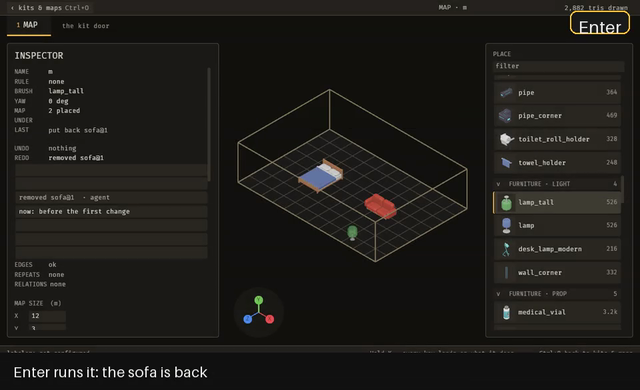</a>
- **261-area-solve-just-the-area** `c42c260` A layout in an area solves just the area: two old pieces the rules would not set side by side no longer refuse the area between them, an enclosure wish counts the area's own cells, and a stamp of a symmetric tile at a turn the kit does not keep pins its edge (#261) *No clip: an operation parameter's solver; proved by a_solve_in_an_area_solves_just_the_area*
- **192-layout-area** `0958546` An agent can lay only part of a map: layout_propose takes an area, and keeping the layout replaces only the unpinned pieces inside it (graybox first, #192) *No clip: an operation parameter an agent sends, nothing new drawn; proved by bevy_grimoire_mapper/tests/a_layout_proposed_in_an_area_leaves_the_rest_of_the_map.rs*
- **185-balances** `be45309` A relation can keep a group balanced about a point: Balances(with, about, within) holds the mean of a piece and its group within so far of a point, relations_solve moves the piece to put the mean there, and the RELATIONS row reads it (research lens #2, #185) *No clip: an API and a RELATIONS row the agent reads, nothing drawn; proved by bevy_grimoire_core/tests/a_group_balanced_about_a_point.rs*
- **ui-36-piece-move-note** `9766629` Right-click a placed piece and choose Move or Note: Move picks that piece up and the next click puts it down, Note opens the note box on it and Enter leaves the note (UI-36, #230) <a href="docs/changelog/media/2026-11-01-ui-36-piece-move-note.mp4">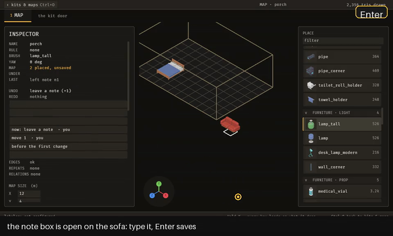</a>
- **ui-36-palette-menu** `187e5ca` Right-click a piece's row in the palette and its menu opens: Place, Mount on floor, wall or ceiling, Remove from the kit, each the same act as its key or click and one line in the history (UI-36, #230) 
- **ui-36-piece-menu** `7320751` Right-click a placed piece and its menu opens at the pointer: Turn left/right, Tip about x/z, Lift, Lower, Remove, each the same act as its key on that one piece and one line in the history; the clip removes a piece from the menu and Ctrl+Z puts it back (UI-36, #230) <a href="docs/changelog/media/2026-11-01-ui-36-piece-menu.mp4">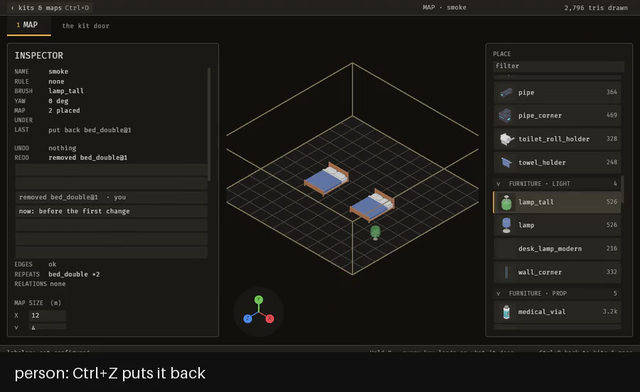</a>
- **103-light-buttons** `e70a079` The light map and the pool budget are buttons: LIGHT MAP dispatches light_map and says its receipt, and POOL HERE dispatches light_pool at the camera's ground point; the clip shows two lit lamps lighting the map (#103) <a href="docs/changelog/media/2026-11-01-103-light-map-button.mp4">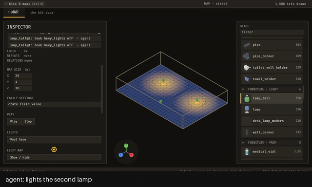</a>
- **ui-90-run-command** `b70184a` An agent runs any registered command by its id (grimoire_run_command), exactly as its shortcut would, and grimoire_state.ui says the screen, workspace, panels and focus (UI-90, #256) *No clip: an MCP tool; proved by a_command_runs_by_id_through_the_agents_door (4 tests)*
- **ui-07-writing-style** `335e231` Every command title follows the writing style: a test refuses abbreviations (verts, loc, rot, fac, obj, cfg, info), contractions and implementation terms, and the refused list is in docs/ui/vision.md §9 (UI-07, #215) *No clip: a test over the command titles; proved by every_label_follows_the_writing_style*
- **ui-04-command-registry** `4a4d6de` Every key is a command with a stable id, a title and a default shortcut (bevy_gooey Shortcut), and no two commands take one chord on a tab where both are live (UI-04, first slice; the menus and the palette dispatch by these ids) *No clip: an API the menus and the palette will read; proved by every_action_is_a_command (5 tests)*
- **103-flicker-preview** `8e958f2` A placed torch flickers in the viewport: a placement carrying a bevy_lights Flicker is drawn with a real light that the crate's own FlickerPlugin drives, retuned when the value changes and taken down when it is removed (#103) 
- **UI-40** `7bf3732` The editor's questions are gooey dialogs: confirm and the vocabulary prompt, with destructive buttons that name what goes <a href="docs/changelog/media/2026-11-01-ui-40-confirm.mp4">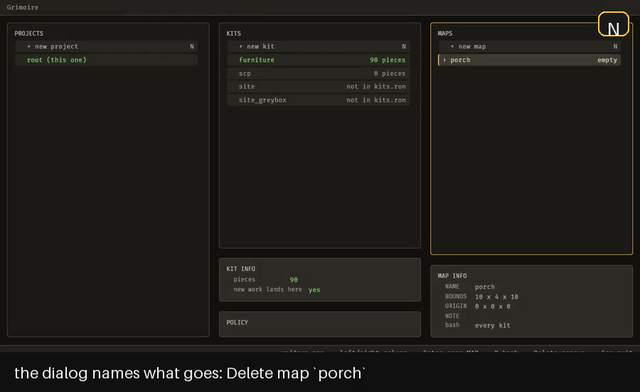</a>
- **ui-70-settings-layers** `9b2a24d` The editor's settings are three layers (defaults, <config_dir>/Grimoire/settings.ron, then the project's assets/grimoire/editor.ron), per key with the later layer winning, and a change to either file changes the running editor: deleting the project's key falls back to the user's value live, and a file that does not read keeps its last good content and is refused naming the field (UI-70) *No clip: no UI reads the settings yet (the settings screen is UI-71), so nothing is visible; proved by a_key_set_in_both_settings_layers_takes_the_projects*
- **fix-207-note-work-reads-the-log** `12d5956` A note's undo and an agent's fence refuse a log line that does not read, naming its line and field, instead of skipping it *No clip: a refusal in the operation log's readers; proved by note_work_reads_the_whole_log*
- **206-torn-oplog** `6867c9d` A write cut short loses one line of the operation log, not the next operation's too: a torn last line is ended before the next entry is written, so the entry is on its own line and reads *No clip: a crash-recovery fix in the log's writer; proved by a_torn_oplog_line_does_not_swallow_the_next_entry*
- **ui-02-editor-skin** `8579674` The editor's colours and measures are a bevy_gooey skin in src/editor_skin.ron (an eight-step elevation ladder that passes GooeySkin::problems()), and it is the running skin, so every gooey widget the editor adds draws in the editor's look (UI-02, first slice) *No clip: a data file and the running skin; the editor's chrome still draws from chrome.rs until the palette moves onto the skin, so nothing changes on screen; proved by editor_skin::the_editor_skin_breaks_none_of_the_librarys_own_rules*
- **ui-11-recent-projects** `b335efc` The editor remembers the projects it opened in <data_dir>/Grimoire/recent.ron, most recent first: opening one moves it to the top, a deleted folder is listed as missing rather than dropped, and an entry can be pinned, removed or located again (UI-11) *No clip: an API and a data file with no screen until the launcher (UI-10); proved by recent_projects::opening_a_project_moves_it_to_the_top_and_a_deleted_folder_is_listed_as_missing_not_dropped*
- **UI-05** `84857c2` A refused operation says the same what, where and fix on the toast, the journal row and an agent's answer (one `Problem` shape; `placement_remove` of an unknown id and an undo of a row that is gone name the entity and the fix) *No clip: an API and the text of a refusal; proved by tests/a_refused_operation_says_the_same_thing_on_every_surface.rs*
- **ui-01-gooey-required** `32b2aeb` The editor's UI library, bevy_gooey, is a required dependency in every build, and one EditorUiPlugin adds it (UI-01) *No clip: an API and a dependency change nobody can see; proved by editor_ui_plugin::a_default_build_has_the_gooey_skin_and_one_plugin_that_owns_it*
- **204-asset-spike** `a72c705` Bevy's asset system was tried on standards.ron beside the editor's own watchers, measured on Linux and macOS, and the watchers stay: every write was seen by both, in place and by rename, but a save of several files reaches the asset system spread over more than one frame (20 of 20 saves of three files 25 ms apart on Linux) where FileWatch says one reload is due after every save, a test of it needs the wall clock, and on macOS Bevy's watcher panics for a root that is not canonical (/var against /private/var); the spike stays behind the asset_spike cargo feature with its tests and its measuring example, and the guide has the numbers and when to read them again (#204) *No clip: a spike behind a cargo feature and a measurement, no visible change; proved by crates/bevy_grimoire_mapper/tests/asset_spike.rs (3 tests, run with --features asset_spike) and examples/asset_spike_measure.rs*
- **203-reload-state** `591955f` Every file of the open project now says what became of its latest edit, in a Reload panel in the inspector and in grimoire_state.reload_files: no game connected, game applied (with when), game refused (with the field and why), needs restart, or pending while the game has not answered an edit made after its last decision, with the editor's own verdict beside it; the editor also now reads a running game's verdict where the game writes it (the project directory, not the authoring kit's, so a real game's verdict never reached grimoire_state.game before)  <a href="docs/changelog/media/2026-11-01-203-reload-state.mp4">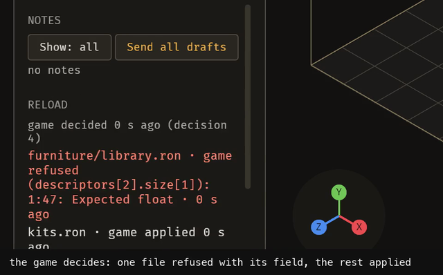</a>
- **202-versions-4** `e3895e2` Every line of the operation log now carries a version, and a line of another version is refused by whoever names what is wrong: oplog.jsonl was the last format the editor writes with no version, an entry did not deny unknown fields so a line a newer build wrote was read as this build's; ops::Entry now has a root version (default 1 for a line written before it, so no log on disk is rewritten, and a refusal in its own deserialiser), every new line is written at version 1 and an append never rewrites a line, the reload verdict and the undo refuse a log holding such a line naming line N.version and version 2 is not the 1 this build reads and change nothing, and the readers that skip a line (the steps feed, the after-edit queue) skip it so the lines around it still show; the unversioned list is now empty and its ratchet 0, every kind of the contract table is versioned, versioned above core or owned elsewhere *No clip: a log format and its readers, nothing to see; proved by crates/bevy_grimoire_mapper/tests/an_oplog_line_of_another_version_is_refused.rs*
- **202-versions-3** `d56ce5d` A map's forest, people and triggers files and a checks.ron now carry a version, and every reader refuses one it does not read: a people or triggers file from a newer build was refused as damaged (Unexpected field named version) and a checks.ron of version 2 was taken as this build's because Checks never denied unknown fields; the refusal is now in each type's own deserialiser, naming the field version and the version this build reads (version 2 is not the 1 this build reads), so forest_scatter, person_set, trigger_set, the forest and checks views and Checks::for_project all refuse the same way and leave the bytes, a file from before the version reads as the first, and what the editor writes carries version 1; 28 kinds are versioned and only the operation log is not (the ratchet fell from 5 to 1) *No clip: a file format and its readers, nothing to see; proved by crates/bevy_grimoire_mapper/tests/a_forest_people_or_scripts_file_of_another_version_is_refused.rs and crates/bevy_grimoire_decide/tests/a_checks_file_of_another_version_is_refused.rs*
- **202-versions-2** `0743196` A vocabulary, the repetition rules, a terrain file, a water plan, a water field and a volume now carry a version, and every reader refuses one it does not read: a file from a newer build was read as this build's, and an editor operation that reads with a plain ron::from_str and writes the whole file back (terrain_stroke, water_place, volume_edit) wrote it back at this build's shape; the refusal is now in the type's own deserialiser, naming the version this build reads (version 2 is not the 1 this build reads), a file from before the version reads as the first so no project on disk is rewritten, and what the editor writes carries version 1; 24 kinds are versioned and 5 are still not (the ratchet fell from 11) *No clip: an API and a refusal, nothing to see; proved by crates/bevy_grimoire_core/tests/a_format_that_gains_a_version_reads_the_files_it_did_not_have_one_in.rs and crates/bevy_grimoire_mapper/tests/a_terrain_water_or_volume_file_of_another_version_is_refused.rs*
- **202-rebuild** `2935a4b` The reload contract lists what will always need a rebuild, with the reason for each, and audits every format for a version: a rules.ron or destructible.ron from a newer build was read as this build's (a reload said applied for a rules file the project open refuses, and destructible_set would have written the marks back at the older version) and is now refused naming the version the build reads; 18 kinds are versioned, 11 are still not (a ratchet that only shrinks) and 4 are another crate's to version *No clip: an API and a verdict, nothing to see; proved by crates/bevy_grimoire_core/tests/every_format_carries_a_version.rs and the_always_rebuild_list_is_in_the_guide.rs*
- **201-follow** `20670d4` What points at a piece follows it when a live reload draws the piece again: a person is not a placement so a reload never draws them and their position and ties survive any edit to a piece, but a person's home (a society's Home(entity)) or a list of bound places names a placement, and a placement an edit draws again has a new entity, so every such reference named an entity that was gone; now the game registers once, on the app, GrimoireLiveApp::follow_respawn::<C>(|c, respawned| c.0 = respawned.follow(c.0)) and after a reload that drew a piece again the closure runs once for every C in the world (the new entity for a piece drawn again, the same entity for a kept or removed one), a component marked changed only when something moved; a closure and not MapEntities because a game cannot implement that for another crate's component; bevy_grimoire 0.3.0 *No clip: an API with nothing to see; proved by crates/bevy_grimoire/tests/live_references.rs*
- **201-migrate** `0150191` A game's state follows a piece a live reload draws again, through one hook per kind of state: a moved, turned or retyped placement gets a new entity and the old one is despawned, so a booking, an animation phase or a camera target on it was lost and every call site that edits a piece had to patch it; now the game registers once, on the app, GrimoireLiveApp::carry_across_respawn::<C>() (a component copied as it is) or migrate_on_respawn(|world, old, new| ...) (anything else), and the hook runs once for each piece drawn again (a rider drawn again with its host too, a piece renamed and drawn again under its new id) after the new entity is drawn and before the old one is despawned, and never for a piece the edit left alone or removed (bevy_grimoire 0.2.1; the in-place move, where a moved piece keeps its entity, needs the owner to change the assertion in live_reload.rs that pins a respawn) *No clip: an API for a game's own state, nothing to watch in the editor; proved by crates/bevy_grimoire/tests/live_migrate.rs (6 tests, the file did not compile before)*
- **201-rename** `d0c9f1a` A placement renamed in the project's files keeps its entity, and what a game hung on it, across a live reload: the game's GrimoireLivePlugin used to read a renamed placement as one removal and one addition, so a booking, an animation phase or a camera target on its entity was lost though the piece had not changed; now a placement whose id changed and whose row did not is a rename (MapDiff::renamed from the new diff_maps_renaming, found by content, paired only when unambiguous, riders on a renamed host and a stamp whose id changed follow), its Entity stays with the new id in its Placement, and a reload that writes the same content draws nothing *No clip: an API and a reload behaviour with no picture of its own (an entity id that does not change); proved by crates/bevy_grimoire/tests/live_identity.rs and crates/bevy_grimoire_core/tests/live_diff_renames.rs*
- **200-reference-family** `82f3e34` A referenced picture that is not a picture, and a family settings file that is not the crate's own type, are named instead of passing: a reference whose file a full disk cut off, a text saved over or another format renamed used to look fine until an agent opened it, and an elements or gooey settings file with a typo'd field was reported applied while the crate threw it away; now grimoire_state.reloads names the file and the field (kind reference_images: signature, format, header, width, height; kind family: clock, climate, accent), once per edit, the last good settings stay, and every kind in the registry has a reader that names its file and field (#200, H3) *No clip: a reload verdict and a status line, nothing to see; proved by core tests/a_reference_image_names_its_field.rs (5 tests), the editor's a_reference_image_that_does_not_read_is_named (4) and, with --features bevy_elements,bevy_gooey, family_settings_typed_verdicts (3)*
- **200-destructible** `d47626b` A destructible piece's damaged marks file or bake is named instead of overwritten: a hand edit that cut destructible.ron off, turned its version into a word or dropped pieces used to reach destructible_set as the parser's position with no field, and a bake that did not parse was baked again over the damaged bytes with no word; now reload_check reads both kinds in every build (the schemas moved into core), and destructible_set and destructible_hit refuse naming the file and the field (destructible.ron (pieces), destructible/site__cart.bake.ron (chunks[1].points)), write nothing, and leave the file as it is, while a bake made from another mesh is still baked again *No clip: a refusal's wording on an operation that reads a file, nothing to see; proved by core tests/reload_verdicts.rs (two more kinds, three bad files each), tests/a_destructible_file_names_its_field.rs, tests/old_data.rs (two frozen real files) and mapper tests/a_destructible_file_that_does_not_read_is_named.rs (4 tests, with the bevy_carnage feature)*
- **200-game-data** `ace7b65` A game's data file that no longer reads is named instead of silently dropping its rows: a hand edit that cut a tuning file off, turned a bounded leaf into a word or removed it used to leave the Data panel empty and data_set refusing without a file, and now grimoire_state.reloads names the file and the leaf (kind game_data, `mob.speed`, one verdict per edit, the reason says what a registered file is missing or holds), says needs_restart for an edit that reads (a running game uses it only if it re-reads its data) and applied when the file is back to the text it first had, reports the registry itself as data_registry, and data_set over a file that does not scan refuses naming the file and the leaf and leaves its bytes *No clip: a reload verdict and a refusal's wording, nothing to see; proved by tests/a_game_data_file_that_does_not_read_is_named.rs (6 tests) and core tests/a_data_file_names_its_leaf_and_field.rs (8 tests)*

## 2026-10-31

- **200-oplog-lines** `47777d7` A damaged line in oplog.jsonl is named instead of skipped without a word: a hand edit or a write cut short used to cost the author what that line recorded and say nothing, and now grimoire_state.reloads names the file, the line and the field of the first line that does not read (kind oplog, `line 3.seq`, `line 3.op` for a missing field, `line 3` for text that is not JSON, one verdict per edit, none for an append to a log that reads), the readers that skip still skip, and an undo past the line refuses naming it and writes nothing *No clip: a reload verdict and a refusal's wording, nothing to see; proved by tests/a_damaged_oplog_line_is_named_and_the_rest_still_reads.rs (4 tests) and core tests/a_json_lines_file_names_its_damaged_line_and_field.rs (7 tests)*
- **200-checks-view** `dc12659` A bad hand edit to checks.ron no longer stops every after-edit check: the editor holds the last good checks in memory, so a typo, a wrong type, a missing field or a threshold outside 0..=1 leaves the checks running as they were and grimoire_state.reloads names the file and the field (kind checks, one verdict per edit); a file that is there and cannot be read is refused, not treated as removed *No clip: a reload verdict and a held value, nothing to see; proved by tests/a_refused_checks_file_keeps_the_last_good_checks.rs (6 tests)*
- **200-old-data** `40b9698` An edit to a settings type that breaks the files already on disk is refused, naming the field: tests/old_data freezes one file of every kind check reads as a release wrote it (the first release's project files byte for byte, 0.3.0's for the rest) and reads each with the type's own reader, so a field added with no default, or removed while old files still carry it, fails naming the kind, the file, the field and the release; with a required field added to Standards the three-bad-files tests still passed and this one failed (#200 step 5, H3) *No clip: a schema-evolution check on settings types, nothing to film; proved by crates/bevy_grimoire_core/tests/old_data.rs (3 tests)*
- **200-needs-restart** `168a471` An edit to rigs.ron now says what became of it: the animation tab reads the manifest when it loads and holds it, so a hand edit used to do nothing and say nothing, and a broken one looked the same as a good one; grimoire_state.reloads now says needs_restart for a file that reads (the third outcome beside applied and refused: it is on disk, the tab keeps what it holds, change door and come back or restart), refused with the file and the field for one that does not read, once per edit however many frames pass, and the verdict clears when the file is put back or the door changes *No clip: an editor reload verdict, said in grimoire_state.reloads and once on the status line; nothing to film beyond a line of text; proved by mapper tests/a_rigs_edit_says_what_became_of_it.rs (5 tests) and core tests/a_restart_verdict_says_so.rs*
- **200-notes-and-family** `20872c1` A bad hand edit to a map's notes file no longer empties the signs and the Notes panel, and notes and family settings say what became of an edit: the editor holds the last good notes in memory, so a typo, a wrong type or a missing field leaves every sign and row as it was, and grimoire_state.reloads names the file and the field (kind notes, one verdict per edit); an edit to a family settings file is a verdict too (kind family: applied, refused with why while the last good settings stay, or gone) (#200 slice 5, H3) *No clip: an editor reload behaviour, a refused file leaves what is shown as it was; proved by tests/a_refused_notes_file_keeps_the_last_good_notes.rs and tests/family_settings_verdicts.rs*
- **200-tree-files** `0b3a0c9` A bad hand edit to a tree file no longer deletes the trees drawn from it: the forest view keeps the last good value of every .tree.ron in memory, so a typo, a wrong type or a field the crate does not know leaves the trees standing exactly as they were and the editor says which file and field in grimoire_state.reloads (kind trees, one verdict per edit), tree_edit refuses to write over a tree file it cannot read and names the file and the field, and an unknown field is named once (undergrow, not undergrow.undergrow); the unreadable kinds left on the editor's ratchet drop from 8 to 7 (#200 slice 4, H3) 
- **200-unread-files** `c05f917` A forest, people or triggers file that does not read is never overwritten: forest_scatter, person_set and trigger_set read the map's file, change one row and wrote all of it back, and a file with a typo counted as no file, so one hand-edit mistake lost every other row; now the call is refused naming the file and the field and the bytes stay as they were, people_run says the same instead of 'nobody lives here', and the forest view decides its file once per edit into grimoire_state.reloads and keeps the trees drawn (#200 slice 3, H3) *No clip: an operation refuses a file it cannot read and leaves it as it was, and a view reports a verdict; nothing to film; proved by mapper tests/a_file_that_does_not_read_is_never_overwritten.rs*
- **loop-ship-audit** every loop pass is audited for what it shipped: commits on main, unpushed work, a release when the package changed, docs and demos, with what was missing, on each repo's loop-stats branch; the loops release every pass that changed the package *No clip: loop tooling and commands; proved by tools/loop/test_steps.py (8 tests) and the driver's test scripts*
- **200-editor-verdicts** `8f03593` A bad hand edit to a terrain, water or volume file no longer changes what the editor draws, and the editor says which file and field: the ground, the water and the carved volume each keep their last good value in memory, so water that does not fill its shape, a carve with no size or a field of the wrong type is refused with its field named, said once on the status line and in grimoire_state.reloads (applied or refused, the field, the reason, one number per edit), and a deleted file is no longer refused; the water plan, water field, volume and data registry join the kinds check can read, 15 unreadable kinds down to 11 (#200 slice 2, H3) 
- **loop-step-times** every step of a loop pass is timed: tools/loop/steps.py reads the pass's omp session into ~/.local/state/wiggum/<clone>/steps.tsv after each pass, a pass marks its phases, and steps.py report ranks where a loop's time goes *No clip: loop tooling, nothing in the editor changes; proved by tools/loop/test_steps.py (6 tests) and the driver's own four test scripts*
- **129-piece-remove** `237e9ac` Delete on a library piece sends it back out of the library through piece_remove, the operation an agent calls: an agent can take a piece out (refused while a map places it or a composition holds it, nothing written), Delete writes one log line, one Cmd+Z puts the whole piece back where it stood and Cmd+Shift+Z sends it out again, and the shelf follows either front end (#129 slice 8) *No clip: an operation behind a key that already existed; proved by tests/piece_remove_is_an_operation.rs (an agent's removal and undo, refusals write nothing, a preview, a person's Delete, Cmd+Z and redo) and operations_have_two_front_ends::*
- **129-pack-set-excluded** `9e310f2` Shift+R leaves a pack out of the kit, or brings it back, through pack_set_excluded, the operation an agent calls: an agent can say a folder of art is not what the kit is built from, a bad or missing folder is refused with nothing written, the key writes one log line and one Cmd+Z takes the newest press back (even after the folder is gone), and a bare undo no longer risks taking it for the map's (#129 slice 7) *No clip: an operation behind a key that already existed; proved by tests/pack_set_excluded_is_an_operation.rs (an agent's exclusion and undo, refusals write nothing, a restore undone after its folder is deleted, a bare undo, a person's Shift+R and Cmd+Z) and operations_have_two_front_ends::*
- **129-piece-set-mount** `7898146` M sets a library piece's mount through piece_set_mount, the operation an agent calls: an agent can say where a piece goes, M steps past rungs the project would refuse, one log line and one Cmd+Z per press, and a bare undo no longer takes a library change for the map's (#129 slice 6) *No clip: an operation behind a key that already existed; proved by tests/piece_set_mount_is_an_operation.rs (an agent's mount and undo, refusals write nothing, a person's M and Cmd+Z, a bare undo) and operations_have_two_front_ends::*
- **200-per-file-verdicts** `5832f5b` A running game that refuses a reload says which file and which field: the verdict it writes (.live/game.ron, version 2) has one applied or refused entry for every file the load reads, with the kind, the path, the field (version, placements[3].at[1]) and the reason, a sequence number so one edit is one verdict however many frames pass, and a refused edit still changes no entity and no world; grimoire_state.game and the journal carry it (#200 slice 1, H3) *No clip: an API and a file format an agent reads, nothing a person sees; proved by core tests/reload_verdicts.rs (three bad files for each of 18 kinds), bevy_grimoire tests/live_verdicts.rs (the game keeps its entities and world, one verdict per edit) and the mapper's the_games_per_file_verdicts_reach_grimoire_state*
- **199-atomic-writes** `2d7fdf7` Every write of a project file is atomic: a reader (the running game, the editor's watcher) sees the old file or the new one, never half of either. One write path, bevy_grimoire_core::atomic_file, writes a uniquely named hidden temp file beside the target, flushes it, renames it over the target and flushes the directory; 19 plain writes (terrain, water, volume, forest, trees, people, scripts, family, game data, destructible, reference images, kits.ron and vocab.ron at creation, and two caches) moved onto it, and a ratchet test fails on a new one (#199) *No clip: an I/O guarantee with nothing to see; proved by core tests/atomic_writes.rs (a reader thread over 10,000 replacements, a child process killed at 40 random points, four writers of one path) and tests/atomic_writes_only.rs*
- **198-reload-contract** `19bd4d2` The reload contract: every kind of file the editor writes (33 kinds) has a reload class (Live, Respawn or Restart) and a lifetime (global or per map) in bevy_grimoire_core::reload, each operation declares the kinds it writes, and docs/guide/reload-contract.md is the audit table rendered from them; a kind with no class fails every_written_kind_has_a_reload_class and a kind that joins Restart off the checked-in list fails the_restart_list_only_shrinks (#198, H1) *No clip: an audit table and two ratchet tests, no editor surface; proved by crates/bevy_grimoire_core/tests/reload_contract.rs (3 tests) and crates/bevy_grimoire_mapper/tests/reload_contract.rs (4 tests), each ratchet shown failing on a mutated list*
- **193-viewport-under-sky** `ed2bec0` With a family/bevy_elements.ron the editor's viewport draws the map's box and grid under the elements sky instead of one flat colour: the interface camera no longer copies the ground colour back over the world (#193, #194) <a href="docs/changelog/media/2026-10-31-193-world-under-sky.mp4">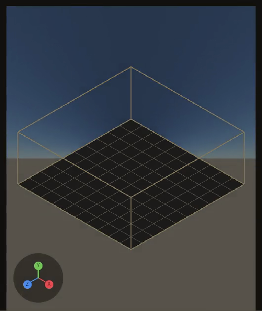</a>
- **129-placement-set-pose** `0f79607` V straightens a placed piece through placement_set_pose, the operation an agent calls: an agent can set a piece's turn and tip in one change, V writes one log line and one Cmd+Z takes both back (#129 slice 5) *No clip: an operation behind a key that already existed; proved by tests/placement_set_pose_is_an_operation.rs (an agent's pose and undo, refusals write nothing, a person's R, Y, V and Cmd+Z) and operations_have_two_front_ends::*
- **196-f32-undo** `ad69737` Undo no longer refuses a turn to 3.9 degrees (or any f32 the log's text spelled one step off) as an edit outside the log: the log is read back with serde_json's exact float parser (#196) *No clip: a fix in how the operation log's numbers are read; proved by tests/an_f32_in_the_log_still_undoes.rs (a turn to five yaws and a settings change, failing before)*
- **coven-docs** the README follows the bevy-coven documentation guide: the Vibe Coded banner, badges, Status and Why lines, a still beside the GIF, the Familiar named, and the 64-second demo moved to the book page *No clip: a README and docs change; the README's GIFs are unchanged and the demo video now plays on bevy-coven.github.io/crates/bevy_grimoire.html; proved by every image URL answering 200*
- **grimoire-solver-0.1.1** bevy_grimoire_solver 0.1.1 on crates.io: its docs.rs page shows the N-queens GIF, now an absolute URL *No clip: a release whose only change is the README image URL; proved by the docs.rs page's image answering 200*
- **grimoire-rename** `8ade561` the editor is Grimoire: crates bevy_grimoire_*, MCP tools grimoire_*, env vars GRIMOIRE_*, and the project data folder assets/grimoire; a project still in assets/emerge is moved once when the editor opens it, and refused when both folders exist *No clip: a rename; the only new pixels are the word Grimoire in the window title and the menu's chrome bar; proved by bevy_grimoire_core/tests/a_project_in_assets_emerge_is_moved_once.rs*
- **129-placement-set-lift** `8455e35` [ and ] lift a placed piece through placement_set_lift, the operation an agent calls: an agent can raise a lamp off its table, the pieces resting on it ride with it, and it is undone like any other (#129 slice 4) *No clip: an operation behind two existing keys, nothing new to see; proved by tests/placement_set_lift_is_an_operation.rs*
- **179-busy-poll** `9b10173` emerge_capture_sequence keeps waiting when the busy editor misses one status poll's 5 s budget, instead of abandoning the clip (#179) *No clip: a fix to the MCP server's capture-sequence poll; proved by bevy_emerge_mcp/tests/a_slow_status_poll.rs*
- **E-006-publish-bevy_emerge_anim** `dd1fc52` bevy_emerge_anim 0.1.0, which blends clip weights on a skinned rig's animation player, is on crates.io: with it every crate a game links is on the registry (#128) *No clip: a release to crates.io, nothing to see in the editor; proved by the crates.io index entry for bevy_emerge_anim 0.1.0 (pubtime 2026-10-31T01:57:45Z) and the bevy_emerge_anim-v0.1.0 tag*
- **129-placement-set-tip** `aab1f59` Y and U tip a placed piece through placement_set_tip, the operation an agent calls: an agent can lay a piece on its side, and it is refused for the same reasons a person is (a host, an unmeasured piece) (#129, slice 3) *No clip: an operation behind keys that already existed; proved by placement_set_tip_is_an_operation:: (agent tip and undo, refusals write nothing, Y is one log line and one Cmd+Z) and operations_have_two_front_ends::*

## 2026-10-30

- **E-006-publish-solver-core-snip** `45309d9` bevy_emerge_solver, bevy_emerge_core and bevy_emerge_snip 0.1.0 are on crates.io (rng was already): a game links them from the registry instead of a path (#128) *No clip: a release to crates.io, nothing to see in the editor; proved by cargo publish verify builds of the packaged crates (solver 9 s, core 7 min, snip 3.5 min) and the tags bevy_emerge_solver-v0.1.0, bevy_emerge_core-v0.1.0, bevy_emerge_snip-v0.1.0*
- **189-stamp-yaw** `7f2239b` stamp_add's yaw is degrees, and its schema says so: an agent's quarter turn (90) turns a stamped composition a quarter turn, not 1.57° (#189) *No clip: an operation schema's unit; the editor's own stamp click already sent degrees, so nothing on screen changes; proved by tests/a_stamp_turns_by_the_unit_its_schema_names.rs*
- **188-relations-end-stack** `7a29aee` A relation's end is its whole stack: a jug on the counter no longer blocks the counter's ClearInFront, nor the stall a sign hangs on its VisibleFrom (#188) *No clip: a fix to two relation checks in core; proved by crates/bevy_emerge_core/tests/a_relations_end_is_its_whole_stack.rs*
- **192-solve-in-area** `3b4598a` A generate can be asked to lay only inside an area: core grammar::solve_in and solve_constrained_in fill the area's cells, join the pieces around it, and leave the rest of the map as it is *No clip: an API (core grammar::Area, solve_in, solve_constrained_in), not yet reachable from the editor (slice 2); proved by crates/bevy_emerge_core/tests/a_generate_lays_only_inside_its_area.rs*
- **E-006-publish-bevy_emerge** `2633021` bevy_emerge 0.1.0, the runtime crate that spawns a map in a Bevy world, is on crates.io: a game adds it with cargo add bevy_emerge instead of a path (#128) *No clip: a release to crates.io, nothing to see in the editor; proved by the crates.io index entry for bevy_emerge 0.1.0 (created 2026-10-31T01:11Z) and the bevy_emerge-v0.1.0 tag*
- **B-187-terrain-shape** `d2d9762` A terrain file whose heights do not fill its shape (a hand edit, a truncated write) no longer panics the editor: it draws no ground, names terrain/<map>.ron on the status line, and terrain_stroke and water_run refuse it (#187) *No clip: a bug fix: what it removes is a panic; proved by bevy_emerge_core/tests/a_terrain_file_that_does_not_fill_its_shape_is_refused.rs and the editor's a_terrain_file_that_does_not_fill_its_shape_is_refused::*
- **186-long-pieces-half-turn** `bcb413e` repetition_vary turns a long clutter piece (a bench, a cart) only a half turn, so it never lands on cells it did not cover *No clip: a fix to repetition_vary's plan (which copies turn, and by how much); proved by crates/bevy_emerge_core/tests/vary_never_turns_a_long_piece_off_its_cells.rs*
- **103-overlay** `1768ce8` The light map is drawn over the open map: a LIGHT MAP button shows bevy_light_grid's field, blue where dark and amber where lit, and it follows the map as torches are lit (#103)  
- **103-pool** `1e73078` light_pool operation: which placed fixtures are real lights from a viewer position, read from bevy_lights' own pool budget (#103) *No clip: an operation's numbers; proved by tests/light_pool.rs*
- **102-forest-view** `06f6e5b` The planted forest is drawn in the viewport with bevy_flora's own trees: scattered trees from the species' pool, placed trees grown with their own seed and age, regrown within half a second of a forest or .tree.ron edit (#102) <a href="docs/changelog/media/2026-10-30-102-forest-view.mp4">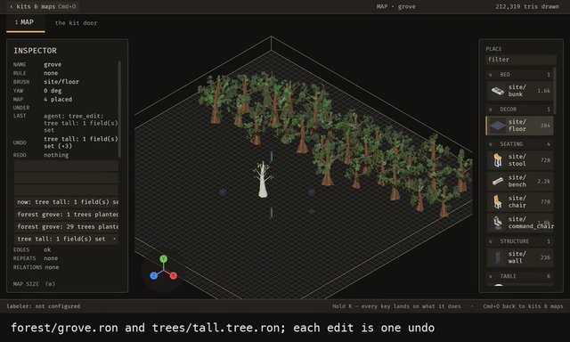</a>
- **B-021** `a8c87ac` A click on the chrome around the viewport (the door strip, the status band) no longer places the armed piece far off the map, unseen (#182) *No clip: a bug fix: what it removes is a placement nobody could see; proved by tests/a_click_outside_the_viewport_places_nothing.rs*
- **184-round-repeats** `9a013de` repetition.ron's round kinds: a barrel or a pot repeats at any turn, and repetition_vary never turns one but counts it as left *No clip: a repetition rule in a project data file (agent and REPEATS line read it); proved by crates/bevy_emerge_core/tests/a_round_piece_repeats_at_any_turn.rs*
- **183-inside** `149f032` Relations: Inside keeps a piece inside an area of another (a table on the rug, a stall in the square), and relations solve sets it just inside *No clip: a relation kind and its RELATIONS row text; proved by bevy_emerge_core/tests/a_piece_inside_an_area.rs*
- **180-pointer-read-first** `c488d07` A click lands where the cursor is this frame: the pointer is read before every Update system, so the Note tool's second Shift-click no longer takes the first piece back out (#180) *No clip: an input-ordering fix with nothing new on screen; proved by the_pointer_is_read_before_anything_acts_on_it and 51 of 51 batch runs of a_person_shift_clicks_two_pieces_into_one_note*
- **181-backs-onto** `e6ce312` Relations: BacksOnto keeps a piece with its back to another (a bookshelf against a wall, anywhere along it), and relations solve turns it out from the wall *No clip: a relation kind in relations.ron and its RELATIONS row text; proved by bevy_emerge_core/tests/a_piece_backed_onto_another.rs*
- **177-note-box-on-screen** `ee0ce2b` While a note is typed, the Inspector scrolls its text (LAST: the words, the caret, [auto]) back on screen, even when it was scrolled down to NOTES <a href="docs/changelog/media/2026-10-30-177-note-box-on-screen.mp4">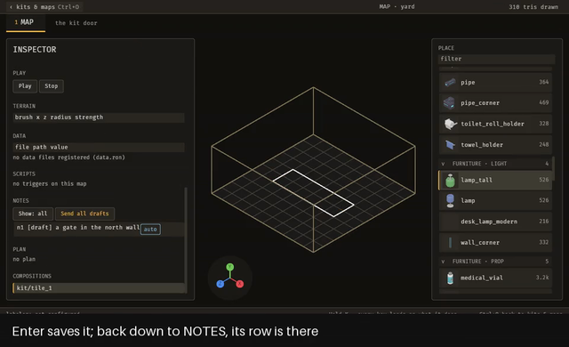</a>
- **95-notes-end-to-end** `59193ea` Notes end to end on a game's map: a person leaves three notes (an area, two Shift-clicked pieces, one piece), two agents work them at once inside their fences, a removal waits for the person's answer, and the person keeps two and undoes the third in one step (#95) <a href="docs/changelog/media/2026-10-30-95-notes-end-to-end.mp4">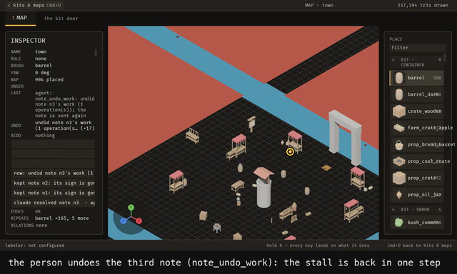</a>
- **173-second-shift-click** `59193ea` The Note tool's second Shift-click adds its piece to the open note, so one note can name a group of pieces (#173) 
- **101-cover** `48272bf` The carved ground wears snow and wetness from the environment file: volume_cover, bevy_elements' SurfaceCover, is put on the chunks' WeatheredMaterial and follows a family_set live (#101) 
- **171-stress-state** `08ac0a1` emerge_state.stress tells an agent whether the kit can loop a hallway back (ring) and open into a room (room), with each piece and its turn *No clip: an emerge_state section for agents; proved by crates/bevy_emerge_mapper/tests/emerge_state_says_whether_the_kit_loops_and_opens_into_a_room.rs*
- **95-undo-removal** `d5d5132` Undoing a note whose agent removed a piece puts the piece back in one step, instead of refusing *No clip: a fix to note_undo_work's reading of a removal's undo; proved by notes_end_to_end::two_notes_kept_and_one_undone_leave_the_map_file_with_only_the_kept_work; #95's end-to-end clip will show it*
- **168-unnested-pane** `c862f0a` The Meshes pane's standards row names each pair of sub-kit modules that do not nest which the piece in focus is part of, in emerge_state's words (#168 slice 3) <a href="docs/changelog/media/2026-10-30-168-unnested-pane.mp4">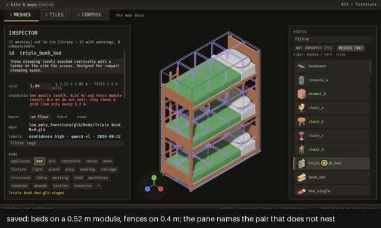</a>
- **167-degrees** `a67d95b` Relations: #167's acceptance (AlignedWith 0/20 met, 0/90 unmet, 350/10 met; Faces at every quarter turn as drawn) proved against the map's degrees *No clip: a regression test for what relations measure on a turned piece; proved by bevy_emerge_core/tests/relations_read_a_maps_yaw_in_degrees.rs*
- **170-mirror** `cee3587` Relations: MirrorOf keeps a piece opposite another across a third's axis (a pair of lamps flanking a door), and relations solve sets it there *No clip: a relation kind in relations.ron and its RELATIONS row text; proved by bevy_emerge_core/tests/a_piece_kept_mirrored_across_another.rs*
- **e002-composition-rename** `7828e55` composition_rename: an agent renames a composition, every stamping map follows, and undo puts it back; the COMPOSE tab's I field dispatches it *No clip: an operation for an existing verb, no visible change; proved by tests/composition_rename_is_an_operation.rs*
- **release-publishable-set** `5cd5fbc` The game-facing crates (solver, core, snip, bevy_emerge, anim) package for crates.io; the editor and MCP server are marked unpublished *No clip: build metadata; proved by cargo publish -p bevy_emerge_solver --dry-run and cargo package --list*
- **e002-composition-arm** `a97b657` composition_arm: an agent arms a composition through the operation the picker and COMPOSE Enter now dispatch *No clip: an operation for an existing verb, no visible change; proved by tests/composition_arm_is_an_operation.rs*
- **168-unnested-state** `9d69ab4` emerge_state.standards lists unnested, the pairs of sub-kit modules that do not nest, re-read from standards.ron on every call (#168 slice 2) *No clip: an MCP read, no editor surface changed; proved by crates/bevy_emerge_mapper/tests/emerge_state_names_modules_that_do_not_nest.rs*
- **168-unnested-core** `e465bcf` Kit standards name the sub-kit modules that do not nest: standards::unnested pairs rules whose modules are not whole multiples of each other, with the run on which they meet again (#168 slice 1) *No clip: an engine-free core API; proved by crates/bevy_emerge_core/tests/a_kit_names_modules_that_do_not_nest.rs*
- **165-degrees** `df938a1` Relations read a map's yaw in degrees: a piece in front of a turned door is in front of it, and relations solve writes degrees back *No clip: a fix to what relations measure and write on a turned piece; proved by bevy_emerge_mapper/tests/relations_read_a_turned_piece_in_degrees.rs*
- **163-beside** `ab5a504` Relations: LeftOf and RightOf keep a piece beside another (a lamp left of the door), and relations solve sets it there *No clip: a relation kind in relations.ron and its RELATIONS row text; proved by bevy_emerge_core/tests/a_piece_kept_beside_another.rs*
- **166-options** `684e580` A block offers several distinct layouts on request: rules::options keeps up to N that each differ from the others in at least a given number of cells, each chosen by the seed that rebuilds it *No clip: a core API; proved by bevy_emerge_core/tests/a_block_offers_distinct_options.rs*
- **158-created-file** `b0e7a8f` A project file written for the first time while the editor is open (repetition.ron, standards.ron, rules.ron, compositions.ron) is read at once, not after a second edit (#158) *No clip: a watcher fix, seen in the E-090 clip's second step; proved by tests/a_project_file_created_while_open_is_read.rs*
- **162-room** `273b5b0` A kit says whether it can open a hallway out into a room: adjacency::room builds the smallest room with a middle, nine pieces with every inner seam declared, or says there is none *No clip: a core API; proved by a_kit_says_whether_it_can_open_into_a_room*
- **forest-season** `c0a2402` Trees follow the map's date: the preview's FloraSeason turns blossom, green, autumn, snow with the month, shifted for the south (#102) 
- **102-tree-editor** tree_edit: start a tree from a bevy_flora preset and tune any field by path, written as a project .tree.ron the crate's loader reads, one undo per edit; terrain-field line `tree <name> [preset] [field=value]` (#102) <a href="docs/changelog/media/2026-10-30-102-tree-editor.mp4">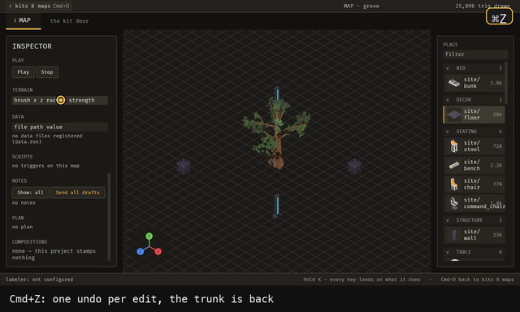</a>
- **forest-place** `72be365` Place one tree by hand with an age and a seed (forest_scatter's place); the same seed grows the same tree *No clip: an API; proved by tests/forest_place.rs*
- **161-behind** `93d1c20` Relations: Behind keeps a piece behind another (a chest behind the counter), and relations solve sets it there *No clip: a relation kind in relations.ron and its RELATIONS row text; proved by bevy_emerge_core/tests/a_piece_kept_behind_another.rs*
- **160-ring** `eb75d90` A kit says whether it can loop a hallway back: adjacency::ring builds the smallest closed loop of four pieces, or says there is none *No clip: a core API; proved by a_kit_says_whether_it_can_loop_a_hallway_back*
- **159-between** `7523243` A relation keeps a piece between two others (a table between two chairs), and relations solve sets it there <a href="docs/changelog/media/2026-10-30-159-between.mp4">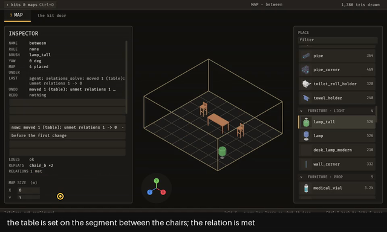</a>
- **session-per-turn** `c6628e3` session::score measures an agent per turn: asking on a clear request or acting on a vague one, and a later turn breaking an earlier turn's relation *No clip: an engine-free API; proved by bevy_emerge_core/tests/a_session_scores_each_turn.rs*
- **relations-aligned-with** `8777873` Relations: AlignedWith keeps a piece on another's heading (a row of pews), and relations solve turns it there in place <a href="docs/changelog/media/2026-10-30-relations-aligned-with.mp4">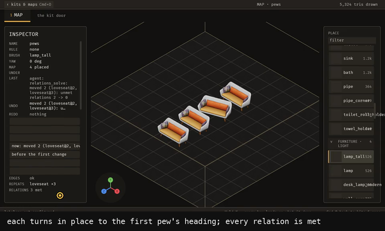</a>
- **153-options** `8c44207` An agent asked for options gets distinct layouts, each with the seed that lays it (layout_propose options) *No clip: an MCP operation parameter; proved by tests/a_proposal_offers_options.rs*
- **152-clockscrub-door** `a17d0ea` With bevy_elements on, the Environment panel's held hour is released when the door changes, and the feature's tests are green *No clip: a resource classification; proved by every_resource_says_what_a_door_does_to_it with --features bevy_elements*
- **relations-hard** `15698c2` A relation can be hard: relations solve never breaks it to mend soft ones, and names the relations it left unmet <a href="docs/changelog/media/2026-10-30-relations-hard.mp4">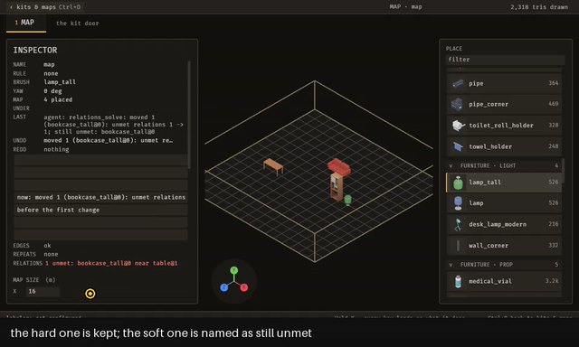</a>
- **relations-reachable-from** `abf6439` Relations: ReachableFrom, a walk from one piece to another round whatever stands between, and solve opens a sealed one <a href="docs/changelog/media/2026-10-30-relations-reachable-from.mp4">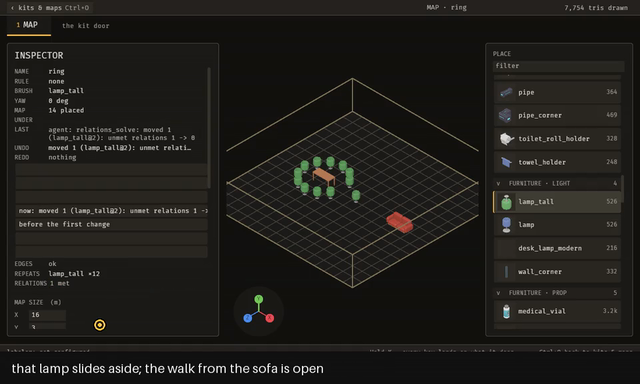</a>
- **gooey-skin** `fe2d94f` A project's family/bevy_gooey.ron is the running UI skin: a partial file restyles bevy_gooey widgets live, and a bad file or a WCAG failure is a status-line problem (#147) 
- **relations-along** `e8b7fe0` A relation keeps a piece beside a path through other pieces: Along names how far off it stands, and relations solve brings it back <a href="docs/changelog/media/2026-10-30-relations-along.mp4">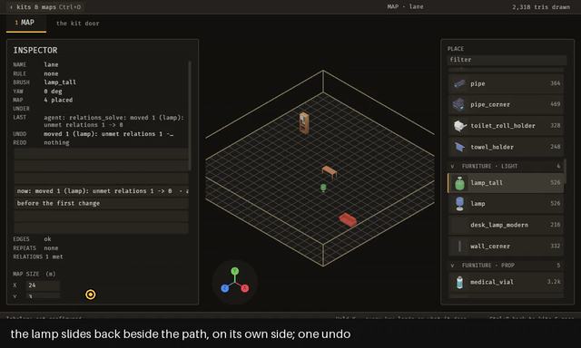</a>
- **dead-end-closest** `d29b77c` A kit's dead end names the piece nearest to closing it and the cells it gets wrong <a href="docs/changelog/media/2026-10-30-dead-end-closest.mp4">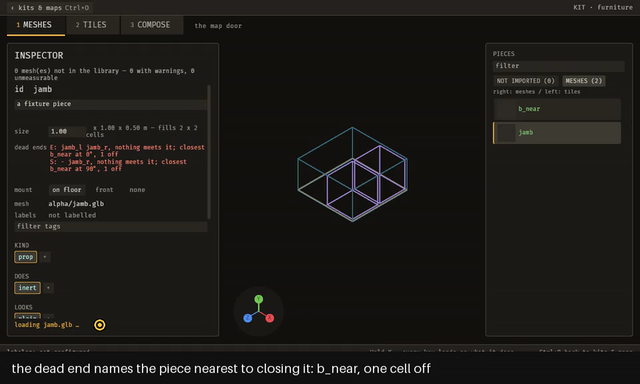</a>
- **relations-visible-from** `96d335e` A relation keeps a sight line clear: VisibleFrom names the piece in the way, and relations solve moves it off <a href="docs/changelog/media/2026-10-30-relations-visible-from.mp4">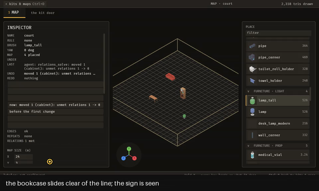</a>
- **E-142-2** `6665972` The Meshes pane and emerge_state name every kit face no piece can meet (dead ends) 
- **143-repetition-vary** `2fad900` repetition_vary and the Terrain line `repeats vary` turn the clutter copies that repeat visibly, never structure, with one undo <a href="docs/changelog/media/2026-10-30-repetition-vary.mp4">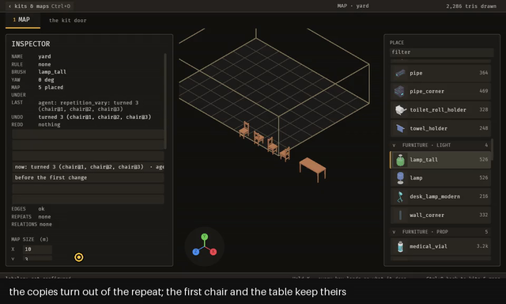</a>
- **E-142-1** `dd539fc` A kit names every edge face no piece of it can meet (adjacency::dead_ends) *No clip: an API with no editor surface yet; proved by tests/a_kit_names_every_face_nothing_can_meet.rs*
- **B-140** `92b2dc0` A piece despawned in the frame its materials arrive no longer panics the editor (#140) *No clip: a crash fix; proved by crates/bevy_emerge/tests/paint_on_a_despawned_piece.rs*
- **e088-inspector-relations** `d1264c8` The Map inspector's RELATIONS row names how many intended relations the open map breaks and the first one, live as the file changes 
- **E-091** `1dfe893` emerge_list_operations takes a query: an agent finds an operation by searching, best first, instead of reading all 64+ *No clip: an MCP/BRP API; proved by tests/an_agent_can_search_the_operations.rs*
- **E-090** `e8f9edf` A project's repetition.ron decides which kinds are structure and how far a repeat is seen; emerge_state and the REPEATS line follow an edit live <a href="docs/changelog/media/2026-10-30-E-090.mp4">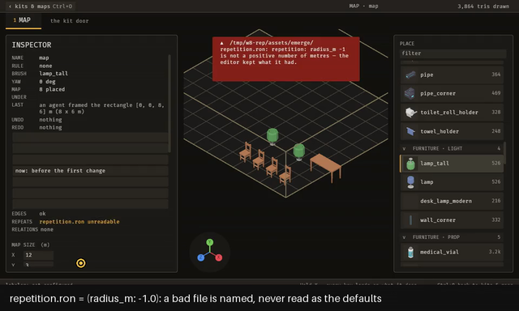</a>
- **E-089-4** `4c4144f` The Meshes pane names the project standards the selected piece breaks, and an edit to standards.ron reaches it live <a href="docs/changelog/media/2026-10-30-E-089-4.mp4">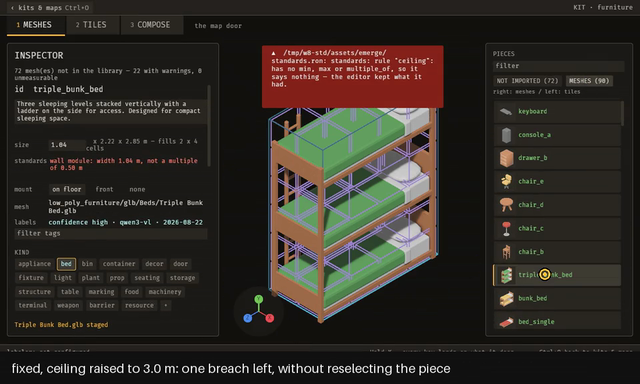</a>
- **137-relations-solve** `009a7e5` relations_solve and the Terrain line `relations solve` move the pieces of a map's broken relations, with one undo 
- **106-balloon** `pending` Dialogue preview balloon: the lines a dialogue <name> walk says are drawn as one balloon over the piece that carries the conversation, following the camera (#106 slice 6) <a href="docs/changelog/media/2026-10-30-106-balloon.mp4">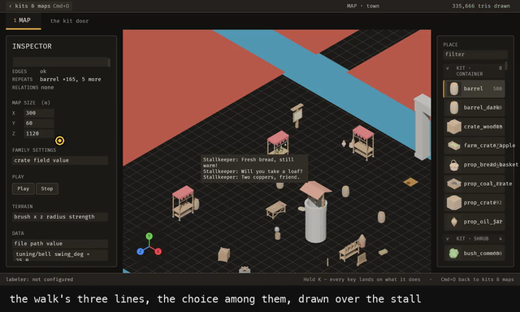</a>
- **138-import-standards** `d2a3ee9` piece_import names which of the project's standards the imported piece breaks *No clip: an MCP answer field; proved by tests/an_imported_piece_names_the_standards_it_breaks.rs*
- **E-089-s2** `a23ba4b` emerge_state names the kit pieces that break the project's standards.ron, and the rules that cover no piece (#138 slice 2) *No clip: an MCP read, no editor surface changed; proved by crates/bevy_emerge_mapper/tests/emerge_state_reports_standards_breaches.rs*
- **137-solve** `4353041` relations::solve nudges pieces until a map's intended relations hold, never breaking one to mend another *No clip: an engine-free API; proved by crates/bevy_emerge_core/tests/a_solver_mends_broken_relations.rs*
- **E-089-s1** `3abf44f` Kit standards: a project's standards.ron says which pieces break its module, door opening or storey height (#138 slice 1) *No clip: an engine-free core API; proved by crates/bevy_emerge_core/tests/a_kit_says_which_pieces_break_its_standards.rs*
- **e088-relations-state** `4f79e81` emerge_state names the intended relations the open map breaks, read live from <map>.relations.ron *No clip: an MCP read (emerge_state.relations); proved by crates/bevy_emerge_mapper/tests/emerge_state_reports_broken_relations.rs*
- **E-087-inspector** `50e9fa6` The Map inspector's REPEATS row names the repeat a player will notice first, and how many other looks repeat 
- **E-088** `9747292` Layout relations: a map says which intended relations (faces, near, apart, in front of, clear in front) its placements break, and by what *No clip: a core API, not yet drawn in the editor; proved by crates/bevy_emerge_core/tests/a_map_says_which_relations_it_breaks.rs*
- **E-087b** `0b4323b` emerge_state names the repeats a player will notice: repeated clutter first, structure after *No clip: an MCP state field; proved by tests/emerge_state_names_visible_repeats.rs*
- **e075-drop** `4417f4d` Dropping an image on the editor window keeps it as a reference of the open map, copied into the project's references/ *No clip: visible, not yet recorded: no display on big*
- **136-repetition** `bdafe68` Role-weighted repetition: a map reports which repeated pieces a player will notice, clutter above structure *No clip: an engine-free API with no UI yet; proved by tests/repeated_clutter_outranks_repeated_structure.rs*
- **E-070-chip** `be3b1d7` A note the agent may decide for itself shows an 'auto' chip on its row in the Notes panel (E-070) <a href="docs/changelog/media/2026-10-30-E-070-chip.mp4">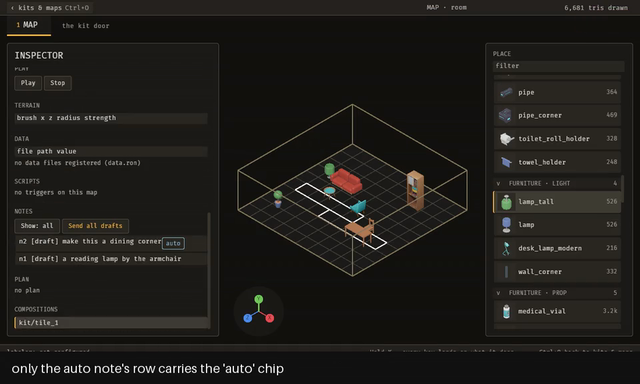</a>
- **E-083** `cc725d4` Generating from compositions on a project with no tile says which groups were left out and why, instead of 'nothing has been placed yet' *No clip: an error message from the composition grammar; proved by crates/bevy_emerge_core/tests/a_tileless_composition_set_says_why.rs*
- **e069-plan-panel** `e9d70f9` The Inspector's PLAN section shows the agent's plan: a count and one numbered row per step with its status <a href="docs/changelog/media/2026-10-30-e069-plan-panel.mp4">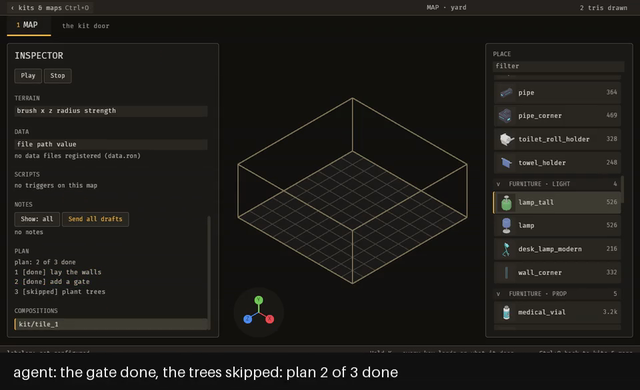</a>
- **105-scripts-panel** Scripts panel: every trigger of the open map is a row in the editor; a row opens the terrain line to edit it (#105) 
- **E-043** `3b5e8b0` label_suggest and label_apply: an agent asks the VLM about a piece from its own shots and applies the answer, with undo *No clip: an MCP operation pair; proved by tests/a_vlm_label_is_suggested_then_applied.rs*
- **105-receipt** `85093ed` The line after 'people run' names the triggers that fired and for whom, and any script error (#105) *No clip: visible, not yet recorded: the viewport draws no people, so only the status line shows it; proved by the_run_receipt_names_the_triggers_that_fired*
- **E-055** `c177b4d` Stale code comments corrected *No clip: comments only; proved by cargo check*
- **E-070-auto-toggle** `99cd8e5` Tab in the note box marks a note auto: the agent decides open choices itself and says what it assumed 
- **E-075c** `f328bc5` A note's resolution can cite a reference picture by id; an id the map lacks is refused *No clip: an agent-facing refusal; proved by note_cites_reference::a_resolve_citing_a_reference_the_map_lacks_is_refused*
- **E-075b** `4c54e46` Reference images are added and removed through the reference_set operation (UI line 'ref <path> [caption]') and listed in emerge_state for the agent to cite *No clip: an operation and state field; proved by tests/references.rs*
- **E-047** `238331d` emerge_list_pieces says its confidence describes the record, not a check; one confidence parser *No clip: an API wording and a refactor; proved by a_confidence_word_parses_back*
- **E-075-refs-core** Reference images are project data: <map>.references.ron holds them with ids an agent can cite (core slice, #124) *No clip: an API, no operation or UI yet; proved by bevy_emerge_core tests/references.rs*
- **E-012** `a7a7222` Ratchet: a global observer can no longer hide a bare Res inside a SystemParam bundle *No clip: a test ratchet; proved by no_observer_hides_a_resource_in_a_bundle*
- **E-052** emerge_list_pieces: unconfirmed is another spelling of by_model, which matches agent-written axes too *No clip: an MCP parameter alias; proved by pieces_params_tests::unconfirmed_is_the_by_model_filter*
- **E-070** `163f508` note_add takes auto: the agent decides open choices itself and cannot ask, the fence still holds *No clip: an API option on a note; proved by note_auto tests*
- **105-hot** `4ceb657` A trigger script edited on disk fires on the next society run, no restart (#105) *No clip: a test; proved by a_script_edited_on_disk_takes_effect*
- **E-069-1** `10c4310` An agent can show its plan beside the map (plan_set): a checklist with a status per item, in emerge_state, with undo and redo *No clip: an agent API; proved by an_agent_can_show_its_plan*
- **E-072-3** `1286260` An agent can change a composition's envelope (composition_set_envelope); a second click on the selected Compose row flips it <a href="docs/changelog/media/2026-10-30-E-072-3.mp4">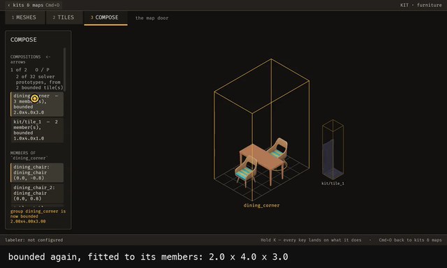</a>
- **99-sculpt-clip** `baa506f` Strokes on a map's terrain are drawn in the viewport: two hills raised and a hollow dug by terrain_stroke, saved as the map's heightfield (#99) <a href="docs/changelog/media/2026-10-30-terrain-sculpt.mp4">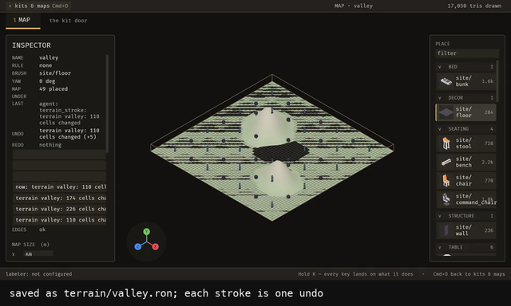</a>
- **105-note-bind** `76975de` A trigger can be bound to a note's area: trigger_set bind.note *No clip: an API over MCP; proved by tests/a_trigger_binds_to_a_notes_area.rs*
- **stamp-add** `09d70a1` An agent can stamp a composition onto the map (stamp_add), with undo and redo *No clip: an operation with no new surface; proved by tests/an_agent_can_stamp_a_composition.rs*
- **106-person-talks** `ad0a4b7` A person holds a conversation: person_set takes one the project's dialogue script defines, an undefined one is refused (#106) *No clip: an API; proved by tests::person_talks*
- **105-triggers** Triggers: bevy_society Rhai scripts bound to people, a faction or an area, syntax-checked on save, and shown firing in people_run (trigger_set) *No clip: visible, not yet recorded: no display on big; proved by tests/triggers.rs*
- **dialogue-barks** `d3785bc` Barks: a piece can carry a list of the crate's own Bark lines, refused with the crate's message when malformed (#106 slice 4) *No clip: visible, not yet recorded: no display on big; proved by family_dialogue::barks_attached_to_a_piece_are_the_crates_own_bark_list_and_a_malformed_one_is_refused*
- **104-ties** People can have ties to each other (person_set tie, terrain line tie=Odo:0.3:0.8); a people run starts from them and reports each person's bonds (#104 slice 4) *No clip: visible, not yet recorded: no display on big; proved by people_ties tests*
- **101-draw** `e8dc64c` A carve in the ground is drawn: the viewport shows the volume's isomesh chunks in place of the heightfield mesh (#101 slice 6) <a href="docs/changelog/media/2026-10-30-carve-the-ground.mp4">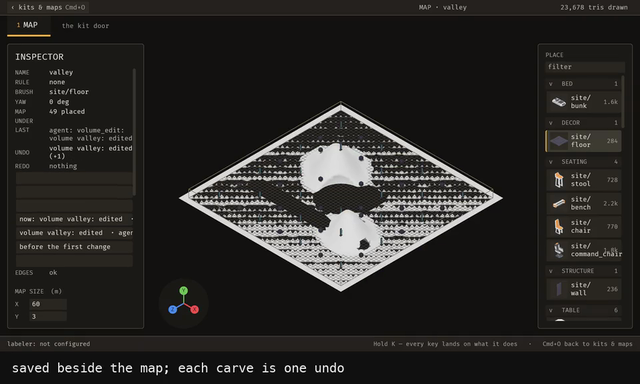</a>
- **water-pond-clip** `61c7f57` A spring on a sculpted valley is run until it settles into a pond, drawn in the viewport and kept as the map's water (#100) <a href="docs/changelog/media/2026-10-30-water-pond.mp4">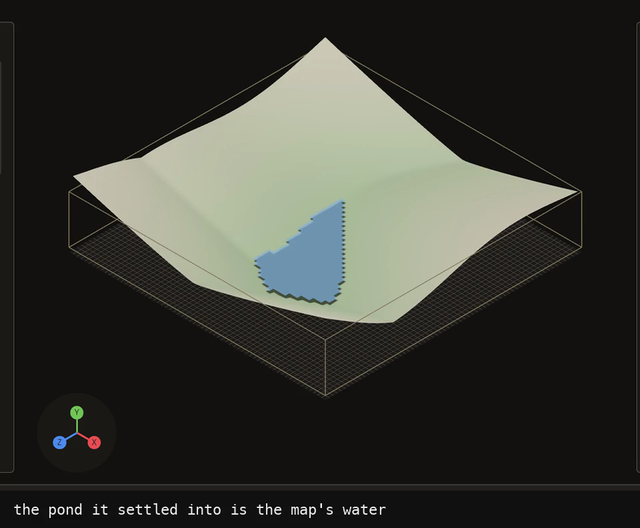</a>
- **people-run** `72e9b7c` people_run (and the terrain line 'people run [seed] [days]') runs a map's villagers forward in bevy_society's own app: same seed, same day (#104) *No clip: visible, not yet recorded: no display on big*
- **106-runtime** `b982f0f` A conversation attached to a piece plays through the crate's own runtime: the talker asks, the chosen option leads to its line *No clip: visible, not yet recorded: no display on big; proved by dialogue_runtime::the_conversation_a_piece_carries_is_walked_by_the_crates_runtime_down_the_chosen_option*
- **104-people** `ade2541` People: person_set authors a person (home, workplace, faction) beside the map; a building someone lives in cannot be removed (#104) *No clip: visible, not yet recorded: no display on big*
- **101-snow** `244e532` Snow lies on a carved hill and never fills its tunnel: bevy_elements' SnowyField over the volume (#101 slice 5, feature volume_snow) *No clip: an API behind the volume_snow feature; proved by volume_snow::snow_covers_the_top_and_the_tunnel_stays_open*
- **101-caves-rest** `cecc860` A floor piece authored inside a carved cave stands on the cave's floor (resolve_y_in, #101) <a href="docs/changelog/media/2026-10-30-101-caves-rest.mp4">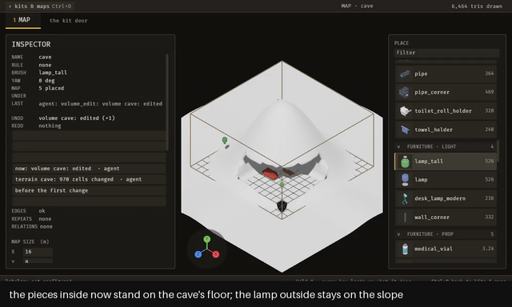</a>
- **106-dialogue-preview** Preview a conversation without playing it: dialogue_preview walks a path through the script, says its lines, offers an unmade choice's options and names nodes no path reaches (family field: dialogue <name> [options]) *No clip: visible, not yet recorded: no display on big; proved by dialogue_preview::the_chosen_path_is_said_in_order_and_the_unreachable_node_is_named*
- **101-cave-floor** `0e40c30` Volume::floor_below: the floor under a point inside a carved cave, for pieces placed in caves (#101) *No clip: an engine-free query; proved by bevy_emerge_core/tests/volume_floor.rs*
- **terrain-preset** `6114249` terrain_preset: hills, mountains, dunes or plains from bevy_elements baked into the map's saved terrain, one undo *No clip: an operation with no viewport surface yet; proved by tests/terrain_preset_is_an_operation.rs*
- **106-attach** `0ecb31a` A conversation can be attached to a placed piece by name; one the dialogue script lacks is refused *No clip: visible, not yet recorded: no display on big; proved by family_dialogue attach test*
- **101-s2** `d3f9e8a` Volume: the carved edit list meshes in chunks through isomesh, sealed with no cracks at chunk seams *No clip: an API behind the isomesh feature; proved by volume_meshes_without_cracks*
- **terrain-water-draw** `db5f919` The sculpted ground and the kept water are drawn in the editor viewport, following terrain_stroke and water_run (#99, #100) 
- **101-volume-edit** `51d0e09` Volume edit list: add and carve sphere, box and capsule primitives, one undo each, saved beside the map *No clip: an operation and a data type, not yet drawn (isomesh meshing owed); proved by volume_edit_is_an_operation*
- **104-society-host** `2b3486f` bevy_society is a hosted family crate: family_set refuses a society definition the crate cannot compile *No clip: an API; proved by family_society tests*

## 2026-10-29

- **light-map-op** `a5bf126` light_map operation: bevy_light_grid's illuminance field over the open map, from placed torches, with walls casting shadow (#103, feature bevy_light_grid) *No clip: an API (overlay drawing and clip still owed); proved by tests/light_map.rs*
- **115-s5** `8316c61` Rows laid by hand turn into a run: placements_to_run, or Cmd-drag in run mode *No clip: an operation; proved by rows_become_a_run_through_an_operation*
- **115-live-diff** `3b51545` The live reload names an edited run once by its id, not each of its rows (#115) *No clip: an API; proved by crates/bevy_emerge_core/tests/live_diff_names_runs.rs*
- **102-forest-scatter** `d7a0d7c` forest_scatter: a stroke plants bevy_flora's own scatter under the brush, on the terrain, one undo step (typed 'forest' line and apply) *No clip: an operation and a typed line, no viewport drawing yet; proved by tests/forest_stroke_is_an_operation.rs*
- **102-flora-host** `033523f` bevy_flora is a hosted family crate: a project lists it in family.ron and its settings change through family_set *No clip: an API and cargo feature; proved by flora_family tests*
- **play-stop-group** `2f2603d` Stop ends the game Play started even when it runs through a launcher such as cargo run *No clip: a process-lifecycle fix; proved by play_stop_ends_the_whole_game*
- **f4-cover-settings** Snow, wetness, rock scatter and blown sand are settings in bevy_elements' own types, set through family_set, one undo each, and drive the preview (#100) *No clip: visible, not yet recorded: no display on big; proved by environment_applies::snow_rocks_and_sand_are_set_in_the_crates_own_types_and_an_old_file_still_loads*
- **water-run** `316cd58` Springs and lakes run over the sculpted ground until the water settles, and the result is kept as the map's water in one undo 
- **106-s1** `55d25d6` bevy_speech_bubbles is a hosted family crate: a conversation is saved as the crate's own DialogueScript and a graph validate_script rejects is refused *No clip: visible, not yet recorded: no display on big; proved by family_dialogue*
- **108-s1** `803eed1` bevy_carnage is a hosted family crate: its CarnageSettings are authored through family_set *No clip: an API/feature host; proved by family_carnage_settings*
- **108-destructible** Mark a piece destructible (bevy_carnage): it is fractured once, the chunks cached in the project, and a previewed hit breaks it into closed chunks; the violence dials are the crate's own settings *No clip: visible, not yet recorded: no display on big*
- **E-072a** `cbb2ac5` An agent can define a composition from placements on the map (composition_define), replace it on request, and undo it *No clip: an operation over MCP; proved by tests/an_agent_can_define_a_composition.rs*
- **fix-120** `0df31ae` Family settings reload in about 0.2 s instead of up to 1.5 s (flaky gate, #120) *No clip: a latency change, not visible in a clip; proved by family_settings_reload test*
- **107-heat** `a10b342` Crowd preview heat overlay: the run's trail and queues drawn on the floor, and carried in crowd_preview's outcome *No clip: visible, not yet recorded: the overlay needs a clip of 100 walkers gate to church; proved by crowd_heat tests*
- **water-place** `385bcbe` Springs, sinks and lakes can be placed on a map and saved beside it, one undo each 
- **94-agent** `f99a11f` Send starts the project's notes agent (agent.ron), and the MCP docs say how any agent works a note *No clip: visible, not yet recorded: no display on big; proved by tests/send_starts_the_notes_agent.rs*
- **107-crowd-op** `345ddd8` Crowd preview is an operation and a Crowd field: walk N people between two spots and read who arrived and where they queue *No clip: visible, not yet recorded: heat overlay not built yet; proved by crowd_preview_is_an_operation*
- **99-terrain-import** `40d5d9b` Terrain can start from a 16-bit PNG height map: terrain_import (or 'import file cell_m low high' on the Terrain line) replaces the ground with the map's heights, 4225 cells from one 65x65 PNG, and the Inspector records it as the last change with one entry to take back (#99) 
- **crowd-preview-107** `pending` Crowd preview engine (#107, slice 1): walkers step with bevy_orca avoidance round the map's solid pieces and lay bevy_stigmergy trail and congestion fields; features bevy_orca and bevy_stigmergy *No clip: visible, not yet recorded: the engine has no editor panel or overlay yet; proved by tests/crowd_preview_measures.rs*
- **99-ground** Pieces standing on the floor ride the map's sculpted terrain: the editor's heights and picking read terrain/<map>.ron 
- **F7-placement-flicker** `114e55a` A brazier is a placement carrying its bevy_lights Flicker: placement_set_family saves it on the row and undoes it *No clip: an operation and a saved field; proved by tests/placement_family.rs*
- **n97-fairy** `7608736` The editor's agent channel is bevy_fairy, pinned by revision; bevy_debugger_mcp is gone (#97) *No clip: a dependency swap and wire-method rename; proved by the mapper (745) and mcp tests building and passing on bevy_fairy*
- **103-lights-f0** `86fec1f` bevy_lights is a hosted family crate: its feature and git pin are in, and family.ron may list it (#103 slice 1) *No clip: an API and a cargo feature; proved by family_lights_settings::a_brazier_flicker_is_set_through_family_set_and_reads_back_as_the_crates_own_type*
- **99-terrain-stroke** terrain_stroke: a sculpt stroke on a map's saved heightfield is one registered operation and one undo, from the Terrain field or an agent's apply (#99 slice 2) 
- **99a** Heightfield for sculpted ground: raise, lower, smooth, flatten and noise strokes, ground query, 16-bit height-map import (#99 slice 1, engine-free) *No clip: an API in bevy_emerge_core, no editor surface yet; proved by bevy_emerge_core/tests/heightfield.rs*
- **97-play-stop** `1875d5f` Play and Stop: the project's game starts on the open map at the editor camera (play.ron), and stops by pid (#97 slice 1) *No clip: visible, not yet recorded: the Play button was proved headless, not on screen; proved by play_starts_and_stops_the_game*
- **98-panel-season-climate** `0ffc53a` Environment panel: the four season buttons and the climate presets each dispatch one `family_set`, so a press is one undo step — Winter turns the June sky to heavy snow, Summer clears it again (#98, slice 5) 
- **98-launch** `e7866f0` Family settings already in the project at launch apply at once, so the environment preview is dressed without an edit *No clip: a launch-time bug fix; proved by tests/family_settings_at_launch.rs*
- **one-test-binary** `16fa7bb` The editor's integration tests build as one binary: the push gate's mapper build and run went from 815 s to 132 s *No clip: test infrastructure; proved by every_test_file_is_a_module_here and the timings in 16fa7bb*
- **n93-review** `pending` Review a done note: Keep it, or Undo this note reverts all its pieces as one step (#93 slice 2) 
- **93-s1** `6228546` Notes review rules: keep a done note, or undo its work unless a later change depends on it (#93 slice 1) *No clip: an engine-free API; proved by crates/bevy_emerge_core/tests/note_review.rs*
- **fix-118-black-viewport** `HEAD` With bevy_elements on, the editor viewport no longer goes black once the camera is dressed (#118): the HDR world and the interface are composed over each other *No clip: a bug fix to the camera output chain; proved by tests/a_dressed_camera_leaves_the_world_on_the_surface.rs and a live capture of the scratch town project*
- **E-051** `d59670d` Kit clicks no longer copy the whole project: a project's library, masks and kit layers are shared, and copied only when written *No clip: a performance refactor nobody can see; proved by crates/bevy_emerge_mapper/tests/project_clone_shares.rs*
- **92-fence** `ba9dfba` An agent holding a note is fenced: apply with its name refuses changes outside the area plus one cell, and removing a person's piece until it has asked and been answered (#92) *No clip: visible only in an agent's refusal; clip owed with the issue's end-to-end clip; proved by crates/bevy_emerge_mapper/tests/note_fence.rs*
- **#116** data_set, the Data panel and project.data_files read data.ron from the emerge directory, so a game under assets/emerge can change its tuning files *No clip: a path fix in three readers; proved by data_set_is_an_operation (7 tests)*
- **98-preview** `a32f56d` The editor viewport previews a map's sky, fog and clouds with bevy_elements (#98) *No clip: visible, not yet recorded: needs the noon/dusk/rain street on a display*
- **98-clock-scrub** `6e2fd82` Environment: the clock scrubber holds the preview at an hour of day — 6:00, 18:30, 23:00 — with no file write and no undo step: LAST stays before the first change and UNDO stays empty while the sky follows (#98, slice 2) 
- **92b** `f295a70` Notes: an agent asks a question on a note, the person answers, and the agent resolves it with summary, assumptions, operations and two captures 
- **notes-fence-core** `f97e646` Notes: the engine-free fence (area plus margin, ask-first thresholds), questions and answers, and the resolve record *No clip: core API, not yet wired to operations; proved by crates/bevy_emerge_core/tests/note_fence.rs*
- **113-mount-front** `8a90ab8` Decision-model labelling also proposes a piece's mount and front (#113 slice 2) *No clip: an API, labelling internals; proved by tests/decision_labels_mount_front.rs*
- **notes-claims** `e866c66` An agent claims a sent note over MCP: note_claim, note_renew, note_release leases, and emerge_state's notes bundle (text, area plus margin, pieces, palette, camera, earlier notes) <a href="docs/changelog/media/2026-11-01-notes-claims.mp4">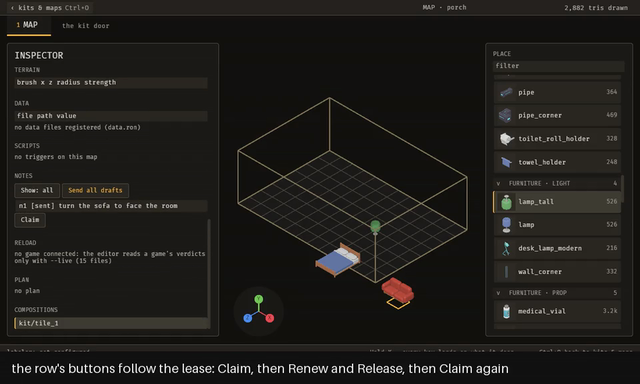</a>
- **e98-environment-data** `c1a546b` A map's climate, date, clock and forced weather are saved in bevy_elements' own types and applied to the preview *No clip: an API and data layer, the Environment panel is the next slice; proved by environment_applies*
- **d5-decision-labels** `8308239` Labelling can ask a decision model one yes/no question per vocabulary token (EMERGE_LABEL_PATH=decide), with the chat path kept until measured *No clip: an editor setting, no new surface; proved by decide_labels::tests*
- **notes-panel** `cff4207` A Notes panel lists every note newest first, filters by status, sends all drafts, and a row frames its note <a href="docs/changelog/media/2026-10-30-notes-panel.mp4">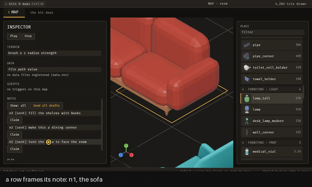</a>
- **115-run-ops** `9a88580` Runs are edited through operations: run_add, run_set (move an end, change pitch, corners, gaps) and run_remove, each undone by id; Shift-drag in run mode lays a run the map holds, dragging a run's end moves it, a removal click takes it off whole (#115 slice 3) *No clip: visible, not yet recorded: Shift-drag run tool not filmed this pass; proved by tests/runs_are_edited_through_operations.rs*
- **E-066** `cce6e36` Undo takes away a map that map_create made, and redo puts its file back *No clip: an undo behaviour with no new screen; proved by a_made_map_can_be_taken_away_by_undo*
- **86-data-panel** `pending` The Data panel lists every registered data file's leaves; clicking one opens the field with its file and path typed (#86) *No clip: visible, not yet recorded: panel not captured on a display this pass*
- **data-set** `a046add` data_set: an agent or a person sets one leaf of a game's tuning file, logged and undoable *No clip: visible, not yet recorded: no display session this pass; the operation is proved by data_set_is_an_operation*
- **115-rows-to-run** `c20aa71` Rows that are one line convert to a run: Map::placements_to_run (#115 slice 2) *No clip: an API; proved by maps_hold_runs::rows_a_run_laid_convert_back_to_the_run and a_row_off_the_pitch_does_not_convert*
- **111-check-view** `cfdaeda` Check view: the journal's button runs the project's checks on what is on screen; the answer lands there, one line a finding — or, with no model served, the endpoint that did not answer and which checks could not be asked (#111) 
- **runs-in-maps** `4cc8a12` A map can hold a run (a fence as one line, not its rows); rows are laid on load as <id>/<n> *No clip: an API / data change; proved by crates/bevy_emerge_core/tests/maps_hold_runs.rs*
- **d3b-after-edit** `01aae83` An agent's applied operation now owes the project's after-edit checks once; a person's own edit owes none (#111 slice 3) *No clip: an internal trigger; proved by tests/an_agents_edit_owes_checks_a_persons_does_not.rs*
- **decide-d3b** emerge_decide over MCP: a named check or ad-hoc typed questions, a probability for every answer (#111 slice 2) *No clip: an MCP tool; proved by crates/bevy_emerge_mcp/tests/decide.rs with a recorded stand-in*
- **D3a** `e2d2699` Checks as project data: checks.ron with five built-in checks (floating, clipping, out of area, blank frame, toast), findings 'floating 0.93 > 0.70' *No clip: an API and data format, no editor surface yet; proved by bevy_emerge_decide/tests/checks.rs*
- **D2** `2abe1eb` bevy_emerge_decide: typed yes/no, choice and score questions to a decision model, recorded-fixture replay, and threshold calibration *No clip: an engine-free API crate; proved by crates/bevy_emerge_decide/tests/decide.rs*
- **D1** `0373600` clef-flash serves typed decisions (probability per option) on the LAN: recipe and first recorded fixture *No clip: serving recipe and a fixture; proved by a recorded /v1/systemone request and response (0.187 s warm)*
- **notes-history-send** `67a0f31` Notes keep an append-only history and Send sends all drafts in one undo step (#90, part) 
- **n89-pieces** `9b6dc87` Note tool: Shift+N arms it, a rectangle dragged over the map opens a draft note on those cells, and Enter leaves it in the map's notes file with one undo step (#89) 

## 2026-10-28

- **96-hot-reload** `0c63869` A family crate's settings file edited on disk is reloaded in the editor within a second; an invalid edit keeps the last good settings (#96) *No clip: an API and a status line; proved by core tests/family_watch.rs and mapper tests/family_settings_reload.rs*
- **B-030** `b823a2f` Undoing a change made before a map rename now says which rename to undo first, not 'Open <old name>' *No clip: an error message; proved by tests/an_undo_across_a_rename_names_the_rename.rs*
- **96-family-set** `8929fe4` family_set: an agent changes one field of a family crate's settings — here `bevy_elements`' `clock.hour`, which the preview follows from noon to dusk — undoable (#96) 
- **f0-family-feature** `dc7cbbe` bevy_elements is an optional cargo feature pinned by git rev; a family.ron crate the build lacks is a status problem (#96) *No clip: an API and a cargo feature; proved by crates/bevy_emerge_mapper/tests/family_host.rs*
- **family-set-field** `5158321` family::set_field: write one field of a crate's settings RON, comments kept, old value returned for undo (#96) *No clip: an API; proved by crates/bevy_emerge_core/tests/family.rs*
- **F0-family-ron** `pending` family.ron: a project names the family crates it uses, and one it lists but the build lacks is a problem message (#96, data slice) *No clip: data and API; proved by crates/bevy_emerge_core/tests/family.rs*
- **#89-ops** Notes 1/7 (operations and Note tool): note_add, note_edit and note_remove are registered operations with undo; Shift+N arms a Note tool that drags a rectangle and opens a note box *No clip: visible, not yet recorded: no display on this pass; proved by tests/notes_are_operations.rs*
- **N1-core** `d614f62` Core notes can record an area: cells, world bounds, pieces, margin, camera, draft status (#89, data half) *No clip: an API; proved by crates/bevy_emerge_core/tests/note_areas.rs*
- **E-004** `ae13f82` Two agents writing one project's operation log can no longer claim the same sequence number or operation id *No clip: an operation-log internals fix; proved by two_writers_never_share_a_sequence_number*
- **S4.1** `383a00f` Notes for agents: the note data and its file beside the map *No clip: not visible: data and its file; proved by `crates/bevy_emerge_core/tests/notes.rs`*
- **S3.8** `ff89008` `bevy_emerge::live`: a running game reloads and respawns what changed *No clip: visible only in a running game, not in the editor; proved by `crates/bevy_emerge/tests/live_reload.rs`*
- **E-011** `edf7109` `emerge_state` carries the editor's frame clock *No clip: not visible: an MCP state field; proved by the tests in its commit*
- **S3.6** `9a493f9` `data_files`: a registry of game data files and type-keeping leaf edits *No clip: not visible: a core API; proved by the tests in its commit*
- **S3.5** `63c37f6` The game's verdict on a reload reaches the editor *No clip: not visible: an MCP state field; proved by the tests in its commit*
- **S3.4** `ac95eac` `--live` writes every change through to disk *No clip: not visible in the editor alone: a game that watches its project shows it; proved by the tests in its commit*
- **S3.3** `e95e0e6` `bevy_emerge_core::live`: FileWatch and diff_maps *No clip: not visible: a core API; proved by the tests in its commit*
- **S3.2** `3b254d7` A map is written one placement a line *No clip: not visible: the map file's format; proved by the tests in its commit*
- **S3.1** `868800b` The parity tables are product code (E-086) *No clip: not visible: a refactor; proved by the tests in its commit*
- **E-086** `868800b` The UI entry-point tables are product code, so a new operation needs no protected-file edit *No clip: not visible: a refactor; proved by the tests in its commit*

## 2026-10-27

- **Behaviour change (`089705f`, #82): a guest `on` a host lands on the host's lid.** `stack::surface_lift` now takes away the `align.y_offset` that `datum` already added, so the lid stands `extent.height` above the host's *base*. Hosts with no `y_offset` are unchanged. A consumer that compensated for the old arithmetic (declaring `ymax`, not `ymax − ymin`) now sinks guests into the lid by the host's `y_offset`. **Migration: declare `ymax − ymin`, not `ymax`.** *No clip: not visible: a placement rule, its documentation and a core API; proved by the tests in `089705f`*
- `Extent::height` is documented as base-to-top, independent of `y_offset` (#83). *No clip: not visible: a placement rule, its documentation and a core API; proved by the tests in `089705f`*
- `Library::height_disagreements(asset_root, tolerance_m)` compares every surface-offering descriptor's declared height with its glb and lists the ones that disagree, plus those it could not measure (#83). *No clip: not visible: a placement rule, its documentation and a core API; proved by the tests in `089705f`*
- **E-041** `203fbc3` A test can click a palette row *No clip: not visible: test harness; proved by the tests in its commit*
- **E-003** `8eecbe0` A kit's save re-reads that kit, not the whole project (kit hot reload) *No clip: visible, not yet recorded (backfill)*
- **E-020** `709d733` A preview is drawn at the draw level the piece lands at *No clip: not visible: draw ordering; proved by the tests in its commit*
- **E-060** `f0b2145` Every surface class gets its own 'or floor' mount *No clip: not visible: a kit data option; proved by the tests in its commit*

## 2026-10-26

- **E-049** `4cb7946` A chip click writes library.ron once, not twice *No clip: not visible: a file-write fix; proved by the tests in its commit*
- **E-050** `ee47069` Arriving on the Meshes shelf is a selection through `piece_select` *No clip: not visible: the same selection, now an operation; proved by the tests in its commit*
- **E-061** `477b721` A composed proposal is drawn piece by piece, not as a cell outline *No clip: visible, not yet recorded (backfill)*
- **E-079** `d27e452` A piece standing in a measured doorway is reported *No clip: not visible: a validator; proved by the tests in its commit*
- **E-076** `dfac080` After an agent's undo, the person can redo it (recorded on the 2026-10-28 build) <a href="docs/changelog/media/2026-10-26-E-076.mp4">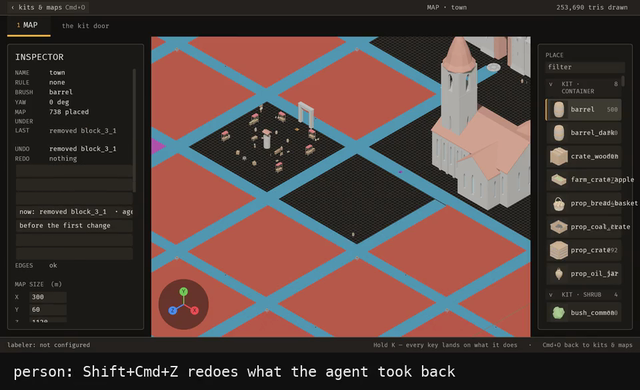</a>
- **E-082** `64e07a4` A rule weight that tunes no piece says so instead of reporting applied *No clip: not visible: a refusal message; proved by the tests in its commit*
- **E-068** `f2c5b34` The agent's steps are on screen, one row each *No clip: visible, not yet recorded (backfill)*
- **E-084** `0c5d95d` An agent's tool can take back its whole turn *No clip: not visible: undo ordering; proved by the tests in its commit*

## 2026-10-25

- **E-071** `8b27196` An agent's turn is one undo step *No clip: visible, not yet recorded (backfill)*
- **E-080** `bea3ee0` A layout proposal says how varied it is *No clip: not visible: a measurement in the proposal's report; proved by the tests in its commit*
- **E-081** `c560a45` `rules_set`: an agent changes a rule, and one Cmd+Z puts it back *No clip: not visible: a data edit with undo; proved by the tests in its commit*
- **E-073** `0597d83` An agent reads the rules a layout is generated from *No clip: not visible: an MCP read; proved by the tests in its commit*
- **E-074** `c989759` A whole-map overlap pass, and face directions by name *No clip: not visible: a validator; proved by the tests in its commit*
- **E-078** `a2ae442` `map_open` on the menu enters the editor on that map *No clip: visible, not yet recorded (backfill)*

## 2026-10-24

- **S2.4** `9831217` Series S-002 closed with a live proof through golem *No clip: not visible: a series close-out; proved by the tests in its commit*
- **S2.3** The acceptance script imports a .glb (`--glb`) *No clip: not visible: acceptance tooling; proved by the tests in its commit*
- **S2.2** `60912db` `piece_import`: an agent turns a .glb inside the project into a kit piece *No clip: visible, not yet recorded (backfill)*
- **S2.1** `68d06d0` `placement_add`: an agent places one piece (recorded on the 2026-10-28 build) <a href="docs/changelog/media/2026-10-24-S2.1.mp4">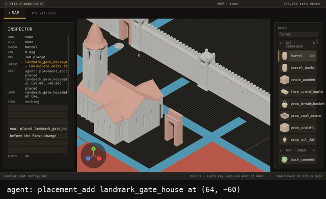</a>
- **S1.8** `9831217` Series S-001 closed: gate, acceptance, performance and live proof *No clip: not visible: a series close-out; proved by the tests in its commit*
- **S1.7** `7be7ffd` `emerge_present`: an agent puts its result in front of the person, with keep or undo (recorded on the 2026-10-28 build) <a href="docs/changelog/media/2026-10-24-S1.7.mp4">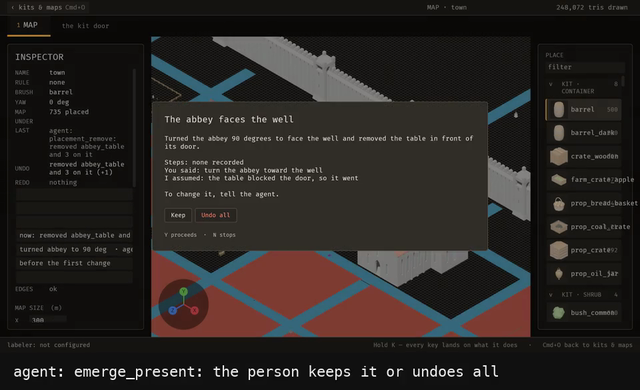</a>
- **S1.6** `b9d1a0f` `map_save`: an agent saves the map *No clip: not visible: a save; proved by the tests in its commit*
- **S1.5** `b9d1a0f` `fill`: an agent flood-fills (F for the person) (recorded on the 2026-10-28 build) <a href="docs/changelog/media/2026-10-24-S1.5.mp4">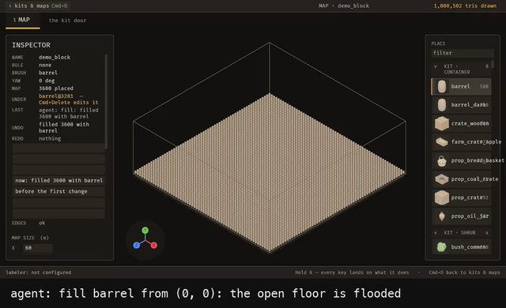</a>
- **S1.4** `2668fb4` `layout_accept` and `layout_discard`: keep or throw away a proposal (Enter, Esc) *No clip: visible, not yet recorded (backfill)*
- **S1.3** `2668fb4` `layout_propose`: an agent proposes a layout (G, Shift+G, Cmd+G for the person) *No clip: visible, not yet recorded (backfill)*
- **S1.2** `7df0d30` A context carries the standing proposal, and a row delta undoes itself *No clip: not visible: plumbing for S1.3; proved by the tests in its commit*
- **S1.1** `35699c5` One pure layout proposer behind every generate key *No clip: not visible: a refactor, behaviour unchanged; proved by the tests in its commit*
- **E-067** `11e18b0` `map_open`: an agent opens a map by name *No clip: visible, not yet recorded (backfill)*
- **E-065** `bb9884f` A capture sequence that runs behind its schedule applies its operation before it finishes *No clip: not visible: capture timing; proved by the tests in its commit*
- **E-064** `b5bc218` An effects write says when the vocabulary overruled it *No clip: visible, not yet recorded (backfill)*
- **E-063** `c998324` A label kind write says which effects it re-settled *No clip: visible, not yet recorded (backfill)*
- **E-062** `4b25016` A still read back over BRP says what the picture is, so a stale file is caught *No clip: not visible: capture plumbing; proved by the tests in its commit*
- **E-059** `c651cc1` The readout names which layer a two-way piece took *No clip: visible, not yet recorded (backfill)*
- **E-057** `9bf3698` A save writes only the fields that say something (maps 41% smaller) *No clip: not visible: the map file's format; proved by the tests in its commit*
- **E-054** `b8952b5` Making a map opens it in the same press *No clip: visible, not yet recorded (backfill)*
- **E-048** `a1e1ed6` An agent's kit edit says what it changed, in the door you are on *No clip: visible, not yet recorded (backfill)*
- **E-008** `dadb7ef` An agent can make a map; the chooser's new-map dialog goes through the operation *No clip: not visible: the same dialog, now a registered operation; proved by the tests in its commit*
- **E-005** `e5e5fc4` The enclosure wish and weight are the map's to set, not the editor's source *No clip: not visible: a map setting the layout reads; proved by the tests in its commit*

## 2026-10-23

- **E-044** `dbfc9c3` `piece_select`: an agent selects a shelf piece through the operation *No clip: visible, not yet recorded (backfill)*
- **E-042** `46b88f8` `label_set`: an agent sets a piece's label axis through the operation *No clip: visible, not yet recorded (backfill)*
- **E-040** The frame-the-map demo is cropped so the Home view fills the frame *No clip: not visible: demo tooling; proved by the tests in its commit*
- **E-037** `bc2c98b` An operation arms a brush piece, so an agent can arm one and its ghost preview follows it, drawn by the map and the library 
- **E-036** `47f1099` record.py stamps MCP events when the call starts, so captions stay in time *No clip: not visible: demo tooling; proved by the tests in its commit*
- **E-035** `83bdf63` The demo checker counts a frozen tail and MCP view changes correctly *No clip: not visible: demo tooling; proved by the tests in its commit*
- **E-018** `52d7f84` The undo history is a list, and a click jumps to any point in it <a href="docs/loop/iterations/assets/2026-10-23-cycle3-52d7f84/cycle3_history_click.gif">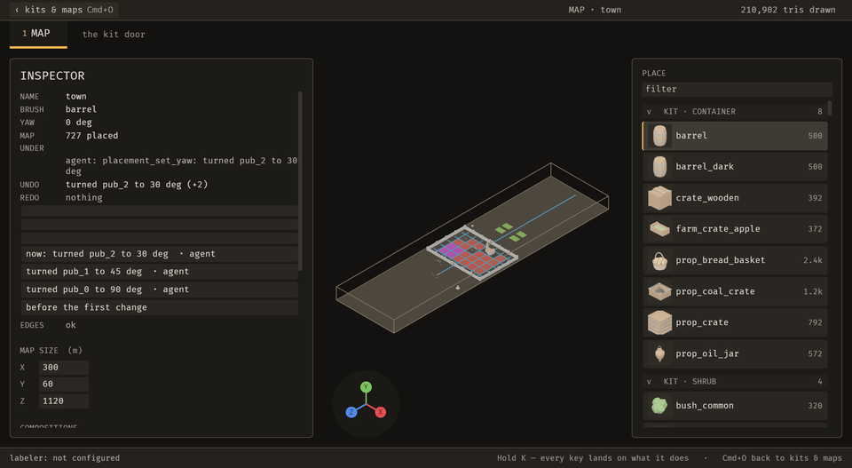</a>

## 2026-10-22

- **E-027** `4364dd4` One undo history takes back an agent's change too *No clip: not visible: one undo record instead of two; proved by the tests in its commit*
- **E-030** `12b8c26` `placement_remove`: an agent removes a piece and Cmd+Z puts it back <a href="docs/loop/iterations/assets/2026-10-22-12b8c26/remove-demo.gif">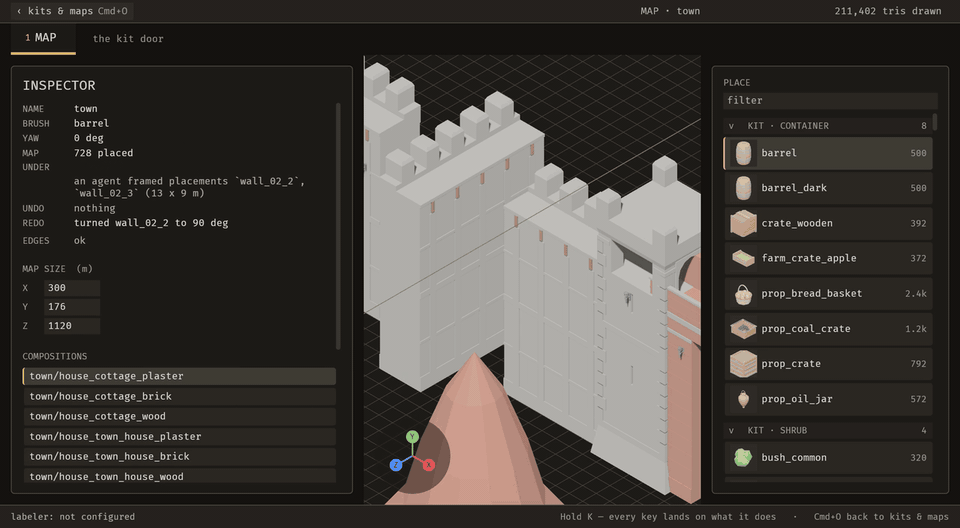</a>
- **E-014** `a5b4dc0` Snip: the person drags a rectangle over the editor and the agent receives the crop and where it is <a href="docs/loop/iterations/assets/2026-10-22-a5b4dc0/snip-gesture.gif">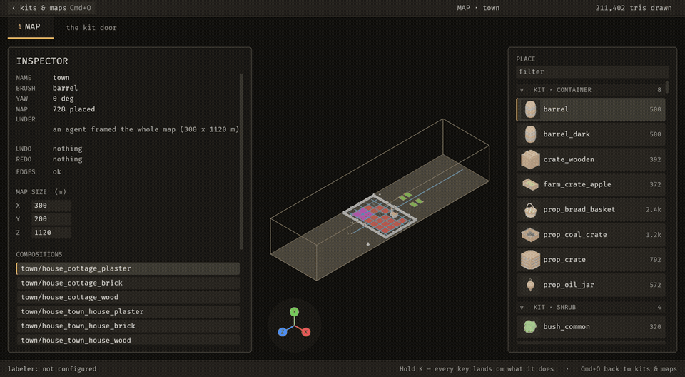</a>
- **E-034** `66e4069` The frame's documentation says a row's children need `Pickable::IGNORE` too *No clip: not visible: documentation; proved by the tests in its commit*
- **E-026** `77a7f60` `emerge_state` reports each placement's pin *No clip: not visible: an MCP state field; proved by the tests in its commit*
- **E-032** `f1f69ce` A box's stamp half and stamp_remove's undo are covered by tests *No clip: not visible: test coverage; proved by the tests in its commit*
- **E-029** `323965a` X's removal dispatches registered operations *No clip: not visible: the same removal, now a registered operation; proved by the tests in its commit*
- **E-021** `900a6e0` Home frames the locked placement, or the whole map <a href="docs/media/frame-the-map.gif">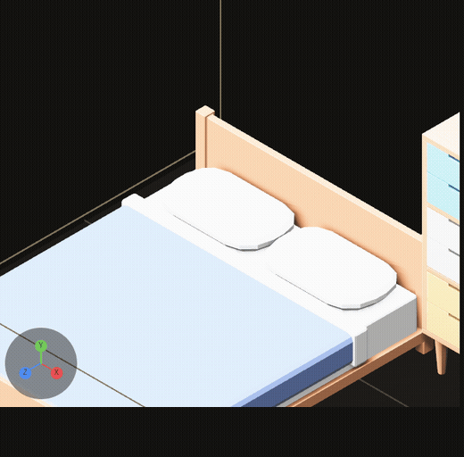</a>

## 2026-10-21

- **E-024** `885ba4a` One key action moved into the operation registry, so new person actions can follow *No clip: not visible: a registry migration; proved by the tests in its commit*
- **E-013** `602e1f3` The person's Cmd+Z takes back an agent's change <a href="docs/media/agent-removes-then-undo.gif">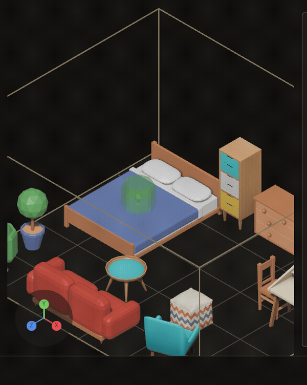</a>
- **E-025** `2109326` How a migrated key action leaves the enum without bypassing the typing guard (a design decision) *No clip: not visible: a design decision; proved by the tests in its commit*
- **E-022** `3834b0b` The Map opens framed on the map, not on an 18 m close-up of the origin  <a href="docs/changelog/media/2026-10-30-E-022.mp4">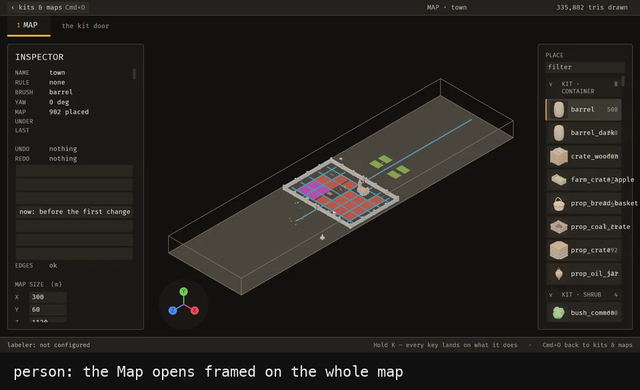</a>
- **E-017** `8c97677` An agent frames the view: the map, a placement, placements or a rectangle 
- **E-016** `63e6631` The inspector names what Cmd+Z and Cmd+Shift+Z will do <a href="docs/loop/iterations/assets/2026-10-21-63e6631/enh-after.gif">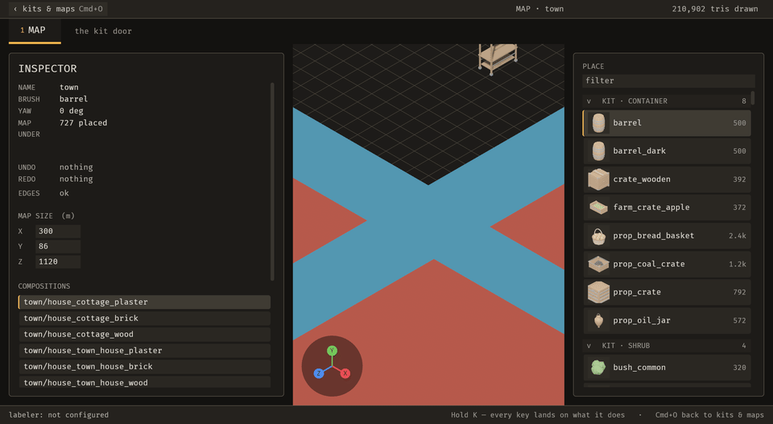</a>
- **E-010** `da9b549` Cmd+Z takes back a map-settings change, not only placements <a href="docs/changelog/media/2026-10-29-E-010.mp4">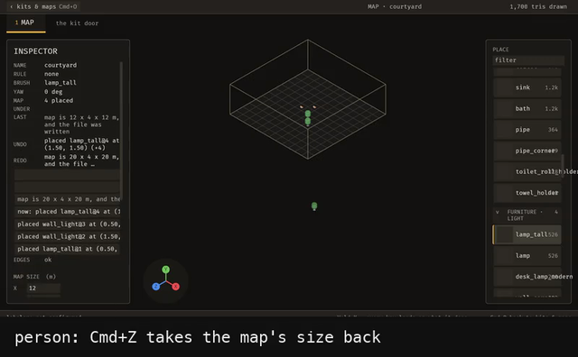</a>
- **E-009** `39ab825` `emerge_undo_operation`: an agent takes its own change back by its id <a href="docs/loop/iterations/assets/2026-10-21-556158d/enh-after.gif">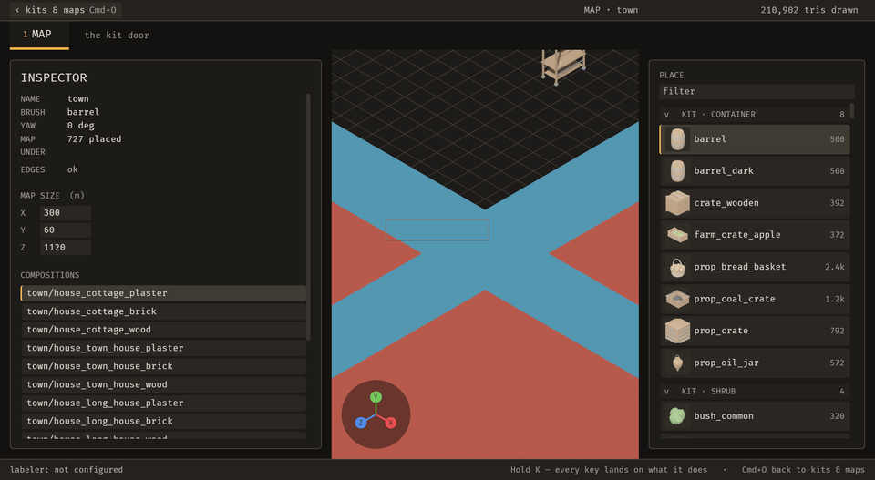</a>

## 2026-10-20

- **E-001** An agent drives the editor through typed operations over MCP, and the map file changes under it <a href="docs/media/agent-drives.gif">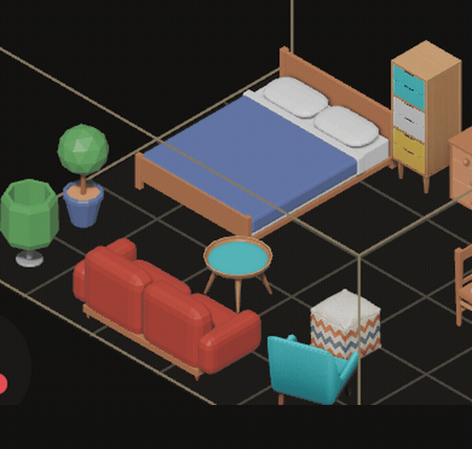</a>
