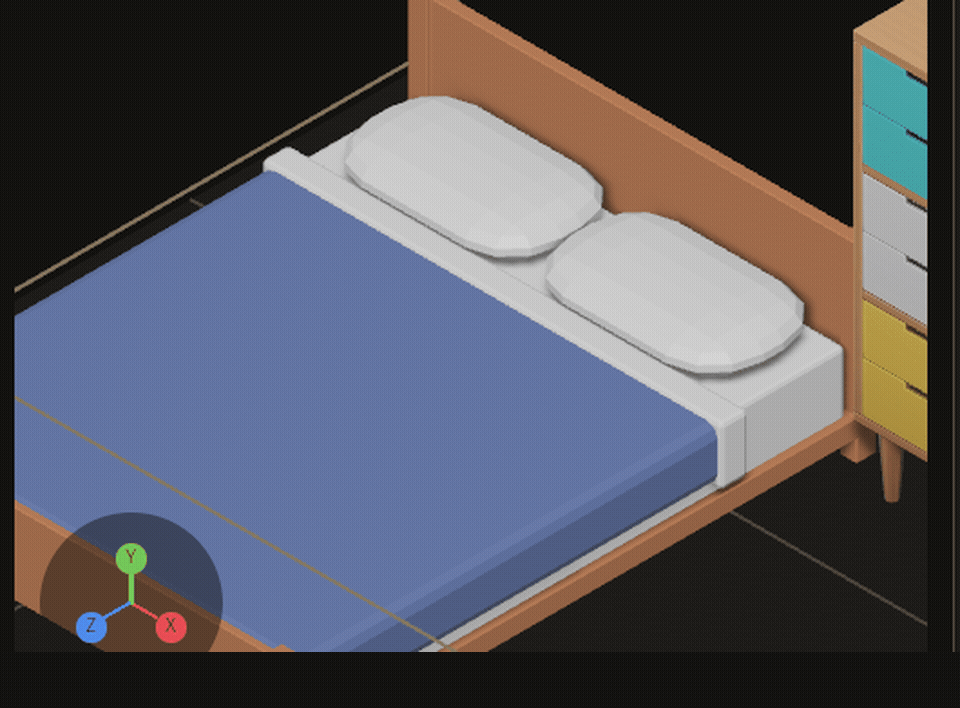
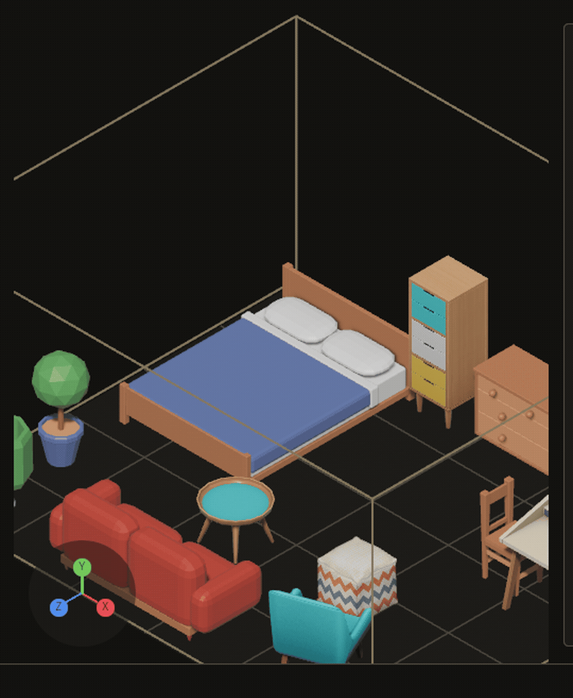
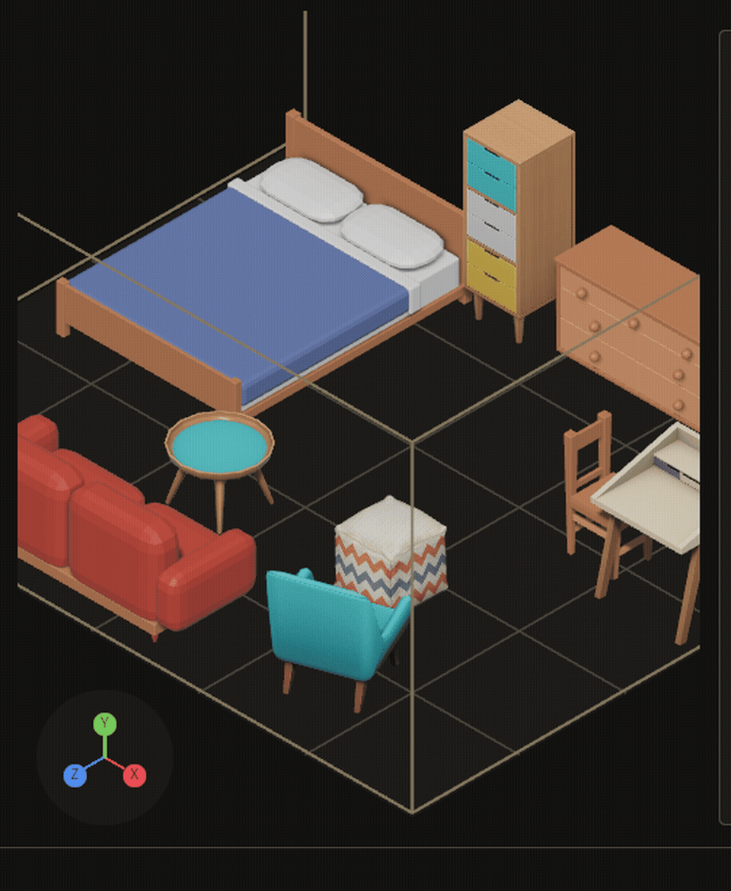

# Changelog

What each change added, newest first. A visible change has a clip: click the still to play it. `python3 tools/changelog/changelog.py page --open` plays them all in one page.

## 2026-11-01

- **202-versions-2** `0743196` A vocabulary, the repetition rules, a terrain file, a water plan, a water field and a volume now carry a version, and every reader refuses one it does not read: a file from a newer build was read as this build's, and an editor operation that reads with a plain ron::from_str and writes the whole file back (terrain_stroke, water_place, volume_edit) wrote it back at this build's shape; the refusal is now in the type's own deserialiser, naming the version this build reads (version 2 is not the 1 this build reads), a file from before the version reads as the first so no project on disk is rewritten, and what the editor writes carries version 1; 24 kinds are versioned and 5 are still not (the ratchet fell from 11) *No clip: an API and a refusal, nothing to see; proved by crates/bevy_grimoire_core/tests/a_format_that_gains_a_version_reads_the_files_it_did_not_have_one_in.rs and crates/bevy_grimoire_mapper/tests/a_terrain_water_or_volume_file_of_another_version_is_refused.rs*
- **202-rebuild** `2935a4b` The reload contract lists what will always need a rebuild, with the reason for each, and audits every format for a version: a rules.ron or destructible.ron from a newer build was read as this build's (a reload said applied for a rules file the project open refuses, and destructible_set would have written the marks back at the older version) and is now refused naming the version the build reads; 18 kinds are versioned, 11 are still not (a ratchet that only shrinks) and 4 are another crate's to version *No clip: an API and a verdict, nothing to see; proved by crates/bevy_grimoire_core/tests/every_format_carries_a_version.rs and the_always_rebuild_list_is_in_the_guide.rs*
- **201-follow** `20670d4` What points at a piece follows it when a live reload draws the piece again: a person is not a placement so a reload never draws them and their position and ties survive any edit to a piece, but a person's home (a society's Home(entity)) or a list of bound places names a placement, and a placement an edit draws again has a new entity, so every such reference named an entity that was gone; now the game registers once, on the app, GrimoireLiveApp::follow_respawn::<C>(|c, respawned| c.0 = respawned.follow(c.0)) and after a reload that drew a piece again the closure runs once for every C in the world (the new entity for a piece drawn again, the same entity for a kept or removed one), a component marked changed only when something moved; a closure and not MapEntities because a game cannot implement that for another crate's component; bevy_grimoire 0.3.0 *No clip: an API with nothing to see; proved by crates/bevy_grimoire/tests/live_references.rs*
- **201-migrate** `0150191` A game's state follows a piece a live reload draws again, through one hook per kind of state: a moved, turned or retyped placement gets a new entity and the old one is despawned, so a booking, an animation phase or a camera target on it was lost and every call site that edits a piece had to patch it; now the game registers once, on the app, GrimoireLiveApp::carry_across_respawn::<C>() (a component copied as it is) or migrate_on_respawn(|world, old, new| ...) (anything else), and the hook runs once for each piece drawn again (a rider drawn again with its host too, a piece renamed and drawn again under its new id) after the new entity is drawn and before the old one is despawned, and never for a piece the edit left alone or removed (bevy_grimoire 0.2.1; the in-place move, where a moved piece keeps its entity, needs the owner to change the assertion in live_reload.rs that pins a respawn) *No clip: an API for a game's own state, nothing to watch in the editor; proved by crates/bevy_grimoire/tests/live_migrate.rs (6 tests, the file did not compile before)*
- **201-rename** `d0c9f1a` A placement renamed in the project's files keeps its entity, and what a game hung on it, across a live reload: the game's GrimoireLivePlugin used to read a renamed placement as one removal and one addition, so a booking, an animation phase or a camera target on its entity was lost though the piece had not changed; now a placement whose id changed and whose row did not is a rename (MapDiff::renamed from the new diff_maps_renaming, found by content, paired only when unambiguous, riders on a renamed host and a stamp whose id changed follow), its Entity stays with the new id in its Placement, and a reload that writes the same content draws nothing *No clip: an API and a reload behaviour with no picture of its own (an entity id that does not change); proved by crates/bevy_grimoire/tests/live_identity.rs and crates/bevy_grimoire_core/tests/live_diff_renames.rs*
- **200-reference-family** `82f3e34` A referenced picture that is not a picture, and a family settings file that is not the crate's own type, are named instead of passing: a reference whose file a full disk cut off, a text saved over or another format renamed used to look fine until an agent opened it, and an elements or gooey settings file with a typo'd field was reported applied while the crate threw it away; now grimoire_state.reloads names the file and the field (kind reference_images: signature, format, header, width, height; kind family: clock, climate, accent), once per edit, the last good settings stay, and every kind in the registry has a reader that names its file and field (#200, H3) *No clip: a reload verdict and a status line, nothing to see; proved by core tests/a_reference_image_names_its_field.rs (5 tests), the editor's a_reference_image_that_does_not_read_is_named (4) and, with --features bevy_elements,bevy_gooey, family_settings_typed_verdicts (3)*
- **200-destructible** `d47626b` A destructible piece's damaged marks file or bake is named instead of overwritten: a hand edit that cut destructible.ron off, turned its version into a word or dropped pieces used to reach destructible_set as the parser's position with no field, and a bake that did not parse was baked again over the damaged bytes with no word; now reload_check reads both kinds in every build (the schemas moved into core), and destructible_set and destructible_hit refuse naming the file and the field (destructible.ron (pieces), destructible/site__cart.bake.ron (chunks[1].points)), write nothing, and leave the file as it is, while a bake made from another mesh is still baked again *No clip: a refusal's wording on an operation that reads a file, nothing to see; proved by core tests/reload_verdicts.rs (two more kinds, three bad files each), tests/a_destructible_file_names_its_field.rs, tests/old_data.rs (two frozen real files) and mapper tests/a_destructible_file_that_does_not_read_is_named.rs (4 tests, with the bevy_carnage feature)*
- **200-game-data** `ace7b65` A game's data file that no longer reads is named instead of silently dropping its rows: a hand edit that cut a tuning file off, turned a bounded leaf into a word or removed it used to leave the Data panel empty and data_set refusing without a file, and now grimoire_state.reloads names the file and the leaf (kind game_data, `mob.speed`, one verdict per edit, the reason says what a registered file is missing or holds), says needs_restart for an edit that reads (a running game uses it only if it re-reads its data) and applied when the file is back to the text it first had, reports the registry itself as data_registry, and data_set over a file that does not scan refuses naming the file and the leaf and leaves its bytes *No clip: a reload verdict and a refusal's wording, nothing to see; proved by tests/a_game_data_file_that_does_not_read_is_named.rs (6 tests) and core tests/a_data_file_names_its_leaf_and_field.rs (8 tests)*

## 2026-10-31

- **200-oplog-lines** `47777d7` A damaged line in oplog.jsonl is named instead of skipped without a word: a hand edit or a write cut short used to cost the author what that line recorded and say nothing, and now grimoire_state.reloads names the file, the line and the field of the first line that does not read (kind oplog, `line 3.seq`, `line 3.op` for a missing field, `line 3` for text that is not JSON, one verdict per edit, none for an append to a log that reads), the readers that skip still skip, and an undo past the line refuses naming it and writes nothing *No clip: a reload verdict and a refusal's wording, nothing to see; proved by tests/a_damaged_oplog_line_is_named_and_the_rest_still_reads.rs (4 tests) and core tests/a_json_lines_file_names_its_damaged_line_and_field.rs (7 tests)*
- **200-checks-view** `dc12659` A bad hand edit to checks.ron no longer stops every after-edit check: the editor holds the last good checks in memory, so a typo, a wrong type, a missing field or a threshold outside 0..=1 leaves the checks running as they were and grimoire_state.reloads names the file and the field (kind checks, one verdict per edit); a file that is there and cannot be read is refused, not treated as removed *No clip: a reload verdict and a held value, nothing to see; proved by tests/a_refused_checks_file_keeps_the_last_good_checks.rs (6 tests)*
- **200-old-data** `40b9698` An edit to a settings type that breaks the files already on disk is refused, naming the field: tests/old_data freezes one file of every kind check reads as a release wrote it (the first release's project files byte for byte, 0.3.0's for the rest) and reads each with the type's own reader, so a field added with no default, or removed while old files still carry it, fails naming the kind, the file, the field and the release; with a required field added to Standards the three-bad-files tests still passed and this one failed (#200 step 5, H3) *No clip: a schema-evolution check on settings types, nothing to film; proved by crates/bevy_grimoire_core/tests/old_data.rs (3 tests)*
- **200-needs-restart** `168a471` An edit to rigs.ron now says what became of it: the animation tab reads the manifest when it loads and holds it, so a hand edit used to do nothing and say nothing, and a broken one looked the same as a good one; grimoire_state.reloads now says needs_restart for a file that reads (the third outcome beside applied and refused: it is on disk, the tab keeps what it holds, change door and come back or restart), refused with the file and the field for one that does not read, once per edit however many frames pass, and the verdict clears when the file is put back or the door changes *No clip: an editor reload verdict, said in grimoire_state.reloads and once on the status line; nothing to film beyond a line of text; proved by mapper tests/a_rigs_edit_says_what_became_of_it.rs (5 tests) and core tests/a_restart_verdict_says_so.rs*
- **200-notes-and-family** `20872c1` A bad hand edit to a map's notes file no longer empties the signs and the Notes panel, and notes and family settings say what became of an edit: the editor holds the last good notes in memory, so a typo, a wrong type or a missing field leaves every sign and row as it was, and grimoire_state.reloads names the file and the field (kind notes, one verdict per edit); an edit to a family settings file is a verdict too (kind family: applied, refused with why while the last good settings stay, or gone) (#200 slice 5, H3) *No clip: an editor reload behaviour, a refused file leaves what is shown as it was; proved by tests/a_refused_notes_file_keeps_the_last_good_notes.rs and tests/family_settings_verdicts.rs*
- **200-tree-files** `0b3a0c9` A bad hand edit to a tree file no longer deletes the trees drawn from it: the forest view keeps the last good value of every .tree.ron in memory, so a typo, a wrong type or a field the crate does not know leaves the trees standing exactly as they were and the editor says which file and field in grimoire_state.reloads (kind trees, one verdict per edit), tree_edit refuses to write over a tree file it cannot read and names the file and the field, and an unknown field is named once (undergrow, not undergrow.undergrow); the unreadable kinds left on the editor's ratchet drop from 8 to 7 (#200 slice 4, H3) *No clip: visible, not yet recorded: no display on big; proved by mapper tests/a_refused_tree_file_keeps_the_last_good_tree.rs (the same tree entity after each of three bad edits, the field named, one verdict per edit however many frames pass, a good edit regrows it, a deleted file draws nothing and is not a refusal), the trees case of tests/a_file_that_does_not_read_is_never_overwritten.rs and core tests/an_unknown_field_is_named_once.rs*
- **200-unread-files** `c05f917` A forest, people or triggers file that does not read is never overwritten: forest_scatter, person_set and trigger_set read the map's file, change one row and wrote all of it back, and a file with a typo counted as no file, so one hand-edit mistake lost every other row; now the call is refused naming the file and the field and the bytes stay as they were, people_run says the same instead of 'nobody lives here', and the forest view decides its file once per edit into grimoire_state.reloads and keeps the trees drawn (#200 slice 3, H3) *No clip: an operation refuses a file it cannot read and leaves it as it was, and a view reports a verdict; nothing to film; proved by mapper tests/a_file_that_does_not_read_is_never_overwritten.rs*
- **loop-ship-audit** every loop pass is audited for what it shipped: commits on main, unpushed work, a release when the package changed, docs and demos, with what was missing, on each repo's loop-stats branch; the loops release every pass that changed the package *No clip: loop tooling and commands; proved by tools/loop/test_steps.py (8 tests) and the driver's test scripts*
- **200-editor-verdicts** `8f03593` A bad hand edit to a terrain, water or volume file no longer changes what the editor draws, and the editor says which file and field: the ground, the water and the carved volume each keep their last good value in memory, so water that does not fill its shape, a carve with no size or a field of the wrong type is refused with its field named, said once on the status line and in grimoire_state.reloads (applied or refused, the field, the reason, one number per edit), and a deleted file is no longer refused; the water plan, water field, volume and data registry join the kinds check can read, 15 unreadable kinds down to 11 (#200 slice 2, H3) *No clip: visible, not yet recorded: no display on big; proved by mapper tests/a_refused_terrain_file_keeps_the_last_good_drawing.rs (the same pool entity after a refused edit, the field named, one verdict per edit, a fix redraws, a removal clears the refusal) and core tests/reload_verdicts.rs (three bad files for each of 22 kinds)*
- **loop-step-times** every step of a loop pass is timed: tools/loop/steps.py reads the pass's omp session into ~/.local/state/wiggum/<clone>/steps.tsv after each pass, a pass marks its phases, and steps.py report ranks where a loop's time goes *No clip: loop tooling, nothing in the editor changes; proved by tools/loop/test_steps.py (6 tests) and the driver's own four test scripts*
- **129-piece-remove** `237e9ac` Delete on a library piece sends it back out of the library through piece_remove, the operation an agent calls: an agent can take a piece out (refused while a map places it or a composition holds it, nothing written), Delete writes one log line, one Cmd+Z puts the whole piece back where it stood and Cmd+Shift+Z sends it out again, and the shelf follows either front end (#129 slice 8) *No clip: an operation behind a key that already existed; proved by tests/piece_remove_is_an_operation.rs (an agent's removal and undo, refusals write nothing, a preview, a person's Delete, Cmd+Z and redo) and operations_have_two_front_ends::*
- **129-pack-set-excluded** `9e310f2` Shift+R leaves a pack out of the kit, or brings it back, through pack_set_excluded, the operation an agent calls: an agent can say a folder of art is not what the kit is built from, a bad or missing folder is refused with nothing written, the key writes one log line and one Cmd+Z takes the newest press back (even after the folder is gone), and a bare undo no longer risks taking it for the map's (#129 slice 7) *No clip: an operation behind a key that already existed; proved by tests/pack_set_excluded_is_an_operation.rs (an agent's exclusion and undo, refusals write nothing, a restore undone after its folder is deleted, a bare undo, a person's Shift+R and Cmd+Z) and operations_have_two_front_ends::*
- **129-piece-set-mount** `7898146` M sets a library piece's mount through piece_set_mount, the operation an agent calls: an agent can say where a piece goes, M steps past rungs the project would refuse, one log line and one Cmd+Z per press, and a bare undo no longer takes a library change for the map's (#129 slice 6) *No clip: an operation behind a key that already existed; proved by tests/piece_set_mount_is_an_operation.rs (an agent's mount and undo, refusals write nothing, a person's M and Cmd+Z, a bare undo) and operations_have_two_front_ends::*
- **200-per-file-verdicts** `5832f5b` A running game that refuses a reload says which file and which field: the verdict it writes (.live/game.ron, version 2) has one applied or refused entry for every file the load reads, with the kind, the path, the field (version, placements[3].at[1]) and the reason, a sequence number so one edit is one verdict however many frames pass, and a refused edit still changes no entity and no world; grimoire_state.game and the journal carry it (#200 slice 1, H3) *No clip: an API and a file format an agent reads, nothing a person sees; proved by core tests/reload_verdicts.rs (three bad files for each of 18 kinds), bevy_grimoire tests/live_verdicts.rs (the game keeps its entities and world, one verdict per edit) and the mapper's the_games_per_file_verdicts_reach_grimoire_state*
- **199-atomic-writes** `2d7fdf7` Every write of a project file is atomic: a reader (the running game, the editor's watcher) sees the old file or the new one, never half of either. One write path, bevy_grimoire_core::atomic_file, writes a uniquely named hidden temp file beside the target, flushes it, renames it over the target and flushes the directory; 19 plain writes (terrain, water, volume, forest, trees, people, scripts, family, game data, destructible, reference images, kits.ron and vocab.ron at creation, and two caches) moved onto it, and a ratchet test fails on a new one (#199) *No clip: an I/O guarantee with nothing to see; proved by core tests/atomic_writes.rs (a reader thread over 10,000 replacements, a child process killed at 40 random points, four writers of one path) and tests/atomic_writes_only.rs*
- **198-reload-contract** `19bd4d2` The reload contract: every kind of file the editor writes (33 kinds) has a reload class (Live, Respawn or Restart) and a lifetime (global or per map) in bevy_grimoire_core::reload, each operation declares the kinds it writes, and docs/guide/reload-contract.md is the audit table rendered from them; a kind with no class fails every_written_kind_has_a_reload_class and a kind that joins Restart off the checked-in list fails the_restart_list_only_shrinks (#198, H1) *No clip: an audit table and two ratchet tests, no editor surface; proved by crates/bevy_grimoire_core/tests/reload_contract.rs (3 tests) and crates/bevy_grimoire_mapper/tests/reload_contract.rs (4 tests), each ratchet shown failing on a mutated list*
- **193-viewport-under-sky** `ed2bec0` With a family/bevy_elements.ron the editor's viewport draws the map's box and grid under the elements sky instead of one flat colour: the interface camera no longer copies the ground colour back over the world (#193, #194) 
- **129-placement-set-pose** `0f79607` V straightens a placed piece through placement_set_pose, the operation an agent calls: an agent can set a piece's turn and tip in one change, V writes one log line and one Cmd+Z takes both back (#129 slice 5) *No clip: an operation behind a key that already existed; proved by tests/placement_set_pose_is_an_operation.rs (an agent's pose and undo, refusals write nothing, a person's R, Y, V and Cmd+Z) and operations_have_two_front_ends::*
- **196-f32-undo** `ad69737` Undo no longer refuses a turn to 3.9 degrees (or any f32 the log's text spelled one step off) as an edit outside the log: the log is read back with serde_json's exact float parser (#196) *No clip: a fix in how the operation log's numbers are read; proved by tests/an_f32_in_the_log_still_undoes.rs (a turn to five yaws and a settings change, failing before)*
- **coven-docs** the README follows the bevy-coven documentation guide: the Vibe Coded banner, badges, Status and Why lines, a still beside the GIF, the Familiar named, and the 64-second demo moved to the book page *No clip: a README and docs change; the README's GIFs are unchanged and the demo video now plays on bevy-coven.github.io/crates/bevy_grimoire.html; proved by every image URL answering 200*
- **grimoire-solver-0.1.1** bevy_grimoire_solver 0.1.1 on crates.io: its docs.rs page shows the N-queens GIF, now an absolute URL *No clip: a release whose only change is the README image URL; proved by the docs.rs page's image answering 200*
- **grimoire-rename** `8ade561` the editor is Grimoire: crates bevy_grimoire_*, MCP tools grimoire_*, env vars GRIMOIRE_*, and the project data folder assets/grimoire; a project still in assets/emerge is moved once when the editor opens it, and refused when both folders exist *No clip: a rename; the only new pixels are the word Grimoire in the window title and the menu's chrome bar; proved by bevy_grimoire_core/tests/a_project_in_assets_emerge_is_moved_once.rs*
- **129-placement-set-lift** `8455e35` [ and ] lift a placed piece through placement_set_lift, the operation an agent calls: an agent can raise a lamp off its table, the pieces resting on it ride with it, and it is undone like any other (#129 slice 4) *No clip: an operation behind two existing keys, nothing new to see; proved by tests/placement_set_lift_is_an_operation.rs*
- **179-busy-poll** `9b10173` emerge_capture_sequence keeps waiting when the busy editor misses one status poll's 5 s budget, instead of abandoning the clip (#179) *No clip: a fix to the MCP server's capture-sequence poll; proved by bevy_emerge_mcp/tests/a_slow_status_poll.rs*
- **E-006-publish-bevy_emerge_anim** `dd1fc52` bevy_emerge_anim 0.1.0, which blends clip weights on a skinned rig's animation player, is on crates.io: with it every crate a game links is on the registry (#128) *No clip: a release to crates.io, nothing to see in the editor; proved by the crates.io index entry for bevy_emerge_anim 0.1.0 (pubtime 2026-10-31T01:57:45Z) and the bevy_emerge_anim-v0.1.0 tag*
- **129-placement-set-tip** `aab1f59` Y and U tip a placed piece through placement_set_tip, the operation an agent calls: an agent can lay a piece on its side, and it is refused for the same reasons a person is (a host, an unmeasured piece) (#129, slice 3) *No clip: an operation behind keys that already existed; proved by placement_set_tip_is_an_operation:: (agent tip and undo, refusals write nothing, Y is one log line and one Cmd+Z) and operations_have_two_front_ends::*

## 2026-10-30

- **E-006-publish-solver-core-snip** `45309d9` bevy_emerge_solver, bevy_emerge_core and bevy_emerge_snip 0.1.0 are on crates.io (rng was already): a game links them from the registry instead of a path (#128) *No clip: a release to crates.io, nothing to see in the editor; proved by cargo publish verify builds of the packaged crates (solver 9 s, core 7 min, snip 3.5 min) and the tags bevy_emerge_solver-v0.1.0, bevy_emerge_core-v0.1.0, bevy_emerge_snip-v0.1.0*
- **189-stamp-yaw** `7f2239b` stamp_add's yaw is degrees, and its schema says so: an agent's quarter turn (90) turns a stamped composition a quarter turn, not 1.57° (#189) *No clip: an operation schema's unit; the editor's own stamp click already sent degrees, so nothing on screen changes; proved by tests/a_stamp_turns_by_the_unit_its_schema_names.rs*
- **188-relations-end-stack** `7a29aee` A relation's end is its whole stack: a jug on the counter no longer blocks the counter's ClearInFront, nor the stall a sign hangs on its VisibleFrom (#188) *No clip: a fix to two relation checks in core; proved by crates/bevy_emerge_core/tests/a_relations_end_is_its_whole_stack.rs*
- **192-solve-in-area** `3b4598a` A generate can be asked to lay only inside an area: core grammar::solve_in and solve_constrained_in fill the area's cells, join the pieces around it, and leave the rest of the map as it is *No clip: an API (core grammar::Area, solve_in, solve_constrained_in), not yet reachable from the editor (slice 2); proved by crates/bevy_emerge_core/tests/a_generate_lays_only_inside_its_area.rs*
- **E-006-publish-bevy_emerge** `2633021` bevy_emerge 0.1.0, the runtime crate that spawns a map in a Bevy world, is on crates.io: a game adds it with cargo add bevy_emerge instead of a path (#128) *No clip: a release to crates.io, nothing to see in the editor; proved by the crates.io index entry for bevy_emerge 0.1.0 (created 2026-10-31T01:11Z) and the bevy_emerge-v0.1.0 tag*
- **B-187-terrain-shape** `d2d9762` A terrain file whose heights do not fill its shape (a hand edit, a truncated write) no longer panics the editor: it draws no ground, names terrain/<map>.ron on the status line, and terrain_stroke and water_run refuse it (#187) *No clip: a bug fix: what it removes is a panic; proved by bevy_emerge_core/tests/a_terrain_file_that_does_not_fill_its_shape_is_refused.rs and the editor's a_terrain_file_that_does_not_fill_its_shape_is_refused::*
- **186-long-pieces-half-turn** `bcb413e` repetition_vary turns a long clutter piece (a bench, a cart) only a half turn, so it never lands on cells it did not cover *No clip: a fix to repetition_vary's plan (which copies turn, and by how much); proved by crates/bevy_emerge_core/tests/vary_never_turns_a_long_piece_off_its_cells.rs*
- **103-overlay** `1768ce8` The light map is drawn over the open map: a LIGHT MAP button shows bevy_light_grid's field, blue where dark and amber where lit, and it follows the map as torches are lit (#103) *No clip: visible, not yet recorded: owed with #103's night clip (a street at night, two torches, the light map changes); proved by tests/light_overlay.rs*
- **103-pool** `1e73078` light_pool operation: which placed fixtures are real lights from a viewer position, read from bevy_lights' own pool budget (#103) *No clip: an operation's numbers; proved by tests/light_pool.rs*
- **102-forest-view** `06f6e5b` The planted forest is drawn in the viewport with bevy_flora's own trees: scattered trees from the species' pool, placed trees grown with their own seed and age, regrown within half a second of a forest or .tree.ron edit (#102) 
- **B-021** `a8c87ac` A click on the chrome around the viewport (the door strip, the status band) no longer places the armed piece far off the map, unseen (#182) *No clip: a bug fix: what it removes is a placement nobody could see; proved by tests/a_click_outside_the_viewport_places_nothing.rs*
- **184-round-repeats** `9a013de` repetition.ron's round kinds: a barrel or a pot repeats at any turn, and repetition_vary never turns one but counts it as left *No clip: a repetition rule in a project data file (agent and REPEATS line read it); proved by crates/bevy_emerge_core/tests/a_round_piece_repeats_at_any_turn.rs*
- **183-inside** `149f032` Relations: Inside keeps a piece inside an area of another (a table on the rug, a stall in the square), and relations solve sets it just inside *No clip: a relation kind and its RELATIONS row text; proved by bevy_emerge_core/tests/a_piece_inside_an_area.rs*
- **180-pointer-read-first** `c488d07` A click lands where the cursor is this frame: the pointer is read before every Update system, so the Note tool's second Shift-click no longer takes the first piece back out (#180) *No clip: an input-ordering fix with nothing new on screen; proved by the_pointer_is_read_before_anything_acts_on_it and 51 of 51 batch runs of a_person_shift_clicks_two_pieces_into_one_note*
- **181-backs-onto** `e6ce312` Relations: BacksOnto keeps a piece with its back to another (a bookshelf against a wall, anywhere along it), and relations solve turns it out from the wall *No clip: a relation kind in relations.ron and its RELATIONS row text; proved by bevy_emerge_core/tests/a_piece_backed_onto_another.rs*
- **177-note-box-on-screen** `ee0ce2b` While a note is typed, the Inspector scrolls its text (LAST: the words, the caret, [auto]) back on screen, even when it was scrolled down to NOTES 
- **95-notes-end-to-end** `59193ea` Notes end to end on a game's map: a person leaves three notes (an area, two Shift-clicked pieces, one piece), two agents work them at once inside their fences, a removal waits for the person's answer, and the person keeps two and undoes the third in one step (#95) 
- **173-second-shift-click** `59193ea` The Note tool's second Shift-click adds its piece to the open note, so one note can name a group of pieces (#173) 
- **101-cover** `48272bf` The carved ground wears snow and wetness from the environment file: volume_cover, bevy_elements' SurfaceCover, is put on the chunks' WeatheredMaterial and follows a family_set live (#101) *No clip: visible, not yet recorded: no display on big; proved by volume_wears_its_cover (--features volume_snow)*
- **171-stress-state** `08ac0a1` emerge_state.stress tells an agent whether the kit can loop a hallway back (ring) and open into a room (room), with each piece and its turn *No clip: an emerge_state section for agents; proved by crates/bevy_emerge_mapper/tests/emerge_state_says_whether_the_kit_loops_and_opens_into_a_room.rs*
- **95-undo-removal** `d5d5132` Undoing a note whose agent removed a piece puts the piece back in one step, instead of refusing *No clip: a fix to note_undo_work's reading of a removal's undo; proved by notes_end_to_end::two_notes_kept_and_one_undone_leave_the_map_file_with_only_the_kept_work; #95's end-to-end clip will show it*
- **168-unnested-pane** `c862f0a` The Meshes pane's standards row names each pair of sub-kit modules that do not nest which the piece in focus is part of, in emerge_state's words (#168 slice 3) 
- **167-degrees** `a67d95b` Relations: #167's acceptance (AlignedWith 0/20 met, 0/90 unmet, 350/10 met; Faces at every quarter turn as drawn) proved against the map's degrees *No clip: a regression test for what relations measure on a turned piece; proved by bevy_emerge_core/tests/relations_read_a_maps_yaw_in_degrees.rs*
- **170-mirror** `cee3587` Relations: MirrorOf keeps a piece opposite another across a third's axis (a pair of lamps flanking a door), and relations solve sets it there *No clip: a relation kind in relations.ron and its RELATIONS row text; proved by bevy_emerge_core/tests/a_piece_kept_mirrored_across_another.rs*
- **e002-composition-rename** `7828e55` composition_rename: an agent renames a composition, every stamping map follows, and undo puts it back; the COMPOSE tab's I field dispatches it *No clip: an operation for an existing verb, no visible change; proved by tests/composition_rename_is_an_operation.rs*
- **release-publishable-set** `5cd5fbc` The game-facing crates (solver, core, snip, bevy_emerge, anim) package for crates.io; the editor and MCP server are marked unpublished *No clip: build metadata; proved by cargo publish -p bevy_emerge_solver --dry-run and cargo package --list*
- **e002-composition-arm** `a97b657` composition_arm: an agent arms a composition through the operation the picker and COMPOSE Enter now dispatch *No clip: an operation for an existing verb, no visible change; proved by tests/composition_arm_is_an_operation.rs*
- **168-unnested-state** `9d69ab4` emerge_state.standards lists unnested, the pairs of sub-kit modules that do not nest, re-read from standards.ron on every call (#168 slice 2) *No clip: an MCP read, no editor surface changed; proved by crates/bevy_emerge_mapper/tests/emerge_state_names_modules_that_do_not_nest.rs*
- **168-unnested-core** `e465bcf` Kit standards name the sub-kit modules that do not nest: standards::unnested pairs rules whose modules are not whole multiples of each other, with the run on which they meet again (#168 slice 1) *No clip: an engine-free core API; proved by crates/bevy_emerge_core/tests/a_kit_names_modules_that_do_not_nest.rs*
- **165-degrees** `df938a1` Relations read a map's yaw in degrees: a piece in front of a turned door is in front of it, and relations solve writes degrees back *No clip: a fix to what relations measure and write on a turned piece; proved by bevy_emerge_mapper/tests/relations_read_a_turned_piece_in_degrees.rs*
- **163-beside** `ab5a504` Relations: LeftOf and RightOf keep a piece beside another (a lamp left of the door), and relations solve sets it there *No clip: a relation kind in relations.ron and its RELATIONS row text; proved by bevy_emerge_core/tests/a_piece_kept_beside_another.rs*
- **166-options** `684e580` A block offers several distinct layouts on request: rules::options keeps up to N that each differ from the others in at least a given number of cells, each chosen by the seed that rebuilds it *No clip: a core API; proved by bevy_emerge_core/tests/a_block_offers_distinct_options.rs*
- **158-created-file** `b0e7a8f` A project file written for the first time while the editor is open (repetition.ron, standards.ron, rules.ron, compositions.ron) is read at once, not after a second edit (#158) *No clip: a watcher fix, seen in the E-090 clip's second step; proved by tests/a_project_file_created_while_open_is_read.rs*
- **162-room** `273b5b0` A kit says whether it can open a hallway out into a room: adjacency::room builds the smallest room with a middle, nine pieces with every inner seam declared, or says there is none *No clip: a core API; proved by a_kit_says_whether_it_can_open_into_a_room*
- **forest-season** `c0a2402` Trees follow the map's date: the preview's FloraSeason turns blossom, green, autumn, snow with the month, shifted for the south (#102) *No clip: visible, not yet recorded: no display, the editor does not draw flora yet; proved by forest_season tests*
- **102-tree-editor** tree_edit: start a tree from a bevy_flora preset and tune any field by path, written as a project .tree.ron the crate's loader reads, one undo per edit; terrain-field line `tree <name> [preset] [field=value]` (#102) 
- **forest-place** `72be365` Place one tree by hand with an age and a seed (forest_scatter's place); the same seed grows the same tree *No clip: an API; proved by tests/forest_place.rs*
- **161-behind** `93d1c20` Relations: Behind keeps a piece behind another (a chest behind the counter), and relations solve sets it there *No clip: a relation kind in relations.ron and its RELATIONS row text; proved by bevy_emerge_core/tests/a_piece_kept_behind_another.rs*
- **160-ring** `eb75d90` A kit says whether it can loop a hallway back: adjacency::ring builds the smallest closed loop of four pieces, or says there is none *No clip: a core API; proved by a_kit_says_whether_it_can_loop_a_hallway_back*
- **159-between** `7523243` A relation keeps a piece between two others (a table between two chairs), and relations solve sets it there 
- **session-per-turn** `c6628e3` session::score measures an agent per turn: asking on a clear request or acting on a vague one, and a later turn breaking an earlier turn's relation *No clip: an engine-free API; proved by bevy_emerge_core/tests/a_session_scores_each_turn.rs*
- **relations-aligned-with** `8777873` Relations: AlignedWith keeps a piece on another's heading (a row of pews), and relations solve turns it there in place 
- **153-options** `8c44207` An agent asked for options gets distinct layouts, each with the seed that lays it (layout_propose options) *No clip: an MCP operation parameter; proved by tests/a_proposal_offers_options.rs*
- **152-clockscrub-door** `a17d0ea` With bevy_elements on, the Environment panel's held hour is released when the door changes, and the feature's tests are green *No clip: a resource classification; proved by every_resource_says_what_a_door_does_to_it with --features bevy_elements*
- **relations-hard** `15698c2` A relation can be hard: relations solve never breaks it to mend soft ones, and names the relations it left unmet 
- **relations-reachable-from** `abf6439` Relations: ReachableFrom, a walk from one piece to another round whatever stands between, and solve opens a sealed one 
- **gooey-skin** `fe2d94f` A project's family/bevy_gooey.ron is the running UI skin: a partial file restyles bevy_gooey widgets live, and a bad file or a WCAG failure is a status-line problem (#147) *No clip: visible, not yet recorded: no display on big; proved by family_gooey_skin*
- **relations-along** `e8b7fe0` A relation keeps a piece beside a path through other pieces: Along names how far off it stands, and relations solve brings it back 
- **dead-end-closest** `d29b77c` A kit's dead end names the piece nearest to closing it and the cells it gets wrong 
- **relations-visible-from** `96d335e` A relation keeps a sight line clear: VisibleFrom names the piece in the way, and relations solve moves it off 
- **E-142-2** `6665972` The Meshes pane and emerge_state name every kit face no piece can meet (dead ends) 
- **143-repetition-vary** `2fad900` repetition_vary and the Terrain line `repeats vary` turn the clutter copies that repeat visibly, never structure, with one undo 
- **E-142-1** `dd539fc` A kit names every edge face no piece of it can meet (adjacency::dead_ends) *No clip: an API with no editor surface yet; proved by tests/a_kit_names_every_face_nothing_can_meet.rs*
- **B-140** `92b2dc0` A piece despawned in the frame its materials arrive no longer panics the editor (#140) *No clip: a crash fix; proved by crates/bevy_emerge/tests/paint_on_a_despawned_piece.rs*
- **e088-inspector-relations** `d1264c8` The Map inspector's RELATIONS row names how many intended relations the open map breaks and the first one, live as the file changes 
- **E-091** `1dfe893` emerge_list_operations takes a query: an agent finds an operation by searching, best first, instead of reading all 64+ *No clip: an MCP/BRP API; proved by tests/an_agent_can_search_the_operations.rs*
- **E-090** `e8f9edf` A project's repetition.ron decides which kinds are structure and how far a repeat is seen; emerge_state and the REPEATS line follow an edit live 
- **E-089-4** `4c4144f` The Meshes pane names the project standards the selected piece breaks, and an edit to standards.ron reaches it live 
- **137-relations-solve** `009a7e5` relations_solve and the Terrain line `relations solve` move the pieces of a map's broken relations, with one undo 
- **106-balloon** `pending` Dialogue preview balloon: the lines a dialogue <name> walk says are drawn as one balloon over the piece that carries the conversation, following the camera (#106 slice 6) 
- **138-import-standards** `d2a3ee9` piece_import names which of the project's standards the imported piece breaks *No clip: an MCP answer field; proved by tests/an_imported_piece_names_the_standards_it_breaks.rs*
- **E-089-s2** `a23ba4b` emerge_state names the kit pieces that break the project's standards.ron, and the rules that cover no piece (#138 slice 2) *No clip: an MCP read, no editor surface changed; proved by crates/bevy_emerge_mapper/tests/emerge_state_reports_standards_breaches.rs*
- **137-solve** `4353041` relations::solve nudges pieces until a map's intended relations hold, never breaking one to mend another *No clip: an engine-free API; proved by crates/bevy_emerge_core/tests/a_solver_mends_broken_relations.rs*
- **E-089-s1** `3abf44f` Kit standards: a project's standards.ron says which pieces break its module, door opening or storey height (#138 slice 1) *No clip: an engine-free core API; proved by crates/bevy_emerge_core/tests/a_kit_says_which_pieces_break_its_standards.rs*
- **e088-relations-state** `4f79e81` emerge_state names the intended relations the open map breaks, read live from <map>.relations.ron *No clip: an MCP read (emerge_state.relations); proved by crates/bevy_emerge_mapper/tests/emerge_state_reports_broken_relations.rs*
- **E-087-inspector** `50e9fa6` The Map inspector's REPEATS row names the repeat a player will notice first, and how many other looks repeat 
- **E-088** `9747292` Layout relations: a map says which intended relations (faces, near, apart, in front of, clear in front) its placements break, and by what *No clip: a core API, not yet drawn in the editor; proved by crates/bevy_emerge_core/tests/a_map_says_which_relations_it_breaks.rs*
- **E-087b** `0b4323b` emerge_state names the repeats a player will notice: repeated clutter first, structure after *No clip: an MCP state field; proved by tests/emerge_state_names_visible_repeats.rs*
- **e075-drop** `4417f4d` Dropping an image on the editor window keeps it as a reference of the open map, copied into the project's references/ *No clip: visible, not yet recorded: no display on big*
- **136-repetition** `bdafe68` Role-weighted repetition: a map reports which repeated pieces a player will notice, clutter above structure *No clip: an engine-free API with no UI yet; proved by tests/repeated_clutter_outranks_repeated_structure.rs*
- **E-070-chip** `be3b1d7` A note the agent may decide for itself shows an 'auto' chip on its row in the Notes panel (E-070) 
- **E-083** `cc725d4` Generating from compositions on a project with no tile says which groups were left out and why, instead of 'nothing has been placed yet' *No clip: an error message from the composition grammar; proved by crates/bevy_emerge_core/tests/a_tileless_composition_set_says_why.rs*
- **e069-plan-panel** `e9d70f9` The Inspector's PLAN section shows the agent's plan: a count and one numbered row per step with its status 
- **105-scripts-panel** Scripts panel: every trigger of the open map is a row in the editor; a row opens the terrain line to edit it (#105) *No clip: visible, not yet recorded: no display on big; proved by tests/the_scripts_panel_lists_the_maps_triggers.rs*
- **E-043** `3b5e8b0` label_suggest and label_apply: an agent asks the VLM about a piece from its own shots and applies the answer, with undo *No clip: an MCP operation pair; proved by tests/a_vlm_label_is_suggested_then_applied.rs*
- **105-receipt** `85093ed` The line after 'people run' names the triggers that fired and for whom, and any script error (#105) *No clip: visible, not yet recorded: the viewport draws no people, so only the status line shows it; proved by the_run_receipt_names_the_triggers_that_fired*
- **E-055** `c177b4d` Stale code comments corrected *No clip: comments only; proved by cargo check*
- **E-070-auto-toggle** `99cd8e5` Tab in the note box marks a note auto: the agent decides open choices itself and says what it assumed 
- **E-075c** `f328bc5` A note's resolution can cite a reference picture by id; an id the map lacks is refused *No clip: an agent-facing refusal; proved by note_cites_reference::a_resolve_citing_a_reference_the_map_lacks_is_refused*
- **E-075b** `4c54e46` Reference images are added and removed through the reference_set operation (UI line 'ref <path> [caption]') and listed in emerge_state for the agent to cite *No clip: an operation and state field; proved by tests/references.rs*
- **E-047** `238331d` emerge_list_pieces says its confidence describes the record, not a check; one confidence parser *No clip: an API wording and a refactor; proved by a_confidence_word_parses_back*
- **E-075-refs-core** Reference images are project data: <map>.references.ron holds them with ids an agent can cite (core slice, #124) *No clip: an API, no operation or UI yet; proved by bevy_emerge_core tests/references.rs*
- **E-012** `a7a7222` Ratchet: a global observer can no longer hide a bare Res inside a SystemParam bundle *No clip: a test ratchet; proved by no_observer_hides_a_resource_in_a_bundle*
- **E-052** emerge_list_pieces: unconfirmed is another spelling of by_model, which matches agent-written axes too *No clip: an MCP parameter alias; proved by pieces_params_tests::unconfirmed_is_the_by_model_filter*
- **E-070** `163f508` note_add takes auto: the agent decides open choices itself and cannot ask, the fence still holds *No clip: an API option on a note; proved by note_auto tests*
- **105-hot** `4ceb657` A trigger script edited on disk fires on the next society run, no restart (#105) *No clip: a test; proved by a_script_edited_on_disk_takes_effect*
- **E-069-1** `10c4310` An agent can show its plan beside the map (plan_set): a checklist with a status per item, in emerge_state, with undo and redo *No clip: an agent API; proved by an_agent_can_show_its_plan*
- **E-072-3** `1286260` An agent can change a composition's envelope (composition_set_envelope); a second click on the selected Compose row flips it 
- **99-sculpt-clip** `baa506f` Strokes on a map's terrain are drawn in the viewport: two hills raised and a hollow dug by terrain_stroke, saved as the map's heightfield (#99) 
- **105-note-bind** `76975de` A trigger can be bound to a note's area: trigger_set bind.note *No clip: an API over MCP; proved by tests/a_trigger_binds_to_a_notes_area.rs*
- **stamp-add** `09d70a1` An agent can stamp a composition onto the map (stamp_add), with undo and redo *No clip: an operation with no new surface; proved by tests/an_agent_can_stamp_a_composition.rs*
- **106-person-talks** `ad0a4b7` A person holds a conversation: person_set takes one the project's dialogue script defines, an undefined one is refused (#106) *No clip: an API; proved by tests::person_talks*
- **105-triggers** Triggers: bevy_society Rhai scripts bound to people, a faction or an area, syntax-checked on save, and shown firing in people_run (trigger_set) *No clip: visible, not yet recorded: no display on big; proved by tests/triggers.rs*
- **dialogue-barks** `d3785bc` Barks: a piece can carry a list of the crate's own Bark lines, refused with the crate's message when malformed (#106 slice 4) *No clip: visible, not yet recorded: no display on big; proved by family_dialogue::barks_attached_to_a_piece_are_the_crates_own_bark_list_and_a_malformed_one_is_refused*
- **104-ties** People can have ties to each other (person_set tie, terrain line tie=Odo:0.3:0.8); a people run starts from them and reports each person's bonds (#104 slice 4) *No clip: visible, not yet recorded: no display on big; proved by people_ties tests*
- **101-draw** `e8dc64c` A carve in the ground is drawn: the viewport shows the volume's isomesh chunks in place of the heightfield mesh (#101 slice 6) 
- **water-pond-clip** `61c7f57` A spring on a sculpted valley is run until it settles into a pond, drawn in the viewport and kept as the map's water (#100) 
- **people-run** `72e9b7c` people_run (and the terrain line 'people run [seed] [days]') runs a map's villagers forward in bevy_society's own app: same seed, same day (#104) *No clip: visible, not yet recorded: no display on big*
- **106-runtime** `b982f0f` A conversation attached to a piece plays through the crate's own runtime: the talker asks, the chosen option leads to its line *No clip: visible, not yet recorded: no display on big; proved by dialogue_runtime::the_conversation_a_piece_carries_is_walked_by_the_crates_runtime_down_the_chosen_option*
- **104-people** `ade2541` People: person_set authors a person (home, workplace, faction) beside the map; a building someone lives in cannot be removed (#104) *No clip: visible, not yet recorded: no display on big*
- **101-snow** `244e532` Snow lies on a carved hill and never fills its tunnel: bevy_elements' SnowyField over the volume (#101 slice 5, feature volume_snow) *No clip: an API behind the volume_snow feature; proved by volume_snow::snow_covers_the_top_and_the_tunnel_stays_open*
- **101-caves-rest** `cecc860` A floor piece authored inside a carved cave stands on the cave's floor (resolve_y_in, #101) 
- **106-dialogue-preview** Preview a conversation without playing it: dialogue_preview walks a path through the script, says its lines, offers an unmade choice's options and names nodes no path reaches (family field: dialogue <name> [options]) *No clip: visible, not yet recorded: no display on big; proved by dialogue_preview::the_chosen_path_is_said_in_order_and_the_unreachable_node_is_named*
- **101-cave-floor** `0e40c30` Volume::floor_below: the floor under a point inside a carved cave, for pieces placed in caves (#101) *No clip: an engine-free query; proved by bevy_emerge_core/tests/volume_floor.rs*
- **terrain-preset** `6114249` terrain_preset: hills, mountains, dunes or plains from bevy_elements baked into the map's saved terrain, one undo *No clip: an operation with no viewport surface yet; proved by tests/terrain_preset_is_an_operation.rs*
- **106-attach** `0ecb31a` A conversation can be attached to a placed piece by name; one the dialogue script lacks is refused *No clip: visible, not yet recorded: no display on big; proved by family_dialogue attach test*
- **101-s2** `d3f9e8a` Volume: the carved edit list meshes in chunks through isomesh, sealed with no cracks at chunk seams *No clip: an API behind the isomesh feature; proved by volume_meshes_without_cracks*
- **terrain-water-draw** `db5f919` The sculpted ground and the kept water are drawn in the editor viewport, following terrain_stroke and water_run (#99, #100) 
- **101-volume-edit** `51d0e09` Volume edit list: add and carve sphere, box and capsule primitives, one undo each, saved beside the map *No clip: an operation and a data type, not yet drawn (isomesh meshing owed); proved by volume_edit_is_an_operation*
- **104-society-host** `2b3486f` bevy_society is a hosted family crate: family_set refuses a society definition the crate cannot compile *No clip: an API; proved by family_society tests*

## 2026-10-29

- **light-map-op** `a5bf126` light_map operation: bevy_light_grid's illuminance field over the open map, from placed torches, with walls casting shadow (#103, feature bevy_light_grid) *No clip: an API (overlay drawing and clip still owed); proved by tests/light_map.rs*
- **115-s5** `8316c61` Rows laid by hand turn into a run: placements_to_run, or Cmd-drag in run mode *No clip: an operation; proved by rows_become_a_run_through_an_operation*
- **115-live-diff** `3b51545` The live reload names an edited run once by its id, not each of its rows (#115) *No clip: an API; proved by crates/bevy_emerge_core/tests/live_diff_names_runs.rs*
- **102-forest-scatter** `d7a0d7c` forest_scatter: a stroke plants bevy_flora's own scatter under the brush, on the terrain, one undo step (typed 'forest' line and apply) *No clip: an operation and a typed line, no viewport drawing yet; proved by tests/forest_stroke_is_an_operation.rs*
- **102-flora-host** `033523f` bevy_flora is a hosted family crate: a project lists it in family.ron and its settings change through family_set *No clip: an API and cargo feature; proved by flora_family tests*
- **play-stop-group** `2f2603d` Stop ends the game Play started even when it runs through a launcher such as cargo run *No clip: a process-lifecycle fix; proved by play_stop_ends_the_whole_game*
- **f4-cover-settings** Snow, wetness, rock scatter and blown sand are settings in bevy_elements' own types, set through family_set, one undo each, and drive the preview (#100) *No clip: visible, not yet recorded: no display on big; proved by environment_applies::snow_rocks_and_sand_are_set_in_the_crates_own_types_and_an_old_file_still_loads*
- **water-run** `316cd58` Springs and lakes run over the sculpted ground until the water settles, and the result is kept as the map's water in one undo 
- **106-s1** `55d25d6` bevy_speech_bubbles is a hosted family crate: a conversation is saved as the crate's own DialogueScript and a graph validate_script rejects is refused *No clip: visible, not yet recorded: no display on big; proved by family_dialogue*
- **108-s1** `803eed1` bevy_carnage is a hosted family crate: its CarnageSettings are authored through family_set *No clip: an API/feature host; proved by family_carnage_settings*
- **108-destructible** Mark a piece destructible (bevy_carnage): it is fractured once, the chunks cached in the project, and a previewed hit breaks it into closed chunks; the violence dials are the crate's own settings *No clip: visible, not yet recorded: no display on big*
- **E-072a** `cbb2ac5` An agent can define a composition from placements on the map (composition_define), replace it on request, and undo it *No clip: an operation over MCP; proved by tests/an_agent_can_define_a_composition.rs*
- **fix-120** `0df31ae` Family settings reload in about 0.2 s instead of up to 1.5 s (flaky gate, #120) *No clip: a latency change, not visible in a clip; proved by family_settings_reload test*
- **107-heat** `a10b342` Crowd preview heat overlay: the run's trail and queues drawn on the floor, and carried in crowd_preview's outcome *No clip: visible, not yet recorded: the overlay needs a clip of 100 walkers gate to church; proved by crowd_heat tests*
- **water-place** `385bcbe` Springs, sinks and lakes can be placed on a map and saved beside it, one undo each 
- **94-agent** `f99a11f` Send starts the project's notes agent (agent.ron), and the MCP docs say how any agent works a note *No clip: visible, not yet recorded: no display on big; proved by tests/send_starts_the_notes_agent.rs*
- **107-crowd-op** `345ddd8` Crowd preview is an operation and a Crowd field: walk N people between two spots and read who arrived and where they queue *No clip: visible, not yet recorded: heat overlay not built yet; proved by crowd_preview_is_an_operation*
- **99-terrain-import** `40d5d9b` Terrain can start from a 16-bit PNG height map: terrain_import (or 'import file cell_m low high' on the Terrain line), one undo step (#99) *No clip: visible, not yet recorded: no display on big*
- **crowd-preview-107** `pending` Crowd preview engine (#107, slice 1): walkers step with bevy_orca avoidance round the map's solid pieces and lay bevy_stigmergy trail and congestion fields; features bevy_orca and bevy_stigmergy *No clip: visible, not yet recorded: the engine has no editor panel or overlay yet; proved by tests/crowd_preview_measures.rs*
- **99-ground** Pieces standing on the floor ride the map's sculpted terrain: the editor's heights and picking read terrain/<map>.ron 
- **F7-placement-flicker** `114e55a` A brazier is a placement carrying its bevy_lights Flicker: placement_set_family saves it on the row and undoes it *No clip: an operation and a saved field; proved by tests/placement_family.rs*
- **n97-fairy** `7608736` The editor's agent channel is bevy_fairy, pinned by revision; bevy_debugger_mcp is gone (#97) *No clip: a dependency swap and wire-method rename; proved by the mapper (745) and mcp tests building and passing on bevy_fairy*
- **103-lights-f0** `86fec1f` bevy_lights is a hosted family crate: its feature and git pin are in, and family.ron may list it (#103 slice 1) *No clip: an API and a cargo feature; proved by family_lights_settings::a_brazier_flicker_is_set_through_family_set_and_reads_back_as_the_crates_own_type*
- **99-terrain-stroke** terrain_stroke: a sculpt stroke on a map's saved heightfield is one registered operation and one undo, from the Terrain field or an agent's apply (#99 slice 2) 
- **99a** Heightfield for sculpted ground: raise, lower, smooth, flatten and noise strokes, ground query, 16-bit height-map import (#99 slice 1, engine-free) *No clip: an API in bevy_emerge_core, no editor surface yet; proved by bevy_emerge_core/tests/heightfield.rs*
- **97-play-stop** `1875d5f` Play and Stop: the project's game starts on the open map at the editor camera (play.ron), and stops by pid (#97 slice 1) *No clip: visible, not yet recorded: the Play button was proved headless, not on screen; proved by play_starts_and_stops_the_game*
- **98-panel-season-climate** `0ffc53a` Environment panel: season and climate preset buttons, each one undo step (#98, slice 5) *No clip: visible, not yet recorded: no clip pass on this machine yet; proved by tests/environment_applies.rs the_panels_season_and_climate_buttons_are_one_undo_step_each*
- **98-launch** `e7866f0` Family settings already in the project at launch apply at once, so the environment preview is dressed without an edit *No clip: a launch-time bug fix; proved by tests/family_settings_at_launch.rs*
- **one-test-binary** `16fa7bb` The editor's integration tests build as one binary: the push gate's mapper build and run went from 815 s to 132 s *No clip: test infrastructure; proved by every_test_file_is_a_module_here and the timings in 16fa7bb*
- **n93-review** `pending` Review a done note: Keep it, or Undo this note reverts all its pieces as one step (#93 slice 2) *No clip: visible, not yet recorded: bmb has no clip run this pass*
- **93-s1** `6228546` Notes review rules: keep a done note, or undo its work unless a later change depends on it (#93 slice 1) *No clip: an engine-free API; proved by crates/bevy_emerge_core/tests/note_review.rs*
- **fix-118-black-viewport** `HEAD` With bevy_elements on, the editor viewport no longer goes black once the camera is dressed (#118): the HDR world and the interface are composed over each other *No clip: a bug fix to the camera output chain; proved by tests/a_dressed_camera_leaves_the_world_on_the_surface.rs and a live capture of the scratch town project*
- **E-051** `d59670d` Kit clicks no longer copy the whole project: a project's library, masks and kit layers are shared, and copied only when written *No clip: a performance refactor nobody can see; proved by crates/bevy_emerge_mapper/tests/project_clone_shares.rs*
- **92-fence** `ba9dfba` An agent holding a note is fenced: apply with its name refuses changes outside the area plus one cell, and removing a person's piece until it has asked and been answered (#92) *No clip: visible only in an agent's refusal; clip owed with the issue's end-to-end clip; proved by crates/bevy_emerge_mapper/tests/note_fence.rs*
- **#116** data_set, the Data panel and project.data_files read data.ron from the emerge directory, so a game under assets/emerge can change its tuning files *No clip: a path fix in three readers; proved by data_set_is_an_operation (7 tests)*
- **98-preview** `a32f56d` The editor viewport previews a map's sky, fog and clouds with bevy_elements (#98) *No clip: visible, not yet recorded: needs the noon/dusk/rain street on a display*
- **98-clock-scrub** `6e2fd82` Environment: the clock scrubber holds the preview at an hour of day with no file write and no undo step (#98, slice 2) *No clip: visible once the Environment panel lands, not yet recorded: no panel or preview yet; proved by tests/environment_applies.rs scrubbing_the_clock_moves_the_preview_clock_and_writes_nothing*
- **92b** `f295a70` Notes: an agent asks a question on a note, the person answers, and the agent resolves it with summary, assumptions, operations and two captures *No clip: visible, not yet recorded: no display on big*
- **notes-fence-core** `f97e646` Notes: the engine-free fence (area plus margin, ask-first thresholds), questions and answers, and the resolve record *No clip: core API, not yet wired to operations; proved by crates/bevy_emerge_core/tests/note_fence.rs*
- **113-mount-front** `8a90ab8` Decision-model labelling also proposes a piece's mount and front (#113 slice 2) *No clip: an API, labelling internals; proved by tests/decision_labels_mount_front.rs*
- **notes-claims** `e866c66` An agent claims a sent note over MCP: note_claim, note_renew, note_release leases, and emerge_state's notes bundle (text, area plus margin, pieces, palette, camera, earlier notes) *No clip: visible, not yet recorded: no display on big (the Claim, Renew and Release buttons on a note row); proved by bevy_emerge_core/tests/note_leases.rs and bevy_emerge_mapper/tests/note_claims.rs*
- **e98-environment-data** `c1a546b` A map's climate, date, clock and forced weather are saved in bevy_elements' own types and applied to the preview *No clip: an API and data layer, the Environment panel is the next slice; proved by environment_applies*
- **d5-decision-labels** `8308239` Labelling can ask a decision model one yes/no question per vocabulary token (EMERGE_LABEL_PATH=decide), with the chat path kept until measured *No clip: an editor setting, no new surface; proved by decide_labels::tests*
- **notes-panel** `cff4207` A Notes panel lists every note newest first, filters by status, sends all drafts, and a row frames its note 
- **115-run-ops** `9a88580` Runs are edited through operations: run_add, run_set (move an end, change pitch, corners, gaps) and run_remove, each undone by id; Shift-drag in run mode lays a run the map holds, dragging a run's end moves it, a removal click takes it off whole (#115 slice 3) *No clip: visible, not yet recorded: Shift-drag run tool not filmed this pass; proved by tests/runs_are_edited_through_operations.rs*
- **E-066** `cce6e36` Undo takes away a map that map_create made, and redo puts its file back *No clip: an undo behaviour with no new screen; proved by a_made_map_can_be_taken_away_by_undo*
- **86-data-panel** `pending` The Data panel lists every registered data file's leaves; clicking one opens the field with its file and path typed (#86) *No clip: visible, not yet recorded: panel not captured on a display this pass*
- **data-set** `a046add` data_set: an agent or a person sets one leaf of a game's tuning file, logged and undoable *No clip: visible, not yet recorded: no display session this pass; the operation is proved by data_set_is_an_operation*
- **115-rows-to-run** `c20aa71` Rows that are one line convert to a run: Map::placements_to_run (#115 slice 2) *No clip: an API; proved by maps_hold_runs::rows_a_run_laid_convert_back_to_the_run and a_row_off_the_pitch_does_not_convert*
- **111-check-view** `cfdaeda` Check view: a button in the journal runs the project's checks on what is on screen, findings and a clear answer land in the journal (#111) *No clip: visible, not yet recorded: no display on big*
- **runs-in-maps** `4cc8a12` A map can hold a run (a fence as one line, not its rows); rows are laid on load as <id>/<n> *No clip: an API / data change; proved by crates/bevy_emerge_core/tests/maps_hold_runs.rs*
- **d3b-after-edit** `01aae83` An agent's applied operation now owes the project's after-edit checks once; a person's own edit owes none (#111 slice 3) *No clip: an internal trigger; proved by tests/an_agents_edit_owes_checks_a_persons_does_not.rs*
- **decide-d3b** emerge_decide over MCP: a named check or ad-hoc typed questions, a probability for every answer (#111 slice 2) *No clip: an MCP tool; proved by crates/bevy_emerge_mcp/tests/decide.rs with a recorded stand-in*
- **D3a** `e2d2699` Checks as project data: checks.ron with five built-in checks (floating, clipping, out of area, blank frame, toast), findings 'floating 0.93 > 0.70' *No clip: an API and data format, no editor surface yet; proved by bevy_emerge_decide/tests/checks.rs*
- **D2** `2abe1eb` bevy_emerge_decide: typed yes/no, choice and score questions to a decision model, recorded-fixture replay, and threshold calibration *No clip: an engine-free API crate; proved by crates/bevy_emerge_decide/tests/decide.rs*
- **D1** `0373600` clef-flash serves typed decisions (probability per option) on the LAN: recipe and first recorded fixture *No clip: serving recipe and a fixture; proved by a recorded /v1/systemone request and response (0.187 s warm)*
- **notes-history-send** `67a0f31` Notes keep an append-only history and Send sends all drafts in one undo step (#90, part) 
- **n89-pieces** `9b6dc87` Note tool: Shift-click pieces to leave a note on them *No clip: visible, not yet recorded: no display on this laptop pass; proved by tests/a_note_on_picked_pieces_is_saved.rs*

## 2026-10-28

- **96-hot-reload** `0c63869` A family crate's settings file edited on disk is reloaded in the editor within a second; an invalid edit keeps the last good settings (#96) *No clip: an API and a status line; proved by core tests/family_watch.rs and mapper tests/family_settings_reload.rs*
- **B-030** `b823a2f` Undoing a change made before a map rename now says which rename to undo first, not 'Open <old name>' *No clip: an error message; proved by tests/an_undo_across_a_rename_names_the_rename.rs*
- **96-family-set** `8929fe4` family_set: change one field of a family crate's settings from a FAMILY SETTINGS field or an agent's apply, undoable (#96) *No clip: visible, not yet recorded: loop pass ran past budget compiling; proved by crates/bevy_emerge_mapper/tests/family_set_is_an_operation.rs*
- **f0-family-feature** `dc7cbbe` bevy_elements is an optional cargo feature pinned by git rev; a family.ron crate the build lacks is a status problem (#96) *No clip: an API and a cargo feature; proved by crates/bevy_emerge_mapper/tests/family_host.rs*
- **family-set-field** `5158321` family::set_field: write one field of a crate's settings RON, comments kept, old value returned for undo (#96) *No clip: an API; proved by crates/bevy_emerge_core/tests/family.rs*
- **F0-family-ron** `pending` family.ron: a project names the family crates it uses, and one it lists but the build lacks is a problem message (#96, data slice) *No clip: data and API; proved by crates/bevy_emerge_core/tests/family.rs*
- **#89-ops** Notes 1/7 (operations and Note tool): note_add, note_edit and note_remove are registered operations with undo; Shift+N arms a Note tool that drags a rectangle and opens a note box *No clip: visible, not yet recorded: no display on this pass; proved by tests/notes_are_operations.rs*
- **N1-core** `d614f62` Core notes can record an area: cells, world bounds, pieces, margin, camera, draft status (#89, data half) *No clip: an API; proved by crates/bevy_emerge_core/tests/note_areas.rs*
- **E-004** `ae13f82` Two agents writing one project's operation log can no longer claim the same sequence number or operation id *No clip: an operation-log internals fix; proved by two_writers_never_share_a_sequence_number*
- **S4.1** `383a00f` Notes for agents: the note data and its file beside the map *No clip: not visible: data and its file; proved by `crates/bevy_emerge_core/tests/notes.rs`*
- **S3.8** `ff89008` `bevy_emerge::live`: a running game reloads and respawns what changed *No clip: visible only in a running game, not in the editor; proved by `crates/bevy_emerge/tests/live_reload.rs`*
- **E-011** `edf7109` `emerge_state` carries the editor's frame clock *No clip: not visible: an MCP state field; proved by the tests in its commit*
- **S3.6** `9a493f9` `data_files`: a registry of game data files and type-keeping leaf edits *No clip: not visible: a core API; proved by the tests in its commit*
- **S3.5** `63c37f6` The game's verdict on a reload reaches the editor *No clip: not visible: an MCP state field; proved by the tests in its commit*
- **S3.4** `ac95eac` `--live` writes every change through to disk *No clip: not visible in the editor alone: a game that watches its project shows it; proved by the tests in its commit*
- **S3.3** `e95e0e6` `bevy_emerge_core::live`: FileWatch and diff_maps *No clip: not visible: a core API; proved by the tests in its commit*
- **S3.2** `3b254d7` A map is written one placement a line *No clip: not visible: the map file's format; proved by the tests in its commit*
- **S3.1** `868800b` The parity tables are product code (E-086) *No clip: not visible: a refactor; proved by the tests in its commit*
- **E-086** `868800b` The UI entry-point tables are product code, so a new operation needs no protected-file edit *No clip: not visible: a refactor; proved by the tests in its commit*

## 2026-10-27

- **Behaviour change (`089705f`, #82): a guest `on` a host lands on the host's lid.** `stack::surface_lift` now takes away the `align.y_offset` that `datum` already added, so the lid stands `extent.height` above the host's *base*. Hosts with no `y_offset` are unchanged. A consumer that compensated for the old arithmetic (declaring `ymax`, not `ymax − ymin`) now sinks guests into the lid by the host's `y_offset`. **Migration: declare `ymax − ymin`, not `ymax`.** *No clip: not visible: a placement rule, its documentation and a core API; proved by the tests in `089705f`*
- `Extent::height` is documented as base-to-top, independent of `y_offset` (#83). *No clip: not visible: a placement rule, its documentation and a core API; proved by the tests in `089705f`*
- `Library::height_disagreements(asset_root, tolerance_m)` compares every surface-offering descriptor's declared height with its glb and lists the ones that disagree, plus those it could not measure (#83). *No clip: not visible: a placement rule, its documentation and a core API; proved by the tests in `089705f`*
- **E-041** `203fbc3` A test can click a palette row *No clip: not visible: test harness; proved by the tests in its commit*
- **E-003** `8eecbe0` A kit's save re-reads that kit, not the whole project (kit hot reload) *No clip: visible, not yet recorded (backfill)*
- **E-020** `709d733` A preview is drawn at the draw level the piece lands at *No clip: not visible: draw ordering; proved by the tests in its commit*
- **E-060** `f0b2145` Every surface class gets its own 'or floor' mount *No clip: not visible: a kit data option; proved by the tests in its commit*

## 2026-10-26

- **E-049** `4cb7946` A chip click writes library.ron once, not twice *No clip: not visible: a file-write fix; proved by the tests in its commit*
- **E-050** `ee47069` Arriving on the Meshes shelf is a selection through `piece_select` *No clip: not visible: the same selection, now an operation; proved by the tests in its commit*
- **E-061** `477b721` A composed proposal is drawn piece by piece, not as a cell outline *No clip: visible, not yet recorded (backfill)*
- **E-079** `d27e452` A piece standing in a measured doorway is reported *No clip: not visible: a validator; proved by the tests in its commit*
- **E-076** `dfac080` After an agent's undo, the person can redo it (recorded on the 2026-10-28 build) 
- **E-082** `64e07a4` A rule weight that tunes no piece says so instead of reporting applied *No clip: not visible: a refusal message; proved by the tests in its commit*
- **E-068** `f2c5b34` The agent's steps are on screen, one row each *No clip: visible, not yet recorded (backfill)*
- **E-084** `0c5d95d` An agent's tool can take back its whole turn *No clip: not visible: undo ordering; proved by the tests in its commit*

## 2026-10-25

- **E-071** `8b27196` An agent's turn is one undo step *No clip: visible, not yet recorded (backfill)*
- **E-080** `bea3ee0` A layout proposal says how varied it is *No clip: not visible: a measurement in the proposal's report; proved by the tests in its commit*
- **E-081** `c560a45` `rules_set`: an agent changes a rule, and one Cmd+Z puts it back *No clip: not visible: a data edit with undo; proved by the tests in its commit*
- **E-073** `0597d83` An agent reads the rules a layout is generated from *No clip: not visible: an MCP read; proved by the tests in its commit*
- **E-074** `c989759` A whole-map overlap pass, and face directions by name *No clip: not visible: a validator; proved by the tests in its commit*
- **E-078** `a2ae442` `map_open` on the menu enters the editor on that map *No clip: visible, not yet recorded (backfill)*

## 2026-10-24

- **S2.4** `9831217` Series S-002 closed with a live proof through golem *No clip: not visible: a series close-out; proved by the tests in its commit*
- **S2.3** The acceptance script imports a .glb (`--glb`) *No clip: not visible: acceptance tooling; proved by the tests in its commit*
- **S2.2** `60912db` `piece_import`: an agent turns a .glb inside the project into a kit piece *No clip: visible, not yet recorded (backfill)*
- **S2.1** `68d06d0` `placement_add`: an agent places one piece (recorded on the 2026-10-28 build) 
- **S1.8** `9831217` Series S-001 closed: gate, acceptance, performance and live proof *No clip: not visible: a series close-out; proved by the tests in its commit*
- **S1.7** `7be7ffd` `emerge_present`: an agent puts its result in front of the person, with keep or undo (recorded on the 2026-10-28 build) 
- **S1.6** `b9d1a0f` `map_save`: an agent saves the map *No clip: not visible: a save; proved by the tests in its commit*
- **S1.5** `b9d1a0f` `fill`: an agent flood-fills (F for the person) (recorded on the 2026-10-28 build) 
- **S1.4** `2668fb4` `layout_accept` and `layout_discard`: keep or throw away a proposal (Enter, Esc) *No clip: visible, not yet recorded (backfill)*
- **S1.3** `2668fb4` `layout_propose`: an agent proposes a layout (G, Shift+G, Cmd+G for the person) *No clip: visible, not yet recorded (backfill)*
- **S1.2** `7df0d30` A context carries the standing proposal, and a row delta undoes itself *No clip: not visible: plumbing for S1.3; proved by the tests in its commit*
- **S1.1** `35699c5` One pure layout proposer behind every generate key *No clip: not visible: a refactor, behaviour unchanged; proved by the tests in its commit*
- **E-067** `11e18b0` `map_open`: an agent opens a map by name *No clip: visible, not yet recorded (backfill)*
- **E-065** `bb9884f` A capture sequence that runs behind its schedule applies its operation before it finishes *No clip: not visible: capture timing; proved by the tests in its commit*
- **E-064** `b5bc218` An effects write says when the vocabulary overruled it *No clip: visible, not yet recorded (backfill)*
- **E-063** `c998324` A label kind write says which effects it re-settled *No clip: visible, not yet recorded (backfill)*
- **E-062** `4b25016` A still read back over BRP says what the picture is, so a stale file is caught *No clip: not visible: capture plumbing; proved by the tests in its commit*
- **E-059** `c651cc1` The readout names which layer a two-way piece took *No clip: visible, not yet recorded (backfill)*
- **E-057** `9bf3698` A save writes only the fields that say something (maps 41% smaller) *No clip: not visible: the map file's format; proved by the tests in its commit*
- **E-054** `b8952b5` Making a map opens it in the same press *No clip: visible, not yet recorded (backfill)*
- **E-048** `a1e1ed6` An agent's kit edit says what it changed, in the door you are on *No clip: visible, not yet recorded (backfill)*
- **E-008** `dadb7ef` An agent can make a map; the chooser's new-map dialog goes through the operation *No clip: not visible: the same dialog, now a registered operation; proved by the tests in its commit*
- **E-005** `e5e5fc4` The enclosure wish and weight are the map's to set, not the editor's source *No clip: not visible: a map setting the layout reads; proved by the tests in its commit*

## 2026-10-23

- **E-044** `dbfc9c3` `piece_select`: an agent selects a shelf piece through the operation *No clip: visible, not yet recorded (backfill)*
- **E-042** `46b88f8` `label_set`: an agent sets a piece's label axis through the operation *No clip: visible, not yet recorded (backfill)*
- **E-040** The frame-the-map demo is cropped so the Home view fills the frame *No clip: not visible: demo tooling; proved by the tests in its commit*
- **E-037** `bc2c98b` An operation arms a brush piece, so an agent can arm one and its hint shows *No clip: visible, not yet recorded (backfill)*
- **E-036** `47f1099` record.py stamps MCP events when the call starts, so captions stay in time *No clip: not visible: demo tooling; proved by the tests in its commit*
- **E-035** `83bdf63` The demo checker counts a frozen tail and MCP view changes correctly *No clip: not visible: demo tooling; proved by the tests in its commit*
- **E-018** `52d7f84` The undo history is a list, and a click jumps to any point in it 

## 2026-10-22

- **E-027** `4364dd4` One undo history takes back an agent's change too *No clip: not visible: one undo record instead of two; proved by the tests in its commit*
- **E-030** `12b8c26` `placement_remove`: an agent removes a piece and Cmd+Z puts it back 
- **E-014** `a5b4dc0` Snip: the person drags a rectangle over the editor and the agent receives the crop and where it is 
- **E-034** `66e4069` The frame's documentation says a row's children need `Pickable::IGNORE` too *No clip: not visible: documentation; proved by the tests in its commit*
- **E-026** `77a7f60` `emerge_state` reports each placement's pin *No clip: not visible: an MCP state field; proved by the tests in its commit*
- **E-032** `f1f69ce` A box's stamp half and stamp_remove's undo are covered by tests *No clip: not visible: test coverage; proved by the tests in its commit*
- **E-029** `323965a` X's removal dispatches registered operations *No clip: not visible: the same removal, now a registered operation; proved by the tests in its commit*
- **E-021** `900a6e0` Home frames the locked placement, or the whole map 

## 2026-10-21

- **E-024** `885ba4a` One key action moved into the operation registry, so new person actions can follow *No clip: not visible: a registry migration; proved by the tests in its commit*
- **E-013** `602e1f3` The person's Cmd+Z takes back an agent's change 
- **E-025** `2109326` How a migrated key action leaves the enum without bypassing the typing guard (a design decision) *No clip: not visible: a design decision; proved by the tests in its commit*
- **E-022** `3834b0b` The Map opens framed on the map, not on an 18 m close-up of the origin  
- **E-017** `8c97677` An agent frames the view: the map, a placement, placements or a rectangle 
- **E-016** `63e6631` The inspector names what Cmd+Z and Cmd+Shift+Z will do 
- **E-010** `da9b549` Cmd+Z takes back a map-settings change, not only placements 
- **E-009** `39ab825` `emerge_undo_operation`: an agent takes its own change back by its id 

## 2026-10-20

- **E-001** An agent drives the editor through typed operations over MCP, and the map file changes under it 
