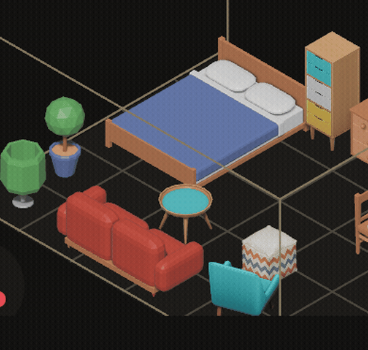
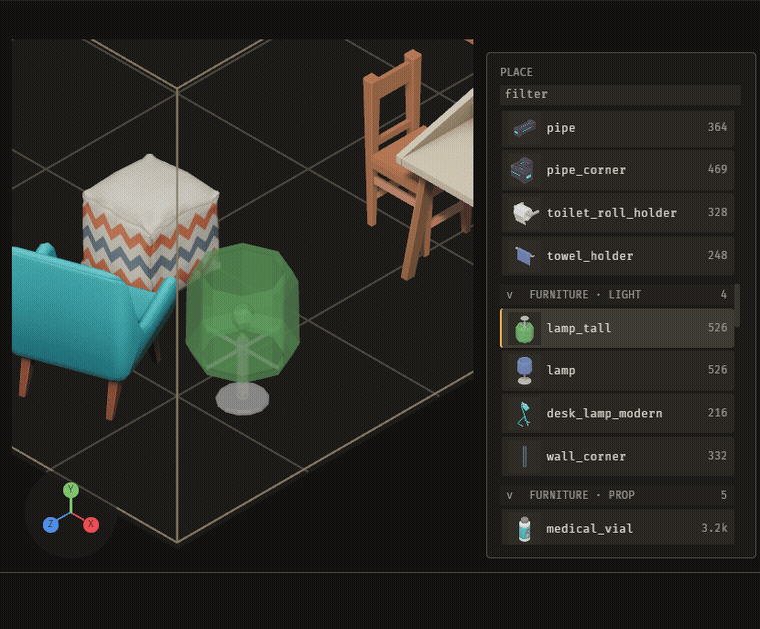

# Cauldron (`bevy_grimoire`)

> ⚠️ **Vibe Coded.** Written by AI agents working from a human's direction, covered by tests rather than a line-by-line human review. Read the code before you rely on it for something you care about.

The Cauldron is a world editor for Bevy games, for developers who build levels with an AI agent, the Familiar, working beside them. A grimoire is what it writes and your game loads.

[](https://crates.io/crates/bevy_grimoire) [](https://docs.rs/bevy_grimoire_core) [](https://github.com/bevy-coven/bevy_grimoire/actions/workflows/ci.yml) [](https://bevyengine.org) [](#who-and-licence)



*An agent calls `grimoire_apply_operation` twice, a removal and then a turn, and two presses of Cmd+Z (Ctrl+Z on Linux and Windows, as recorded here) take them back; the still below shows the inspector naming each change and who made it. A 64-second recording with snips is [on the book page](https://bevy-coven.github.io/crates/bevy_grimoire.html#the-demo).*

**Status:** usable · Bevy 0.20 · toolchain 1.98.1 (pinned in `rust-toolchain.toml`)

**Why:** a level editor where an agent's change is the same kind of change as yours, through the same named operations, in the same undo history, so you can let it build while you watch, snip what is wrong and take back what you do not want.

## Quick start

```sh
git clone https://github.com/bevy-coven/bevy_grimoire
cd bevy_grimoire
cargo run -p bevy_cauldron -- .
```

The editor opens a menu of the project's kits and maps; choose a map in the MAPS column. Run it with no argument and it opens the launcher instead: the projects you opened before (most recent first, with when), a folder to type, **New project…** and what the changelog added since you last opened one; opening a project starts the editor on it, at its kit and map menu, and **Copy command line** gives the line that does the same from a terminal. On your own game, pass its root instead of `.`; a project from before the rename has its `assets/emerge` folder moved to `assets/grimoire` the first time it opens. [Getting started](https://github.com/bevy-coven/bevy_grimoire/blob/main/docs/guide/getting-started.md) walks through your first map.

**On a Mac with Apple Silicon**, download `Cauldron-<version>-macos-arm64.dmg` from the [releases](https://github.com/bevy-coven/bevy_grimoire/releases) and drag Cauldron into Applications: it is the same editor with every family crate built in, signed and notarized. Its launcher shows its version, **Open example** copies the example project to `~/Documents/Cauldron Example` and opens it, and when a newer release exists the launcher and the editor's top bar offer **Update to v…** (the launcher also has a quiet **Check for updates** under its version line, to look again for a release published after the app opened), which downloads it, checks its checksum and signature, and restarts into it (it waits while a map has unsaved changes). `tools/release/macos/build_app.sh` builds the same app locally.

To let the Familiar drive the open editor, add the MCP server to your MCP client (the editor must be running):

```json
{ "mcpServers": { "bevy_grimoire": {
    "command": "cargo", "args": ["run", "-q", "-p", "bevy_cauldron_mcp", "--", "--project", "/path/to/project"],
    "cwd": "/path/to/bevy_grimoire" } } }
```

## Try it

```sh
cargo run -p bevy_cauldron -- . --kit furniture
```

Opens the repository's own project on its `furniture` kit (`site` and `scp` are the others); choose `bedroom` in the MAPS column to open the one-room map that ships with the repository, or `+ new map` for an empty one. [The MCP tools](https://github.com/bevy-coven/bevy_grimoire/blob/main/docs/mcp-tools.md) list what an agent can call.


*The same window mid-clip: every change in the history list says who made it.*

## What you can do

- **Build a map**: place pieces, fill areas, turn and remove them, and undo any of it: [building maps](https://github.com/bevy-coven/bevy_grimoire/blob/main/docs/guide/building-maps.md).

  

- **Work in a terminal on every screen**: a terminal is docked across the bottom of the projects home, the project page and the editor from the moment Cauldron opens, already in your project's directory — `cargo`, `git`, your agent — with the same shells and scrollback on every screen. Cmd+J on a Mac (Ctrl+J elsewhere) collapses it and brings it back; Cmd+` or a click puts the keyboard in it. Keys go to the shell while it holds them, so typing a `d` does not move the camera and an arrow does not move the screen's focus. It draws colours, inverse text and coloured backgrounds the way a program asks, a drag shows what it selects, and the prompt stays in view after a screenful of output; typing while you are scrolled back into the output brings you back to the prompt. Cmd+F (Ctrl+F elsewhere) finds text in the scrollback: every match is lit, Enter walks to older ones and Shift+Enter to newer, the box counts them, and Escape hands the keys back to the shell. The caret is a block over its cell, takes the shape a program asks for (vim's block and bar), and is an outline while the keys are elsewhere. The shell is told it runs in Cauldron (`TERM_PROGRAM=Cauldron` and the version) and gets a UTF-8 locale when it would have none. Its text is drawn in FiraMono Nerd Font Mono, so the icons a prompt or a tool prints (starship, powerline, `eza --icons`) are icons, one cell wide. Its text size, cursor style and whether the cursor blinks are settings (Cmd+, on a Mac, Ctrl+, elsewhere, then the Terminal tab), and a change reaches a running terminal at once. Full-screen programs get their keys and mouse the way they ask: the wheel scrolls `less`, `man` and `git log`, a click reaches a program that asks for the mouse (`htop` sorts by the column you click), and Shift+drag still selects. Cmd+click (Ctrl+click elsewhere) on an `http://` or `https://` address in the output opens it in your browser, even over a program that asked for the mouse. Every shell is told where it runs: `TERM_PROGRAM=Cauldron`, `CAULDRON_PROJECT` (the open project's folder), and the program and arguments it runs are the settings `terminal_shell` and `terminal_shell_args`.

  

- **Hide the left panel, or everything but the world**: Cmd+B on a Mac (Ctrl+B elsewhere) shows and hides the left panel, as in VS Code, and the viewport takes the room; Shift+Cmd+M (Shift+Ctrl+M) is Zen mode, which hides the menu bar, toolbar, docks, terminal and status band until the same chord is pressed again. View, Show left panel and View, Zen mode are the same two as ticks. The run tool, which held Cmd+B, is Shift+Cmd+B now.

- **Mac line editing in the terminal**: on a Mac, Cmd+Backspace clears the line the shell is reading back to its start, and Cmd+Left and Cmd+Right go to its start and end, as in VS Code's and iTerm2's terminals (they send the control codes `^U`, `^A` and `^E`).

- **The wheel belongs to what is under it**: a wheel turned over the terminal scrolls its output, and over the menu bar, the status band or any panel it leaves the map alone; the map zooms only when the pointer is over the map itself.

- **Start your agent in the terminal, already connected**: set Settings, Terminal, **Terminal agent** to Oh My Pi (or to Custom command, with `terminal_agent_command` in `settings.ron`) and the terminal shows an **Invoke Agent** button (nothing starts, and no tokens are spent, until you press it or hit Enter in the terminal; the one exception is below) that starts it with Cauldron's tools. A card over the terminal checks the tools server, the start, the MCP connection and a one-turn self test as each passes, and ends with an **LED** that adds them up (a pulsing amber square while it checks, a green disc when it is live, a red diamond when a check failed, each with its word beside it); then a chip in the bar says `omp connected · 22 tools`, with the same LED before it, still lit after the card has gone; **Agent** in the bar opens another: [agents](https://github.com/bevy-coven/bevy_grimoire/blob/main/docs/guide/agents.md).

  

- **Close Cauldron with an agent running, and it is back where it was**: Cauldron remembers the omp session each project's agent was in; when you open that project again with omp chosen, the agent's tab opens by itself and resumes the same session (`omp --resume <id>`), with no new self-test prompt. Closing the agent's tab, or leaving omp, clears it: [agents](https://github.com/bevy-coven/bevy_grimoire/blob/main/docs/guide/agents.md).

- **Find any command**: the menu bar at the top of the window lists every command exactly once, under File, Edit, View, Map, Meshes, Tiles, Compose, Rigs, Tools and Help, each with the key it answers to; a row that cannot run greys out and says why.
- **Work with the Familiar**: an agent turns, removes, labels, frames and captures through the same operations you use, and one Cmd+Z takes back its turn: [agents](https://github.com/bevy-coven/bevy_grimoire/blob/main/docs/guide/agents.md).
- **Show the agent what you mean**: Cmd+\ snips a rectangle of the editor with a note the agent can read and see: [agents](https://github.com/bevy-coven/bevy_grimoire/blob/main/docs/guide/agents.md).
- **Continue a layout you started**: the editor learns the rules of a corner you laid out and continues it with WFC (wave function collapse), drawn as translucent pieces before you keep it: [building maps](https://github.com/bevy-coven/bevy_grimoire/blob/main/docs/guide/building-maps.md).
- **Make kits and labels**: bring in meshes, group them into kits, and confirm the labels a vision model proposes: [kits and labels](https://github.com/bevy-coven/bevy_grimoire/blob/main/docs/guide/kits-and-labels.md).
- **Edit the files your game loads, live**: the editor re-reads changed project files every quarter of a second, and a game can reload them too: [data files](https://github.com/bevy-coven/bevy_grimoire/blob/main/docs/guide/data-files.md), [your game](https://github.com/bevy-coven/bevy_grimoire/blob/main/docs/guide/your-game.md).
- **Set the editor up the way you work**: Cmd+, opens the settings screen, where every setting shows its default, can be searched and reset, and is written to your own file or to the project's; the project configuration screen turns the family crates the project uses on and off and leaves a pack out of the kit or brings it back: [data files](https://github.com/bevy-coven/bevy_grimoire/blob/main/docs/guide/data-files.md).
- **Configure the rest of the Coven**: sky, forests, lights, villagers, dialogue and destructible props, each as that crate's own settings: [the book](https://bevy-coven.github.io/with-grimoire.html).

## Part of the Coven

The Cauldron is the editor of the [Bevy Coven](https://github.com/bevy-coven): it takes each family crate as an optional cargo feature and edits that crate's own serde settings, so what it saves is what your game loads with the crate alone. [Using a crate with Grimoire](https://bevy-coven.github.io/with-grimoire.html) explains the arrangement.

## The crates

| Crate | What it is |
|---|---|
| `bevy_cauldron` | The editor. Opens a project directory and writes the files a game loads. Not on crates.io: run it from a clone. |
| `bevy_cauldron_mcp` | The MCP server that gives an agent the editor's operations over stdio. |
| [`bevy_grimoire`](https://crates.io/crates/bevy_grimoire) | The runtime half: loads a library and a map into a Bevy world (`GrimoirePlugin`, `GrimoireLivePlugin`). |
| [`bevy_grimoire_core`](https://crates.io/crates/bevy_grimoire_core) | The engine-free core: the constraint representation, solvers, WFC and the grammar learner. |
| [`bevy_grimoire_solver`](https://crates.io/crates/bevy_grimoire_solver), [`_rng`](https://crates.io/crates/bevy_grimoire_rng), [`_anim`](https://crates.io/crates/bevy_grimoire_anim), [`_snip`](https://crates.io/crates/bevy_grimoire_snip) | A deterministic SAT back-end, one ChaCha8 random stream, clip-weight blending, and cutting a rectangle out of a picture of the editor. |
| `bevy_devshot` | A frame on demand: touch a sentinel file and the next frame is written as a PNG. |

A game depends on `bevy_grimoire_core` and `bevy_grimoire` (`cargo add bevy_grimoire_core bevy_grimoire`). The crates were called `bevy_emerge_*` until 2026-10-31; those names have a final release that points here.

## Bevy compatibility

| `bevy_grimoire_*` | Bevy |
|---|---|
| 0.1 | 0.20 |

## Learn more

- [The guide](https://github.com/bevy-coven/bevy_grimoire/blob/main/docs/guide/README.md): every page, in reading order.
- [The book page](https://bevy-coven.github.io/crates/bevy_grimoire.html), with the 64-second demo.
- [MCP tools](https://github.com/bevy-coven/bevy_grimoire/blob/main/docs/mcp-tools.md), [`CHANGELOG.md`](https://github.com/bevy-coven/bevy_grimoire/blob/main/CHANGELOG.md) (every visible change has a clip), and [docs.rs/bevy_grimoire_core](https://docs.rs/bevy_grimoire_core).
- [The development loop](https://github.com/bevy-coven/bevy_grimoire/blob/main/docs/guide/loop.md): how changes are proposed, tested and reported.

## Who and licence

Maintained by [@Ladvien](https://github.com/Ladvien). Issues and pull requests are welcome at [github.com/bevy-coven/bevy_grimoire/issues](https://github.com/bevy-coven/bevy_grimoire/issues); a game asks for what it needs with the `consumer` label. Read the org's [CONTRIBUTING.md](https://github.com/bevy-coven/.github/blob/main/CONTRIBUTING.md) and [`AGENTS.md`](https://github.com/bevy-coven/bevy_grimoire/blob/main/AGENTS.md) first, and run `cargo nextest run --workspace` before you push.

MIT OR Apache-2.0, at your option.
