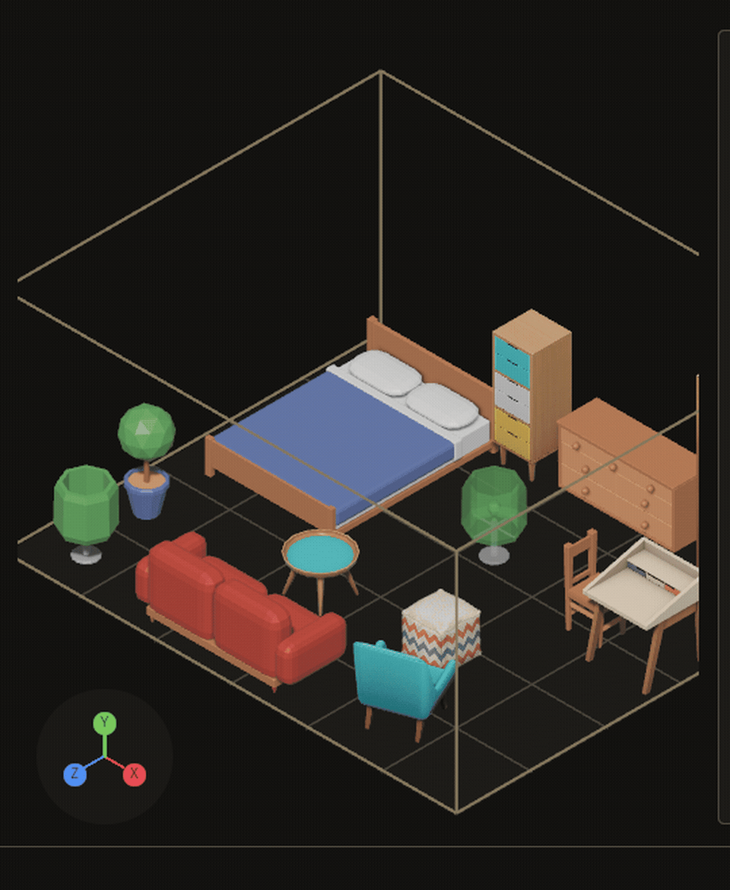

# Working with an agent

An AI agent can look at your map, change it, and undo its own changes, through the running editor. You describe the problem, the agent looks and acts, and you check the result on screen. Every change the agent makes goes into the same operation log as your own changes, and you can undo it with Cmd+Z in the editor.

This page uses a few words you may not know yet. A **door** is one of the editor's three workspaces: Map, kit, and Rigs. A **kit** is a folder of meshes plus its `library.ron`. A **piece** is a library entry. A **placement** is a piece placed on a map. A **stamp** is a composition placed on a map. A **composition** is a saved group of pieces. The **bash** is the named combination of kits a map offers, or none for every kit it binds.

## Set up the agent

Goal: connect an MCP client to the running editor, so the agent can read and change the open project.

1. Start the editor on your project folder. For the repo's own project, run `cargo run -p bevy_grimoire_mapper -- .` from the repo root. The editor serves the Bevy Remote Protocol (BRP) on port 15702 by default. Set `BEVY_BRP_PORT` before launching if that port is taken.
2. Build the MCP server with `cargo build -p bevy_grimoire_mcp`. The binary is `target/debug/bevy_grimoire_mcp`.
3. Add the server to your client's config. Use absolute paths. Point `--project` at the project folder, the same folder you passed to the editor:

```json
{
  "mcpServers": {
    "bevy_grimoire": {
      "command": "/absolute/path/to/bevy_grimoire/target/debug/bevy_grimoire_mcp",
      "args": ["--project", "/absolute/path/to/your/project"],
      "env": { "BEVY_BRP_PORT": "15702" }
    }
  }
}
```

Leave out the `env` block if you did not change the port. Set the same value on the editor if you did.

What you see: ask the agent to call `grimoire_state`. It answers with the open map, the door you are on, and the undo depth. If the editor is not running, the server answers with a sentence saying so, and changes nothing.

If it goes wrong: a refusal that says no editor answered means the editor is not running, or it is on another port. Check that both sides use the same `BEVY_BRP_PORT`.

## A worked session

Goal: remove a piece that blocks a gate, and undo the removal if you change your mind.

Say to the agent what you see. For example: "The abbey blocks the gate. Take it out." The agent then does the following.

1. It calls `grimoire_state` to read the open map and the placements. The answer gives the abbey's id.
2. It calls `grimoire_capture_still` to see the gate before the change.
3. It calls `grimoire_preview_operation` with `operation: "placement_remove"` and `parameters: {"id": "<the abbey's id>"}`. The answer says what would change. Nothing changes yet.
4. It calls `grimoire_apply_operation` with the same operation and parameters. The answer carries an `operation_id`.
5. It calls `grimoire_capture_still` again. The gate is clear.
6. You press Cmd+Z in the editor. The abbey comes back. `grimoire_read_oplog` shows the undo as a new line.

To turn a placement instead of removing it, use `placement_set_yaw` with `id` and `yaw`. Yaw wraps to 0 to 360, so `-15` is `345`. To lay it on its side, use `placement_set_tip` with `id` and `tip`, two quarter-turn counts (about X, then Z) from 0 to 3; `[0, 0]` is upright. To raise a lamp off its table, use `placement_set_lift` with `id` and `lift` in metres; `0` puts it back. To set the turn and the tip in one change, use `placement_set_pose` with `id`, `yaw` and `tip`; `0` and `[0, 0]` stand it straight, as `V` does.


The inspector on the left shows the same thing you would read in the tool answers: LAST names the newest change, UNDO names what Cmd+Z takes back next, and the history list marks the agent's changes with `agent`.


What you see: after step 4 the abbey is gone from the map and the gate is open. After your Cmd+Z the abbey stands on the gate again, and the operation log has one new undo line.

If it goes wrong: `placement_remove` takes away any piece standing on the placement too, so check the still in step 2 before you apply.

## How an edit travels

An agent never writes a file itself. The server passes each call to the editor, and the editor does the work.

1. The agent lists the operations with `grimoire_list_operations`. The names are the same as in the table below.
2. The agent previews one with `grimoire_preview_operation`. A preview refuses bad input and says what would change, and it writes nothing.
3. The agent applies it with `grimoire_apply_operation`. The editor changes the open map or the library in memory.
4. The editor writes the file it changed under `assets/grimoire/`, and appends one line to `assets/grimoire/oplog.jsonl`. The editor watches the project files, so the open editor shows the new state.
5. To take a change back, the agent calls `grimoire_undo_operation`. The undo is a new log line.

Each apply answers with an `operation_id`, which names its line in the log.

A refused preview or apply answers with `outcome: "refused"`, `refusal` (the sentence) and `problem`, the same facts the editor shows its user in the toast and the journal. `problem.what` is the sentence; `where` names the `file`, `field` or `entity` it is about; `why` is the cause when the sentence does not already say it; `fix` says what to do. A part a refusal does not have is left out, so a refusal that is only a sentence has only `what`. `placement_remove` of an id the map does not have names the entity and says to name a placement that is on the map; the other refusals gain their parts the same way, one at a time.

## Operations

Goal: know what an agent can change, and what undoes each change.

| Operation | What it does | Undo |
|---|---|---|
| `map_set_settings` | Sets a map's origin, bounds, axis, bash, or note. `null` clears the bash or the note. | Puts the old settings back |
| `placement_set_pin` | Pins or unpins a placement. | Puts the old pin back |
| `placement_set_yaw` | Turns a placement to a new yaw in degrees, wrapped to 0 to 360. | Puts the old yaw back |
| `placement_set_tip` | Tips a placement to quarter turns about X and Z, each 0 to 3, as `Y` and `U` do. Refuses a piece something rests on and an unmeasured piece. | Puts the old tip back |
| `placement_set_lift` | Lifts a placement to a height in metres above the one its mount decides, as `[` and `]` do; negative lowers it, and 0 puts it back on its datum. Anything resting on it rides with it. | Puts the old lift back |
| `placement_set_pose` | Sets a placement's yaw and tip together, as `V` does with `0` and `[0, 0]`; one change, one undo. Refuses a tip on a piece something rests on and on an unmeasured piece. | Puts the old yaw and tip back |
| `placement_remove` | Removes a placement, and any piece standing on it. | Puts the pieces back |
| `stamp_remove` | Removes a stamp from the map. | Puts the stamp back |
| `map_rename` | Renames the open map. The name is forced to snake_case, so `Town Two` becomes `town_two`. | Puts the old name back |
| `brush_arm` | Arms a library piece as the brush. `null` puts the brush down. | None: it changes the view, not the map |
| `composition_arm` | Arms a composition, so the next click on the Map stamps it. `null` puts it down. | None: it changes the view, not the map |
| `composition_rename` | Renames a composition, and every map that stamps it follows. The name is forced to snake_case per `/` segment. | Puts the old name back, in the compositions file and every map |
| `door_open` | Opens the kit, map, or rigs door, and optionally one of its tabs. | None: it changes the view, not the map |
| `piece_select` | Selects a library piece on the Meshes shelf. | None: it changes the view, not the map |
| `label_set` | Sets one label axis (kind, effects, look, or surfaces) on a piece. | Puts the old labels back |

`map_set_settings` refuses `bounds` and `axis` in the same call.

`door_open` can wait. If you leave a map that has unsaved edits, the answer comes back with `waiting` set to `"the map has unsaved changes"`. The editor then asks you about the unsaved changes, and the agent cannot answer that question for you.

## Seeing what the agent sees

Goal: give the agent a picture of the editor, and read back what the person saw.

`grimoire_capture_still` returns one picture of the whole window, world and interface together, plus a summary of the state at that moment. The picture is also written to a file, and the answer gives its path and a **fingerprint** of the picture's bytes. Use it before and after a change. **Compare fingerprints, not paths**: two stills with the same fingerprint are the same picture, so a fingerprint that did not move says the screen did not change. Reading the raw `bevy_fairy/screenshot` method instead is a trap: it answers with an id in about twenty milliseconds and writes the file a frame or more later — measured, about 200 ms — so a read at that moment finds no file at all, or the previous capture if the path was reused. This tool polls `bevy_fairy/capture` until the frame is done and writes the file itself, which is why it is the one to use.

`grimoire_capture_sequence` takes a series of frames. Its `label` names the run, `seconds` sets the length (default 2, up to 10), and `fps` sets the rate (default 4, from 2 to 15). With an `operation`, the editor applies it after frame 0. Frame 0 is the state before the change, and the later frames show what it did. The run is done only when every frame is written. A frame that does not land within five seconds ends the run with a reason.

`grimoire_frame_view` moves the Map camera without changing any map data. Its `target` is `"map"`, `"selection"`, `{"placements": [ids]}`, or `{"rect": [x0, z0, x1, z1]}` in map metres. It is not logged and not undoable. Call `grimoire_capture_still` after it to see the result.

A snip is a region you mark for the agent. Press Cmd+\ in the editor, drag a rectangle, type a one-line note, and press Enter to save. Press Escape to cancel. The editor writes `snip-<ms>.png` and `snip-<ms>.json` under `target/loop/captures/snips/`. Those files stay out of `assets/grimoire/`, so a game never loads them.

A snip that is confirmed but not yet written is pending. The editor clears pending snips once, when a project is first opened in the session. `grimoire_list_snips` reads the snips you took. It takes a `limit` from 1 to 20, default 5. It changes nothing. A snip is not logged and not undoable.

`grimoire_snip` is a different tool. The agent gives it a `label` and a `rect` in window pixels, and it writes one crop of the editor's picture. The crop is not logged and not undoable.

`grimoire_decide` asks a decision model a typed question and returns a probability for every answer. Give it `check` (a named check: `floating`, `clipping`, `out_of_area`, `blank_frame` or `toast_visible`, from the editor's built-ins with the project's `assets/grimoire/checks.ron` over them, read on every call) or `questions` (ad-hoc `noul`, `choice` and `score` questions), with `images` (project files, at most four), `view: true` for the editor's current picture, and `facts`. A check missing a picture or the facts is refused and names what is missing. A finding is advisory: it changes no map data and never blocks or undoes an operation. The endpoint is one per run, set by `GRIMOIRE_DECIDE_ENDPOINT`, `GRIMOIRE_DECIDE_MODEL` and `GRIMOIRE_DECIDE_KEY`; local clef-flash is the default, and a Cloudflare endpoint sends pictures off the LAN.



The state read has its own paging. `grimoire_state` takes `pinned_from` to page the list of pins, and returns `pinned_next` when more follow. It also reports `undo_next`, `undo_depth`, `redo_next`, `redo_depth`, `leaving`, and `door_waiting`.

An agent shows what it means to do with the `plan_set` operation: the whole list of steps as it now stands, each `pending`, `doing`, `done` or `skipped`. The plan is `<map>.plan.ron` beside the map, `grimoire_state` reports it under `plan`, and one undo puts the previous list back. The editor's Inspector shows it under **PLAN**: a line `plan: k of n done`, then one numbered row per step with its status, redrawn within half a second of a change, and `no plan` when the list is empty.

What a map is meant to keep true lives beside it in `<map>.relations.ron`: relations between placements by id, such as a chair that `Faces` its table, a lamp `Near` a door, a door whose `ClearInFront` corridor nothing but its own stack may stand in (a jug on the counter is part of the counter), a sign `VisibleFrom(from: "gate", clearance: 1.0)`, a sight line no other piece's centre may stand within 1 m of (each end's whole stack does not count: what rests on either end, and what an end rests on, such as the stall a sign hangs on), or a lamp `Along(path: ["gate", "well", "hall"], within: 1.0)`, within 1 m of the road through those pieces' centres in order (two or more waypoints; past the last one, it is measured to the end). A chest `ReachableFrom(from: "gate", clearance: 0.6)` asks for a walk from the gate to the chest that keeps 0.6 m from every other piece's centre, round whatever stands between; it is measured as the walk's length, and a sealed one names the piece whose removal opens it, which `relations_solve` slides aside. `grimoire_state` reports them under `relations`, each with its outcome (`met`, `unmet` or `missing`), what was measured, and what blocks it. The file is re-read on every call. The `relations_solve` operation, or the line `relations solve` in the Terrain field, nudges the pieces of the unmet relations. It keeps a move only when fewer relations are broken after it, and it never moves a relation's target. One undo puts every moved row back. A map with no relations file, or one that does not parse, is refused and nothing moves.

A pew `AlignedWith("pew_1")` keeps pew_1's heading, within 30°: a row of pews facing the altar, stalls along a street. It is measured as the angle between the two headings the short way round (facing the opposite way is 180° off), `relations_solve` turns the piece to the other's heading without moving it, and the `RELATIONS` row reads `pew_2 aligned with pew_1`.

A table `Between(a: "chair_1", b: "chair_2", within: 0.5)` stands between the two chairs: its centre projects strictly inside the segment joining theirs, no more than 0.5 m off it (a rug between the hearth and the bed, a guard between the gate and the hall). It is measured as the distance to that segment, so past either end it is the distance to that end, and two ends on one spot have nothing between them. `relations_solve` moves the piece onto the segment, inside its ends and on its own side of the line, carrying what rests on it, and the `RELATIONS` row reads `table between chair_1 and chair_2`.

A chest `Behind(of: "counter", within: 3.0)` stands behind the counter: against the counter's forward, inside the same 45° half-cone `InFrontOf` uses, no more than 3 m back (a guard behind the throne, a well behind the house). It is measured as the distance back along the counter's forward, so a piece in front of it measures negative. `relations_solve` sets the piece on the counter's backward axis, carrying what rests on it, and the `RELATIONS` row reads `chest behind counter`.

A lamp `LeftOf(of: "door", within: 3.0)` stands to the door's left, and a chair `RightOf(of: "desk", within: 2.0)` to the desk's right. The sides are the other piece's own, as it faces its forward, so turning the door turns them; each holds inside the same 45° half-cone `InFrontOf` uses, out to `within` metres. Each is measured as the distance out along that side, so a piece on the opposite side measures negative. `relations_solve` sets the piece on that side axis, carrying what rests on it, and the `RELATIONS` rows read `lamp left of door` and `chair right of desk`.

A second lamp `MirrorOf(of: "lamp_1", about: "door", within: 0.3)` stands opposite the first across the door's axis, the line through the door's centre along its forward: the same distance ahead of the door, the same distance out on its other side (two thrones either side of the altar's axis, a pair of statues flanking a gate). Turning the door turns the axis. It is measured as the distance from that mirror point, and holds within `within` metres; headings are left to `AlignedWith` and `Faces`. `relations_solve` sets the piece on the mirror point, carrying what rests on it, and leaves the door and the first lamp where they are; the `RELATIONS` row reads `lamp_2 mirror of lamp_1 about door`.

A bookshelf `BacksOnto(of: "wall", within: 0.5)` stands with its back to the wall: its centre is off the wall's face, the plane through the wall's centre square to its forward, by more than nothing and no more than `within` metres, on either side, and it faces straight out from that plane within 30° (a throne backed onto the apse, a sofa with its back to the window). Sideways along the wall is free, so a long wall backs a piece anywhere along it; add `Near` to keep it to one end. It is measured as the distance off the plane. `relations_solve` turns the piece out from the wall and sets it just inside `within` on its own side, where it stood along the wall, carrying what rests on it; the wall stays. The `RELATIONS` row reads `shelf backs onto wall`.

A table `Inside(of: "rug", width: 2.0, depth: 4.0)` stands on the rug: its centre is inside the `width` × `depth` rectangle centred on the rug, in the rug's own frame (`width` across its left and right, `depth` along its forward), so turning the rug turns the area (a chest inside the room's floor, a stall in the market square). `Near` is a circle, so around a long hall's centre it either spills out of the hall's sides or misses its ends; `Inside` follows the rectangle. Headings are free. It is measured as the distance from the centre to the rectangle, 0 inside. `relations_solve` sets a piece outside just inside whichever edges it stood past, on its own side, keeping its heading and carrying what rests on it; the rug stays. The `RELATIONS` row reads `table inside rug`.

A relation is soft unless it says `hard: true`, as in `(of: "door", kind: ClearInFront(depth: 1.5, width: 1.0), hard: true)`. `relations_solve` ranks a map by its broken hard relations first and its broken soft ones second, so it never breaks a hard relation to mend soft ones, and it mends a hard one even when that breaks a soft one. Its summary ends `still unmet: door (hard), lamp`, and its preview lists the same relations under `unsatisfied` as `{of, hard}`. A file with no `hard` reads as before, with every relation soft.

A person sees the same check on the Map inspector's `RELATIONS` row, under `REPEATS`: `2 unmet, 1 missing: chair faces table` names how many relations are broken and the first broken one (with the piece in the way, for a blocked corridor), a broken hard one first, marked `(hard)`. It reads `N met`, dimmed, when every relation holds, `none` with no file, and `m.relations.ron does not read` when the file does not parse. The row re-reads the file about once a second, so an edit to it shows with no restart.

## Who did what

Goal: find out who changed a map, and take back only the change you want.

Every log line records whether a person or an agent made the change. The log is `assets/grimoire/oplog.jsonl`. Read it with `grimoire_read_oplog`, which lists lines newest last. A refusal is not logged, so every line is a change that happened.

`grimoire_list_pieces` lists the library a page at a time, 50 pieces per page. Pass `pieces_from` to read the next page. Filters combine. `with_mesh` keeps pieces that have a mesh. `unlabelled` keeps pieces with no label. `by_model` keeps pieces with a label that a model or an agent set and no person has changed since. `confidence` takes `high`, `medium`, or `low`, and refuses anything else. `id_contains` matches part of an id. Without an open project, the call refuses. It does not answer with an empty list.

`grimoire_undo_operation` takes an optional `operation_id`. Without one, it takes back the newest change still in effect. With one, it takes back that change. Pass `dry_run` to check the undo without making it.

An undo refuses, and says why, in these cases:

- A newer change to the same map is still in effect. The refusal names that change, so you can undo it first.
- The state no longer matches what the change left. Someone changed the map after it, and putting the old values back would overwrite that work.
- The change was logged before undo existed, so it has nothing to put back.
- The operation id is not in the log. `grimoire_read_oplog` lists the ids.

A removal with `put_back` is the undo of another removal. An agent cannot apply it directly. Take the removal back with `grimoire_undo_operation`, or with Cmd+Z in the editor.

Cmd+Z in the editor undoes the newest change on the door you are on. The keys page lists which doors keep a history.

## Limits

- The editor must be running. The server answers with a sentence when it cannot reach the editor, and changes nothing.
- An editor built without the `debugger` feature has no BRP endpoint, so the server cannot reach it. The feature is on by default.
- The agent can turn, pin, remove, rename, label, and set settings. It cannot place a new piece, stamp a composition, or fill an area. The registry has no operation for those. Place them yourself in the editor, as the building maps page describes.
- The server makes no change itself. Every change to the map goes through the editor's operations above.
- `grimoire_snip` and `grimoire_frame_view` change no map data. They are not logged, and they cannot be undone.
- `grimoire_capture_sequence` waits for the run to end: at most the sequence's length, plus ten seconds, plus five seconds for each frame.
- A still shows one moment on screen. An agent reads only what is in the picture, so frame the area with `grimoire_frame_view` before you ask for a still.

For the full schema of every tool, parameter, and annotation, see [docs/mcp-tools.md](../mcp-tools.md). For the keys the editor uses, see [keys](keys.md). For labels and the kit door, see [kits and labels](kits-and-labels.md). For map work, see [building maps](building-maps.md). For the files in a project, see [data files](data-files.md).
