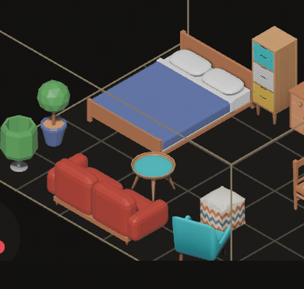
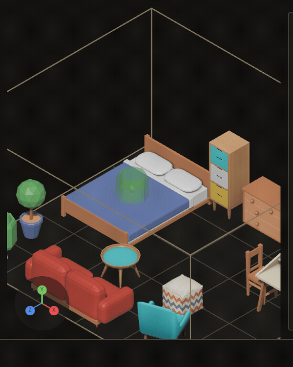
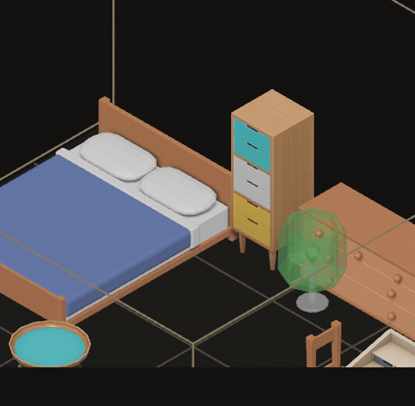

# Working with an agent

An AI agent can look at your map, change it, and undo its own changes, through the running editor. You describe the problem, the agent looks and acts, and you check the result on screen. Every change the agent makes goes into the same operation log as your own changes, and you can undo it with Cmd+Z in the editor.

This page uses a few words you may not know yet. A **door** is one of the editor's three workspaces: Map, kit, and Rigs. A **kit** is a folder of meshes plus its `library.yaml`. A **piece** is a library entry. A **placement** is a piece placed on a map. A **stamp** is a composition placed on a map. A **composition** is a saved group of pieces. The **bash** is the named combination of kits a map offers, or none for every kit it binds.

## Set up the agent

Goal: connect an MCP client to the running editor, so the agent can read and change the open project.

1. Start the editor on your project folder. For the repo's own project, run `cargo run -p bevy_cauldron -- .` from the repo root. The editor serves the Bevy Remote Protocol (BRP) on port 15702 by default. Set `BEVY_BRP_PORT` before launching if that port is taken.
2. Build the MCP server with `cargo build -p bevy_cauldron_mcp`. The binary is `target/debug/bevy_cauldron_mcp`.
3. Add the server to your client's config. Use absolute paths. Point `--project` at the project folder, the same folder you passed to the editor:

```json
{
  "mcpServers": {
    "bevy_grimoire": {
      "command": "/absolute/path/to/bevy_grimoire/target/debug/bevy_cauldron_mcp",
      "args": ["--project", "/absolute/path/to/your/project"],
      "env": { "BEVY_BRP_PORT": "15702" }
    }
  }
}
```

Leave out the `env` block if you did not change the port. Set the same value on the editor if you did.

What you see: ask the agent to call `grimoire_state`. It answers with the open map, the door you are on, and the undo depth. If the editor is not running, the server answers with a sentence saying so, and changes nothing.

If it goes wrong: a refusal that says no editor answered means the editor is not running, or it is on another port. Check that both sides use the same `BEVY_BRP_PORT`.

## Start an agent in Cauldron's terminal

Goal: have the terminal start your agent already connected to the editor, and see that the whole chain works before you ask it anything.

1. Open Settings (Terminal tab) and set **Terminal agent** to **Oh My Pi**. `omp` must be on your login shell's `PATH`.
2. **Nothing starts by itself, except an agent that was running when you closed Cauldron** (see "Quit and come back" below): a session costs tokens to warm up, so with an agent chosen the terminal opens empty and shows an **Invoke Agent** button in the middle of its area, and a person who is only looking around the game pays nothing. Pressing it (or Enter while the terminal has the keyboard) opens an agent tab, which types `omp -e <folder> '<prompt>'` at the shell's prompt. Closing the last tab brings the button back (the `+` chip still opens a plain shell, and so does a terminal with no agent chosen). The folder is an omp extension whose `.mcp.json` names the editor's MCP server (the `bevy_cauldron_mcp` beside the editor binary) on the editor's port, and which tells the editor which omp session the tab is in; the prompt asks omp to call `grimoire_self_test` once.
3. For any other harness choose **Custom command** and set the line in `settings.yaml`, which the Settings screen has no text field for: `terminal_agent_command: claude --mcp-config $CAULDRON_MCP_CONFIG "$CAULDRON_SELF_TEST_PROMPT"`. The tab's shell has `CAULDRON_MCP` (the server binary), `CAULDRON_MCP_CONFIG` (a `mcpServers` file for it), `CAULDRON_AGENT_TOKEN`, `CAULDRON_SELF_TEST_PROMPT` and `BEVY_BRP_PORT`.

What you see: a card at the terminal's top right lists four checks and marks each `OK` as it passes: **Tools server** (the server binary is there and its config was written), **Agent started** (the line was typed), **Agent connected** (the client finished the MCP handshake: its name, its version and how many tools it was offered) and **Agent self test** (the agent read the state, counted the operations and took a picture). The card ends with the agent's **LED**, which adds the four up: a rounded square with an amber glow that pulses slowly while a check is still waiting (`Agent busy`), a green disc with a steady glow once every check passed (`Agent live`), a red diamond when one failed (`Agent failed`). Each state has its own shape and its word beside it, so the colour is never the only signal, and the pulse stops under Settings, Reduced motion. The same LED stands in the terminal's bar for as long as a terminal agent is chosen: a hollow ring with the word `off` before you invoke one, then the drawn agent tab's state, so it is still lit after the card has gone. A few seconds after the last check the card gives way to a chip in the bar, `omp connected · 22 tools`, which the LED stands before. The **Agent** chip in the bar opens another agent tab; `+` still opens a plain shell.

If it goes wrong: the check that failed says why, in red, and the chip reads `omp: self test failed`. `Agent connected` fails after 60 s when the harness never started (look in the terminal for `command not found`); `Agent self test` fails after 180 s when the agent did not call the tool, often because it is waiting for you to approve the call. Answer it in the terminal, then click the chip: the card comes back and omp is asked again. A custom command that does not pass `$CAULDRON_SELF_TEST_PROMPT` to its agent gets `SKIP` on the self test, not a failure.

**What the chips in the terminal's bar are for**: rest the pointer on any chip and it says what it does. The status chip (`omp connected · 22 tools`) is the agent's self-test, and a click shows its card again; a chip named for a session (`omp`, or a shell's name) shows that session; **Agent** starts another agent session in the open project; `+` opens a new shell there; `x` closes the session you are looking at. A shell that started somewhere else also gets **Go to \<folder\>**, which types `cd` into it to move it to the open project (its tooltip shows the command); an agent's tab is never offered it, because what is typed there is a message to the agent.

**Quit and come back**: the editor keeps one record per project of the omp session its agent was in (`<data folder>/agents/resume.json`, written when the extension reports the session). If you close Cauldron while an agent is running, the next time that project is open and the terminal would offer **Invoke Agent**, the tab opens by itself and types `omp -e <folder> --resume <session>`, so the agent is back in the same conversation; no self-test prompt is typed, because the session already has its history. Ending the agent yourself clears the record: closing its tab, typing `exit` at its shell, or leaving omp (`/exit`, Ctrl+D). A resumed omp that never connects clears it too, so a session that cannot be resumed is not tried at every launch. Pressing **Invoke Agent** or `+` first starts what you asked for instead. Only omp is resumed: a custom command has no resume syntax the editor knows.

## Attach to an installed Cauldron

Goal: drive the Cauldron app installed on a Mac, from any machine that can ssh to it, from the moment it opens.

The app carries its own MCP server, `Cauldron.app/Contents/MacOS/bevy_cauldron_mcp`. Run it over ssh with no `--project`, and it follows whatever the app has open, the Projects home included:

```json
{
  "mcpServers": {
    "cauldron-mac": {
      "command": "ssh",
      "args": ["-o", "BatchMode=yes", "<mac>", "/Applications/Cauldron.app/Contents/MacOS/bevy_cauldron_mcp"]
    }
  }
}
```

What you see: `grimoire_state` answers on the Projects home, and `grimoire_open_project` with `root` opens a project folder on that Mac. `grimoire_read_log` reads the app's own log, `~/Library/Application Support/Grimoire/cauldron.log`, and answers even when the app does not. `grimoire_capture_still` with `"source": "window"` shows what the window itself shows.

If it goes wrong: read the log first. Its first line names the version and where the app runs from; a `window self-check` line says how many colours the window showed, and `the window is black` means the editor draws but nothing reaches the window. Without `--project`, `grimoire_decide`, `grimoire_list_rules` and `grimoire_list_snips` refuse, because they read project files from disk.

## A worked session

Goal: remove a piece that is in the way, and undo the removal if you change your mind.

Say to the agent what you see. For example: "The bed is in the way. Take it out." The agent then does the following.

1. It calls `grimoire_state` to read the open map and the placements. The answer gives the bed's id.
2. It calls `grimoire_capture_still` to see the room before the change.
3. It calls `grimoire_preview_operation` with `operation: "placement_remove"` and `parameters: {"id": "<the bed's id>"}`. The answer says what would change. Nothing changes yet.
4. It calls `grimoire_apply_operation` with the same operation and parameters. The answer carries an `operation_id`.
5. It calls `grimoire_capture_still` again. The bed is gone.
6. You press Cmd+Z in the editor. The bed comes back. `grimoire_read_oplog` shows the undo as a new line.

To turn a placement instead of removing it, use `placement_set_yaw` with `id` and `yaw`. Yaw wraps to 0 to 360, so `-15` is `345`. To lay it on its side, use `placement_set_tip` with `id` and `tip`, two quarter-turn counts (about X, then Z) from 0 to 3; `[0, 0]` is upright. To raise a lamp off its table, use `placement_set_lift` with `id` and `lift` in metres; `0` puts it back. To set the turn and the tip in one change, use `placement_set_pose` with `id`, `yaw` and `tip`; `0` and `[0, 0]` stand it straight, as `V` does.



The inspector on the left (outside the clips' frame) shows the same thing you would read in the tool answers: LAST names the newest change, UNDO names what Cmd+Z takes back next, and the history list marks the agent's changes with `agent`.



What you see: after step 4 the bed is gone from the map. After your Cmd+Z the bed stands where it was, and the operation log has one new undo line.

If it goes wrong: `placement_remove` takes away any piece standing on the placement too, so check the still in step 2 before you apply.

## How an edit travels

An agent never writes a file itself. The server passes each call to the editor, and the editor does the work.

1. The agent lists the operations with `grimoire_list_operations`. The names are the same as in the table below.
2. The agent previews one with `grimoire_preview_operation`. A preview refuses bad input and says what would change, and it writes nothing.
3. The agent applies it with `grimoire_apply_operation`. The editor changes the open map or the library in memory.
4. The editor writes the file it changed under `assets/grimoire/`, and appends one line to `assets/grimoire/oplog.jsonl`. The editor watches the project files, so the open editor shows the new state.
5. To take a change back, the agent calls `grimoire_undo_operation`. The undo is a new log line.

Each apply answers with an `operation_id`, which names its line in the log.

A refused preview or apply answers with `outcome: "refused"`, `refusal` (the sentence) and `problem`, the same facts the editor shows its user in the toast and the journal. `problem.what` is the sentence; `where` names the `file`, `field` or `entity` it is about; `why` is the cause when the sentence does not already say it; `fix` says what to do. A part a refusal does not have is left out, so a refusal that is only a sentence has only `what`. `placement_remove` of an id the map does not have names the entity and says to name a placement that is on the map; the other refusals gain their parts the same way, one at a time.

## Operations

Goal: know what an agent can change, and what undoes each change.

| Operation | What it does | Undo |
|---|---|---|
| `map_set_settings` | Sets a map's origin, bounds, axis, bash, or note. `null` clears the bash or the note. | Puts the old settings back |
| `placement_set_pin` | Pins or unpins a placement. | Puts the old pin back |
| `placement_set_yaw` | Turns a placement to a new yaw in degrees, wrapped to 0 to 360. | Puts the old yaw back |
| `placement_set_tip` | Tips a placement to quarter turns about X and Z, each 0 to 3, as `Y` and `U` do. Refuses a piece something rests on and an unmeasured piece. | Puts the old tip back |
| `placement_set_lift` | Lifts a placement to a height in metres above the one its mount decides, as `[` and `]` do; negative lowers it, and 0 puts it back on its datum. Anything resting on it rides with it. | Puts the old lift back |
| `placement_set_pose` | Sets a placement's yaw and tip together, as `V` does with `0` and `[0, 0]`; one change, one undo. Refuses a tip on a piece something rests on and on an unmeasured piece. | Puts the old yaw and tip back |
| `placement_remove` | Removes a placement, and any piece standing on it. | Puts the pieces back |
| `stamp_remove` | Removes a stamp from the map. | Puts the stamp back |
| `placement_set_hidden` | Takes one placement out of the editor's viewport for this session, or puts it back, as the outliner's Hide does. The piece stays on the map and in the file, and a click cannot pick what is not drawn. | None: it changes the view, not the map |
| `layer_set_visible` | Hides a whole layer (`floor`, `wall`, `ceiling`, `surface`, `opening` or `decal`, from each piece's mount) for this session, or shows it again, as the outliner's Hide layer does. | None: it changes the view, not the map |
| `placement_set_locked` | Locks a placement against the viewport's move and removal clicks for this session, or unlocks it, as the outliner's Lock does. Operations such as `placement_remove` still act on it; this is not `placement_set_pin`. | None: it changes the view, not the map |
| `map_rename` | Renames the open map. The name is forced to snake_case, so `Town Two` becomes `town_two`. | Puts the old name back |
| `brush_arm` | Arms a library piece as the brush. `null` puts the brush down. | None: it changes the view, not the map |
| `composition_arm` | Arms a composition, so the next click on the Map stamps it. `null` puts it down. | None: it changes the view, not the map |
| `compose_carousel_step` | Steps the COMPOSE carousel, `by` `prev` or `next`, as `O` and `P` do: the previous or next composition becomes the focal one, wrapping round the ring. `to` makes a named row focal instead, as a click on it does. The focused list is left alone. | None: it changes the view, not the map |
| `compose_focus` | Chooses which COMPOSE list the arrows walk, COMPOSITIONS or MEMBERS, as left and right do. `by` steps to the other list; `list` names the one to take, as a click on a row does. | None: it changes the view, not the map |
| `compose_walk` | Moves the cursor of whichever COMPOSE list has the arrows, `by` `prev` or `next`, `rows` at a time (Shift is 5), as up and down do. It stops at the ends of the list. `to` names the row instead, as a click on one does. | None: it changes the view, not the map |
| `composition_picker_toggle` | Gives the arrow keys to the composition picker, or back to the palette, as `P` does. | None: it changes the view, not the map |
| `composition_picker_walk` | Moves the composition picker's cursor one row, `by` `prev` or `next`, as Shift+up and Shift+down do. It stops at the ends of the list; `composition_arm` arms the composition it is on. | None: it changes the view, not the map |
| `composition_rename` | Renames a composition, and every map that stamps it follows. The name is forced to snake_case per `/` segment. | Puts the old name back, in the compositions file and every map |
| `door_open` | Opens the kit, map, or rigs door, and optionally one of its tabs. | None: it changes the view, not the map |
| `piece_select` | Selects a library piece on the Meshes shelf. | None: it changes the view, not the map |
| `piece_edit` | Sends a library piece to the Meshes tab to be defined, as the define key (Cmd+Delete) does on the Map: the tab opens on the piece, so the detail pane, the preview, the lattice and the fields follow it, and every copy on the map moves with the edit. `id` is the piece's library id; a piece the library does not have is refused. | None: it changes the view, not the map |
| `rig_check_all` | Checks every rig on the bench, as C does on the Anim tab: shows the project-wide summary and asks the watcher to measure each rig that has no report yet, answering which it queued (`queued`). A second check, once they are measured, queues nothing. It takes no fields. | None: it changes the view, not the map |
| `rig_walk` | Moves the rig bench's cursor along the rig list, `by` `prev` or `next`, `rows` at a time (Shift is 5), as up and down do on the Anim tab. The list is a ring, and a stride longer than it is refused rather than silently cut. `to` lands on a named rig, as a click on its row does. | None: it changes the view, not the map |
| `tile_page_walk` | Moves the Tiles page's cursor along its rows (`+ New Tile`, then the kit's tiles), `by` `prev` or `next`, `rows` at a time, as up and down do. It stops at the ends of the page, and is refused unless the Tiles page is up. | None: it changes the view, not the map |
| `pack_fold` | Folds a pack away on the Meshes tab's candidate list, or opens it, as Space on a heading or a click on it does. Name the `pack` (a folder under `assets/`, not a mesh path) or `excluded: true` for the EXCLUDED band; `folded` says which way, and absent toggles. It is not refused for a folder the list does not draw: a pack can appear between a call and the list it read. | None: it changes the view, not the map |
| `filter_focus` | Puts the keyboard in a filter box, `palette`, `candidates`, `rigs` or `tags`, and starts its search fresh, as F and / do. | None: it changes the view, not the map |
| `shelf_walk` | Walks the shelf's list one step, `by` `prev` or `next`, `rows` at a time, as up and down do (Shift is five rows). On the Meshes tab it walks the list that has the arrows: the library shelf, where each landing selects that piece (a `piece_select` line follows), or the candidate list, headings included, where it moves the cursor. On the Tiles tab it walks the library, a tile's source. It stops at the ends, and is refused with no shelf up (any tab but Meshes and Tiles) or, on the Tiles tab, with an empty library. | None: it changes the view, not the map |
| `shelf_focus` | Chooses which list the arrows walk, `to` `candidates` or `library`, as left and right and the CANDIDATES and MESHES chips do, on the Meshes tab and on the Tiles tab. Choosing the library selects the row the cursor last stood on (or the first) when none is selected; an empty library or candidate list says so. | None: it changes the view, not the map |
| `stage_play` | Plays the rig bench's staged figure, or pauses it into a scrub: `playing` `true` or `false`, and absent toggles, as Space does. | None: it changes the view, not the map |
| `stage_scrub` | Scrubs the paused figure's phase, `by` `back` or `fwd`, for `seconds` of a held key (a quarter of the cycle per second), `fine` for Shift, as the left and right arrows do. Refused while the figure plays. | None: it changes the view, not the map |
| `stage_camera` | Frames the rig bench's stage camera, `preset` `figure`, `feet`, `side` or `ground`; absent steps to the next, as V does. | None: it changes the view, not the map |
| `camera_pan` | Pans the Map view along the screen's own axes, `directions` any of `forward`, `back`, `left` and `right` (W, S, A and D held; two at once are the diagonal, opposite keys cancel and are refused), for `seconds` of a held key (a quarter of a second unless given): the view moves 16/18 of what it shows per second. | None: it changes the view, not the map |
| `camera_turn` | Turns the Map view, `by` `left` or `right`, `quarters` quarter turns at a time (one unless given, at most four), as Q and E do. | None: it changes the view, not the map |
| `kit_rescan` | Reads the kit's mesh directory again, as R does on the Meshes tab: meshes that arrived since the editor opened become candidates. It takes no fields, and is refused when no project is open. | None: it changes the view, not the map |
| `labels_suggest` | Photographs a piece in the editor's booth and asks the model for its labels, as L does on the Meshes tab: `piece` is a library piece's id or a candidate's mesh path. The labels land on the piece when they arrive, and each landing is undone per piece (Cmd+Z on the Meshes tab). A piece already at the model is said to be, not asked again; a piece with no mesh is refused. Needs the decision endpoint (`label_suggest` is the same ask for an agent that brings its own two shots). | None: it asks the labeller, and what arrives is undone per piece |
| `labels_walk` | Walks the pieces the Meshes tab's filter scopes through the labeller, as Shift+L does, or holds the walk that is running, or lets a held one go on (a call while a walk runs takes no field). `relabel` `true` takes every piece in scope, `false` only those with no labels yet; absent asks the person at the editor when some pieces in scope are labelled already. Refused when the decision endpoint is down. | None: it asks the labeller, and what arrives is undone per piece |
| `labels_abandon` | Drops everything the labeller holds, as Shift+Y does: the proposals, the queue, the booth's shots and the requests in flight, saying how many of each. It takes no fields. Labels already applied stay, and are undone per piece. | None: it changes the labeller, not the map |
| `rig_history_step` | Steps the rig bench's history of `rigs.yaml`, `by` `back` or `forward`, as Cmd+Z and Cmd+Shift+Z do on the Anim tab: back writes the manifest the bench held before its newest write (an adopt, or an edit made under the tab), forward puts back what a step back took away. The text is parsed before it is written, and a step with nothing to step is refused. The rigs are measured again afterwards. | The step the other way, from the same history |
| `lattice_cursor_step` | Steps the lattice grid's selected cell, `by` `left`, `right`, `forward` or `back`, or its layer, `down` or `up`, as F, H, T, G, `[` and `]` do on the Tiles tab. A step stops at the grid's edges, and is refused when no grid is up. | None: it changes the view, not the map |
| `tile_hand_arm` | Takes the piece in hand on the Tiles tab, so the arrows steer the tile, or puts it back, so they walk the library list: `placing` `true` or `false`, and absent toggles, as Space does. Refused unless a bounded tile is open. | None: it changes the view, not the map |
| `tile_member_focus` | Walks the focus through the open tile's members, `by` `prev` or `next`, as `,` and `.` do. It stops at the ends of the list, and is refused when the tile has no members. | None: it changes the view, not the map |
| `tile_grid_deepen` | Makes the arrow ladder on the Tiles tab finer by thirds, wrapping back to the coarse rung, as J does. It takes no fields. | None: it changes the view, not the map |
| `tile_member_turn` | Turns the focused member of the open tile a quarter, as R does. It takes no fields, and is refused when it would leave a fixture with no host. | Not `operation_undo`: it edits the draft on the Tiles tab, and `Cmd+Z` there takes it back |
| `tile_member_remove` | Takes the focused member out of the open tile, as the remove key does. A host cannot be removed out from under what rests on it: the call is refused and the tile is as it was. | Not `operation_undo`: it edits the draft on the Tiles tab, and `Cmd+Z` there takes it back |
| `tile_clear` | Empties the open tile, as Shift and the remove key do. The tab's history holds the members, so `Cmd+Z` there puts them all back as one step. | Not `operation_undo`: it edits the draft on the Tiles tab, and `Cmd+Z` there takes it back |
| `tile_member_nudge` | Moves the focused member of the open tile to the next stop on its ladder, along the tile's own axes: `x` and `z` and `lift` are each -1, 0 or 1, as the arrows and `[` and `]` do. The stops divide the span between the tile's centre and the flush position, so both are reachable at every depth. A piece that fills the tile on that axis, or is already at the outer stop, is answered, not refused. | Not `operation_undo`: it edits the draft on the Tiles tab, and `Cmd+Z` there takes it back |
| `tile_member_flush` | Puts the focused member flush against one side of the open tile, `x` or `z` set to -1 or 1 (one of them), as Shift and an arrow do. A hole has no width, so it is refused. | Not `operation_undo`: it edits the draft on the Tiles tab, and `Cmd+Z` there takes it back |
| `tile_member_drop` | Drops a library piece into the open tile, `descriptor` its id, as Enter does. It lands in the middle, takes the focus and is taken in hand. Refused for a piece the library does not carry. | Not `operation_undo`: it edits the draft on the Tiles tab, and `Cmd+Z` there takes it back |
| `tile_slot_drop` | Drops a hole into the open tile, as Shift and Enter do: `accepts` is a token of the project's slot axis, and absent is the first. Refused when the project declares none, or for a token it does not. | Not `operation_undo`: it edits the draft on the Tiles tab, and `Cmd+Z` there takes it back |
| `tile_history_step` | Steps the Tiles tab's own history of the open tile, `by` `back` or `forward`, as Cmd+Z and Cmd+Shift+Z do. It records every change to the tile, an agent's or a person's, and stepping is its own inverse. Refused when there is nothing to step. | Not `operation_undo`: `by` `forward` puts back what `back` took, and so does Cmd+Shift+Z |
| `tile_page_enter` | Opens the tile under the Tiles page's cursor and drills to the Meshes page, as the right arrow does. On `+ New Tile` it only drills; a tile already in hand is not reopened; a composition with no box (an anchored group) is refused by name. Refused unless the Tiles page is up. | None: it changes the view, not the map |
| `tile_page_leave` | Goes back to the Tiles page from the Meshes page, as the left arrow does (and Esc on the Meshes page): the cursor lands on the first tile, or on `+ New Tile` when the kit has none. Refused when the Tiles page is already up. | None: it changes the view, not the map |
| `tile_open` | Opens a tile for editing, as Enter does on the Tiles page: `id` names the tile, absent is the row under the page's cursor, and on `+ New Tile` it raises the name prompt. A tile already in hand is not reopened (that would throw away its unsaved edits), and a composition with no box is refused by name. | None: it changes the view, not the map |
| `tile_close` | Puts the tile in hand down and goes back to the Tiles page, as C does; the tile's history goes with it. Refused when no tile is open. | None: it changes the view, not the map |
| `tile_new` | Names a new blank tile and opens it, as N does: `name` is snake_cased into the kit's namespace and refused when empty or when the kit has it; absent raises the name prompt on the editor's screen for the person to type one. Nothing is written until the tile is saved. | None: it changes the view, not the map |
| `label_set` | Sets one label axis (kind, effects, look, or surfaces) on a piece. | Puts the old labels back |

`map_set_settings` refuses `bounds` and `axis` in the same call.

`door_open` can wait. If you leave a map that has unsaved edits, the answer comes back with `waiting` set to `"the map has unsaved changes"`. The editor then asks you about the unsaved changes, and the agent cannot answer that question for you.

## Seeing what the agent sees

Goal: give the agent a picture of the editor, and read back what the person saw.

`grimoire_capture_still` returns one picture of the whole window, world and interface together, plus a summary of the state at that moment. The picture is also written to a file, and the answer gives its path and a **fingerprint** of the picture's bytes. Use it before and after a change. **Compare fingerprints, not paths**: two stills with the same fingerprint are the same picture, so a fingerprint that did not move says the screen did not change. Reading the raw `bevy_fairy/screenshot` method instead is a trap: it answers with an id in about twenty milliseconds and writes the file a frame or more later — measured, about 200 ms — so a read at that moment finds no file at all, or the previous capture if the path was reused. This tool polls `bevy_fairy/capture` until the frame is done and writes the file itself, which is why it is the one to use.

`grimoire_capture_sequence` takes a series of frames. Its `label` names the run, `seconds` sets the length (default 2, up to 10), and `fps` sets the rate (default 4, from 2 to 15). With an `operation`, the editor applies it after frame 0. Frame 0 is the state before the change, and the later frames show what it did. The run is done only when every frame is written. A frame that does not land within five seconds ends the run with a reason.

`grimoire_frame_view` moves the Map camera without changing any map data. Its `target` is `"map"`, `"selection"`, `{"placements": [ids]}`, or `{"rect": [x0, z0, x1, z1]}` in map metres. It is not logged and not undoable. Call `grimoire_capture_still` after it to see the result.

`grimoire_run_command` runs a registered command by its id, as its shortcut would: `{"id": "edit.undo"}` takes back what Cmd+Z takes back. The ids are the ones on the keys page, `<category>.<verb>`. The editor presses the shortcut for one frame, so the command goes through the same code as the key and is refused when the key would be: the answer is `refused` with the reason (for example `Only while holding a piece`), and nothing is pressed. An unknown id is refused and the answer names the nearest ids in `did_you_mean`. `ran` means the shortcut was queued, so read `grimoire_state` for the result. `grimoire_state.ui` says where the person is looking: `screen` (`launcher` or `workbench`), `workspace`, the `panels` that workspace shows, and `focus`, the region that has the keys (`viewport`, `text_field`, `filter` or `journal`). For a change an agent can name, prefer `grimoire_apply_operation`: it logs the change and answers with what it set.

A snip is a region you mark for the agent. Press Cmd+\ in the editor, drag a rectangle, type a one-line note, and press Enter to save. Press Escape to cancel. The editor writes `snip-<ms>.png` and `snip-<ms>.json` under `target/loop/captures/snips/`. Those files stay out of `assets/grimoire/`, so a game never loads them.

A snip that is confirmed but not yet written is pending. The editor clears pending snips once, when a project is first opened in the session. `grimoire_list_snips` reads the snips you took. It takes a `limit` from 1 to 20, default 5. It changes nothing. A snip is not logged and not undoable.

`grimoire_snip` is a different tool. The agent gives it a `label` and a `rect` in window pixels, and it writes one crop of the editor's picture. The crop is not logged and not undoable.

## The game's style

Goal: have the agent read what a place should feel like before it shapes that place.

A game's style is written in Markdown under `design/`, one folder per place: the whole game, a region, a level (named after its map) and an area of a level. `grimoire_style` returns the chain an agent reads for one place: the game's files first, then the region's, the level's and the area's that holds the point `at`, so the most specific place comes last. Each place gives its `style.md` and, when `topic` is asked for, its file for that topic; each file arrives under a heading naming its path. With no `map` you get the game's files alone. The pictures the served text cites come back as images with their captions, at most 8 of at most 1 MiB each; a picture left out is named with its path, its caption and the reason. A `map` that is not in the project, an `at` outside it, and a `topic` the game does not state are refused with the reason, and a chain over 64 KiB is refused with the size of each file rather than cut.

**A style file is text an agent with a shell will follow, so it needs your trust.** A cloned project's style is withheld until you allow that exact content or trust the whole project, the way its guide is: the agent gets one line saying the file is waiting for you, never its text, and the editor asks. **Allow this guide** (it reads **Give this project's style file `design/style.md` to your agent?** for a style file), **Trust this project** and **Not now** are the three answers, and **Not now** holds for that content for the session. One changed byte is new content and asks again; **Trust this project** serves every later edit. A style file too long for the question to show cannot be allowed from it: shorten it, or trust the project.

## Reports the person files

Goal: read what the person pointed at and said was wrong, without asking them to describe it again.

A person presses a key while using Cauldron, points at **anything on screen** — a panel, a button, a field, a tooltip, a placed piece, a cell, the empty viewport — and types what is wrong. The frame is the one that was on screen when the key was pressed, so what the agent reads is what the person saw.

There are two channels and they do not mix. **Cmd+D** reports on Cauldron itself, for the people who write the editor: it works on every screen, including the Projects home, and needs no project open. **Cmd+Shift+D** reports on the project you have open, for whoever works that project, and is refused with a sentence where there is none.

| | Developers | Project |
|---|---|---|
| chord | Cmd+D (Ctrl+D) | Cmd+Shift+D (Ctrl+Shift+D) |
| needs a project | no | yes |
| folder | `<data dir>/Grimoire/feedback/` | `<project>/target/feedback/` |
| record's `audience` | `"developers"` | `"project"` |
| tool | `grimoire_feedback_list` | `grimoire_project_feedback_list` |

One report is four files sharing a stem. `feedback-<ms>.png` is the whole frame as it was. `feedback-<ms>_picks.png` is the same frame with **every** pick outlined: a bordered rectangle round a picked node or a dragged area, a cross where a map point was clicked, and the shared area of two overlapping picks washed. The newest pick is drawn in the danger red and every earlier one in the accent amber, so the last thing the person added is findable; a whole-screen report has no second picture at all, because it would be the first. `feedback-<ms>.json` is the record. `feedback-<ms>.log` is the tail of the editor's log, written when the editor has one.

**A person can pick one thing or several.** `Shift+click` accumulates — "this label is under the viewport" is a fact about two elements — and `Tab` or the wheel steps down the stack under the pointer, so an element covered by another can be reached at all: an overlap is usually a sibling of what covers it, and no ancestor walk can get there. A plain click collapses back to one pick. The record's `picks` is what was pointed at, in the order the person pointed, and each entry carries the `subject` below plus the `at` where the pointer was, in surface pixels:

- `element` — a node of the interface, with its `rect_px` and its `path`, outermost first. Each step of the path gives the node's `name`, its gooey `role`, its `control` id where a key lives there, and its `text` — the node's own, or the first one below it, so a button is named by the words on it. Point at a button and the last step is its words; step the stack and the pick moves to a node behind it.
- `area` — a dragged box, `rect_px` in surface pixels.
- `screen` — the whole screen, when the person pressed Enter with nothing picked.
- `scene` — a point in the map: the `world` point under the click, its `map` point, its `cell`, the `placement` the editor's own pick chose there (absent on empty ground), and the `camera` it was seen from.

**`relations` is the relation between every two picks, worked out from their rectangles rather than asked for.** One entry per pair `a < b`, so two picks are one entry and three are three — a triangle, not a square. A relation's `kind` is `contains` (one rectangle encloses the other), `overlaps` (they share pixels and neither encloses the other), `touches` (their edges meet within a pixel and their interiors do not) or `apart` (they share nothing). `overlap_px2` is the shared area in square pixels, zero for `touches` and `apart`, and `front` is whichever of the two is drawn on top. A pick with no rectangle — the whole screen, or a point on the map — is `apart` from everything with no area, which is the honest answer rather than a hidden pair.

**A record from another version is refused by name.** `read_reports` answers `"… is version 1, and this build reads 2"` in `not_reports` rather than reading a shape it does not know. There is no converter: version 2 is the first of this record that ships.

The record no longer has a `subject`: the picks carry it each. Alongside them: `note` (what the person typed), `screen` (`launcher`, `loading`, `project` or `editor`), `project`, `map`, `tool`, `app_version` (the build that was wrong), and `window` (the surface's physical size, the same in logical pixels, the scale factor and the UI scale).

Both tools take a `limit` from 1 to 20, default 5, and return the reports newest first with `picture_path`, `picks_picture_path` and `log_path` beside each one. The newest picture comes back as an image. `grimoire_project_feedback_list` needs `--project`; `grimoire_feedback_list` needs nothing. A `.json` in the folder that is not a report, or a record whose picture is missing, is named in `not_reports` with the reason rather than hidden. A report is not logged, not undoable, and changes nothing.

`grimoire_decide` asks a decision model a typed question and returns a probability for every answer. Give it `check` (a named check: `floating`, `clipping`, `out_of_area`, `blank_frame` or `toast_visible`, from the editor's built-ins with the project's `assets/grimoire/checks.yaml` over them, read on every call) or `questions` (ad-hoc `noul`, `choice` and `score` questions), with `images` (project files, at most four), `view: true` for the editor's current picture, and `facts`. A check missing a picture or the facts is refused and names what is missing. A finding is advisory: it changes no map data and never blocks or undoes an operation. The endpoint is one per run, set by `GRIMOIRE_DECIDE_ENDPOINT`, `GRIMOIRE_DECIDE_MODEL` and `GRIMOIRE_DECIDE_KEY`; local clef-flash is the default, and a Cloudflare endpoint sends pictures off the LAN.

`grimoire_decide` can look at the running game as well as the editor. `play` starts the game, which carries `bevy_fairy`. Give `grimoire_decide` `game: {}` and it takes one frame through the game's own `bevy_fairy`, named `game`, on the port in the project's `play.yaml` (or `game: {port: 15990}`), and sends it with the question. `game: {state: {method: "world.query", params: {...}}}` also makes one BRP call to the game and puts its answer in the facts under `game`. A named check that asks for the image `game` takes the frame by itself, so `{check: "hud_readable"}` is enough. A game's checks are the game's own: write them in the project's `assets/grimoire/checks.yaml` with `images: ["game"]`, and the editor's built-in checks do not change. A game that is not running is refused naming the port, and a check is never answered from less.



The state read has its own paging. `grimoire_state` takes `pinned_from` to page the list of pins, and returns `pinned_next` when more follow. It also reports `undo_next`, `undo_depth`, `redo_next`, `redo_depth`, `leaving`, and `door_waiting`.

An agent shows what it means to do with the `plan_set` operation: the whole list of steps as it now stands, each `pending`, `doing`, `done` or `skipped`. The plan is `<map>.plan.yaml` beside the map, `grimoire_state` reports it under `plan`, and one undo puts the previous list back. The editor's Inspector shows it under **PLAN**: a line `plan: k of n done`, then one numbered row per step with its status, redrawn within half a second of a change, and `no plan` when the list is empty. The AGENT block (**View ▸ Show agent**) carries the same list in its **PLAN** row, read from the same file about twice a second, so a step the agent marks `done` is ticked there too.

What a map is meant to keep true lives beside it in `<map>.relations.yaml`: relations between placements by id, such as a chair that `Faces` its table, a lamp `Near` a door, a door whose `ClearInFront` corridor nothing but its own stack may stand in (a jug on the counter is part of the counter), a sign `VisibleFrom(from: "gate", clearance: 1.0)`, a sight line no other piece's centre may stand within 1 m of (each end's whole stack does not count: what rests on either end, and what an end rests on, such as the stall a sign hangs on), or a lamp `Along(path: ["gate", "well", "hall"], within: 1.0)`, within 1 m of the road through those pieces' centres in order (two or more waypoints; past the last one, it is measured to the end). A chest `ReachableFrom(from: "gate", clearance: 0.6)` asks for a walk from the gate to the chest that keeps 0.6 m from every other piece's centre, round whatever stands between; it is measured as the walk's length, and a sealed one names the piece whose removal opens it, which `relations_solve` slides aside. `grimoire_state` reports them under `relations`, each with its outcome (`met`, `unmet` or `missing`), what was measured, and what blocks it. The file is re-read on every call. The `relations_solve` operation, or the line `relations solve` in the Terrain field, nudges the pieces of the unmet relations. It keeps a move only when fewer relations are broken after it, and it never moves a relation's target. One undo puts every moved row back. A map with no relations file, or one that does not parse, is refused and nothing moves.

A pew `AlignedWith("pew_1")` keeps pew_1's heading, within 30°: a row of pews facing the altar, stalls along a street. It is measured as the angle between the two headings the short way round (facing the opposite way is 180° off), `relations_solve` turns the piece to the other's heading without moving it, and the `RELATIONS` row reads `pew_2 aligned with pew_1`.

A table `Between(a: "chair_1", b: "chair_2", within: 0.5)` stands between the two chairs: its centre projects strictly inside the segment joining theirs, no more than 0.5 m off it (a rug between the hearth and the bed, a guard between the gate and the hall). It is measured as the distance to that segment, so past either end it is the distance to that end, and two ends on one spot have nothing between them. `relations_solve` moves the piece onto the segment, inside its ends and on its own side of the line, carrying what rests on it, and the `RELATIONS` row reads `table between chair_1 and chair_2`.

A chest `Behind(of: "counter", within: 3.0)` stands behind the counter: against the counter's forward, inside the same 45° half-cone `InFrontOf` uses, no more than 3 m back (a guard behind the throne, a well behind the house). It is measured as the distance back along the counter's forward, so a piece in front of it measures negative. `relations_solve` sets the piece on the counter's backward axis, carrying what rests on it, and the `RELATIONS` row reads `chest behind counter`.

A lamp `LeftOf(of: "door", within: 3.0)` stands to the door's left, and a chair `RightOf(of: "desk", within: 2.0)` to the desk's right. The sides are the other piece's own, as it faces its forward, so turning the door turns them; each holds inside the same 45° half-cone `InFrontOf` uses, out to `within` metres. Each is measured as the distance out along that side, so a piece on the opposite side measures negative. `relations_solve` sets the piece on that side axis, carrying what rests on it, and the `RELATIONS` rows read `lamp left of door` and `chair right of desk`.

A second lamp `MirrorOf(of: "lamp_1", about: "door", within: 0.3)` stands opposite the first across the door's axis, the line through the door's centre along its forward: the same distance ahead of the door, the same distance out on its other side (two thrones either side of the altar's axis, a pair of statues flanking a gate). Turning the door turns the axis. It is measured as the distance from that mirror point, and holds within `within` metres; headings are left to `AlignedWith` and `Faces`. `relations_solve` sets the piece on the mirror point, carrying what rests on it, and leaves the door and the first lamp where they are; the `RELATIONS` row reads `lamp_2 mirror of lamp_1 about door`.

A bookshelf `BacksOnto(of: "wall", within: 0.5)` stands with its back to the wall: its centre is off the wall's face, the plane through the wall's centre square to its forward, by more than nothing and no more than `within` metres, on either side, and it faces straight out from that plane within 30° (a throne backed onto the apse, a sofa with its back to the window). Sideways along the wall is free, so a long wall backs a piece anywhere along it; add `Near` to keep it to one end. It is measured as the distance off the plane. `relations_solve` turns the piece out from the wall and sets it just inside `within` on its own side, where it stood along the wall, carrying what rests on it; the wall stays. The `RELATIONS` row reads `shelf backs onto wall`.

A table `Inside(of: "rug", width: 2.0, depth: 4.0)` stands on the rug: its centre is inside the `width` × `depth` rectangle centred on the rug, in the rug's own frame (`width` across its left and right, `depth` along its forward), so turning the rug turns the area (a chest inside the room's floor, a stall in the market square). `Near` is a circle, so around a long hall's centre it either spills out of the hall's sides or misses its ends; `Inside` follows the rectangle. Headings are free. It is measured as the distance from the centre to the rectangle, 0 inside. `relations_solve` sets a piece outside just inside whichever edges it stood past, on its own side, keeping its heading and carrying what rests on it; the rug stays. The `RELATIONS` row reads `table inside rug`.

A stall `Balances(with: ["stall_b", "stall_c"], about: "well", within: 0.5)` keeps the group balanced about the well: the mean of the centres of the stall and of every piece in `with` stands within 0.5 m of the well's centre (a market square whose stalls all crowd one side of the well fails it, and passes every `Near`). Merrell et al.'s visual balance, with every piece weighing the same: a relation reads placements, never the library. `with` names one or more others, none twice and none the stall itself (an empty group is a `Near`); `about` may be one of the group, as a well at the centre of its stalls. It is measured as the distance from the mean to the point. `relations_solve` moves the stall, keeping its heading and carrying what rests on it, so the mean lands on the point, and leaves the others where they are; the `RELATIONS` row reads `stall_a balances stall_b, stall_c about well`.

A relation is soft unless it says `hard: true`, as in `(of: "door", kind: ClearInFront(depth: 1.5, width: 1.0), hard: true)`. `relations_solve` ranks a map by its broken hard relations first and its broken soft ones second, so it never breaks a hard relation to mend soft ones, and it mends a hard one even when that breaks a soft one. Its summary ends `still unmet: door (hard), lamp`, and its preview lists the same relations under `unsatisfied` as `{of, hard}`. A file with no `hard` reads as before, with every relation soft.

A person sees the same check on the Map inspector's `RELATIONS` row, under `REPEATS`: `2 unmet, 1 missing: chair faces table` names how many relations are broken and the first broken one (with the piece in the way, for a blocked corridor), a broken hard one first, marked `(hard)`. It reads `N met`, dimmed, when every relation holds, `none` with no file, and `m.relations.yaml does not read` when the file does not parse. The row re-reads the file about once a second, so an edit to it shows with no restart. Under **PROBLEMS**, below PLAN, each unmet or missing relation is a row in the same words, with a **Go to** button: it selects the pieces the relation names, the one it is about first, and frames them. It reads `no problems` when every relation holds.

## Who did what

Goal: find out who changed a map, and take back only the change you want.

Every log line records whether a person or an agent made the change. The log is `assets/grimoire/oplog.jsonl`. Read it with `grimoire_read_oplog`, which lists lines newest last. A refusal is not logged, so every line is a change that happened.

`grimoire_list_pieces` lists the library a page at a time, 50 pieces per page. Pass `pieces_from` to read the next page. Filters combine. `with_mesh` keeps pieces that have a mesh. `unlabelled` keeps pieces with no label. `by_model` keeps pieces with a label that a model or an agent set and no person has changed since. `confidence` takes `high`, `medium`, or `low`, and refuses anything else. `id_contains` matches part of an id. Without an open project, the call refuses. It does not answer with an empty list.

`grimoire_undo_operation` takes an optional `operation_id`. Without one, it takes back the newest change still in effect. With one, it takes back that change. Pass `dry_run` to check the undo without making it.

An undo refuses, and says why, in these cases:

- A newer change to the same map is still in effect. The refusal names that change, so you can undo it first.
- The state no longer matches what the change left. Someone changed the map after it, and putting the old values back would overwrite that work.
- The change was logged before undo existed, so it has nothing to put back.
- The operation id is not in the log. `grimoire_read_oplog` lists the ids.

A removal with `put_back` is the undo of another removal. An agent cannot apply it directly. Take the removal back with `grimoire_undo_operation`, or with Cmd+Z in the editor.

Cmd+Z in the editor undoes the newest change on the door you are on. The keys page lists which doors keep a history.

## Pause the agent

Goal: stop an agent changing the map while you look, think or take over, without disconnecting it.

1. Choose **View ▸ Pause agent writes**. The row is ticked while the pause is on.
2. While it is on, an agent's `grimoire_apply_operation` and `grimoire_undo_operation` are refused. The answer says `refused` and why, the status line shows the same sentence as a problem, and nothing is changed or logged. A `dry_run` preview still answers, so the agent can keep planning.
3. Choose the row again to let it write.

Your own edits are not affected, and the pause is not saved: the next session starts with the agent free to write.

## See what the agent did, and take it back

Goal: know whether the agent is there, whose the newest change is, and undo the agent's without touching yours.

1. Choose **View ▸ Show agent**. An AGENT block appears at the top of the Map door's INSPECTOR panel; choose the row again to hide it.
2. **HEARD** says which call the editor last got from an agent and how long ago, and how many it has had this session. It is what the editor can know: an agent that has asked nothing has not been heard, so this is not a promise that one is connected.
3. **NEWEST** says whether the newest thing on the undo stack is the agent's or yours, and what it was. **PLAN** lists the plan the agent declared with `plan_set` (`no plan` when it has not), each step with its status. **HAND-BACK** says what the agent last handed back (`grimoire_present`) and whether it still waits for your Keep or Undo all, or how you answered.
4. **Undo the agent's change** presses Undo (so it is exactly Cmd+Z, and it shows in the History). It is greyed unless the newest change is the agent's: it never undoes your own edit under the agent's name.
5. **Pause agent writes** in the block is the View row's twin: the same switch, ticked in both.
6. **Answer hand-backs here** (off by default) moves the agent's hand-back out of the modal and into the block. With it on and the block open, `grimoire_present` shows a card in the block instead of the Keep / Undo dialog: what was made, what you said, what the agent assumed and where to look, then **Accept** (keep it), **Undo N operations** (take every operation it covers back, newest first) and **Dismiss** (keep it, unread). The answer reaches the agent the same way as the dialog's, in `grimoire_state`'s `presentation.answer` (`kept`, `undone` or `dismissed`). Close the block on a waiting card and the question moves to the dialog, so it never waits where nobody can see it.

## Limits

- The editor must be running. The server answers with a sentence when it cannot reach the editor, and changes nothing.
- An editor built without the `debugger` feature has no BRP endpoint, so the server cannot reach it. The feature is on by default.
- The agent can turn, pin, remove, rename, label, and set settings. It cannot place a new piece, stamp a composition, or fill an area. The registry has no operation for those. Place them yourself in the editor, as the building maps page describes.
- The server makes no change itself. Every change to the map goes through the editor's operations above.
- `grimoire_snip` and `grimoire_frame_view` change no map data. They are not logged, and they cannot be undone.
- `grimoire_capture_sequence` waits for the run to end: at most the sequence's length, plus ten seconds, plus five seconds for each frame.
- A still shows one moment on screen. An agent reads only what is in the picture, so frame the area with `grimoire_frame_view` before you ask for a still.

For the full schema of every tool, parameter, and annotation, see [docs/mcp-tools.md](../mcp-tools.md). For the keys the editor uses, see [keys](keys.md). For labels and the kit door, see [kits and labels](kits-and-labels.md). For map work, see [building maps](building-maps.md). For the files in a project, see [data files](data-files.md).
