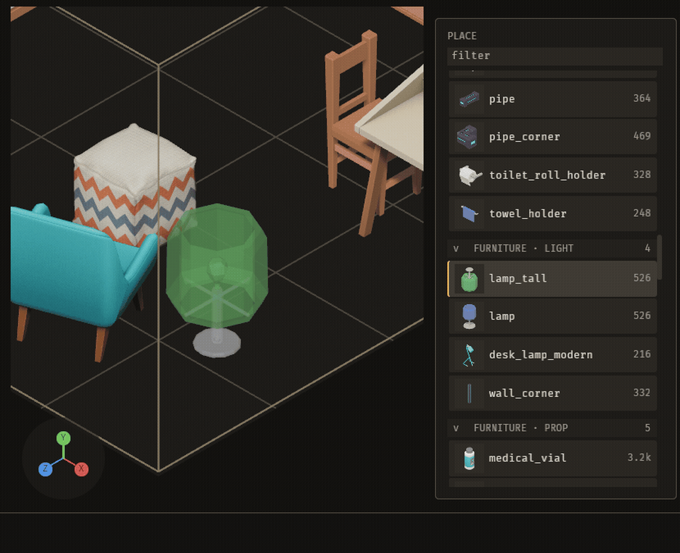
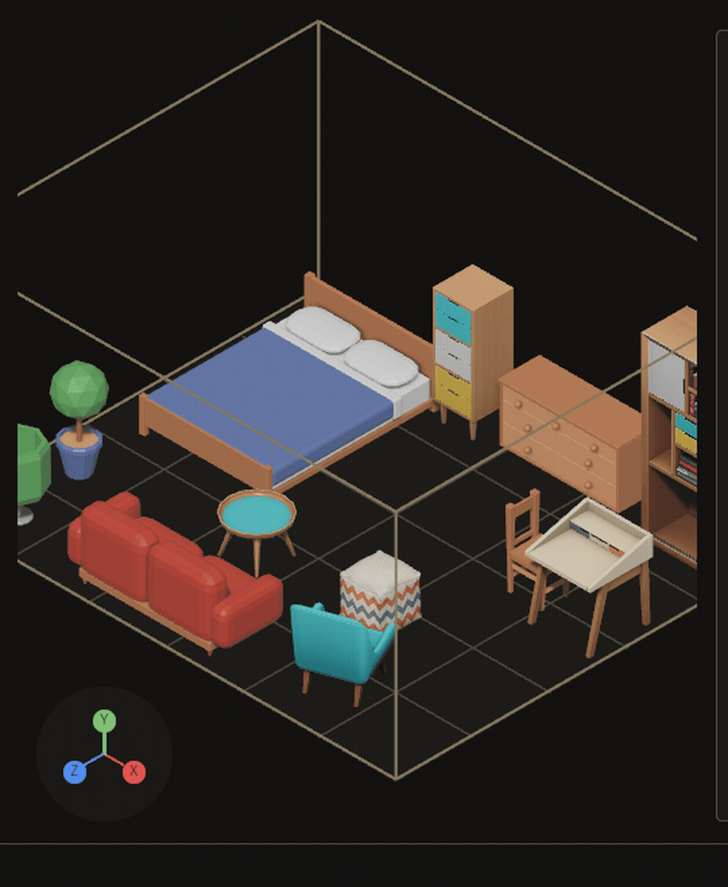

# Building maps

The Map door is one of the editor's three workspaces. It is where you lay pieces on the ground. A **piece** is one kit item you place. A **placement** is one piece on the map. A **stamp** is a composition laid down as one unit. A **composition** is a named group of pieces that you keep for reuse. This page covers the tasks you do on the Map. For the file formats, see [data files](data-files.md). For every key, see [keys](keys.md).

The clip shows the jobs below in one pass: arm a piece from the PLACE list, set its facing with `R` while it is armed, click to place, `X` and a click to remove, and Cmd+Z to undo (the clip was recorded on Linux, where the key is Ctrl+Z). The INSPECTOR on the left, outside the clip's frame, names each step: BRUSH and YAW for the armed piece, MAP for the count, LAST for the newest change, and the history list with who made each one.

## Place a piece and undo it

**Goal:** Put one piece on the ground and take it back.

1. Pick a piece in the palette.
2. Click the ground where the piece goes.
3. Press `Cmd+Z` to take the placement back.
4. Press `Cmd+Shift+Z` to put it back.

**What you see:** The piece appears where you clicked. `Cmd+Z` takes it back, and `Cmd+Shift+Z` puts it back.

**If it goes wrong:** Hold `Alt` (Option on a Mac) while you click to place the piece exactly where the pointer is. Alt turns off grid snapping for that click.

Or right-click the piece's row in the palette: its menu opens with Place, Mount on floor, Mount on wall, Mount on ceiling and Remove from the kit. Place is the row's own click. A mount is one line in the history, and a wall mount keeps the height the piece already has. Remove from the kit sends the piece back to the NOT IMPORTED shelf, and says which map places it when one does, and then leaves it in the library.

## Turn, tip and lift a piece

**Goal:** Rotate, tip or raise a piece you have already placed, or set the facing of the piece you are about to place.

1. To turn a placed piece, first put the brush down (`Esc`), so no piece is armed. Point at the piece.
2. Press `R` to turn it left, or `T` to turn it right, 15° a press. Hold the key to keep turning.
3. Press `Y` to tip it about x, or `U` to tip it about z, a quarter turn a press.
4. Press `V` to straighten it.
5. Press `]` to lift the piece, or `[` to lower it.

**What you see:** The piece turns, tips, or moves up or down in place.

**While a piece is armed,** `R`, `T`, `Y` and `U` turn and tip the armed piece instead (the INSPECTOR's YAW row shows its facing), so the next click places it already turned. A placed piece under the pointer is left alone.

## Move a piece

**Goal:** Pick up a placed piece and set it down somewhere else.

1. Press `B` to move.
2. Drag the piece to the new spot.

**What you see:** The piece moves to the spot you set it down on.

## Remove pieces

**Goal:** Take a piece off the map.

1. Press `X` to enter removal mode.
2. Click the piece you want to remove.
3. Press `X` again to leave removal mode.

**What you see:** The piece comes off the map. `Cmd+Z` puts it back.

Or right-click the piece: its menu opens at the pointer with Turn left, Turn right, Tip about x, Tip about z, Lift, Lower and Remove. Each is the same act as its key, on that one piece, and each is one line in the history, so `Cmd+Z` takes it back. Move picks that piece up with the move tool, so the next click on the map puts it down (one move in the history); Note arms the Note tool with its box already open on that piece, so you type it and Enter leaves the note.

## Clone and run

**Goal:** Copy a piece, or lay a line of the same piece.

1. Press `Shift+B` to clone.
2. Press `Cmd+B` to run a line of pieces.

**What you see:** The clone tool copies the piece you pick up. The run tool lays a line of the same piece.

## Keep a group as a composition

**Goal:** Save a set of pieces as a named composition you can stamp again later.

1. Select the set of pieces you want to keep.
2. Press `M` to keep the set as a composition.

**What you see:** The set is kept as a composition. Press `P` to open the composition picker, then `Enter` to arm a composition for the map.

## Fill an area

**Goal:** Fill an empty area with pieces in one step.

1. Press `F` and click an empty cell. The fill spreads across the empty cells connected to it.

**What you see:** The fill places pieces across the connected empty cells.

**If it goes wrong:** A fill stops at 4,096 cells, and the status line says so. A fill cannot start on a cell that already holds a piece. To carry on, fill again from another empty cell next to the stopped area.

## Generate a layout and keep it or throw it away

**Goal:** Ask the editor for a layout, look at it, and keep it or throw it away.

1. Press `G` to generate from the pieces the kit has learned. Press `Shift+G` to generate from the rules the kit declares. Press `Cmd+G` to generate from compositions.
2. Press `Enter` to keep the layout. Press `Esc` to throw it away.

**What you see:** The layout waits for your answer. Press `Enter` to keep it, or `Esc` to throw it away.

An agent can lay only part of the map: `layout_propose` takes an `area`, `[x0, z0, x1, z1]` in map metres (the same space as a placement's `at`), and lays only the cells whose centre is in it. The cells around the area stay as they are and the new layout joins them, and `layout_accept` replaces only the unpinned pieces in the area, so everything outside it stays where it was. An area that holds no cell of the map is refused, and so is one on a map the project's block rules lay. Only the area is solved. The pieces around it narrow what its edge cells may be, each edge cell taking what the rules let stand beside the piece it touches, so two old pieces that the rules would not set side by side do not refuse an area between them. An enclosure wish counts the area's own cells, and a wall on an edge cell's outward face closes it; a stamp of a symmetric tile at a turn the kit does not keep counts as the turn it equals.

## Pin a piece

**Goal:** Mark a piece you want to keep.

1. Point at the piece and press `O` to pin it. Press `O` on a pinned piece to unpin it.

**What you see:** The pin toggles on the piece.

## Undo and redo

**Goal:** Take back a change, or put it back.

1. Press `Cmd+Z` to take back the last change on the Map, whoever made it.
2. Press `Cmd+Shift+Z` to redo a change you took back.

**What you see:** Changes you make by hand and changes an agent makes through the editor share the same undo stack. `Cmd+Z` takes back an agent's change too.

## Snip a region for an agent

**Goal:** Send a region of the screen to an agent.

1. Press `Cmd+\` to snip an area.
2. Drag a rectangle over the region you want.

**What you see:** The snip is saved as a picture and a small file. Both go to `target/loop/captures/snips/`. The agent reads them through MCP.

## Give an agent a reference picture

**Goal:** Keep a picture with the map, so you can say "like this" and an agent can name it back.

1. Drag a png, jpg, jpeg, webp or gif file onto the editor window. Or type `ref <path> [caption]` in the terrain field.
2. Type `ref <id> remove` in the terrain field to take one off.

**What you see:** The status line says `added reference r1 (references/court.png)`. A picture from outside the project is copied into the project's `references/` folder first; one already inside stays where it is. The list is kept beside the map as `<map>.references.ron`, and an agent reads it in `grimoire_state` and cites a picture by its id. `Cmd+Z` takes the reference back and leaves the copied file. A file that is not an image, or a different picture under a name `references/` already holds, is refused and nothing changes.

## Move the camera

**Goal:** Look at a different part of the map.

1. Press `W`, `A`, `S` or `D` to pan.
2. Press `Q` or `E` to turn the view.

**What you see:** The camera moves and turns. It does not change the map.

## Frame the map

**Goal:** Bring the piece you are working on, or the whole map, into view.

1. Press `Home`.

**What you see:** `Home` frames the locked placement when there is one. If there is none, it frames the whole map. Framing moves the camera only, so it is not in the undo history.
