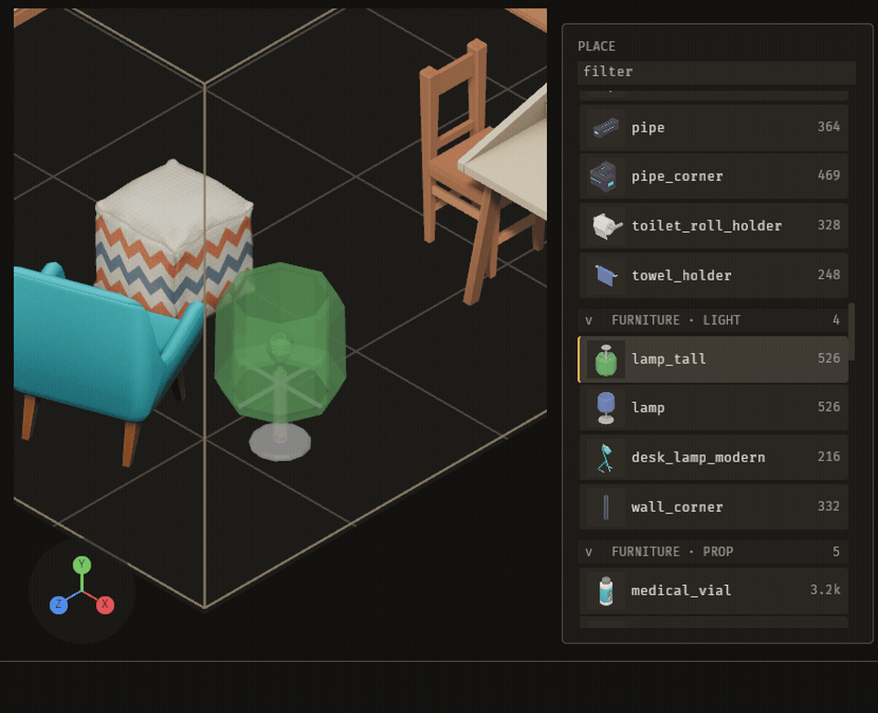

# Getting started: make your first map

In about ten minutes you will make a map in this repo's own project, place a piece on it, undo the placement, save, and open the map again.

You need a Rust toolchain and a clone of this repo. Run every command from the repo root.



## Start the editor

1. Run the editor on this project:

   ```
   cargo run -p bevy_cauldron -- .
   ```

2. Wait for the window. It opens on the menu.

The menu has three columns: PROJECTS, KITS and MAPS. Three panels sit under them: KIT INFO, POLICY and MAP INFO. PROJECTS also lists other projects found on this machine.

The KITS column is selected first, on the first kit in the list. In this repo that is `furniture`, the kit that new work lands in. KIT INFO shows `pieces 90` and `new work lands here yes`. Other kits can be empty: `scp` shows 0 pieces.

A **kit** is a folder of pieces. A **piece** is one thing you can place on a map, such as a wall, a table, or a gate house.

## Make a map

A **map** is a file that holds your placements. It is saved as `<name>.map.ron` in the project's maps folder.

1. Press Right. The MAPS column is selected. Its only row is `+ new map`. The hint bar reads `up/down map · left/right column · Enter new map · Esc quit`.
2. Press `N`. A form titled `NEW MAP IN furniture` opens in the panel under MAPS. It has four fields: NAME, BOUNDS, ORIGIN and NOTE. NAME is blank, BOUNDS is `10 x 4 x 10` and ORIGIN is `0 x 0 x 0`. The hint reads `type · Enter makes the map · Esc cancel`. Enter on `+ new map` also starts the name prompt.
3. Type `first_map`. Use lowercase letters, digits and underscores. Start with a letter.
4. Press Enter. The map `first_map` is made **and opens in the editor**, in that one press.

**What you see:** the editor opens on the MAP door. A door is one of the editor's three workspaces. The MAP door shows your map. A new map's bounds start at `10 x 4 x 10`.

**If the map is made but does not open:** the door refused it, and the reason is on the status line (`\`first_map\` will not open: …`). The map is still in the MAPS column, so pressing Enter on it tries again.

**If it goes wrong:** if Enter on `+ new map` does nothing, check that the form is open under MAPS. If you press Enter with the name blank, the message reads `a map needs a name — snake_case, starting with a letter`. Type a name first.

## Look at the kit door

1. Press `=`. The editor switches to the other door, KIT.

**What you see:** the KIT door opens on the MESHES tab.

2. Press `=` again. You are back on the MAP door.

## Arm a piece and place it

Arming a piece means choosing the piece that your next click will place. A **placement** is one piece put on the map.

1. Make sure you are on the MAP door. The PLACE palette lists the pieces of the kit.
2. Press Down. Each Down press arms the next piece in the PLACE list. Hold Shift to skip five pieces at a time.
3. Move the pointer over the floor. A translucent ghost of the armed piece follows the pointer.
4. Click on empty ground. The piece is placed where you clicked.
5. Place a second piece the same way, so the map has two placements.

**What you see:** each click adds a solid copy of the piece at the spot under the pointer. The ghost stays with the pointer until you arm something else.

**If it goes wrong:** if the ghost does not appear, press Down again. Walking the PLACE list is what arms a piece. Pressing Enter does not arm a single piece. Enter arms a composition, which is a group of pieces. It works only while the composition picker is open, which you open with `P`.

Press Home to frame the view. With a locked placement, Home frames that placement. Otherwise it frames the whole map. Framing does not change the map.

## Undo and redo

1. Press Cmd+Z. The second placement disappears.
2. Press Cmd+Shift+Z to redo it. It comes back.
3. Press Cmd+Z again to leave the map with one placement.

**What you see:** each Cmd+Z removes the most recent change, one change at a time. Cmd+Shift+Z puts back the change you last undid.

## Save

1. Press Cmd+S.

**What you see:** a line in the status band reads `saved`, followed by the file path. The file is `maps/first_map.map.ron` inside the project, which is `assets/grimoire/maps/first_map.map.ron`.

**If it goes wrong:** if the map cannot be saved, the status band shows `NOT SAVED:` followed by the reason. The map stays open and nothing on disk changes. Fix the reason, then press Cmd+S again.

## Return to the menu and reopen

1. Press Cmd+O. The editor returns to the menu.
2. The MAPS column lists `first_map`. Select it, then press Enter.

**What you see:** the editor opens `first_map` on the MAP door. The piece you kept is still on the map. The piece you undid is not.

## Where next

- [Keys](keys.md) lists every key, grouped by where you are in the editor.
- [README](README.md) describes the guide and what it covers.
