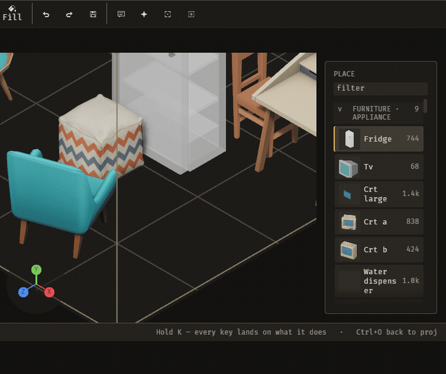

# Getting started: make your first map

In about ten minutes you will make a map in this repo's own project, place a piece on it, undo the placement, save, and open the map again.

You need a Rust toolchain and a clone of this repo. Run every command from the repo root.



## Start the editor

With no argument, `cargo run -p bevy_cauldron` opens the **launcher** before any project: your recent projects (a missing folder is listed as missing, not dropped), a field to type a project's folder, **Open example**, **New project…** (a name, a place and a template; a name that is already a folder is refused beside the field and Create stays off until it is free) and, when the changelog has grown since you last opened a project, what it added. Choosing a project starts the editor on it, at its kit and map menu, as step 1 below does by hand. **Copy command line** on a recent project puts that line on your clipboard. The list follows the desktop's conventions: one press (or Enter), on a card, opens it, typing a project's first letters moves to it, a card shrinks a little under the press, a list longer than its box fades at the edge that hides rows, and in the **New project…** form Return presses **Create** from the Name field. A button that is a screen's main action is gooey's `Submit` (the accent), a toolbar button is a `Ghost`, and the agreeing answer of a question that cannot be undone is `Danger`.

A project named on the command line with a door or a map (`cargo run -p bevy_cauldron -- . bedroom`) opens on a **loading screen**: nothing for the first second, then the stage it is in with a spinner, and from ten seconds a bar that says `N of M` and the stage. **Cancel** goes back to the launcher and writes nothing. When it has loaded, any file of the project that does not read is listed on a card, one row each with the file, the field and why; **Open anyway** goes on into the editor and **Back** returns to the launcher. `GRIMOIRE_LOAD_STAGE_DELAY_MS=3000` pauses after each stage if you want to see the screen on a project that opens too fast to.


1. Run the editor on this project:

   ```
   cargo run -p bevy_cauldron -- .
   ```

2. Wait for the window. It opens on the menu.

The menu has three columns: PROJECTS, KITS and MAPS. Three panels sit under them: KIT INFO, POLICY and MAP INFO. PROJECTS also lists other projects found on this machine.

The KITS column is selected first, on the first kit in the list. In this repo that is `furniture`, the kit that new work lands in. KIT INFO shows `pieces 90` and `new work lands here yes`. Other kits can be empty: `scp` shows 0 pieces.

A **kit** is a folder of pieces. A **piece** is one thing you can place on a map, such as a wall, a table, or a sofa.

## Make a map

A **map** is a file that holds your placements. It is saved as `<name>.map.yaml` in the project's maps folder.

1. Press Right. The MAPS column is selected. Its first row is `+ new map`, and below it is `bedroom`, a one-room map that ships with this repo (Enter on it opens it). The hint bar reads `up/down map · left/right column · Enter new map · Esc quit`.
2. Press `N`. A form titled `NEW MAP IN furniture` opens in the panel under MAPS. It has four fields: NAME, BOUNDS, ORIGIN and NOTE. NAME is blank, BOUNDS is `10 x 4 x 10` and ORIGIN is `0 x 0 x 0`. The hint reads `type · Enter makes the map · Esc cancel`. Enter on `+ new map` also starts the name prompt.
3. Type `first_map`. Use lowercase letters, digits and underscores. Start with a letter.
4. Press Enter. The map `first_map` is made **and opens in the editor**, in that one press.

**What you see:** the editor opens on the MAP workspace, which shows your map. A workspace is one of the editor's jobs: Map, Kit, Animation and more. A new map's bounds start at `10 x 4 x 10`.

**If the map is made but does not open:** the door refused it, and the reason is on the status line (`\`first_map\` will not open: …`). The map is still in the MAPS column, so pressing Enter on it tries again.

**If it goes wrong:** if Enter on `+ new map` does nothing, check that the form is open under MAPS. If you press Enter with the name blank, the message reads `a map needs a name — snake_case, starting with a letter`. Type a name first.

## Look at the Kit workspace

1. Press `Cmd+4` (`Ctrl+4` on Windows and Linux). The editor switches to the KIT workspace.

**What you see:** the KIT workspace opens on the MESHES tab.

2. Press `Cmd+2` (`Ctrl+2`). You are back on the MAP workspace.

## Arm a piece and place it

Arming a piece means choosing the piece that your next click will place. A **placement** is one piece put on the map.

1. Make sure you are on the MAP door. The PLACE palette lists the pieces of the kit.
2. Press Down. Each Down press arms the next piece in the PLACE list. Hold Shift to skip five pieces at a time.
3. Move the pointer over the floor. A translucent ghost of the armed piece follows the pointer.
4. Click on empty ground. The piece is placed where you clicked.
5. Place a second piece the same way, so the map has two placements.

**What you see:** each click adds a solid copy of the piece at the spot under the pointer. The ghost stays with the pointer until you arm something else.

**If it goes wrong:** if the ghost does not appear, press Down again. Walking the PLACE list is what arms a piece. Pressing Enter does not arm a single piece. Enter arms a composition, which is a group of pieces. It works only while the composition picker is open, which you open with `P`.

Press Home to frame the view. With a locked placement, Home frames that placement. Otherwise it frames the whole map. Framing does not change the map.

**Resize the docks.** The thin bar between the INSPECTOR on the left and the map is a divider. Drag it left or right and the inspector narrows or widens with it, its rows reflowing to the new width, while the map keeps the rest of the window. Until you drag it, the dock is as wide as the inspector asks to be. The wheel over the inspector scrolls it to the sections below the fold, such as ENVIRONMENT.

**Your arrangement is kept.** A divider you drag, a tab you pick and a panel you move into another group are saved in your settings file (`settings.yaml`, in the application's data folder) as the shell's layout, and the editor opens on that arrangement next time. **View ▸ Reset layout** puts the default back — the inspector on the left, the map in the middle, the place panel on the right — and takes the key out of the file, so the default is what every later start begins from. A project's own `editor.yaml` may state a layout too; the project's is the one read when a project is open.

## Undo and redo

1. Press Cmd+Z. The second placement disappears.
2. Press Cmd+Shift+Z to redo it. It comes back.
3. Press Cmd+Z again to leave the map with one placement.

**What you see:** each Cmd+Z removes the most recent change, one change at a time. Cmd+Shift+Z puts back the change you last undid.

## Save

1. Press Cmd+S.

**What you see:** a line in the status band reads `saved`, followed by the file path. The file is `maps/first_map.map.yaml` inside the project, which is `assets/grimoire/maps/first_map.map.yaml`.

**If it goes wrong:** if the map cannot be saved, the status band shows `NOT SAVED:` followed by the reason. The map stays open and nothing on disk changes. Fix the reason, then press Cmd+S again.

## When the editor refuses something

A refusal stands at the top of the viewport as a toast with the reason, and stays until you dismiss it: press its **Dismiss** button or `Esc`, or let the next refusal replace it. The same line is kept in the list behind `Cmd+E`. When the refusal is about one thing (for example ``not sent back: `bed_double` is placed by `bedroom` ``), the toast has a **Show** button that takes you to it: a placement on the Map is targeted, and a piece in the library is selected on the Kit door's Meshes panel.

## Return to the menu and reopen

1. Press Cmd+O. The editor returns to the menu.
2. The MAPS column lists `first_map`. Select it, then press Enter.

**What you see:** the editor opens `first_map` on the MAP door. The piece you kept is still on the map. The piece you undid is not.

## Where next

- [Keys](keys.md) lists every key, grouped by where you are in the editor.
- [README](README.md) describes the guide and what it covers.
