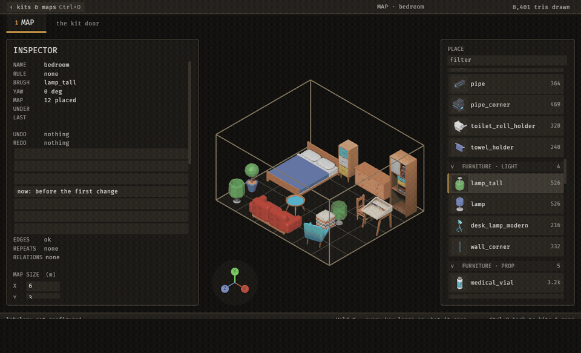

# Kits and labels

A kit is the set of meshes a map draws from. You bring meshes into a kit, label each one, and the labels tell the editor what each piece is for. This page covers the kit door from start to finish, and ends with an agent labelling a piece for you.

## What a kit is

A **kit** is a folder of meshes and the `library.ron` file that lists them. Each entry in that file is a **piece**: one mesh, its size, and its labels. The file lives beside the meshes, for example at `assets/grimoire/kit/library.ron`.

A **door** is one of the editor's three screens: Map, Kit and Rigs. Press `=` to switch to the other door. The kit door has three panels, and you switch between them with `1`, `2` and `3`:

- `1` **Meshes**: bring meshes in, and label the pieces you have.
- `2` **Tiles**: the kit's tiles, and placing pieces on them.
- `3` **Compose**: saved groups of pieces, called **compositions**.

## Bring a mesh into a kit

Goal: add a mesh from the kit's folder to the library as a piece.

1. Press `1` to open the Meshes panel.
2. Read the two shelves. `NOT IMPORTED (n)` lists meshes on disk that are not pieces yet. `MESHES (n)` lists the pieces.
3. Press `Left` to walk the NOT IMPORTED list, or `Right` to walk MESHES. Up and Down move one row; Shift with an arrow moves five.
4. On a mesh in NOT IMPORTED, press `Enter`. The mesh becomes a piece and moves to MESHES.
5. Press `I` to type the piece's id.
6. Press `M` to cycle the piece's mount.

What you see: the NOT IMPORTED count drops and the MESHES count rises. The new piece's labels row reads `not labelled` until you label it.

If it goes wrong:

- To send a piece back to NOT IMPORTED, press `Backspace` on a Mac, or `Delete` on other systems.
- To re-read the folder from disk, press `R`.
- A pack is a folder of meshes. Press `Space` on a pack heading to fold or open it. Press `Shift+R` on a mesh to exclude its pack from the list. Press `Shift+R` again to restore it. Use this for folders of art the kit does not use, such as characters.

## Import a folder without a window

Goal: add every `.glb` under a directory to a library in one step, then label the pieces in the editor.

1. Run the importer from the repository root, with three arguments: the asset root, a directory under it, and the library file.

   ```
   cargo run -p bevy_grimoire_core --example import_dir -- /path/to/game/assets models/kit /path/to/game/assets/grimoire/kit/library.ron
   ```

2. Open the kit in the editor and check the Meshes panel.

What you see: each new mesh is appended to the library with its measurements. Its labels are empty for the labeller to fill in.

If it goes wrong:

- A mesh already in the library is skipped.
- A mesh that cannot be measured is reported and left out. The rest still import.
- The library is checked before it is written. A library that fails the check is not written.
- The importer scans every `.glb` under the directory you give it. Exclude folders that are not part of the kit with `Shift+R` in the editor.

## Labels

Goal: know what each piece is for, and who decided that.

A piece has six label axes:

- `kind`: what the piece is.
- `effects`: what the piece does, shown on the chip `DOES`.
- `look`: how it looks, shown on the chip `LOOKS`.
- `surfaces`: what it offers, shown on the chip `OFFERS`.
- `mount`: where the piece attaches. A piece may also declare **two**: `OnSurfaceOrFloor { class }` says it rests on a piece offering `class` when dropped on one, and stands on the floor when dropped anywhere else. The placement records which of the two it took, so a reload reproduces it.
- `note`: a description in your own words.

The first four are **tokens**: words from the vocabulary in `assets/grimoire/vocab.ron`. A token that is not in the vocabulary is refused.

Each piece shows its labels on the Meshes panel as chips, grouped under `KIND`, `DOES`, `LOOKS` and `OFFERS`. The chip colour says who set the value. A value you set reads in the normal text colour. A value a model or an agent set, and you have not changed, reads in the unchecked colour.

A piece's labels row says who set its labels and when:

- `not labelled`: the piece has no labels yet.
- `by hand · <date>`: every axis was set by you, and no model was used.
- `confidence <level> · <model> · checked <date>`: every axis is checked, and a model proposed them.
- `confidence <level> · <model> · <date>`, plus `agent set <axes>` or `by hand set <axes>`: some axes are still a model's or an agent's. The unchecked colour marks the row.

`<model>` is the model's file name without its folder and extension. `<level>` is `high`, `medium` or `low`. The model states its confidence. When it does not, the editor records `medium`. Confidence is shown for your information. It does not change how a piece is used.

## Label a piece by hand

Goal: set a piece's labels yourself.

1. Press `1` to open the Meshes panel, and press `Right` to walk MESHES.
2. Highlight the piece with `Up` and `Down`.
3. Click a chip to add or remove that token.
4. Edit the description to change the `note`.
5. Press `M` to change the `mount`.

What you see: the labels row reads `by hand · <date>` once every axis is set and no model was used.

## Label with the VLM labeller

Goal: have a vision model propose labels for a piece, and check them.

The labeller sends a photograph of a piece to a vision model. The model replies with tokens for each axis. The editor applies them as they arrive.

Set this up once. The labeller needs `GRIMOIRE_VLM_KEY`. Put it in the project root's `.env` file, which is gitignored, or set it in the environment. A value in the environment wins over the one in `.env`.

- `GRIMOIRE_VLM_KEY`: required. An empty value is an error.
- `GRIMOIRE_VLM_URL`: the chat-completions endpoint. The default is `http://127.0.0.1:9292/v1/chat/completions`.
- `GRIMOIRE_VLM_MODEL`: the model to ask. The default is `qwen3.8-27b`.
- `GRIMOIRE_VLM_TIMEOUT_SECS`: how long to wait for a reply. The default is 600.
- `GRIMOIRE_VLM_THINK`: set to `1` or `true` to let the model reason before it answers. It is off by default.
- `GRIMOIRE_VLM_MAX_TOKENS`: the reply's length limit. The default is 2000.

Steps:

1. Press `1`, then `Right`, and highlight a piece on MESHES.
2. Press `L`. The editor photographs the piece and asks the model.
3. Watch the description. It shows `PROPOSED` while the suggestion is pending.
4. Read the chips. The model's tokens appear as they arrive. There is no review step: the labels stay marked as the model's until you change them.
5. To label every piece that is missing judgement fields, press `Shift+L`. Press `Shift+L` again to hold the walk, and once more to resume it.
6. To drop every suggestion still waiting and stop the walk, press `Shift+Y`.

What you see: the labels row reads `confidence <level> · <model> · <date>` in the unchecked colour, and the model's chips use the same colour.

If it goes wrong:

- If `GRIMOIRE_VLM_KEY` is not set, the labeller stops before it asks, and the message names the missing setting.
- The editor checks a local or LAN endpoint before it asks. A remote endpoint is not checked in advance, so a failure shows only when the request runs.
- The reply must use only tokens in the vocabulary. The editor refuses the whole suggestion if any token is outside it, and asks the model once more. If the second reply is still wrong, nothing is applied. To allow a word the vocabulary lacks, add it to `assets/grimoire/vocab.ron` by hand.
- A reply that names no model is refused.
- A mesh that lies on its side is not turned for you. Turn it with `N` (X), `O` (Y) or `P` (Z) on the Meshes panel, then press `L` again.

## Confirm or correct a label

Goal: decide whether a model's or an agent's label is right, and fix it if it is not.

Changing an axis marks it as yours. Clicking a chip, changing the `mount`, and editing the description each set that axis as set by hand. While another axis is still a model's or an agent's, the labels row lists yours as `by hand set <axes>`.

To correct a label, click the chip to remove a wrong token, or click the right one to add it.

There is no key that marks a model's or an agent's value as checked without changing it. A value you agree with stays in the unchecked colour until you change it. This is a limitation.

## Tiles and Compose

Goal: know the other two panels well enough to find your way.

**Tiles** (`2`): the kit's tiles are on the TILES shelf. Up and Down walk the list, and Enter opens the highlighted tile. On a tile, Space picks up a piece. The arrow keys move it, Enter drops it, and Esc puts it back.

**Compose** (`3`): the compositions are listed here.

1. Press `Up` or `Down` to walk the compositions. `O` and `P` step the focal composition to the previous or next one.
2. Press `Left` or `Right` to walk the pieces in the selected composition.
3. Press `I` to rename the composition.
4. Press `Enter` to arm the composition for the map. A click on the map places it.

## Find the faces nothing in the kit can meet

Goal: know which sockets of a kit no piece can close before a map runs into them.

A face whose edge tokens no piece of the kit presents back, at any quarter turn, is a dead end: a jamb with no partner, a hallway that cannot be capped. Select a piece on the Meshes panel; its `dead ends` row names each such side and what the face presents, for example `E: jamb_l jamb_r, nothing meets it`. A piece with no dead face has no row. An agent reads the whole kit's list in `grimoire_state.dead_ends`. Add a piece that presents the face back and the row goes away.

When some piece comes near, the line says which and how far off: `E: jamb_l jamb_r, nothing meets it; closest b_near at 0°, 1 off` means `b_near`, unturned, agrees with the face in every cell but one. `grimoire_state.dead_ends` rows carry the same as `closest`: the piece, its turn in degrees, and each cell it gets wrong (`at`, `want`, `found`). Ties go to the fewest wrong cells, then the piece id, then the turn.

A kit that caps every opening can still fail to build. Two stress tests in `bevy_grimoire_core::adjacency` build with the kit, the way shipped modular kits are proved: `ring(&library, face_bands)` returns the smallest closed loop, four pieces around a point with every inner seam declared and passing the seam check, and `room(&library, face_bands)` the smallest room with a middle, three rows of three, where the middle piece meets a neighbour on all four sides. Each returns the pieces with their quarter turns and the map they make, or `None`: a corridor kit of straights and corners loops back but never opens into a room.

An agent reads both in `grimoire_state.stress`, from the library on every call, so an edit to a piece's tokens is in the next answer: `ring` is the loop's four pieces (north-west, north-east, south-west, south-east) and `room` three rows of three, north to south and west to east with the middle at `[1][1]`, each piece as `{piece, turn}` with its turn in degrees, or `null` when the kit cannot build it. `declared` counts the pieces that carry an edge token: at `0` the kit is unlabelled, and its nulls say nothing about it. The editor's panels do not show them yet.

## Undo on the kit door

Goal: take back the newest change to a piece.

On the Meshes panel, press `Cmd+Z` to undo the newest change to a piece. Press `Shift+Cmd+Z` to redo it. Undo here is separate from the Map door's undo.

## Let an agent do it

Goal: have an agent find unchecked labels and set them.

The agent uses three operations and one read. It calls them through `grimoire_apply_operation`, which takes `operation`, `parameters` and `dry_run`. On this tool `dry_run` defaults to `false`; set it to `true` to preview a change without making it.



Steps:

1. Find the pieces a model labelled. Call `grimoire_list_pieces` with `{"by_model": true}`. The reply has `total` and a page of up to 50 pieces. Pass `pieces_from`, with the value of `pieces_next`, to read the next page.
2. Open the kit's Meshes panel. Call `grimoire_apply_operation` with `{"operation": "door_open", "parameters": {"door": "kit", "tab": "meshes"}, "dry_run": false}`.
3. Select the piece. Call `grimoire_apply_operation` with `{"operation": "piece_select", "parameters": {"id": "<piece id>"}, "dry_run": false}`. The editor refuses a piece the shelf filter hides.
4. Set a label. Call `grimoire_apply_operation` with `{"operation": "label_set", "parameters": {"id": "<piece id>", "axis": "look", "tokens": ["<word from vocab.ron>"]}, "dry_run": false}`. `axis` is one of `kind`, `effects`, `look` or `surfaces`. The tokens replace the whole axis.

What you see: the labels row reads `agent set look`, in the unchecked colour, until you change that axis. To take the change back, call `grimoire_undo_operation` with the `operation_id` that step 4 returned.

`grimoire_list_pieces` also takes these filters: `with_mesh` leaves out pieces with no mesh, `unlabelled` lists pieces with no labels, `confidence` takes `high`, `medium` or `low`, and `id_contains` matches part of an id. The filters combine.

To list every operation and its parameters, call `grimoire_list_operations`.
