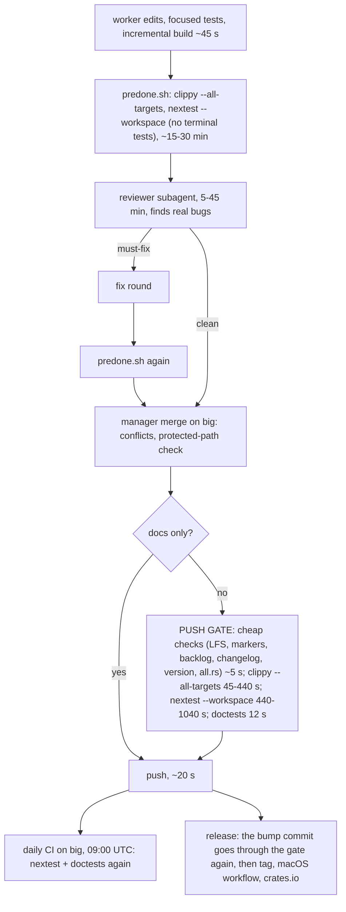

# Gate audit, 2026-11-12

Asked by the owner: what are all the gates, how do they string together, and are they all necessary. Measured from big's `gate.log` (31 commits gated in the push clone), the fleet result files and the runs of 2026-11-11/12. Inference is marked.

## The chain, per cluster of issues

## Measured

| Step | Cost | Note |
|---|---|---|
| cheap pre-push checks | ~5 s | not a problem |
| clippy | 45 s warm, 100-440 s after the `touch` | |
| nextest build | ~9-11 min | the editor's ~1,900 tests are one binary (`autotests = false`); the largest memory user |
| nextest run | 3-5 min | 3,834 tests |
| doctests | 12 s | |
| whole gate, passing | 8-19 min, median 10 | |

- In the push clone, 16 of 31 gated commits failed in the test step (16,286 s, 4.5 h wasted); the 15 that passed took 12,488 s (3.5 h). 57% of gate time went on runs that failed.
- Those failures were tests the worker never ran (13 static protected tests), wall-clock tests under load (9) and merge interactions. The first two are fixed by `predone.sh` and the nextest exclusivity override.
- Not in that log: about nine gate runs killed by systemd-oomd or the kernel on 2026-11-12 (each lost 5-15 min) because the kill precedes the log line. Cause: big's `/tmp` is a 16 GB tmpfs whose pages live in swap (swap 27 of 32 GB), and whole-suite builds overlapped.

## Redundancy found

1. The whole suite ran three or four times per cluster (predone, again after each review fix round, the gate, daily CI). The gate on a merge commit re-tested two parents that had each passed.
2. A version-bump commit paid the full ~20-minute gate; it changes a manifest's own `version` line and `Cargo.lock`, nothing else. Releases pay it twice.
3. The manager's `touch` of every `.rs` file before each gate (added after shared-target test binaries went stale) forced a full workspace rebuild, the 10-minute, 10-12 GB step that was killed.
4. Clippy and the nextest build both compile the workspace; cheap warm (about 45 s), left alone.
5. Daily CI repeats the same tests on the same host; harmless, kept.

## Done (owner: "1, 2, 3, 5 now")

1. Fleet worktrees live in `$HOME/worktrees`, never in `/tmp` (`launch.sh`, README, AGENTS.md).
2. `tools/loop/hooks/pre-push`: a diff made only of `version = "x"` lines in Cargo manifests and `Cargo.lock` runs no test (the version policy check still runs); tested by `tools/loop/test_pre_push_version_bump.py`.
3. The gate has its own target dir (`~/.cargo-target-gate`) and no `touch`; each fleet cluster builds in `~/.cargo-target-fleet/<cluster>`, which `predone.sh` uses too.
5. A worker runs the whole suite once per round, after the review (`brief.md` rule 6).

Left to the owner: 4 (record predone as a gated sha so a merge takes the clean-merge fast path; it trades one round of merge-interaction detection for ~10-15 min per landing; three such failures were caught this week) and 6 (split the editor's single test binary).

## Guidance

`AGENTS.md`, "Gates and hosts: hunt the time sucks": measure, treat repeated work, long waits, retries, kills and refusals as findings with their cost, never work around a slow step silently, propose gate changes with the measurement and the risk. The generated global guidance (`~/.omp/agent/AGENTS.md`) is built from `github.com/Ladvien/agent-guidance`, whose `general/AGENTS.md` is older than the deployed file (a `compile.py diff` shows it would remove the "Repositories and worktrees" section and rename the crate family), so it was not pushed; that repo needs reconciling first. Note the deployed text still says worktrees go under `/tmp/dark-incorporated`; on big this repo's rule above overrides it.
