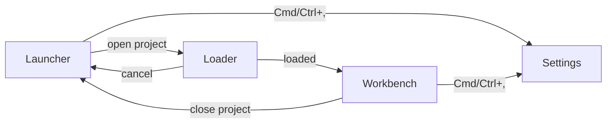

# The editor's UI: vision, principles and architecture

Status: owner-directed series, 2026-11-01. The work is tracked by the issue labelled `ui` titled "UI-00: The editor's UI, on bevy_gooey — the series". Every widget the editor needs comes from `bevy_gooey` (`bevy-coven/bevy_gooey`); a missing widget is a `G-NN` request filed there, never code written here.

## 1. What the UI is for

Grimoire is a **mixed-initiative authoring tool**: a person and the Familiar (the agent) edit one project through the same commands. Horvitz (1999, "Principles of mixed-initiative user interfaces", [10.1145/302979.303030](https://doi.org/10.1145/302979.303030)) asks that an agent add genuine value over direct manipulation, reason about the uncertainty of the user's goal, and time its interruptions to the user's attention. *Procedural Content Generation in Games*, chapter 11, makes the same case for content creation: the human steers, the generator proposes, and both see the same artefact.

So the UI has three jobs:

1. Let a person author a map, a kit or a rig quickly, with the keyboard or the pointer.
2. Show what the Familiar is doing, let the person stop, correct or undo it, and say why it did it.
3. Make the project's files the truth: nothing is only in memory, and every setting is a file that can be read, diffed and committed.

Today the UI is hand-built on `bevy_ui` in `crates/bevy_grimoire_mapper/src/` (`chrome.rs`, 3,531 lines, and 168 raw `Node {` constructions across the crate). `bevy_gooey` is an optional feature used only to preview a game's skin. The series ends with every widget of the editor on gooey, one skin, one command registry and one settings system.

## 2. Principles

Each principle is one rule and its source.

- **P1 One command, many doors.** The menu, the command palette, a shortcut, the toolbar, a context menu and MCP all dispatch one registered command. A thing that can be clicked can be pressed, searched and called by the agent. Sources: [Bevy editor design paradigms](https://bevyengine.github.io/bevy_editor_prototypes/); [VS Code UX guidelines](https://code.visualstudio.com/api/ux-guidelines/overview).
- **P2 Non-overlapping, non-blocking, non-modal.** Regions do not overlap, work goes on while something loads, and a dialog is for a question only the user can answer. Sources: Bevy editor design paradigms; [Blender Human Interface Guidelines](https://developer.blender.org/docs/features/interface/human_interface_guideline/).
- **P3 Every menu option is also a setting in a file, and the files are the truth.** A choice the user makes in the UI is written to the user or project file, and a change to the file shows in the UI live. Source: Bevy editor design paradigms.
- **P4 Novice to expert.** Menus and tooltips show the shortcut, and holding a modifier shows a badge on every widget that has one, so the pointer user learns the keyboard without leaving the task. Sources: Cockburn, Gutwin, Scarr and Malacria, "Supporting Novice to Expert Transitions in User Interfaces", ACM Computing Surveys 47(2), 2014 ([10.1145/2659796](https://doi.org/10.1145/2659796)); Malacria, Bailly, Scarr, Cockburn et al., "ExposeHK", CHI 2013 ([10.1145/2470654.2470735](https://doi.org/10.1145/2470654.2470735)).
- **P5 Stable order.** A menu never reorders itself by recent use; recent items live in their own labelled section. Experts rely on position. Sources: Sears and Shneiderman, "Split menus", ACM TOCHI 1994 ([10.1145/174630.174632](https://doi.org/10.1145/174630.174632)); Malacria et al. 2013.
- **P6 Response time.** Under 0.1 s needs no indicator and feels instant. From 1 s, show feedback that something is happening: a looped indicator for 2 to 10 s, a percent-done bar for 10 s or more. A bar moves at constant speed and is never static. Sources: Nielsen Norman Group, "Response Times: The 3 Important Limits"; arXiv [2211.13909](https://arxiv.org/abs/2211.13909) (a constant-speed progress bar is perceived as faster than non-constant ones).
- **P7 A message says what, where, why and how to fix.** It uses the user's own words, names the file and the field, and links the docs. Sources: Czaplicki, "Compiler Errors for Humans" (Elm); Blender Human Interface Guidelines, writing style.
- **P8 Notifications respect attention.** Few, combined when identical, and low-priority progress goes to the status bar. An error that needs action stays until dismissed. Source: VS Code UX guidelines (notifications, status bar).
- **P9 Agent work is visible, dismissible, correctable and explained.** The UI says whether an agent is connected and what it is doing, attributes every change to a person or to the Familiar, offers Undo on it, and has a global switch that pauses agent writes. Sources: Amershi et al., "Guidelines for Human-AI Interaction", CHI 2019 ([10.1145/3290605.3300233](https://doi.org/10.1145/3290605.3300233)): G1 make clear what the system can do, G2 how well, G7 efficient dismissal, G8 efficient correction, G9 scope services when in doubt, G10 explain, G11 make clear why, G17 global controls, G18 notify about changes.
- **P10 One design system.** Every colour, size, spacing and elevation comes from the gooey skin's semantic roles; no widget picks its own. The elevation ladder is measured (adjacent surfaces differ by at least ΔL* 2) and text meets WCAG 2.2. Sources: gooey's `GooeySkin::problems()`; W3C Design Tokens Format Module 2025.10 (primitive, then semantic, then component tokens).
- **P11 Accessible by default.** Everything is reachable by keyboard, focus is always visible, and a target is at least 24 px in compact density (WCAG 2.2 SC 2.5.8). Text size, interface size, contrast and reduced motion are settings.
- **P12 Developer experience is flow and control.** Fast feedback, no lost work, and an undo for everything. Source: Fagerholm, Ikonen, Kettunen, Munch, Roto and Abrahamsson, "Flow, Intrinsic Motivation, and Developer Experience in Software Engineering" ([10.1007/978-3-319-33515-5_9](https://doi.org/10.1007/978-3-319-33515-5_9)): sense of control and flow predict developers' experience of an IDE.

Fukaya et al. (2026, [10.1080/10447318.2026.2632170](https://doi.org/10.1080/10447318.2026.2632170)) propose heuristics for AI asset-generation tools; P9 and the Familiar panel (UI-60) are checked against them.

## 3. The three screens



- **Launcher** (replaces `Screen::Menu` and the kit/map lists of `chooser.rs`): recent projects with name, path, last opened and thumbnail; Open folder…, New project…, Open example, Settings, and what is new since the user last opened Grimoire.
- **Loader** (a new `Screen::Loading`): the project open as named stages: read project, kits, measure meshes, thumbnails, family crates, maps. Under 1 s nothing shows; from 1 s a spinner; once the stage count is known and 10 s have passed, a percent-done bar with "N of M: stage". Cancel returns to the launcher and writes nothing. When it ends, a report card lists every refused file with its problem.
- **Workbench** (replaces `Screen::Editor`): where the work happens (section 4).
- **Settings** is a workbench tab, opened with Cmd/Ctrl+, and from the launcher.

## 4. Workbench anatomy

Regions, top to bottom and left to right:

```text
+--------------------------------------------------------------+
| menu bar                                                     |
+--------------------------------------------------------------+
| toolbar                                                      |
+---------+--------------------------------------+-------------+
| left    |                                      | right dock  |
| dock    |            viewport                  | inspector   |
| outliner|                                      |             |
| library |                                      |             |
+---------+--------------------------------------+-------------+
| bottom dock: history · problems · notes · log                |
+--------------------------------------------------------------+
| status bar                                                   |
+--------------------------------------------------------------+
```

- The **viewport** is the `surface.rs` image and is a *host* focus region: arrow keys and Enter act on the map, as today. F6 and Shift+F6 cycle regions, Esc returns to the viewport.
- The docks hold **panels**. Each panel has an id, a title and a spawn function in a `PanelRegistry`. The layout of a dock is data (`DockLayout`: a tree of splits and tab groups), saved in settings. There are no floating windows.
- **Workspaces** replace the doors Kit, Map and Rigs: each is a saved dock layout. Window ▸ Reset layout restores a workspace's default.
- The **status bar** left side shows the project, map, workspace and selection count. The right side shows the live link, the reload state, background jobs and the problems count.

## 5. Commands

There is one registry. A command has an `id` (`map.place`, `edit.undo`), a title, a category, a default shortcut and an enabled-or-why answer (a disabled command says why). Every `keys::Action` becomes a command.

- Keys, menus, the palette, the toolbar, context menus and MCP (`grimoire_run_command { id }`) all dispatch through it.
- The menu bar is generated from the categories: File, Edit, View, Map, Kit, Rigs, Tools, Window and Help. Every command appears in exactly one menu.
- The palette (Cmd/Ctrl+Shift+P and Cmd/Ctrl+K) lists every command, recently run first, then by fuzzy score.
- A test proves every command has a unique id and title, and that no two default shortcuts conflict.

## 6. Settings layers

1. Built-in defaults.
2. The user file, `<config_dir>/Grimoire/settings.ron`.
3. The project file, `<root>/assets/grimoire/editor.ron`.

Precedence is per key, and the later layer wins. `EditorSettings` is versioned and has `#[serde(default)]`, so an old file still reads. It is registered in the reload contract as **Live**: editing a file changes the running editor. A file that does not read keeps the last good value and reports a problem. Recent projects live apart, in `<data_dir>/Grimoire/recent.ron`.

The settings screen is searchable with categories as tabs. Each setting shows its default, a description and a modified marker, and has Reset, which removes the key from the file. A User and Project switch chooses the layer being edited. The keymap editor stores its bindings as `keymap` in `settings.ron` and refuses to save a conflict.

## 7. Component inventory

What the editor needs, which gooey widget provides it, and the gooey request that asks for it. A request is `G-NN` in its title on `bevy-coven/bevy_gooey`, labelled `grimoire-ui`; the tracking issue maps each id to its number.

| Editor need | gooey widget | Request |
|---|---|---|
| A skin per subtree: game UI preview beside editor chrome | `SkinScope` | G-01 |
| Compact density, 24 px targets | `Density::Compact`, `SkinPreset::Tool` | G-02 |
| Spacing, radius, type scale, elevation ladder as tokens | `GooeySkin` token fields, `Role::Surface` | G-03 |
| Popovers anchored to a widget | `popover` | G-04 |
| Menu bar and dropdown menus | `menu_bar`, `menu_item`, `submenu` | G-05 |
| Context menus on UI and world entities | `ContextMenu` | G-06 |
| Command palette | `command_palette`, `CommandList` | G-07 |
| Chords, platform labels, conflicts | `Shortcut` | G-08 |
| Resizable panes | `split` | G-09 |
| Dockable panels, layout as data | `DockLayout`, `PanelRegistry`, `dock` | G-10 |
| Outliner | `tree` | G-11 |
| History, data and library lists | `table` (virtualized) | G-12 |
| Scrubbing numbers, vectors, colours | `number_field`, `vec_field`, `color_field` | G-13 |
| Inspector from reflection | `inspector` (feature `reflect`) | G-14 |
| Collapsible sections | `section` | G-15 |
| Searchable select | `select` | G-16 |
| Progress and spinner | `progress`, `spinner` | G-17 |
| Toasts with actions, sticky errors, log | `toast(..).action`, `ToastLog`, `notification_center` | G-18 |
| Status bar | `status_bar`, `status_item` | G-19 |
| Toolbar, icon buttons, toggle groups | `toolbar`, `icon_button`, `toggle_group` | G-20 |
| Icons | `icon` | G-21 |
| Drag a library piece onto the world | `DragPayload`, `DropTarget`, `DroppedOnWorld` | G-22 |
| The viewport keeps its keys | `FocusRegion` | G-23 |
| Multiline notes | `text_area` | G-24 |
| Inline field problems | `FieldProblem` | G-25 |
| Shortcut badges | `ShortcutBadges` | G-26 |
| Headless UI tests by label | `gooey::testing` | G-27 |
| Screen readers | AccessKit nodes | G-28 |

New third-party dependencies, each logged because no family crate does the job: `rfd` for the native folder dialog (UI-10) and `dirs` for the platform's config and data directories (UI-11).

## 8. Migration map

| Today | Replaced by |
|---|---|
| `chrome.rs` colours and ladder | the gooey skin (UI-02); widget builders deleted (UI-99) |
| `chrome.rs` `Status` | the one `Problem` shape and gooey toasts (UI-05, UI-39) |
| `notice.rs` | toasts with actions and the notification centre (UI-39) |
| `confirm.rs`, `token_prompt.rs` | gooey `dialog` (UI-40) |
| `badges.rs` | gooey `ShortcutBadges` (UI-41) |
| `keys.rs` `Action` | the command registry (UI-04); the palette (UI-32); the menus (UI-31) |
| `chooser.rs`, `Screen::Menu` | the launcher (UI-10) |
| `screen.rs` | launcher, loader, workbench (UI-10, UI-20, UI-30) |
| `tiles.rs` `Door`, `Mode` | workspaces (UI-33) and the Kit workspace (UI-59) |
| `oplog_view.rs` | the history panel (UI-53) |
| `checks_view.rs` | the problems panel (UI-54) |
| `notes_view.rs` | the notes panel (UI-55) |
| `data_view.rs` | the data table (UI-56) |
| `anim_tab.rs`, `anim_plots.rs` | the rig bench on gooey (UI-58) |
| `present.rs` | the Familiar panel (UI-60) |
| `ui_skin.rs`, `family_host.rs` | the game UI preview under a scoped skin (UI-03); the family settings panels (UI-57) |
| `args.rs` | the launcher and the command line agree (UI-13) |

## 9. Writing style

For every user-facing string:

- Sentence case. A button is a verb ("Open folder…", "Delete 3 pieces").
- No abbreviations: "vertices", not "verts"; "location", not "loc". The refused list, which `tests/every_label_follows_the_writing_style.rs` checks over every command title, is `verts`, `loc`, `rot`, `fac`, `obj`, `cfg` and `info`.
- No implementation terms in labels: no "RON", "entity" or "struct".
- No contractions.
- A message names the file and the field, and says what to do next.
- An empty state says what to do next and offers the action.

## 10. Research gaps

The HomeStill corpus (2026-11-01) has no indexed papers on docking, inspectors, settings UIs or design systems. Those rules rest on the cited industry guidelines (Bevy editor design, Blender, VS Code, Nielsen Norman Group, W3C), not on studies. The studies that were found support P4, P5, P6, P9 and P12, and are cited where used.
