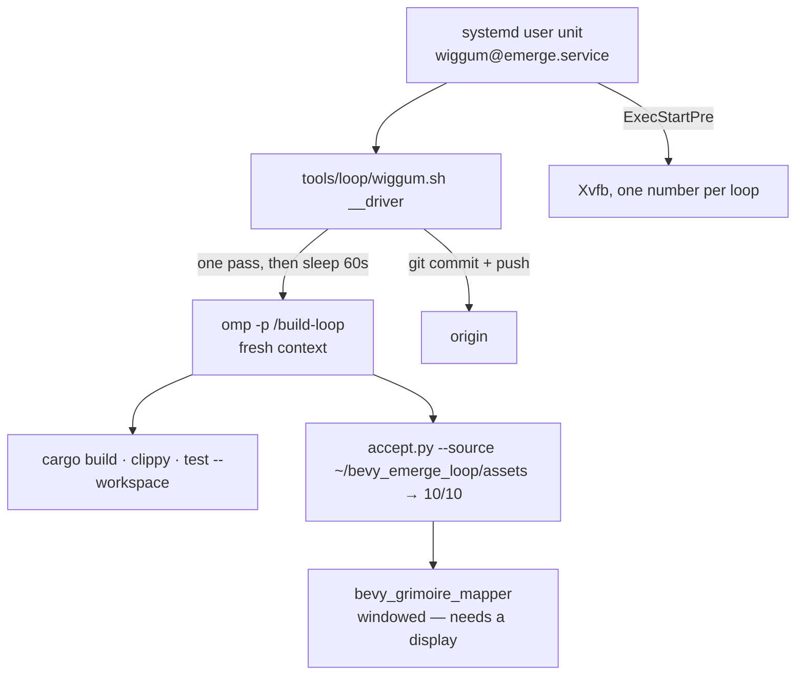

# The Wiggum loop

One dumb driver (`tools/loop/wiggum.sh`) runs a repo's loop command forever: one fresh `omp` process per
pass, no session carried between them, the repository as the only memory. It is parameterised by
`WIGGUM_REPO` and `WIGGUM_COMMAND`, so the same script drives **any** repo in this family — this file is
how to start it, stop it, and read what it did.

`build-loop` runs itself forever: one fresh `omp` process per pass, no session carried between them,
DeepSeek 4.1 Flash, and the repository as the only memory. This file is how to start it, stop it, and
read what it did.

**Setting up a loop on a machine that does not have it yet — its supervisor, its clone, its display, and
the gate prerequisite — is `docs/loop/RUNNING-A-LOOP.md`.** This file assumes a loop already exists here.

## The four pieces, and which owns what

| Piece | Lives in | Owns |
|---|---|---|
| driver | this repo, `tools/loop/wiggum.sh` | *how* a pass runs: one process, stop between passes, refuse a bad tree |
| per-repo command | `<repo>/.omp/commands/*.md` | *what* a pass does, with that repo's conventions |
| generic command | `~/.omp/agent/commands/bevy-loop.md` | the same, for a repo with no loop command — it discovers the repo's conventions first |
| protected evaluator | the repo's harness + tests | the score. **No pass may edit it.** |

Every loop repo's command is `.omp/commands/build-loop.md` (the owner's rule since 2026-10-28: one name to
know, in bevy_grimoire, bevy_elements, bevy_lights and bevy_society), and it wins over the generic `bevy-loop`
where both exist. A repo with no loop command of its own, such as `bevy_debugger_mcp`, runs the generic one.

## What runs what



**Each loop gets its own display number.** `bevy_lights` is `:97`, `bevy_society` is `:98` and
`bevy_grimoire` on big is `:99`; two units whose preflight reaps the same `Xvfb :99` reap each other's
server, so the number is part of the unit, not a machine-wide constant.

**`WIGGUM_REPO` is `~/bevy_emerge_loop`,** a clean clone. It is deliberately **not** `~/bevy_emerge`,
which is the old 198-file rsync scratch tree — the driver refuses any tree with more than 40 modified
files, so pointing it at the scratch tree stops the loop instead of committing into it.

## Any repo, not just this one

The driver is repo-agnostic. `WIGGUM_REPO` is the clone, `WIGGUM_COMMAND` is the slash command a pass
runs, and both default sensibly:

```sh
WIGGUM_REPO=/path/to/bevy_elements ~/wiggum.sh start     # runs /build-loop: the default
WIGGUM_REPO=/path/to/bevy_debugger_mcp WIGGUM_COMMAND=bevy-loop ~/wiggum.sh start   # no command of its own
WIGGUM_REPO=/path/to/anything WIGGUM_COMMAND=bevy-loop ~/wiggum.sh one   # foreground smoke test
```

**State is per repo and lives outside it**: `~/.local/state/wiggum/<repo-name>/`. A loop's own logs and
counters must never appear in a pass's `git status` — a dirty tree is the first thing a pass is told to
fix, and a driver writing bookkeeping into the tree would make every pass diagnose itself. One driver per
repo (the process marker carries the repo name), so two repos can run side by side.

**The marker is an argument, not an environment variable** — `wiggum.sh __driver wiggum-<user>-<repo>` —
because `pgrep -f` reads a process's command line and nothing else. Measured 2026-10-26: with the marker
passed through `env`, `pgrep` matched nothing, a second driver was never refused, and two passes
interleaved in one checkout (pass 1 and pass 2 running together, a pass 3 starting before either
finished). The unit's `ExecStart` re-execs once to put the marker in its argv, and `one` refuses while a
driver is mid-pass rather than queueing behind it.

`/bevy-loop` is the **generic** pass, installed at `~/.omp/agent/commands/bevy-loop.md`, for a repo that
has no loop command of its own: it discovers that repo's backlog/log/report convention first, creates the
smallest one that works if there is none, and never invents a second convention beside an existing one.
Prefer a repo's own command where it has one.

## Daily use

```sh
# on big
~/bevy_emerge_loop/tools/loop/wiggum.sh status   # running? how many passes? last lines
~/bevy_emerge_loop/tools/loop/wiggum.sh tail     # follow the driver's own log
~/bevy_emerge_loop/tools/loop/wiggum.sh drain --wait   # let the pass in flight FINISH, then exit; cuts nothing
~/bevy_emerge_loop/tools/loop/wiggum.sh stop     # end the pass in flight (TERM, KILL after 5 s), then exit

systemctl --user start wiggum@emerge          # the permanent way (enabled at boot)
systemctl --user stop wiggum@emerge           # the same: the whole cgroup is signalled
systemctl --user status wiggum@emerge
journalctl --user -u wiggum@emerge -f
```

**`drain` is the only stop that does not cut a pass.** `wiggum.sh drain` writes a file the driver reads
only between passes, so the pass in flight runs to its own end (commit, push and log included) and the
driver then exits cleanly; `--wait` blocks until it has. Use it to restart onto a new driver or prompt, or to
work in the clone. A driver started before `drain` existed never reads the file: `status` shows `DRAINING`
either way, and `--wait` gives up after `WIGGUM_DRAIN_WAIT` seconds (default 8 hours) and leaves the file.

**`stop` ends the pass in flight, within seconds.** `wiggum.sh stop` writes a stop file and the driver's
poll loop sends the pass `TERM`, then `KILL` five seconds later; `systemctl --user stop` signals the whole
cgroup, so the driver traps SIGTERM and does the same. What the pass had uncommitted is saved by the final
snapshot and parked on a branch at the next start, so no work is lost, but the pass's momentum is.

## Never reset a repo a loop is driving

```sh
WIGGUM_REPO=/path/to/repo ~/wiggum.sh guard   # exit 0 = safe, exit 1 = a pass is running
```

**Measured cost, 2026-10-26:** a `git reset --hard origin/main` on a repo whose pass was mid-edit
destroyed that pass's uncommitted `editor.rs` fix. The new test file survived only because it was
untracked and `reset --hard` leaves untracked files alone — the pass itself had no idea its work had
gone. `guard` exists so the check is one command instead of a judgement call.

The general rule: **a loop repo is owned by the loop.** To work in one, drain the driver first
(`wiggum.sh drain --wait`), which lets the pass finish and then exits. `stop` ends the pass in flight, so
its tree is saved as a snapshot and parked on a branch at the next start.

## Tests for the driver

Four regression suites sit beside the driver, each building a throwaway repo, an origin and a fake `omp` (no model, no waiting). Run them against the file you are about to install, on macOS (bash 3.2) and on Linux (bash 5); the driver was changed on 2026-10-28 and all four passed on the macOS laptop.

```sh
bash tools/loop/test_wiggum_start.sh    tools/loop/wiggum.sh   # start without setsid, the default model, the dirty guard: 12 checks, about 30 s
bash tools/loop/test_wiggum_drain.sh    tools/loop/wiggum.sh   # drain versus stop: 23 checks
bash tools/loop/test_wiggum_park.sh     tools/loop/wiggum.sh   # the park step: 57 checks across 18 cases
bash tools/loop/test_wiggum_settings.sh tools/loop/wiggum.sh   # the repo's .omp/wiggum/ settings file and omp overlay, WIGGUM_SNAPSHOT: 25 checks
python3 -m unittest tools/loop/test_omp_keys.py                # omp_keys.py, the stored-key tool: 7 tests
```

Steering a running loop (focus, settings, provider, keys) is in `docs/loop/RUNNING-A-LOOP.md`, "Steer a loop".

## Where the evidence is

| | |
|---|---|
| driver log | `~/target/emerge-loop/wiggum/driver.log` |
| each pass, full output | `~/target/emerge-loop/wiggum/passes/pass-NNNN-*.log` |
| systemd's view | `~/target/emerge-loop/wiggum/systemd.log` |
| what a pass did | `~/bevy_emerge_loop/docs/loop/iterations/`, `docs/loop/log.md` |
| what is still open | `~/bevy_emerge_loop/docs/loop/backlog.json` |
| how long every step took | `~/.local/state/wiggum/<clone>/steps.tsv`, one row per model turn, tool call, background job and wait, written after each pass by `tools/loop/steps.py record` |

**Where a loop's time goes.** `python3 tools/loop/steps.py report --state ~/.local/state/wiggum/<clone> --last 12` ranks the time by category (`wait: gate`, `wait: tests`, `model`, `cargo test`, ...) and by phase, and lists the slowest single steps. The phase comes from the pass marking it (`steps.py mark <phase>`, asked for in `build-loop.md`). The rows come from omp's own session record, so a killed pass is timed too, and `steps.py backfill --repo <clone> --state <state dir>` rebuilds the history of any loop, including one whose driver predates the tool.

## Facts about big that shaped this

Measured, not assumed:

- **`accept.py` reaches 10/10** against the repo's own `assets/`, not the laptop's 11/11 — the `import`
  step needs a golem `.glb` fixture that is not on big.
- **The editor is windowed.** `main.rs` always builds a `Window`, so a display is mandatory and Xvfb
  `:99` is created by the unit. Without it the only acceptance gate fails every pass on a machine that
  otherwise builds perfectly — the worst kind of failure, because it looks like a code problem.
- **`perf.py` cannot run.** It times a live editor; there is no display to time.
- **Sanctuary is not on big.** Anything that needs `~/sanctuary` cannot happen here.
- **Its own `CARGO_TARGET_DIR` (`~/target/emerge-loop`).** The shared global target dir is a trap:
  workspace crates at one version share an artifact hash across checkouts, so a second tree on the
  shared dir makes cargo call the first tree's units Fresh and silently runs the wrong code.
- **`RUSTUP_TOOLCHAIN=1.98.1`.** big's `stable` is 1.99; the workspace is pinned.
- **It goes under the machine's other work** (`Nice=15`, `CARGO_BUILD_JOBS=8`). Measured: load average
  31 on 24 cores, 3 GB RAM free, while big served `hs-distill` and built `bevy_elements`.

## When the loop stops for good

The unit gives up after **5 failures inside an hour** (`StartLimitBurst`/`StartLimitIntervalSec`, both
`[Unit]` keys). Diagnose from the logs above, fix the cause, then:

```sh
systemctl --user reset-failed wiggum@emerge
systemctl --user start wiggum@emerge
```

Five stops worth checking first: a dirty tree (a killed pass), a full disk, git push failing, the `omp`
model name having changed, and a protected file that a pass thought it needed to edit. That last one is
by design: a pass may not edit `tools/loop/*.py`, the test files, or its own command, so a genuine need
there stops it with `status: "blocked"` for a human to run an evaluator pass.

## What it costs

One pass every ~30–60 minutes, 20–40 minutes of model time each. **There is no spend cap in the units** —
`WIGGUM_MAX` bounds the pass count. It **defaults to 0 (forever) in the script**, but every installed
supervisor sets it to 400 on purpose: the driver exits **0** at the cap and `Restart=on-failure` /
`KeepAlive.Crashed` will not restart a clean exit, so a small number ends the loop silently rather than
bounding spend. To bound it for real, lower it and accept that it ends:

```sh
systemctl --user edit wiggum@emerge     # add Environment=WIGGUM_MAX=20
```
